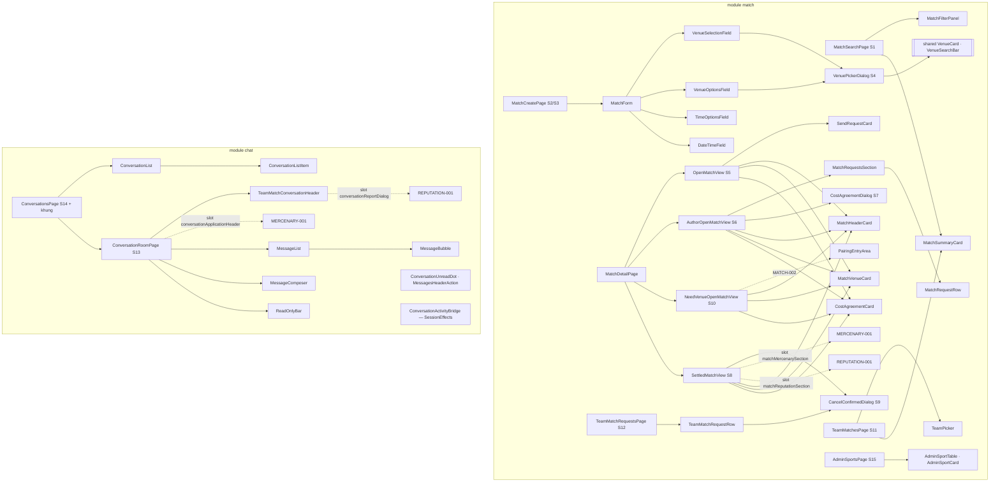

# Component Design — MATCH-001 Kèo luồng A, vòng đời kèo & chat dùng chung

| Mục | Giá trị |
|---|---|
| Mã chức năng | `MATCH-001` |
| Phạm vi tầng | frontend (ArenaFlow-fe) |
| Repo/stack | ArenaFlow-fe · React 19 + TypeScript + Tailwind CSS 4 · React Hook Form + Zod (FE ADR-0005) |
| Nguồn | `UI_Design.md` v1.1 (S1–S15, §3) · `docs/agent/upstream/api/MATCH-001/API_Spec.md` v3.2 · khung `docs/agent/design/SHARED/APP-SHELL/Component_Design.md` v1.2 · VENUE-001 `Component_Design.md` §7 · REPUTATION-001 `Component_Design.md` §6 · MERCENARY-001 `Component_Design.md` §6 |
| Quy ước áp dụng | `docs/agent/convention-frontend.md` §2–§4, §10 · `docs/agent/non-functional-standards.md` §4 · FE ADR-0010 (slot) |
| Tác giả / Ngày / Phiên bản | `solution-architect` (agent) / `2026-11-27` / `v1.1` (lịch sử: `CHANGELOG.md`) |

> Route, điều hướng, chọn góc nhìn S5/S6/S8/S10: `Screen_Flow.md` §3. Query key, endpoint, lỗi, số call: `State_API_Integration.md`.
> Mọi thành phần **mới** (repo chưa có code). Trước khi tạo thành phần `shared/` → `reuse-scan` (`CLAUDE.md` §8). Đường dẫn bảng §2 tương đối với `src/modules/match/`, bảng §3 với `src/modules/chat/`.

## 1. Cây component



## 2. Component của module `match`

| Component | Đường dẫn | Loại | Props chính | Trách nhiệm |
|---|---|---|---|---|
| `MatchSearchPage` | `pages/match-search.page.tsx` | page | — | S1: đọc bộ lọc từ URL, `useGeolocation` (shared), `useMatchSearch`, `useActiveSports`; `QueryStateView` + `Pagination` |
| `MatchFilterPanel` | `components/search/match-filter-panel.component.tsx` | feature | `value: MatchSearchFilters`, `sports: Sport[]`, `nearMeStatus: GeolocationStatus`, `onApply(filters)`, `onReset()`, `variant: 'panel' \| 'sheet'` | Giữ bản nháp bộ lọc (`useState`); kiểm `from ≤ to`; desktop thẻ cột trái, mobile trong `Dialog` (bottom sheet) |
| `MatchFilterChips` | `components/search/match-filter-chips.component.tsx` | feature | `value`, `activeCount`, `onOpenSheet` | Hàng chip mobile + chip "Bộ lọc (n)" |
| `MatchSummaryCard` | `components/match-summary-card.component.tsx` | ui (module) | `match: MatchSummary`, `showStatus?: boolean`, `perspectiveTeamId?: string` | Thẻ kèo §4.3 (S1, S11): link `buildMatchDetailPath`, nhãn có tên đội + giờ; `showStatus` → `MatchStatusBadge`; `perspectiveTeamId` → nhãn vai trò "Đội tạo kèo / Đội đã ghép" + "vs <đội kia>" |
| `MatchCreatePage` | `pages/match-create.page.tsx` | page | — | S2/S3: chế độ từ `?type`, danh sách đội (`useMatchViewerTeams`), bộ môn, `useCreateMatch`; empty khi không có đội hợp lệ |
| `MatchForm` | `components/form/match-form.component.tsx` | feature | `mode: 'HAS_VENUE' \| 'NEED_VENUE'`, `onModeChange`, `teams: CaptainTeamOption[]`, `sports: Sport[]`, `defaultValues`, `pending`, `onSubmit(values)`, `serverError?: ApiError`, `returnTo: string` | RHF + `match-form.schema.ts` (§5.1); áp lỗi BE (`applyServerValidationErrors` + `fieldMap` §5.1); `FormErrorBanner` cho mã nghiệp vụ |
| `DateTimeField` | `components/form/date-time-field.component.tsx` | ui (module) | `label`, `dateName`, `timeName`, `required`, `error?`, `hint?`, `minDate?` | `<input type="date">` + `<input type="time">` trong một `fieldset`; giá trị ghép bằng `toVnDateTimeString` khi dựng body |
| `VenueSelectionField` | `components/form/venue-selection-field.component.tsx` | feature | `value: VenueChoice \| null`, `onChange`, `error?` | Thẻ địa điểm đã chọn (`VenueCard` shared, `variant="row"`) + "Đổi địa điểm"; mở `VenuePickerDialog` `single` |
| `VenueOptionsField` | `components/form/venue-options-field.component.tsx` | feature | `value: VenueChoice[]`, `onChange`, `error?` | Danh sách `ol` đánh số theo thứ tự chọn, nút xoá (`aria-label` "Xoá địa điểm n"), "+ Thêm địa điểm" (disable khi 5) mở picker `multiple` |
| `TimeOptionsField` | `components/form/time-options-field.component.tsx` | feature | `control`, `name: 'timeOptions'`, `errors` | `useFieldArray`; mỗi dòng Ngày + Từ + Đến + xoá (`aria-label` "Xoá khung giờ n"); "+ Thêm khung giờ" disable khi 5; lỗi theo dòng |
| `VenuePickerDialog` | `components/form/venue-picker-dialog.component.tsx` | feature | `open`, `onClose`, `mode: 'single' \| 'multiple'`, `selected: VenueChoice[]`, `max: number`, `onConfirm(venues: VenueChoice[])`, `addVenueReturnTo: string` | S4: `useVenueSearchState({ storage: 'memory' })` + `useVenuePicker` (2.2 VENUE-001); `VenueSearchBar` + `listbox` (`aria-multiselectable` khi `multiple`); bán kính mặc định 5 km; "Thêm địa điểm mới" → `ROUTE_PATHS.venueNew?returnTo=` |
| `MatchDetailPage` | `pages/match-detail.page.tsx` | page | — | Tải 2.3 + vai trò (`useMatchViewer`); tính `displayStatus` (`useNowMs(60_000)`); chọn view (Screen_Flow §3); `ErrorState` `MATCH_001` |
| `MatchHeaderCard` | `components/detail/match-header-card.component.tsx` | ui (module) | `match: MatchDetail`, `displayStatus` | Badge trạng thái + loại, bộ môn · định dạng, `formatMatchTimeRange`, hạn nhận đối, `SkillLevelTags`, độ tuổi, tính chất |
| `MatchVenueCard` | `components/detail/match-venue-card.component.tsx` | ui (module) | `venue: MatchVenue` | Ảnh / tên / địa chỉ; `venueStatus = INACTIVE` → nhãn "Ngừng hoạt động"; link `buildVenueDetailPath` |
| `CostAgreementCard` | `components/detail/cost-agreement-card.component.tsx` | ui (module) | `cost: CostAgreement`, `action?: ReactNode` | Chỉ xem; rỗng → "Chưa có thoả thuận chi phí"; có `depositAmount` / `depositHolder` (kèo B đã ghép) → thêm dòng tiền cọc; `formatVnd` |
| `MatchTeamCard` | `components/detail/match-team-card.component.tsx` | ui (module) | `team: MatchTeam`, `title` | Avatar, tên, "Uy tín n/100", link "Xem đội" (`buildTeamDetailPath` — `[cần xác nhận]` #25) |
| `OpenMatchView` | `components/detail/open-match-view.component.tsx` | feature | `match`, `viewer: MatchViewer`, `displayStatus` | S5: hai cột / một cột; `SendRequestCard` khi `viewer.sendableTeams.length > 0` |
| `SendRequestCard` | `components/detail/send-request-card.component.tsx` | feature | `match`, `teams: CaptainTeamOption[]` | Chọn đội (khi > 1), `useMyTeamMatchRequest(teamId, matchId)` → hiện theo bảng UI_Design S5; gửi (`useSendMatchRequest`), rút `PENDING` (`ReasonDialog`), "Nhắn tin" |
| `AuthorOpenMatchView` | `components/detail/author-open-match-view.component.tsx` | feature | `match`, `viewer`, `authorTeamStatus: 'ACTIVE' \| 'INACTIVE'` | S6: `MatchRequestsSection`, "Sửa chi phí" (ẩn khi `INACTIVE`), menu "Thao tác khác › Huỷ kèo" (luồng huỷ kèo mở — Screen_Flow §3) |
| `MatchRequestsSection` | `components/detail/match-requests-section.component.tsx` | feature | `matchId`, `canAccept: boolean` | `Tabs` "Đang chờ / Tất cả" (URL `requests`), `useMatchRequests`, `Pagination`; empty "Chưa có đội nào gửi yêu cầu" |
| `MatchRequestRow` | `components/detail/match-request-row.component.tsx` | feature | `request: MatchRequest`, `canAccept`, `onAccept`, `onReject` | Dòng / thẻ; nút có tên đội trong `aria-label`; "Nhắn tin" link `buildConversationPath` |
| `ReasonDialog` | `components/detail/reason-dialog.component.tsx` | ui (module) | `open`, `title`, `message`, `confirmLabel`, `tone`, `required: boolean`, `pending`, `error?: string`, `onConfirm(reason: string \| null)`, `onClose` | `ConfirmDialog` (shared) + ô "Lý do" `n/500` (`reason.schema.ts` §5.3) — dùng cho từ chối, rút `PENDING`, huỷ kèo mở, huỷ kèo B |
| `CostAgreementDialog` | `components/detail/cost-agreement-dialog.component.tsx` | feature | `open`, `onClose`, `matchId`, `initial: CostAgreement` | S7: RHF + schema §5.2, render `CostAgreementFields`, "Xoá thoả thuận" (xác nhận); `useSaveCostAgreement` |
| `CostAgreementFields` | `components/form/cost-agreement-fields.component.tsx` | feature | `control`, `errors` (RHF), `disabled?` | Loại chi phí, 2 ô tiền (`MoneyInput`), cách chia, khoản khác (`useFieldArray`, tối đa 10) — dùng ở S7 và MATCH-002 S6 (ghép thêm tiền cọc) — MATCH-002 Screen_Flow §6 C7 |
| `MoneyInput` | `components/form/money-input.component.tsx` | ui (module) | `value: number \| null`, `onChange`, `id`, `aria-*` | `inputmode="numeric"`, hiển thị phân tách nghìn, chỉ nhận chữ số |
| `SettledMatchView` | `components/detail/settled-match-view.component.tsx` | feature | `match`, `viewer`, `displayStatus` | S8: `MatchVersusBlock`, `MatchStatusBanner`, chi tiết, slot (§7), "Nhắn tin với <đội kia>" (`useResolveMatchConversation`), "Huỷ kèo" → `CancelConfirmedDialog` |
| `MatchVersusBlock` | `components/detail/match-versus-block.component.tsx` | ui (module) | `author: MatchTeam`, `opponent: MatchTeam \| null` | "<A> vs <B>"; mobile xếp dọc |
| `MatchStatusBanner` | `components/detail/match-status-banner.component.tsx` | ui (module) | `match`, `displayStatus`, `nowMs` | Banner theo bảng UI_Design S8 (gồm "Trận đang diễn ra", "<Đội> đã huỷ kèo lúc …" — tên đội huỷ so `cancelledByTeamId` với hai đội) |
| `CancelConfirmedDialog` | `components/detail/cancel-confirmed-dialog.component.tsx` | feature | `open`, `onClose`, `mode: 'cancel' \| 'withdraw'`, `matchId`, `startsAt`, `teamOptions: { teamId; teamName }[]`, `requestId?`, `expectedStatus` | S9: `role="alertdialog"`, focus "Không huỷ", mức trừ dự kiến, lý do bắt buộc; `useCancelMatch` / `useWithdrawMatchRequest` |
| `NeedVenueOpenMatchView` | `components/detail/need-venue-open-match-view.component.tsx` | feature | `match`, `viewer`, `displayStatus` | S10: `VenueOptionList`, `TimeOptionList`, `MatchTeamCard`; đội tạo kèo: "Huỷ kèo" (`ReasonDialog`); vị trí `PairingEntryArea` (§8) |
| `VenueOptionList`, `TimeOptionList` | `components/detail/venue-option-list.component.tsx`, `…/time-option-list.component.tsx` | ui (module) | `options` | `ol`, giữ thứ tự BE |
| `MyTeamMatchesRedirectPage` | `pages/my-team-matches-redirect.page.tsx` | page | — | `/me/matches` → `Navigate` (Screen_Flow §3 S11) |
| `TeamMatchesPage` | `pages/team-matches.page.tsx` | page | — | S11: `TeamPicker`, `Tabs` trạng thái, `SegmentedRadioGroup` vai trò, `useTeamMatches`, `Pagination` |
| `TeamPicker` | `components/team/team-picker.component.tsx` | ui (module) | `teams: { teamId; teamName }[]`, `value`, `onChange`, `label` | `<select>` có `label`; dùng ở S11, S12 |
| `TeamMatchRequestsPage` | `pages/team-match-requests.page.tsx` | page | — | S12: `Breadcrumb`, `TeamPicker`, `Tabs`, `useTeamMatchRequests`, `Pagination` |
| `TeamMatchRequestRow` | `components/team/team-match-request-row.component.tsx` | feature | `request: MatchRequest` (có `startsAt`, `authorTeamName`), `teamId` | Badge, lý do, "Xem kèo", "Nhắn tin", "Rút yêu cầu" (`ReasonDialog` / `CancelConfirmedDialog` `withdraw`) |
| `AdminSportsPage` | `pages/admin-sports.page.tsx` | page | — | S15: `Tabs` trạng thái, `useAdminSports`, bảng desktop / thẻ mobile (`useMediaQuery`), `Pagination` |
| `SportToggleRow` | `components/admin/sport-toggle-row.component.tsx` | feature | `sport: Sport`, `variant: 'row' \| 'card'` | `Switch` (`aria-label` "Bật/tắt <tên>"), tắt → `ConfirmDialog`; `useToggleSport`; disable khi đang gửi |
| `MATCH_NAV_ITEMS`, `MATCH_ADMIN_NAV_ITEMS` | `constants/match-nav.constant.ts` | — | — | Screen_Flow §1 |
| `matchRoutes: AppRouteGroups` | `routes/match.routes.tsx` | — | — | Screen_Flow §1 |
| README module | `README.md` | — | — | Mục đích, UC-M01..M04, M08, M09, UC-C01, C02, quy tắc chính |

> `MatchSummaryCard`, `ReasonDialog`, `MoneyInput`, `DateTimeField` chỉ dùng trong module `match` (MATCH-002 ở cùng module — §8.1). Mã khác cần → `reuse-scan`, chuyển `shared/`.
> `VenuePickerDialog` có hai bản gần giống (MATCH-001 module `match`, MERCENARY-001 module `mercenary`): khi `reuse-scan` cân nhắc đưa phần trình bày (dialog + danh sách chọn, không gọi API) lên `shared/`, mỗi module giữ hook gọi `venuePickerKey`.

## 3. Component của module `chat`

| Component | Đường dẫn | Loại | Props chính | Trách nhiệm |
|---|---|---|---|---|
| `ConversationsPage` | `pages/conversations.page.tsx` | page | — | Khung S14 + `<Outlet/>`; desktop 2 khung, mobile một khung theo route (Screen_Flow §3 S13/S14); `<h1>` "Tin nhắn" |
| `ConversationsEmptyPane` | `components/conversations-empty-pane.component.tsx` | ui (module) | — | Khung phải desktop "Chọn một cuộc trò chuyện để bắt đầu" (route `index`) |
| `ConversationList` | `components/list/conversation-list.component.tsx` | feature | `activeConversationId?: string` | `useMyConversations` (trang 1..n, bỏ trùng `conversationId`, bỏ `contextType` lạ), `LoadMoreButton`; empty "Bạn chưa có cuộc trò chuyện nào" |
| `ConversationListItem` | `components/list/conversation-list-item.component.tsx` | ui (module) | `item: ConversationSummary`, `active` | Link `buildConversationPath`; ngữ cảnh "Kèo · <startsAt>" / "Đơn ứng tuyển · <startsAt>"; tin cuối "<senderName>: <contentPreview>"; chấm + chữ ẩn "Chưa đọc"; "Chỉ xem" (icon khoá + chữ) khi `!canSend` |
| `ConversationRoomPage` | `pages/conversation-room.page.tsx` | page | — | Route con render với `key={conversationId}` (đổi phòng = instance mới). S13: kiểm `conversationId` là UUID (sai → `ErrorState`); `useConversation`, `useConversationMessages`, `useConversationRealtime` (đồng bộ `runSync` theo epoch — State_API_Integration §4.4), `useMarkConversationRead` (gọi khi tương tác — không gọi khi tải); cập nhật `openConversationStore` (mount / unmount, `visibilitychange`, lần tương tác đầu); chọn đầu phòng theo `contextType`; `ErrorState` `CHAT_002` / `CHAT_003` |
| `TeamMatchConversationHeader` | `components/room/team-match-conversation-header.component.tsx` | feature | `conversation: Conversation`, `contextStartsAt: string \| null`, `hasMessages: boolean`, `onReportBlocked()` | Bên kia (avatar, tên), "Đội trưởng: …" của hai đội (`captainName`; `null` → "—"), "Bạn nhắn với tư cách <đội mình>", dòng ngữ cảnh (`ConversationContextLine`), badge `requestStatus` (`MatchRequestStatusBadge` shared); luồng B (`matchType = NEED_VENUE`): badge `pairingStatus` + link "Mở thương lượng" (§8.4); `Menu` "⋮" (Screen_Flow §3); mở slot `conversationReportDialog` |
| `ConversationContextLine` | `components/room/conversation-context-line.component.tsx` | ui (module) | `matchId: string \| null`, `startsAt: string \| null` | "Kèo · <formatVnDateTime(startsAt)>" + link "Xem kèo" (`buildMatchDetailPath`); không có `startsAt` → chỉ link `[cần xác nhận]` #9 |
| `MessageList` | `components/room/message-list.component.tsx` | feature | `messages: Message[]` (cũ → mới), `pending: PendingMessage[]`, `parties`, `viewerPartyId`, `hasOlder`, `loadingOlder`, `onLoadOlder`, `emptyHint` | `role="log"` `aria-live="polite"`; mốc ngày (`DateSeparator`); sentinel đầu danh sách (IntersectionObserver) + `LoadMoreButton` "Xem tin cũ hơn" (bàn phím); giữ vị trí cuộn khi chèn tin cũ; tự cuộn xuống khi đang ở đáy và có tin mới |
| `MessageBubble` | `components/room/message-bubble.component.tsx` | ui (module) | `message`, `mine: boolean`, `senderLabel: string` | Tin mình phải / bên kia trái + `Avatar` (`senderAvatarUrl`); nhãn "<tên bên> · <senderName>" (`message-sender.util.ts`); giờ gửi `formatVnTime`; nội dung giữ xuống dòng, React escape (không `dangerouslySetInnerHTML`) |
| `PendingMessageBubble` | `components/room/pending-message-bubble.component.tsx` | ui (module) | `pending: PendingMessage`, `onRetry`, `onDiscard` | Tin mờ + spinner; lỗi → "Gửi không thành công · Thử lại" |
| `MessageComposer` | `components/room/message-composer.component.tsx` | feature | `onSend(content: string)`, `disabled`, `error?: string` | `textarea` có `label` ẩn "Nhập tin nhắn", bộ đếm `n/1000`; Enter gửi, Shift+Enter xuống dòng; rỗng sau trim → nút disable; > 1000 → lỗi dưới ô (§5.4) |
| `ReadOnlyBar` | `components/room/read-only-bar.component.tsx` | ui (module) | `message?: string` | Icon khoá + "Cuộc trò chuyện chỉ còn xem" |
| `RealtimeStatusBanner` | `components/room/realtime-status-banner.component.tsx` | ui (module) | — | `useRealtimeStatus() = 'reconnecting'` → "Đang kết nối lại…" (`role="status"`) |
| `ConversationUnreadDot` | `components/header/conversation-unread-dot.component.tsx` | ui (module) | — (`ComponentType` cho `NavItem.badge`) | `useHasUnreadConversations()` → chấm + chữ ẩn "Có tin nhắn chưa đọc"; không số (BR-N12) |
| `MessagesHeaderAction` | `components/header/messages-header-action.component.tsx` | ui (module) | — | Mobile (`md:hidden`): icon link `ROUTE_PATHS.conversations` `aria-label` "Tin nhắn" (+ ", có tin chưa đọc") + `ConversationUnreadDot` — slot `headerActions` (Screen_Flow §6 C4) |
| `ConversationActivityBridge` | `components/conversation-activity-bridge.component.tsx` | layout (không UI) | — | Render trong `SessionEffects`. `isPersonalChannelEnabled()` (SHARED State_API_Integration §6) = `true` → `subscribePersonal('CONVERSATION_ACTIVITY')` + `onConnected` tải 2.20 trang 1; `false` → không đăng ký, không gọi REST (State_API_Integration §4.5). Bỏ qua tín hiệu của phòng đang mở (`openConversationStore`); reset hai store khi unmount |
| `CHAT_NAV_ITEMS` | `constants/chat-nav.constant.ts` | — | — | Screen_Flow §1 |
| `chatRoutes: AppRouteGroups` | `routes/chat.routes.tsx` | — | — | Route cha `/conversations` + con `index`, `:conversationId` |
| README module | `README.md` | — | — | UC-N01, UC-N04, BR-N03..N06, BR-N12; nêu rõ module dùng chung cho MATCH-002, MERCENARY-001 qua slot |

## 4. Thành phần dùng chung mới (`src/shared/`) — áp qua Screen_Flow §6

| Thành phần | Đường dẫn | Ghi chú | Nguồn thay đổi |
|---|---|---|---|
| `formatVnWeekday`, `formatMatchTimeRange` | `shared/utils/vn-datetime.util.ts` | Screen_Flow §6 C5 | C5 |
| `formatVnd(amount: number)` | `shared/utils/format-money.util.ts` | `Intl.NumberFormat('vi-VN')` + " đ" | C6 |
| `MATCH_STATUS_LABELS`, `MATCH_REQUEST_STATUS_LABELS`, `MATCH_TYPE_LABELS`, type `MatchStatus`, `MatchRequestStatus`, `MatchType` | `shared/constants/match-status.constant.ts` | Nhãn theo UI_Design §3 `[cần xác nhận]` #10 | C6 |
| `MatchStatusBadge`, `MatchRequestStatusBadge`, `MatchTypeBadge` | `shared/components/match-status/*.component.tsx` | Trên `StatusBadge` (luôn chữ + icon); "Chưa có sân" tông `tertiary-container` — `StatusBadge` SHARED chưa có tông này → thêm `tone: 'tertiary'` (Screen_Flow §6 C6) `[cần xác nhận]` #26 | C6 |
| `SkillLevelTags` | `shared/components/skill-level-tags/skill-level-tags.component.tsx` | Chuyển từ USER-001 | C9 |
| `myTeamsKey`, type `MyTeam`, `MyTeamsParams` | `shared/constants/my-teams-query-key.constant.ts`, `shared/types/my-team.type.ts` | State_API_Integration §3.1 | C3, C8 |
| `venuePickerKey` | `shared/constants/venue-picker-query-key.constant.ts` | State_API_Integration §3.1 | C3, C12 |
| `SlotMatchViewer`, `SlotTeamRef` | `shared/types/feature-slots.type.ts` | Theo MERCENARY-001 C6 | MERCENARY C6 |
| Dùng lại có sẵn | — | `VenueCard`, `VenueSearchBar`, `useGeolocation`, `useVenueSearchState`, `VENUE_TYPE_LABELS` (nhãn `format` — cùng enum), `formatDistanceKm` (VENUE-001 §7.1); `useNowMs` (MERCENARY C5); `SKILL_LEVELS` (MERCENARY C3); SHARED §3 (`Dialog`, `ConfirmDialog`, `Tabs`, `Pagination`, `LoadMoreButton`, `Menu`, `Avatar`, `FormField`, `ChoiceChipGroup`, `SegmentedRadioGroup`, `Switch`, `QueryStateView`…) | — |

## 5. Form & validation

> Câu lỗi do FE đặt theo field (SHARED Component_Design §4), trừ khi ghi "message BE". Chống double-submit: nút submit `loading = mutation.isPending`; dialog `dismissible = false` khi đang gửi (SHARED §4). Thời điểm so sánh: `vnDateTimeToEpochMs` vs `Date.now()` lúc submit.

### 5.1. S2/S3 — `components/form/match-form.schema.ts`
Zod `discriminatedUnion('type', …)`; trường chung + riêng theo chế độ.

| Trường form | Kiểu / điều khiển | Validation client | Map BE (API 2.1) | Hiển thị lỗi |
|---|---|---|---|---|
| `teamId` | select đội (đội trưởng, `ACTIVE`) | bắt buộc, thuộc danh sách | `teamId`; mã `TEAM_002/001/015/016` | Dưới ô; mã → `FormErrorBanner` + tải lại đội |
| `sportId` | select bộ môn đang bật | bắt buộc | `sportId`; `SPORT_001/002` | Dưới ô; mã → banner + tải lại 2.13 |
| `format` | `SegmentedRadioGroup` 3 lựa chọn | bắt buộc | `format` | Dưới nhóm |
| `venue` (A) | `VenueSelectionField` | bắt buộc | `venueId`; `VENUE_001/002` | Dưới trường; mã → lỗi tại trường, cho chọn lại |
| `startDate` + `startTime`, `endDate` + `endTime` (A) | `DateTimeField` ×2 | bắt buộc; bắt đầu ≥ bây giờ + 1 giờ; kết thúc > bắt đầu và ≤ bắt đầu + 12 giờ | `startsAt` → `start`, `endsAt` → `end` | Dưới nhóm giờ tương ứng (UC-M01 4b) |
| `venueOptions` (B) | `VenueOptionsField` | 1..5, không trùng | `venueOptionIds` (cả danh sách) → `venueOptions` | Dưới tiêu đề khối |
| `timeOptions[i]` (B) | `TimeOptionsField`: `date`, `startTime`, `endTime` | 1..5; mỗi dòng: bắt đầu ≥ bây giờ + 1 giờ; Đến > Từ, ≤ 12 giờ; giờ bắt đầu không trùng dòng trước | `timeOptions` → `timeOptions` (root); `timeOptions[i].startsAt` → `timeOptions.${i}.startTime`; `timeOptions[i].endsAt` → `timeOptions.${i}.endTime` | Đúng dòng / dưới tiêu đề khối. Khung qua nửa đêm không hỗ trợ `[cần xác nhận]` #28 |
| `expiresDate` + `expiresTime` | `DateTimeField` | bắt buộc; > bây giờ; A: [bắt đầu − 7 ngày, bắt đầu]; B: [S − 7 ngày, S], S = khung sớm nhất | `expiresAt` → `expires` | Câu đúng bảng message API 2.1 (A: "Thời hạn phải nằm trong 7 ngày trước giờ bắt đầu trận"; B: "Thời hạn không được sau khung giờ sớm nhất" / "Thời hạn phải nằm trong 7 ngày trước khung giờ sớm nhất"); ≤ bây giờ → "Thời hạn phải sau thời điểm hiện tại". Lỗi BE trên `expiresAt` → **message BE** (API 2.1 cố định message) |
| `skillLevels` | `ChoiceChipGroup` 9 nhãn (`SKILL_LEVELS`), `max = 3` | ≤ 3, thuộc enum | `skillLevels` | Dưới nhóm; "Đã chọn n/3 · Không chọn = nhận mọi trình độ" |
| `ageNote` | input, bộ đếm `n/100` | trim ≤ 100 | `ageNote` | Dưới ô |
| `matchNature` | input, bộ đếm `n/200` | trim ≤ 200 | `matchNature` | Dưới ô |

- **Dựng body** (`utils/match-request-body.util.ts` → `buildCreateMatchBody(values)`): A gửi `type: 'HAS_VENUE'`, `venueId`, `startsAt`, `endsAt` (không gửi field luồng B); B gửi `type: 'NEED_VENUE'`, `venueOptionIds` (đúng thứ tự), `timeOptions` (đúng thứ tự người nhập), không gửi `venueId`/`startsAt`/`endsAt`. Thời gian bằng `toVnDateTimeString` (không offset — API §1.1). `ageNote`, `matchNature` rỗng sau trim → không gửi. `skillLevels` luôn gửi (có thể `[]`).
- Field BE không map được (`type`, `body`…) → `FormErrorBanner` "Dữ liệu gửi lên không hợp lệ, vui lòng kiểm tra lại".
- Đổi chế độ → `reset` phần riêng, giữ phần chung (Screen_Flow §3 S2/S3).

### 5.2. S7 — `components/form/cost-agreement.schema.ts`
- Export `costAgreementFieldsSchema` (Zod object, **chưa** refine) + `refineCostAgreement(value, ctx)` (quan hệ `costType` ↔ số tiền ↔ `costSplit`) để MATCH-002 S6 ghép thêm tiền cọc; S7 dùng `costAgreementFieldsSchema.superRefine(refineCostAgreement)`.

| Trường | Điều khiển | Validation client | Map BE (API 2.4) |
|---|---|---|---|
| `costType` | `SegmentedRadioGroup`: Tiền sân / Tiền nước / Cả hai / Không có (`NONE`) | bắt buộc chọn | `costType` (`NONE` → `null`) |
| `venueAmount` | `MoneyInput`, hiện khi `VENUE_ONLY` \| `BOTH` | số nguyên 1..1 000 000 000 | `venueAmount` |
| `drinksAmount` | `MoneyInput`, hiện khi `DRINKS_ONLY` \| `BOTH` | như trên | `drinksAmount` |
| `costSplit` | `SegmentedRadioGroup` 4 lựa chọn (`radiogroup`) | bắt buộc khi `costType ≠ NONE`; `LOSER_PAYS_DRINKS` chỉ khi có tiền nước (disable + chú thích "Chỉ chọn được khi có tiền nước") | `costSplit` |
| `customItems[i].itemName`, `.amount` | `useFieldArray`, tối đa 10 | tên trim 1..100; số tiền 1..1 000 000 000 | `customItems[i].itemName` → `customItems.${i}.itemName`; `customItems[i].amount` → `customItems.${i}.amount`; `customItems` → root |

- Dựng body (`buildCostAgreementBody`): field không thuộc `costType` → `null`; `NONE` → `costType`, `costSplit`, `venueAmount`, `drinksAmount` đều `null`. "Xoá thoả thuận" → 4 field `null` + `customItems: []`.
- Không có tiền cọc (chỉ luồng B — MATCH-002).

### 5.3. Lý do — `components/detail/reason.schema.ts`
- `reason`: trim ≤ 500 (bộ đếm `n/500`); bắt buộc ở S9 ("Vui lòng nhập lý do hủy" — UC-M08 3d); tuỳ chọn ở từ chối, rút `PENDING`, huỷ kèo mở / kèo B. Rỗng sau trim → không gửi field (`reason` tuỳ chọn) / chặn submit (bắt buộc).
- BE: `400 VALIDATION_ERROR` field `reason` → lỗi dưới ô; `422 MATCH_011` → lỗi dưới ô (message BE).

### 5.4. Ô soạn tin — `MessageComposer`
- Một trường, không dùng RHF (state cục bộ): trim 1..1000 (API 2.16). Rỗng → nút gửi disable; > 1000 → "Tin nhắn tối đa 1000 ký tự", không gửi. `400 VALIDATION_ERROR` → câu trên dưới ô.
- Gửi xong xoá ô ngay; tin hiện dạng "đang gửi" tới khi có response (State_API_Integration §4.4).

## 6. Hook / util riêng

**Module `match`** (`hooks/`, `utils/`):

| Tên | Đường dẫn | Mục đích |
|---|---|---|
| `useMatchSearch(params, { enabled })`, `useActiveSports()`, `useMatchDetail(matchId)`, `useMatchRequests(matchId, params, { enabled })`, `useMyTeamMatchRequest(teamId, matchId)`, `useTeamMatches(teamId, params)`, `useTeamMatchRequests(teamId, params)`, `useAdminSports(params)`, `useVenuePicker(params \| null)` | `hooks/*.hook.ts` | Query — key / tuỳ chọn: State_API_Integration §3.2 |
| `useMyTeams()` | `hooks/use-my-teams.hook.ts` | `myTeamsKey({ role: null, page: 1, pageSize: 100 })` (shared key), `queryFn` trả nguyên `Page<MyTeam>` |
| `useMatchViewer(match \| undefined)` | `hooks/use-match-viewer.hook.ts` | Từ `useMyTeams` → `MatchViewer` = `{ slot: SlotMatchViewer; authorTeamStatus; sendableTeams: CaptainTeamOption[]; ready: boolean }` (Screen_Flow §4) |
| `useMatchViewerTeams()` | `hooks/use-match-viewer-teams.hook.ts` | Trên `useMyTeams`: `{ teams: CaptainTeamOption[]; status; error; refetch }`, `CaptainTeamOption = { teamId; teamName; status: 'ACTIVE' \| 'INACTIVE' }` — mọi đội người xem làm đội trưởng (`role = CAPTAIN`, cả `INACTIVE`); nơi dùng tự lọc `ACTIVE` khi cần (S2/S3). Dùng ở S2/S3, S5, MATCH-002 (S1 vùng nhận kèo, S3, `usePairingViewer`) |
| `useCreateMatch`, `useSaveCostAgreement`, `useCancelMatch`, `useSendMatchRequest`, `useAcceptMatchRequest`, `useRejectMatchRequest`, `useWithdrawMatchRequest`, `useToggleSport` | `hooks/*.hook.ts` | Mutation — cập nhật cache: State_API_Integration §3.4 |
| `useResolveMatchConversation(match, viewer)` | `hooks/use-resolve-match-conversation.hook.ts` | Tra `conversationId` khi bấm "Nhắn tin" ở S8 (State_API_Integration §4.3) |
| `getDisplayStatus(match, nowMs)` | `utils/match-status.util.ts` | `OPEN` + `expiresAt` ≤ bây giờ → `EXPIRED` (API §1.3) |
| `isMatchStarted(startsAt, nowMs)` | ″ | Ẩn huỷ / rút (API §1.3) |
| `estimateReliabilityPenalty(startsAt, nowMs)` | `utils/reliability-penalty.util.ts` | Δ ≥ 24 giờ → `-2`; 4 giờ ≤ Δ < 24 giờ → `-5`; 0 < Δ < 4 giờ → `-10`; Δ ≤ 0 → `null` (API §1.5) |
| `getMatchPermissions(match, viewer, displayStatus, nowMs)` | `utils/match-permissions.util.ts` | Cờ hiện nút theo API §3.1 (`canSendRequest`, `canEditCost`, `canAccept`, `canReject`, `canCancelOpen`, `canCancelConfirmed`, `canChat`) — một nơi, test đủ bảng |
| `buildCreateMatchBody`, `buildCostAgreementBody` | `utils/match-request-body.util.ts` | §5.1, §5.2 |
| `parseMatchSearchParams(searchParams)`, `toMatchSearchQuery(filters, coords)` | `utils/match-search-params.util.ts` | URL ↔ query 2.2; `from` → `startsAtFrom = <from>T00:00:00`, `to` → `startsAtTo = <to>T23:59:59`; `lat`/`lng` chỉ khi có toạ độ; `radiusKm` chỉ khi có toạ độ |
| `COST_TYPE_LABELS`, `COST_SPLIT_LABELS`, `MATCH_ROLE_FILTERS`, `TEAM_MATCH_STATUS_TABS`, `TEAM_REQUEST_STATUS_TABS`, `ADMIN_SPORT_STATUS_TABS` | `constants/match-options.constant.ts` | Nhãn UI_Design S7, S11, S12, S15 |

**Module `chat`**:

| Tên | Đường dẫn | Mục đích |
|---|---|---|
| `useConversation(id)`, `useConversationMessages(id)`, `useMyConversations()`, `useSendMessage(id)`, `useMarkConversationRead(id)` | `hooks/*.hook.ts` | State_API_Integration §3.2, §3.4; 2.18 chỉ gọi khi người dùng tương tác / tin bên kia đến lúc đã tương tác (§4.4) |
| `useConversationRealtime(id, handlers)` | `hooks/use-conversation-realtime.hook.ts` | `useRealtimeSubscription` (SHARED §6) topic `/topic/conversations/{id chữ thường}` với `onReady(epoch)`; thuật toán `runSync` (`readyEpoch`, `targetEpoch`, `loadedEpoch`, `restCursor`, `inFlight`, `AbortController`, `buffer`) — dự phòng 3 s, chạy lại chỉ khi có epoch mới; mọi ghi cache tin qua `mergeMessages`; `PAIRING_UPDATED` → đổi `pairingStatus` trong cache `detail`; `onError` → như lỗi REST (State_API_Integration §4.4) |
| `openConversationStore` | `store/open-conversation.store.ts` | FE ADR-0006; `{ conversationId, visible, interacted }` — phòng ghi, bridge đọc (State_API_Integration §3.2, §4.4) |
| `toSlotApplicationStatus(s: string)` | `utils/slot-status.util.ts` | Thu hẹp `applicationStatus` (2.19) về union 4 giá trị của slot MERCENARY-001 §6.2; giá trị lạ → `null` (host không render slot) |
| `useHasUnreadConversations()` | `hooks/use-has-unread-conversations.hook.ts` | Chấm đỏ = store tín hiệu ∪ `hasUnread` trong cache trang 1 (State_API_Integration §4.5) |
| `conversationUnreadStore` | `store/conversation-unread.store.ts` | FE ADR-0006 (`useSyncExternalStore`); `Map<conversationId, createdAt>` tín hiệu chưa đọc; `add`, `remove`, `reconcile(items)`, `reset` |
| `mergeMessages(pages, incoming)` | `utils/merge-messages.util.ts` | Bỏ trùng `messageId`, sắp `createdAt` rồi `messageId` (API 2.17) |
| `getSenderLabel(message, parties)` | `utils/message-sender.util.ts` | "<tên bên> · <senderName>" (API §4.8) |
| `patchConversationLists(qc, id, patch)` | `utils/conversation-cache.util.ts` | Sửa dòng trong mọi cache 2.20 (đã đọc / tin cuối) không gọi API |

## 7. Slot cắm vào page của MATCH-001 (FE ADR-0010)

> Host lấy bằng `useFeatureSlot('…')`; slot chưa có khoá trong `FeatureSlots` (mã sở hữu chưa merge) → host **chưa** gọi slot đó (ADR-0010 mục 5). Bọc `<Suspense>`. Props: định nghĩa ở mã sở hữu — dưới chỉ ghi nguồn giá trị phía host.

| Slot (mã sở hữu) | Host · vị trí | Điều kiện render | Giá trị props |
|---|---|---|---|
| `matchMercenarySection` (MERCENARY-001 §6.1) | `SettledMatchView` — dưới `MatchVersusBlock`; `<Suspense fallback={null}>` | `viewer.ready` | `matchId`, `matchStatus = displayStatus`, `startsAt`, `authorTeam = { teamId, name: teamName }`, `opponentTeam` (như trên hoặc `null`), `viewer = viewer.slot`, `onMatchChanged` = invalidate `matchKeys.detail(matchId)` |
| `matchReputationSection` (REPUTATION-001 §6.1) | `SettledMatchView` — dưới slot mercenary; `<Suspense fallback={<Skeleton variant="card"/>}>` | `viewer.ready` | Như dòng trên + `venueName = match.venue?.venueName ?? null`; `onMatchChanged` = invalidate `matchKeys.detail(matchId)` + tiền tố `matchKeys.teamMatchLists()` |
| `conversationReportDialog` (REPUTATION-001 §6.2) | `TeamMatchConversationHeader` — mở từ menu "⋮" | `contextType = TEAM_MATCH`, `hasMessages`, `captainName` bên mình ≠ `null`, chưa bị chặn trong phiên | `conversationId`, `viewerTeamId = viewerPartyId`, `reportedTeam = { teamId: other.partyId, name: other.name }`, `matchStartsAt` (cache 2.20, không có → `null`), `onReported` / `onBlocked` → ẩn mục menu trong phiên; `onBlocked('CHAT_002' \| 'CHAT_003' \| 'TEAM_016')` → invalidate `conversationKeys.detail(id)` |
| `conversationApplicationHeader` (MERCENARY-001 §6.2) | `ConversationRoomPage` — thay khối đầu phòng; `<Suspense fallback={<Skeleton variant="card"/>}>` | `contextType = MERCENARY_APPLICATION` và `toSlotApplicationStatus(applicationStatus) ≠ null` (giá trị lạ → không render slot, hiện đầu phòng tối thiểu: tên bên kia) | `conversationId`, `applicationId`, `applicationStatus` (đã thu hẹp), `teamParty = parties[0]`, `applicantParty = parties[1]`, `viewerSide` (`viewerPartyId === parties[0].partyId` → `TEAM`), `canSend`, `hasMessages`, `onApplicationChanged` = invalidate `conversationKeys.detail(id)` |

- `hasMessages` = vùng tin có ≥ 1 tin (đã tải hoặc nhận realtime).
- Host vẫn sở hữu ô soạn, thanh khoá theo `canSend`, vùng tin, lỗi `CHAT_002` / `CHAT_003` cho mọi loại cuộc trò chuyện.

## 8. Hợp đồng cho MATCH-002 (thiết kế sau MATCH-001)

### 8.1. Vị trí code
- Đề xuất MATCH-002 đặt trong **module `match`** (cùng domain kèo; dùng trực tiếp `matchKeys`, `useMatchDetail`, `useMatchViewer`, `useMatchViewerTeams`, `getDisplayStatus`, `MatchHeaderCard`, `CostAgreementCard`, `MoneyInput`, `ReasonDialog`), key gốc `QUERY_ROOTS.pairing` trong `constants/pairing-query-keys.constant.ts` của module `match` — MATCH-002 đã chốt (MATCH-002 Screen_Flow §6 C8). Route MATCH-002 (`pairingDetail`, `teamPairings`, `matchPairings` + `buildPairingDetailPath`, `buildTeamPairingsPath`, `buildMatchPairingsPath`) khai trong `match.routes.tsx` ở PR MATCH-002 (MATCH-002 Screen_Flow §6 C1). Phòng chat thuộc module `chat`; luồng B không nhúng slot — chỉ badge + link (§8.4).

### 8.2. Form tạo kèo chế độ "Chưa có sân"
- **Do MATCH-001 làm trọn** (S3 — §5.1, API 2.1). MATCH-002 không dựng lại; điểm vào `buildMatchNewPath({ type: 'NEED_VENUE' })`. Kết quả: `timeOptions[].timeOptionId`, `venueOptions` (đúng thứ tự) trong chi tiết kèo 2.3.

### 8.3. Chi tiết kèo
- Route, chọn view: Screen_Flow §3. Kèo B `OPEN` → `NeedVenueOpenMatchView`; MATCH-002 thêm **`PairingEntryArea`** (`components/detail/pairing-entry-area.component.tsx`) tại vị trí "thẻ hành động" (UI_Design S10), props:

```ts
/** Vùng "Nhận kèo" / "Xem thương lượng" của kèo luồng B do MATCH-002 cung cấp. */
interface PairingEntryAreaProps {
  /** Chi tiết kèo 2.3 đã tải (type = NEED_VENUE). */
  match: MatchDetail
  /** Trạng thái hiển thị (đã tính EXPIRED theo expiresAt). */
  displayStatus: MatchStatus
  /** Vai trò người xem + đội có thể nhận kèo (sendableTeams: đội trưởng, không phải đội tạo kèo; kèm status). */
  viewer: MatchViewer
  /** Gọi khi thao tác của MATCH-002 làm kèo đổi (ghép, hết hạn) — host invalidate chi tiết kèo. */
  onMatchChanged: () => void
}
```
- Kèo B đã ghép → `SettledMatchView` (một địa điểm, một khung giờ); `CostAgreementCard` đã hiện tiền cọc. "Nhắn tin với <đội kia>" cho kèo B cần `conversationId` của thương lượng `confirmedPairingId` → MATCH-002 cung cấp `getPairingConversationId(queryClient, pairingId): Promise<string>` (`utils/pairing-conversation.util.ts`; `fetchQuery(pairingKeys.detail(pairingId), staleTime: Infinity)` — có cache 2.4 thì không gọi; lỗi ném `ApiError`) để `useResolveMatchConversation` dùng (State_API_Integration §4.3); trước khi có → ẩn nút ở kèo B. Kèo B `CONFIRMED`: thêm link "Xem thương lượng" → `buildPairingDetailPath(confirmedPairingId)` cho đội trưởng hai đội (MATCH-002 C11, `[cần xác nhận]` #30).
- `PairingEntryArea` (đã được MATCH-002 chấp nhận nguyên props — MATCH-002 Screen_Flow §6 C2): phía đội khác tự chọn đội nhận kèo (`useMatchViewerTeams`) và gọi MATCH-002 2.3 cho đội đang chọn (+1 call S10 — State_API_Integration §1); đội tạo kèo: "Xem thương lượng" → `buildMatchPairingsPath(matchId)` (0 call).
- Sau thao tác của MATCH-002 làm đổi kèo: invalidate `matchKeys.detail(matchId)`, tiền tố `matchKeys.teamMatchLists()`, `matchKeys.searches()`, và `[QUERY_ROOTS.conversation, 'mine']` + `[QUERY_ROOTS.conversation, 'detail']` (không đụng `messages`) (đổi `canSend`).

### 8.4. Phòng chat của thương lượng (luồng B) — không có slot
- Quyết định coordinator 2026-11-27: UI MATCH-002 đã duyệt chỉ **tái dùng** màn chat MATCH-001, không vẽ khối gói thương lượng trong phòng → **không** có slot `conversationPairingPanel`. Phòng chat luồng B = phòng `TEAM_MATCH` (§3) cộng:
  - **Badge** trạng thái thương lượng từ `pairingStatus` của 2.19 (field có sẵn — API MATCH-001 §4.7); cập nhật không gọi API khi nhận frame `PAIRING_UPDATED` cùng `pairingId` (`status` của frame — API MATCH-002 §1.6; State_API_Integration §4.4). Nhãn + badge do MATCH-002 tạo ở `shared/` (MATCH-002 Screen_Flow §6 C6): `src/shared/constants/pairing-status.constant.ts` (`PairingStatus`, `PAIRING_STATUS_LABELS`, …) + `src/shared/components/match-status/pairing-status-badge.component.tsx` (`PairingStatusBadge`, prop `status: string` — giá trị lạ → "Không xác định", tone `neutral`); module `chat` dùng; trước khi có → không hiện badge.
  - **Link "Mở thương lượng"** → `buildPairingDetailPath(pairingId)` kèm `state: { conversationId }` (MATCH-002 đăng ký trong `ROUTE_PATHS`; trước khi có → ẩn link). 0 call.
- Số call S13 luồng B = luồng A (State_API_Integration §1). Gói thương lượng / revision chỉ xem ở trang thương lượng của MATCH-002.
- **Đã cập nhật UI (`UI_Design.md` v1.1):** S13 đã bổ sung đặc tả badge `pairingStatus` + link "Mở thương lượng" cho luồng B (Screen_Flow §6 C15, `[cần xác nhận]` #24).
- Badge có thể cũ khi thương lượng kết thúc không có frame: State_API_Integration §4.4.
- MATCH-002 **cấp** cho MATCH-001 (đã chốt ở MATCH-002 Screen_Flow §6 C1, C4, C6): `buildPairingDetailPath`, `buildMatchPairingsPath`, `buildTeamPairingsPath`; `PairingStatusBadge` (shared); `getPairingConversationId(queryClient, pairingId)` (§8.3).

### 8.5. Dùng chung khác
- `buildConversationPath(conversationId)` cho mọi nút "Nhắn tin" (MATCH-002 S2, S3, S4).
- `formatVnd`, `formatMatchTimeRange`, `MatchStatusBadge` (shared — §4).
- Danh sách đội nhận kèo (MATCH-002 S1, S3): `useMatchViewerTeams()` — không gọi thêm API khi đã có cache.

## 9. A11y
- Mỗi page một `<h1>`: S1 "Tìm kèo", S2/S3 "Tạo kèo", chi tiết kèo "Kèo <bộ môn · định dạng> · <giờ>", S11 "Kèo của đội", S12 "Yêu cầu đã gửi", S14 "Tin nhắn", S15 "Bộ môn"; S13 dùng `<h2>` tên bên kia (trong `<main>` của S14 trên desktop).
- Form: mọi input có `label` (`FormField`); bắt buộc `*` + `aria-required`; lỗi `aria-describedby`; segmented = `radiogroup`; chip trình độ = checkbox; focus ô lỗi đầu tiên.
- Dialog (S4, S7, S9, lý do): `Dialog` / `ConfirmDialog` shared (focus trap, `Esc`, trả focus); S9 `role="alertdialog"`, focus "Không huỷ"; S4 `listbox`.
- Badge trạng thái / loại / "Chỉ xem" / "Chưa đọc": chữ + icon, không chỉ màu (`non-functional-standards.md` §4). Mức trừ điểm có chữ.
- Danh sách lựa chọn địa điểm / khung giờ: `ol`. Tab: `Tabs` (`tablist`), mobile cuộn ngang.
- Phòng chat: `role="log"` `aria-live="polite"`; tin mình / bên kia phân biệt bằng nhãn tên + vị trí; Enter gửi, Shift+Enter xuống dòng; "Xem tin cũ hơn" dùng được bằng bàn phím.
- Sau thao tác trong dialog: focus về nút mở (nếu còn) hoặc `<h1>` / tiêu đề khối.

## 10. `[cần xác nhận]`
> Nội dung đầy đủ + cột **Chặn code?**: State_API_Integration §8. Mục liên quan file này:

| # | Tóm tắt | Chặn code? |
|---|---|---|
| 2 | FE ADR-0010 slot `Proposed` (§7) | **Có** — cắm 4 slot |
| 4 | S13 desktop + slot đơn vượt ở (A) khi trang 1 của 2.20 chưa có cache (§7) | **Có** — nhánh vượt |
| 9 | Đầu phòng chat thiếu giờ / địa điểm (2.19) | Không |
| 10 | Nhãn trạng thái kèo / yêu cầu | Không |
| 24 | MATCH-002 ở module `match`; phòng chat luồng B không có slot gói (§8.4) | Không với MATCH-001 |
| 25 | Link "Xem đội" cho người ngoài đội | Không |
| 26 | Màu badge "Chưa có sân" | Không |
| 28 | Khung giờ luồng B qua nửa đêm | Không |
