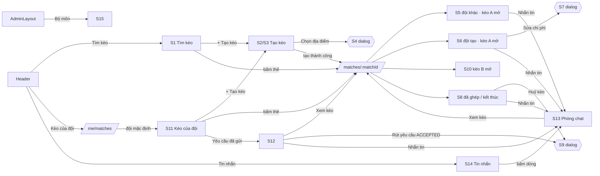

# Screen Flow — MATCH-001 Kèo luồng A, vòng đời kèo & chat dùng chung

| Mục | Giá trị |
|---|---|
| Mã chức năng | `MATCH-001` |
| Phạm vi tầng | frontend (ArenaFlow-fe) — backend: ngoài phạm vi repo này (MATCH-001 `API_Spec.md`) |
| Repo/stack | ArenaFlow-fe · React 19 + TypeScript + Vite · React Router (FE ADR-0003) |
| Nguồn SRS/UI/API | `docs/agent/upstream/business-spec/SYSTEM-001/` — UC-M01..M04, M08, M09, UC-C01, C02, UC-N01, UC-N04; BR-M01..M18, BR-C01..C04, BR-N01, BR-N03..N06, BR-N12 · `UI_Design.md` v1.1 (S1–S15, §3, §4) · `docs/agent/upstream/api/MATCH-001/API_Spec.md` · NOTIFICATION-001 `API_Spec.md` §1.4 · SYSTEM-002 `API_Spec.md` §1.1 |
| Căn cứ | `ArenaFlow-spec@53aee11` · API_Spec `v3.2` (USER-003 `v2.0`, VENUE-001 `v6.2`, NOTIFICATION-001 `v2.0`, REPUTATION-001 `v2.1`, MERCENARY-001 `v3.0`, SYSTEM-002 `v1.2`) |
| Khung dùng chung | `docs/agent/design/SHARED/APP-SHELL/` v1.2 (nhánh `feature/USER-001-user-team`, chưa merge) — route registry, guard, layout, `ROUTE_PATHS`, `useUrlParam`, realtime: **trỏ**, không định nghĩa lại |
| Quy ước áp dụng | `docs/agent/design-standards.md`, `docs/agent/convention-frontend.md`, `docs/agent/security-frontend.md` · FE ADR-0003…0008 (nhánh `feature/USER-001-user-team`), FE ADR-0010 slot (nhánh `feature/REPUTATION-001-…`) — đều `Proposed` |
| Tác giả / Ngày / Phiên bản | `solution-architect` (agent) / `2026-11-27` / `v1.1` (lịch sử: `CHANGELOG.md`) |

> Ba file: `Screen_Flow.md` (file này — route, quyền, điều hướng, tham số URL, **thay đổi cho mã khác §6**) · `Component_Design.md` (cây component, form, slot, **hợp đồng cho MATCH-002 §8**) · `State_API_Integration.md` (endpoint, query key, realtime, lỗi, số API call, **danh sách `[cần xác nhận]` đầy đủ §8**).
> Hai module FE mới: **`src/modules/match/`** (kèo, yêu cầu ghép, thoả thuận chi phí, bộ môn admin — S1–S12, S15) và **`src/modules/chat/`** (phòng chat, "Tin nhắn của tôi", chấm chưa đọc — S13, S14; dùng chung cho MATCH-002 và MERCENARY-001). Hai module không import nhau: điều hướng qua `ROUTE_PATHS` (SHARED Screen_Flow §1.2), nhúng chéo qua slot (FE ADR-0010).
> Mã khác chỉ đọc. File này **không** sửa thiết kế SHARED, USER-001, USER-003, VENUE-001, REPUTATION-001, MERCENARY-001, NOTIFICATION-001 — mọi thay đổi gom ở §6.

## 1. Danh sách màn hình

| # (UI_Design) | Màn hình | Route (`ROUTE_PATHS.*`) | Nhóm route · layout | Module | Use case (SRS) |
|---|---|---|---|---|---|
| S1 | Tìm kèo | `/matches` (`matches`) | `authenticated` · `MainLayout` | match | UC-M03 b1, BR-M14, BR-M15 |
| S2 / S3 | Tạo kèo — "Đã có sân" / "Chưa có sân" (một form, hai chế độ) | `/matches/new` (`matchNew`); `?type=NEED_VENUE` → S3; `?teamId=` chọn sẵn đội | `authenticated` | match | UC-M01, UC-M02 |
| S4 | Chọn địa điểm | Dialog trên S2/S3 (không route) | — | match | UC-M01 b3, UC-M02 b3 |
| S5 / S6 / S8 / S10 | Chi tiết kèo — một route, trang chọn góc nhìn (§3 "Chọn góc nhìn") | `/matches/:matchId` (`matchDetail`) | `authenticated` | match | UC-M03, M04, M08, C01; BR-M17 |
| S7 | Thoả thuận chi phí | Dialog trên S6 | — | match | UC-C01, UC-C02 |
| S9 | Huỷ kèo đã ghép / rút yêu cầu đã được chấp nhận | Dialog trên S8 / S12 | — | match | UC-M08 (CONFIRMED + Alternative Flow) |
| S11 | Kèo của đội | `/teams/:teamId/matches` (`teamMatches`); điểm vào header `/me/matches` (`myTeamMatches`) chuyển hướng | `authenticated` | match | API 2.11 |
| S12 | Yêu cầu đã gửi | `/teams/:teamId/match-requests` (`teamMatchRequests`) | `authenticated` | match | Business_Rules §2.2, BR-M12, BR-M13 |
| S14 | Tin nhắn của tôi | `/conversations` (`conversations`) | `authenticated` | chat | UC-N04, BR-N06 |
| S13 | Phòng chat (dùng chung) | `/conversations/:conversationId` (`conversationDetail`) — route con của `/conversations` | `authenticated` | chat | UC-N01, BR-N03..N05 |
| S15 | Admin quản lý bộ môn | `/admin/sports` (`adminSports`) | `admin` · `AdminLayout` | match | Business_Rules §5.4, BR-M15 |

**Thêm vào `src/shared/constants/route-paths.constant.ts`** (PR của MATCH-001 — SHARED Screen_Flow §1.2):

| Tên | Giá trị | Hàm dựng URL |
|---|---|---|
| `matches` | `/matches` | — |
| `matchNew` | `/matches/new` | `buildMatchNewPath({ type?: 'NEED_VENUE'; teamId?: string })` |
| `matchDetail` | `/matches/:matchId` | `buildMatchDetailPath(matchId)` |
| `myTeamMatches` | `/me/matches` | — |
| `teamMatches` | `/teams/:teamId/matches` | `buildTeamMatchesPath(teamId, { status?, role? })` |
| `teamMatchRequests` | `/teams/:teamId/match-requests` | `buildTeamMatchRequestsPath(teamId, { status? })` |
| `conversations` | `/conversations` | — |
| `conversationDetail` | `/conversations/:conversationId` | `buildConversationPath(conversationId)` |
| `adminSports` | `/admin/sports` | — |

- `/matches/new` khai **trước** `/matches/:matchId` (cùng quy ước USER-001 §1).
- Route của MATCH-002 cùng module `match` (MATCH-002 Screen_Flow §1, §6 C1): `pairingDetail` `/pairings/:pairingId`, `teamPairings` `/teams/:teamId/pairings`, `matchPairings` `/matches/:matchId/pairings` — khai trong `match.routes.tsx` ở PR MATCH-002.
- Route của module `match`: `src/modules/match/routes/match.routes.tsx`; module `chat`: `src/modules/chat/routes/chat.routes.tsx` (`AppRouteGroups` — SHARED Screen_Flow §1.1), page `lazy`.
- `/conversations` là route cha: page `ConversationsPage` (khung 2 khung desktop) + `<Outlet/>`; con `index` = khung phải trống, con `:conversationId` = S13 (Component_Design §3).

**Mục điều hướng** (`NavItem` — SHARED Component_Design §2):

| Hằng (file) | `order` | Nhãn | `to` | Vai trò | Huy hiệu |
|---|---|---|---|---|---|
| `MATCH_NAV_ITEMS` (`modules/match/constants/match-nav.constant.ts`) | 5 | Tìm kèo | `ROUTE_PATHS.matches` | mọi người đã đăng nhập | — |
| ″ | 15 | Kèo của đội | `ROUTE_PATHS.myTeamMatches` | ″ | — |
| `CHAT_NAV_ITEMS` (`modules/chat/constants/chat-nav.constant.ts`) | 90 | Tin nhắn | `ROUTE_PATHS.conversations` | ″ | `ConversationUnreadDot` (Component_Design §3) |
| `MATCH_ADMIN_NAV_ITEMS` | 35 | Bộ môn | `ROUTE_PATHS.adminSports` | `ADMIN` | — |

- Thứ tự giữ đúng UI §3 "Tìm kèo · Kèo của đội · Đội của tôi · Tin nhắn" khi ghép với nav `team` (10/20/30 — USER-003 Screen_Flow §4); vị trí của VENUE-001, MERCENARY-001 `[cần xác nhận]` #11.
- Mobile: ngoài mục "Tin nhắn" trong ngăn kéo, icon "Tin nhắn" có chấm đỏ nằm ở slot `headerActions` (`MessagesHeaderAction`, chỉ hiện dưới `md`) — §6 C4.

## 2. Luồng điều hướng

## 3. Chi tiết từng màn hình

> Hiển thị, nhãn, bố cục: `UI_Design.md` §2 (không lặp lại). Mục dưới chỉ ghi vào/ra, thao tác, tham số URL, điều kiện hiển thị. Số call, key, lỗi: `State_API_Integration.md`.

### S1 — Tìm kèo
- **Tham số URL** (`useUrlParam`, đổi bộ lọc → `replace` + `page = 1`; đổi trang → `push`): `type` ∈ `HAS_VENUE` \| `NEED_VENUE` (vắng = tất cả) · `sportId` · `format` · `skillLevel` (một nhãn — `[cần xác nhận]` #14) · `from`, `to` (`YYYY-MM-DD`) · `near` ∈ `1` \| vắng · `radiusKm` (0.1–50, mặc định 10) · `page`. Giá trị ngoài miền → bỏ (mặc định). **Không** đưa toạ độ lên URL (`security-frontend.md` §4) — toạ độ chỉ trong bộ nhớ (`useGeolocation`).
- **Bộ lọc nháp:** panel desktop / bottom sheet mobile sửa bản nháp; "Áp dụng" mới ghi URL (không gọi API khi gõ → không cần debounce). `from` > `to` → lỗi dưới ô "Đến ngày", không ghi URL.
- **"Gần tôi":** bật → `useGeolocation().request()`; đang định vị → skeleton, chưa gọi 2.2; từ chối / lỗi → tắt `near`, banner "Bật GPS để tìm kèo gần bạn hơn" (fallback khu vực hồ sơ không làm — `[cần xác nhận]` #13).
- **Ra tới:** thẻ → `buildMatchDetailPath(matchId)`; "+ Tạo kèo" → `ROUTE_PATHS.matchNew`.
- **Trạng thái:** skeleton 3 thẻ · empty "Không có kèo phù hợp" + "Xoá lọc" · lỗi + **Thử lại**.

### S2 / S3 — Tạo kèo (một page `MatchCreatePage`, hai chế độ)
- **Chế độ:** `?type=NEED_VENUE` → S3, khác → S2; segmented "Đã có sân / Chưa có sân" đổi `type` bằng `replace` (giữ giá trị chung: đội, bộ môn, định dạng, hạn, trình độ, ghi chú; bỏ giá trị riêng của chế độ cũ). `?teamId=` chọn sẵn đội nếu thuộc danh sách hợp lệ.
- **Điều kiện vào:** danh sách đội người dùng làm đội trưởng và `status = ACTIVE` (State_API_Integration §3.3 `useMatchViewerTeams`). Rỗng → thay form bằng `EmptyState` "Bạn cần là đội trưởng của một đội đang hoạt động để tạo kèo" + link `ROUTE_PATHS.myTeams`. Không dùng guard (quyền thật ở BE — `security-frontend.md` §5).
- **Thao tác:** "Chọn địa điểm" / "+ Thêm địa điểm" → S4. "Tạo kèo" thành công → toast "Kèo đã được tạo" → `navigate(buildMatchDetailPath(id), { replace: true })`. "Huỷ" → `navigate(-1)`; không có lịch sử → `ROUTE_PATHS.matches`.
- **Lỗi / trạng thái:** UI_Design S2, S3; ánh xạ mã lỗi: State_API_Integration §5.2.

### S4 — Chọn địa điểm (dialog)
- Chế độ `single` (S2) / `multiple` tối đa 5 (S3). Trạng thái tìm giữ trong bộ nhớ (`useVenueSearchState({ storage: 'memory' })` — VENUE-001 Component_Design §7.1); đóng dialog → mất.
- "Thêm địa điểm mới" → `ROUTE_PATHS.venueNew?returnTo=<buildMatchNewPath(...)>` (VENUE-001 Screen_Flow §5 #4); quay lại form với `state.createdVenue` → chọn sẵn; dữ liệu form khác bị mất `[cần xác nhận]` #16.

### Chọn góc nhìn trên `/matches/:matchId` (S5 / S6 / S8 / S10)
`MatchDetailPage` tải chi tiết kèo (2.3) + vai trò người xem (§4) rồi chọn view theo **trạng thái hiển thị** `displayStatus` (= `EXPIRED` khi `status = OPEN` và `expiresAt` ≤ bây giờ — API §1.3; tính lại mỗi 60 s):

| `displayStatus` | `type` | Người xem là đội trưởng đội tạo kèo? | View |
|---|---|---|---|
| `OPEN` | `HAS_VENUE` | Có | **S6** `AuthorOpenMatchView` |
| `OPEN` | `HAS_VENUE` | Không | **S5** `OpenMatchView` |
| `OPEN` | `NEED_VENUE` | — | **S10** `NeedVenueOpenMatchView` |
| `CONFIRMED`, `ARCHIVED`, `COMPLETED`, `EXPIRED`, `CANCELLED` | cả hai | — | **S8** `SettledMatchView` (banner theo trạng thái — UI_Design S8) |

- **S5 (đội khác):** thẻ hành động hiện khi người xem làm đội trưởng ≥ 1 đội khác đội tạo kèo (đội `ACTIVE` mới gửi được; đội `INACTIVE` hiện disable kèm "(tạm ngưng)"). Nhiều đội → ô "Gửi yêu cầu bằng đội" (`useState`, mặc định đội `ACTIVE` đầu tiên); trạng thái yêu cầu của đội đang chọn theo bảng UI_Design S5 (nguồn: State_API_Integration §3.3 `useMyTeamMatchRequest`). Gửi thành công → toast "Yêu cầu đã được gửi". "Rút yêu cầu" (`PENDING`) → dialog lý do tuỳ chọn. "Nhắn tin" / "Xem tin nhắn" → `buildConversationPath(request.conversationId)`. Không có hộp xác nhận trước khi gửi `[cần xác nhận]` #17.
- **S6 (đội tạo kèo):** khối "Yêu cầu ghép kèo" — tham số URL `requests` ∈ `pending` (mặc định) \| `all`, `page`. "Chấp nhận" → `ConfirmDialog`; "Từ chối" → dialog lý do tuỳ chọn; "Nhắn tin" → `buildConversationPath(request.conversationId)`; "Sửa chi phí" → S7; menu "Thao tác khác › Huỷ kèo": còn yêu cầu `PENDING` (`pagination.totalItems` của tab `pending` > 0, hoặc BE trả `MATCH_010`) → dialog thông tin "Vui lòng từ chối tất cả yêu cầu trước khi hủy" + "Xem yêu cầu" (đặt `requests=pending`, cuộn tới khối); không còn → `ConfirmDialog` huỷ + lý do tuỳ chọn. Đội tạo kèo `INACTIVE` → ẩn "Chấp nhận", "Sửa chi phí" (API §1.2).
- **S8:** khối đối đầu + slot `matchMercenarySection` rồi slot `matchReputationSection` (Component_Design §7). "Nhắn tin với <đội kia>" (người xem là đội trưởng đội tạo kèo hoặc đội đã ghép, kèo có `opponentTeam`) → tra `conversationId` khi bấm (State_API_Integration §4.3) → S13. "Huỷ kèo" (S9) khi `displayStatus = CONFIRMED`, bây giờ < `startsAt`, người xem là đội trưởng một trong hai đội. Từ `startsAt` tới khi `ARCHIVED`: dòng "Trận đang diễn ra", ẩn huỷ `[cần xác nhận]` #23. Kèo B `CONFIRMED`, người xem là đội trưởng một trong hai đội → link "Xem thương lượng" (`buildPairingDetailPath(confirmedPairingId)` — MATCH-002 C11) `[cần xác nhận]` #30.
- **S10:** danh sách lựa chọn địa điểm (đúng thứ tự) + khung giờ; đội tạo kèo: "Huỷ kèo" (`ConfirmDialog`, lý do tuỳ chọn, "Mọi thương lượng đang trao đổi sẽ kết thúc."). Vùng "Nhận kèo" / "Xem thương lượng": `PairingEntryArea` của MATCH-002 (Component_Design §8.3) — phía đội khác tự chọn đội nhận kèo và gọi MATCH-002 2.3 (+1 call); đội tạo kèo: "Xem thương lượng" → `buildMatchPairingsPath(matchId)`; trước khi có MATCH-002 không render.
- **Ẩn nút ghi theo thời gian:** quá `expiresAt` → ẩn mọi nút ghi của kèo đang mở; ≥ `startsAt` → ẩn huỷ / rút (API §1.3). Kiểm lại ngay lúc bấm (không chỉ lúc render).
- **Sau thao tác đổi trạng thái** (chấp nhận, huỷ): view tự đổi theo dữ liệu tải lại (vd S6 → S8), cùng URL.
- **Lỗi tải:** `404 MATCH_001` hoặc `400 VALIDATION_ERROR` (id sai định dạng) → `ErrorState` "Không tìm thấy kèo" + link `ROUTE_PATHS.matches`.
- **Thông báo / link ngoài:** mọi đích "chi tiết kèo" (NOTIFICATION-001, REPUTATION-001, MERCENARY-001, MATCH-002) dùng `buildMatchDetailPath(matchId)`.

### S7 — Thoả thuận chi phí (dialog trên S6)
- Mở từ "Sửa chi phí"; giá trị ban đầu = `costAgreement` đã tải. Lưu thành công → đóng, toast "Đã lưu thoả thuận chi phí". "Xoá thoả thuận" → gửi bản rỗng (API 2.4) sau `ConfirmDialog`. Form: Component_Design §5.2.

### S9 — Huỷ kèo đã ghép / rút yêu cầu đã chấp nhận (dialog)
- Chế độ `cancel` (từ S8, gọi 2.5 với `teamId` = đội của người xem trong kèo, `expectedStatus` = `status` đã tải) · chế độ `withdraw` (từ S12, gọi 2.10 với `expectedStatus` = `status` của dòng yêu cầu). Người xem là đội trưởng **cả hai** đội → ô "Huỷ với tư cách đội" (đội bị trừ điểm) `[cần xác nhận]` #18.
- Mức trừ dự kiến tính lúc mở dialog từ `startsAt` (Component_Design §6 `estimateReliabilityPenalty`); thành công → toast "Đã huỷ kèo · Trừ <n> điểm uy tín" theo `reliabilityPenalty` của response.

### S11 — Kèo của đội
- **`/me/matches`** (`MyTeamMatchesRedirectPage`): tải danh sách đội của tôi → `<Navigate replace>` tới `buildTeamMatchesPath(<đội đầu danh sách>)` (BE xếp đội làm đội trưởng trước — USER-003 API §2.5). Rỗng → `EmptyState` "Bạn chưa tham gia đội nào" + link `ROUTE_PATHS.teams` `[cần xác nhận]` #12.
- **Tham số URL:** `status` ∈ `ALL` (mặc định) \| 6 trạng thái kèo · `role` ∈ `ALL` (mặc định) \| `AUTHOR` \| `OPPONENT` · `page`.
- **Ô chọn đội:** hiện khi `teamId` thuộc danh sách đội của tôi; đổi đội → `navigate(buildTeamMatchesPath(newId), { replace: true })` (bỏ bộ lọc). `teamId` không thuộc đội của tôi (mở từ link khác) → không có ô chọn; tiêu đề lấy tên đội từ phần tử đầu khớp `authorTeamId` / `opponentTeamId` của danh sách (không gọi thêm API).
- Link "Yêu cầu đã gửi", "Thương lượng" (`buildTeamPairingsPath(teamId)` — MATCH-002 Screen_Flow §6 C3; 0 call; ẩn tới khi có hằng) và "+ Tạo kèo" (`buildMatchNewPath({ teamId })`) chỉ khi người xem làm đội trưởng đội này.
- `404 TEAM_001` / `400 VALIDATION_ERROR` (id sai) → `ErrorState` "Không tìm thấy đội".

### S12 — Yêu cầu đã gửi
- **Tham số URL:** `status` ∈ `ALL` (mặc định) \| 6 trạng thái yêu cầu · `page`. Breadcrumb "Kèo của đội › Yêu cầu đã gửi" (link `buildTeamMatchesPath(teamId)`).
- **Thao tác dòng:** "Xem kèo" → `buildMatchDetailPath`; "Nhắn tin" → `buildConversationPath`; "Rút yêu cầu": `PENDING` → dialog lý do tuỳ chọn (2.10, không trừ điểm); `ACCEPTED` và bây giờ < `startsAt` → S9 chế độ `withdraw`.
- Không phải đội trưởng (`403 TEAM_002`) → `ErrorState` "Chỉ đội trưởng xem được yêu cầu đã gửi"; `422 TEAM_016` → `ErrorState` "Đội đã giải tán".

### S14 — Tin nhắn của tôi · S13 — Phòng chat
- **Bố cục** (`ConversationsPage`, `useMediaQuery('(min-width: 768px)')` — SHARED §5):
  - Desktop: khung trái = danh sách S14 (luôn render); khung phải = `<Outlet/>` (index: "Chọn một cuộc trò chuyện để bắt đầu"; `:conversationId`: S13).
  - Mobile: `/conversations` chỉ danh sách; `/conversations/:id` chỉ phòng chat (**không** render danh sách → không gọi 2.20), nút "‹" → `ROUTE_PATHS.conversations`.
- **S14:** dòng → `buildConversationPath(conversationId)`. "Tải thêm" theo trang (State_API_Integration §6). Dòng có `contextType` lạ → bỏ qua (API §4.1).
- **S13 — đầu phòng theo `contextType` của 2.19:**
  - `TEAM_MATCH` → khối đầu phòng hai đội (`TeamMatchConversationHeader`) + menu "⋮": "Xem kèo" (`buildMatchDetailPath(matchId)`), "Báo cáo giao tiếp tệ" (điều kiện: REPUTATION-001 Screen_Flow S5 — đã có ≥ 1 tin; `captainName` của bên mình ≠ `null`) → slot `conversationReportDialog`. Kèo luồng B (`matchType = NEED_VENUE`) → thêm badge `pairingStatus` + link "Mở thương lượng" (`buildPairingDetailPath(pairingId)` của MATCH-002, truyền kèm `state: { conversationId }`); **không** có khối gói thương lượng trong phòng (Component_Design §8.4).
  - `MERCENARY_APPLICATION` → slot `conversationApplicationHeader` (MERCENARY-001) thay khối đầu phòng; host không hiện menu riêng.
  - Giá trị khác → `ErrorState` "Ứng dụng chưa hỗ trợ loại cuộc trò chuyện này" `[cần xác nhận]` #27.
- **Chỉ xem** (`canSend = false`) → thanh khoá thay ô soạn. `CHAT_002` → "Không tìm thấy cuộc trò chuyện"; `CHAT_003` → "Bạn không còn xem được cuộc trò chuyện này"; cả hai kèm nút về `ROUTE_PATHS.conversations`.
- **Rời phòng / đổi phòng** → huỷ subscription topic cũ; mở lại phòng → luôn tải trang tin mới nhất (API §1.7).

### S15 — Admin quản lý bộ môn
- **Tham số URL:** `status` ∈ `all` (mặc định) \| `active` \| `inactive` (→ query `isActive`) · `page`.
- Gạt **tắt** → `ConfirmDialog` (tone `danger`, câu UI_Design S15) → 2.15; gạt **bật** → 2.15 ngay, toast "Đã bật bộ môn <tên>". Công tắc của dòng đang gửi → `disabled`.

## 4. Route guard & phân quyền
- S1–S14: `AuthGuard` (nhóm `authenticated`). S15: `AuthGuard → RoleGuard('ADMIN')` (`AdminLayout`) — SHARED Screen_Flow §2.
- **Quyền đội trưởng không kiểm bằng guard.** Nút thao tác thay đội hiện / ẩn theo **vai trò người xem** tính từ danh sách đội của tôi (USER-003 2.5 — State_API_Integration §3.3); BE vẫn kiểm (`TEAM_002`, `MATCH_009`, `CHAT_003`) — `security-frontend.md` §5.
- **Vai trò trong kèo** (`MatchViewer`, dùng cho view, nút, và props `viewer` của slot): tập đội người xem **làm đội trưởng** ∩ {`authorTeam.teamId`, `opponentTeam?.teamId`} → 2 phần tử `CAPTAIN_OF_BOTH`, 1 phần tử `CAPTAIN` (`myTeamId`), 0 → `NONE`. Đội đã giải tán không có trong USER-003 2.5 → không được tính.
- Phòng chat: không kiểm phía FE; quyền theo 2.19 (`403 CHAT_003`).
- `404 USER_001` ở 2.16–2.20 → wrapper `endSession('ACCOUNT_DELETED')` (khai `accountGoneCodes` — State_API_Integration §2).
- `403 AUTH_004` ở S15 → `ErrorState` "Bạn không có quyền truy cập trang này" (SHARED Screen_Flow §2).

## 5. Điều hướng từ thông báo (cho NOTIFICATION-001)

| `referenceType` | Đích | Ghi chú |
|---|---|---|
| `MATCH` | `buildMatchDetailPath(referenceId)` | Mọi loại thông báo kèo (API NOTIFICATION-001 §4.3: `MATCH_REQUEST_RECEIVED`, `REQUEST_*`, `MATCH_CONFIRMED`, `MATCH_CANCELLED`, `MATCH_EXPIRED`, `PAIRING_SUPERSEDED`, `PAIRING_EXPIRED`); trang tự chọn góc nhìn (§3). Đóng NOTIFICATION-001 Screen_Flow §6 #5 phần `MATCH` |

- Tin nhắn chat không tạo thông báo (BR-N12) → không có `referenceType` cho chat.

## 6. Thay đổi cho SHARED / mã khác (nguồn duy nhất)

> MATCH-001 **không** sửa các file này; chủ thiết kế áp qua vòng lặp design của mã đó. Cột "Chặn code?" là với phần MATCH-001 phụ thuộc.

| # | File | Mục | Cũ | Mới | Chặn code? |
|---|---|---|---|---|---|
| C1 | SHARED `Screen_Flow.md` | §1.2 hằng đường dẫn; `HOME_PATH` | Chưa có path MATCH-001; `HOME_PATH` tạm `/teams` (§6 #1) | Ghi nhận 9 khoá + 5 hàm dựng ở §1; đề xuất `HOME_PATH = ROUTE_PATHS.matches` (đóng SHARED Screen_Flow §6 #1 khi user chốt — `[cần xác nhận]` #11) | Không (hằng thêm trong PR MATCH-001) |
| C2 | SHARED `State_API_Integration.md` | §1 dòng "Chấm Tin nhắn" | "Do MATCH-001 thiết kế … Chốt ở MATCH-001" | Request `GET /profile/conversations?page=1&pageSize=20` (MATCH-001 2.20) **chỉ** trong `onConnected` (như `unread-count`), key `conversationKeys.myList({ page: 1, pageSize: 20 })`, chủ sở hữu `ConversationActivityBridge`; realtime `CONVERSATION_ACTIVITY` bật chấm không gọi API. Bridge chỉ đăng ký kênh cá nhân / `onConnected` khi `isPersonalChannelEnabled()` (`PERSONAL_CHANNEL_ENABLED` — SHARED State_API_Integration §6 v1.2). Cột (C) của bảng ngưỡng mọi mã **+1** khi tính khung (State_API_Integration §1) | **Có** — call 2.20 trong `onConnected` chờ SHARED §7 #1 (`[cần xác nhận]` #5); phần realtime không chặn |
| C3 | SHARED `State_API_Integration.md` | §4 bảng `QUERY_ROOTS` + key dùng chung | `'match'`, `'sport'`, `'conversation'` — "thêm khi thiết kế"; key dùng chung: `catalogKeys` (+ `teamDetailKey`, `teamReputationKey` theo REPUTATION-001 C5) | `'match'`, `'sport'` → module `match`; `'conversation'` → module `chat` (MATCH-001). Thêm key dùng chung: `myTeamsKey(params)` = `[QUERY_ROOTS.team, 'mine', params]` (`src/shared/constants/my-teams-query-key.constant.ts`) và `venuePickerKey(params)` = `[QUERY_ROOTS.venue, 'picker', params]` (`src/shared/constants/venue-picker-query-key.constant.ts`); hợp đồng `queryFn` (mỗi module tự khai hàm gọi endpoint — `shared/` không gọi endpoint — và trả **nguyên** response, không biến đổi): State_API_Integration §2, §3.1 | Không (mã code trước tạo, `reuse-scan`) |
| C4 | SHARED `Screen_Flow.md` §3 + `Component_Design.md` §1, §2 | Slot `headerActions`; `SessionEffects`; cây khung "`modules/chat MessagesNavLink`" | `MessagesNavLink` (chấm "Tin nhắn") trong `headerActions` | Desktop: mục nav "Tin nhắn" + `NavItem.badge = ConversationUnreadDot`. Mobile: `MessagesHeaderAction` (icon + chấm, `md:hidden`) trong `headerActions` của `MainLayout` (không cắm `AdminLayout`). `SessionEffects` render thêm `ConversationActivityBridge` (Component_Design §3). Đổi tên `MessagesNavLink` → hai component trên | Không |
| C5 | SHARED `Component_Design.md` §5 · `vn-datetime.util.ts` | Hàm ngày giờ | Không có hàm khoảng giờ kèm thứ | Thêm `formatVnWeekday(s)` (datetime → "Thứ Bảy") và `formatMatchTimeRange(startsAt, endsAt)` → `"18:00 – 20:00 · Thứ Bảy 05/12/2026"` (khác ngày → `"22:00 05/12 – 01:00 06/12/2026"`); tính thứ từ năm/tháng/ngày, không qua `Date` múi giờ máy (FE ADR-0008). Đóng MERCENARY-001 `[cần xác nhận]` #21 | Không (mã code trước tạo ở `shared/`, `reuse-scan`) |
| C6 | SHARED `Component_Design.md` §3, §5 | Thành phần / hằng dùng chung | — | Thêm `formatVnd(amount)` (`src/shared/utils/format-money.util.ts`, `600000` → `"600.000 đ"`) — MATCH-001 S7/S8, MATCH-002 tiền cọc; `MATCH_STATUS_LABELS`, `MATCH_REQUEST_STATUS_LABELS`, `MATCH_TYPE_LABELS` + `MatchStatusBadge`, `MatchRequestStatusBadge` (`src/shared/constants/match-status.constant.ts`, `src/shared/components/match-status/`) — module `match` và `chat` (badge `requestStatus` đầu phòng) cùng dùng; `StatusBadge` thêm `tone: 'tertiary'` (token `tertiary-container`) cho badge "Chưa có sân" (mở rộng union prop → MINOR); ghi nhận dùng `useNowMs` shared (MERCENARY-001 C5), `SKILL_LEVELS` shared (MERCENARY-001 C3) | Không |
| C7 | SHARED `State_API_Integration.md` §6 bảng API `subscribe` + FE ADR-0007 mục "Quyết định" (dòng `subscribe`) | `subscribe` đếm tham chiếu | "Đếm tham chiếu: hai màn cùng topic → một `SUBSCRIBE`" (trùng MERCENARY-001 C4 — áp một lần) | Ghi rõ ở **cả hai** nơi: nhiều subscriber cùng destination **đều** nhận mọi frame; huỷ một subscriber không ảnh hưởng subscriber khác; `onError` gọi cho mọi subscriber. MATCH-001 cần vì host phòng chat và slot `conversationApplicationHeader` subscribe cùng topic | **Có** — realtime S13 đơn mercenary |
| C8 | USER-003 `State_API_Integration.md` §3 + `Component_Design.md` | `teamKeys.mine` / `mineList`; type `MyTeam` | Khai trong module `team` | `teamKeys.mineList(p)` trả giá trị của `myTeamsKey(p)` (cùng giá trị hiện tại); type `MyTeam` + `MyTeamsParams` chuyển `src/shared/types/my-team.type.ts`; `queryFn` dưới key này trả **nguyên** `Page<MyTeam>` (biến đổi chỉ qua `select`); invalidate `teamKeys.mine()` giữ nguyên | Không — cùng giá trị key; điều kiện: `queryFn` không biến đổi dữ liệu (kiểm ở `code-reviewer`) |
| C9 | USER-001 `Component_Design.md` §2, §5 | `SkillLevelTags` | Component riêng module `team` | Chuyển `src/shared/components/skill-level-tags/skill-level-tags.component.tsx` (thẻ kèo S1, S11, chi tiết kèo — USER-001 Component_Design §2 ghi chú "Nếu mã khác … cần → chuyển lên `shared/`") | Không |
| C10 | USER-001 `UI_Design.md` + `Screen_Flow.md` S8a | Lối vào "Kèo của đội" từ chi tiết đội | Không có | Link "Kèo của đội" → `buildTeamMatchesPath(teamId)` (mọi người xem); không thêm call. Đổi UI → qua `ui-designer` (UI_Design MATCH-001 §4 #8) | Không (vào được bằng nav / URL) |
| C11 | REPUTATION-001 `Component_Design.md` §6.1, §6.2 + `State_API_Integration.md` §7 #5 | Props slot; nguồn vai trò | `viewer` inline; đề xuất host dùng USER-003 2.5 `role=CAPTAIN&pageSize=100` | **Chấp nhận** props §6.1, §6.2; `viewer: SlotMatchViewer` (MERCENARY-001 C6). Host dùng `myTeamsKey({ role: null, page: 1, pageSize: 100 })` (một cache với USER-001 S8a — USER-003 State §3 "Bước 4"), lọc `role = CAPTAIN` phía FE; `matchStatus` = `displayStatus` (Screen_Flow §3); `matchStartsAt` của §6.2 lấy từ cache 2.20, không có → `null` (State_API_Integration §4.4). Chuỗi tải + số call: State_API_Integration §1 dòng S8 | **Có** — cắm S3, S5 của REPUTATION-001 (FE ADR-0010) |
| C12 | MERCENARY-001 `Component_Design.md` §6.1, §6.2; `State_API_Integration.md` §3.1, §7 #4, #5 | Props slot; `venuePickerKey`; hằng route | Chờ MATCH-001 | **Chấp nhận** §6.1 (vị trí: dưới khối đối đầu S8, trên khối REPUTATION-001) và §6.2 (`hasMessages` = vùng tin có ≥ 1 tin; `onApplicationChanged` → host invalidate 2.19; host giữ thanh khoá chung, slot giữ dòng lý do). Đã đăng ký `buildConversationPath`, `buildMatchDetailPath` (§1). Phòng chat đơn **+1 call** (2.10) đã tính (State_API_Integration §1, `[cần xác nhận]` #4); `applicationStatus` truyền vào đã thu hẹp về 4 giá trị, giá trị lạ → không render slot (Component_Design §7). `venuePickerKey` chuyển khai ở `shared/` (C3) thay vì trong module `mercenary` | **Có** — cắm S1, S19 của MERCENARY-001 |
| C13 | NOTIFICATION-001 `Screen_Flow.md` §5 dòng `MATCH`; §6 #5 | Hằng đích | "chưa có — đề xuất `buildMatchDetailPath(matchId)`" | Chốt `buildMatchDetailPath(matchId)` (§5) | Không với MATCH-001 |
| C14 | VENUE-001 `Screen_Flow.md` §5 #4 | Nhánh `returnTo` | Chờ MATCH-001 / MERCENARY-001 | MATCH-001 S4 dùng `?returnTo=<buildMatchNewPath({ type?, teamId? })>`; nhận `state.createdVenue` (dạng MERCENARY-001 C13) để chọn sẵn — S2: đặt `venueId`; S3: thêm vào cuối `venueOptionIds` nếu < 5 | Không (thiếu nhánh → người dùng tự chọn lại) |
| C15 | MATCH-001 `UI_Design.md` S13 (qua `ui-designer`) | Đầu phòng chat luồng B | Chỉ vẽ `TEAM_MATCH` luồng A; §2 S13 "luồng B → MATCH-002 có thể thêm khối gói" | **Đã áp ở `UI_Design.md` v1.1:** đầu phòng luồng B = như luồng A + badge `pairingStatus` + link "Mở thương lượng" (không có khối gói — quyết định coordinator 2026-11-27; Component_Design §8.4) | Không |
| C16 | SHARED `State_API_Integration.md` §6 + FE ADR-0007 | `subscribe` và epoch kết nối | `subscribe(destination, onFrame, onError?) → unsubscribe` | **Đã áp ở SHARED v1.2** (§6): `subscribe(destination, onFrame, { onError?, onReady? }) → unsubscribe`, `onReady(epoch)` sau `SUBSCRIBE` mỗi epoch (subscriber đăng ký khi destination đã `SUBSCRIBE` trong epoch hiện tại nhận ngay), `getConnectionEpoch()`, `useRealtimeSubscription` truyền `onReady`; `RECEIPT` theo `[cần xác nhận]` #29. MATCH-001 trỏ SHARED §6, không định nghĩa lại | Không còn chặn ở phía hợp đồng; code theo SHARED §6 khi SHARED merge (#1) |
| C17 | MATCH-001 `UI_Design.md` (qua `ui-designer`) | S8, S10, S11 (+ S13 ở C15) | — | **Đã áp ở `UI_Design.md` v1.1:** S11 thêm link "Thương lượng" cạnh "Yêu cầu đã gửi" (chỉ đội trưởng — MATCH-002 C3); S8 thêm link "Xem thương lượng" trên kèo B `CONFIRMED` (MATCH-002 C11, `[cần xác nhận]` #30); S10 đồng bộ vùng chọn đội nhận kèo (`PairingEntryArea` — MATCH-002 C2, C10) | Không |

## 7. `[cần xác nhận]`
> Đánh số chung 3 tài liệu; nội dung đầy đủ, phương án đề xuất và cột **Chặn code?**: State_API_Integration §8. Mục liên quan file này:

| # | Tóm tắt | Chặn code? |
|---|---|---|
| 1 | Nền SHARED chưa merge + FE ADR-0002…0008 `Proposed` | **Có** — toàn bộ |
| 2 | FE ADR-0010 slot `Proposed` | **Có** — cắm 4 slot (S8, S13) |
| 3 | Ngưỡng (B)/(C) khi tính request khung (SHARED §7 #1) | **Có** — màn vượt tới khi chốt |
| 4 | S13 desktop + slot đơn (C12) vượt ở (A) khi trang 1 của 2.20 chưa có cache | **Có** — nhánh vượt |
| 5 | Chấm "Tin nhắn": 2.20 trang 1 trong `onConnected` (C2) | **Có** — call trong `onConnected`; realtime không chặn |
| 11 | `HOME_PATH = /matches`; thứ tự nav | Không |
| 12 | `/me/matches` chọn đội mặc định; link từ S8a (C10) | Không |
| 13 | GPS bị từ chối: không fallback phường/xã | Không |
| 14 | Lọc trình độ một nhãn | Không |
| 16 | "Thêm địa điểm mới" từ S4 mất dữ liệu form | Không |
| 17 | Không có hộp xác nhận khi gửi yêu cầu | Không |
| 18 | Huỷ kèo khi là đội trưởng cả hai đội | Không |
| 23 | Kèo đang diễn ra chỉ là dòng phụ | Không |
| 27 | `contextType` lạ khi mở thẳng phòng chat | Không |
| 30 | Link "Xem thương lượng" trên kèo B đã ghép (S8) | Không |
