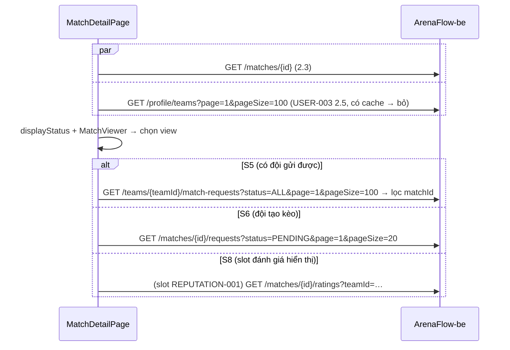
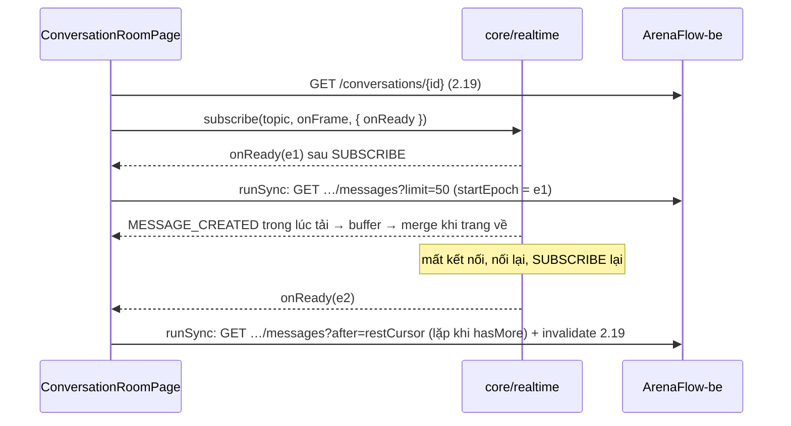

# State & API Integration — MATCH-001 Kèo luồng A, vòng đời kèo & chat dùng chung

| Mục | Giá trị |
|---|---|
| Mã chức năng | `MATCH-001` |
| Phạm vi tầng | frontend (ArenaFlow-fe) — hợp đồng API thuộc BE |
| Nguồn API | `docs/agent/upstream/api/MATCH-001/API_Spec.md` · `docs/agent/upstream/api/api-convention.md` · USER-003 `API_Spec.md` §2.5 (đội của tôi) · VENUE-001 `API_Spec.md` 2.2, §4.3 (bộ chọn sân) · NOTIFICATION-001 `API_Spec.md` §1.4 (`CONVERSATION_ACTIVITY`) · SYSTEM-002 `API_Spec.md` §1.1 (giờ Việt Nam — BE ADR-0017) |
| Căn cứ | `ArenaFlow-spec@53aee11` · API_Spec `v3.2` (USER-003 `v2.0`, VENUE-001 `v6.2`, NOTIFICATION-001 `v2.0`, SYSTEM-002 `v1.2`) |
| Quy ước áp dụng | `docs/agent/convention-frontend.md` §5, `docs/agent/non-functional-standards.md`, `docs/agent/security-frontend.md` · SHARED/APP-SHELL `State_API_Integration.md` v1.2 (http, query key, realtime) · FE ADR-0004, 0006, 0007, 0008, 0010 |
| Tác giả / Ngày / Phiên bản | `solution-architect` (agent) / `2026-11-27` / `v1.1` (lịch sử: `CHANGELOG.md`) |

> Mọi request qua `http.service` (SHARED §2). Field của type **trỏ** API_Spec — không chép bảng field. "2.x" không ghi mã = MATCH-001 `API_Spec.md`.

## 1. Endpoint dùng theo màn hình

| Màn | Thời điểm gọi | Method + path | API_Spec | Số call khi tải |
|---|---|---|---|---|
| S1 | Tải / áp dụng bộ lọc / đổi trang | `GET /matches?type&sportId&format&skillLevel&startsAtFrom&startsAtTo&lat&lng&radiusKm&page&pageSize=20` | 2.2 | 1 (chờ toạ độ khi "Gần tôi" đang định vị) |
| S1, S2/S3 | Tải (cache 10 phút, dùng chung) | `GET /sports?page=1&pageSize=100` | 2.13 | 0–1 |
| S2/S3, chi tiết kèo, S11, S12, `/me/matches` | Tải (cache 5 phút, chung với USER-001 S8a) | `GET /profile/teams?page=1&pageSize=100` | USER-003 2.5 | 0–1 |
| S2/S3 | "Tạo kèo" | `POST /matches` | 2.1 | — |
| S4 | Mở dialog / gõ (300 ms) / "Gần tôi" / bán kính | `GET /venues?q&lat&lng&radiusKm&page&pageSize=20` | VENUE-001 2.2 | 0 khi tải trang; 1 khi mở |
| Chi tiết kèo (mọi view) | Tải | `GET /matches/{matchId}` | 2.3 | 1 |
| S5 | Sau khi biết vai trò, có đội gửi được | `GET /teams/{teamId}/match-requests?status=ALL&page=1&pageSize=100` (đội đang chọn) → lọc `matchId` | 2.12 | 0–1 |
| S5 | "Gửi yêu cầu ghép kèo" / "Rút yêu cầu" | `POST /matches/{matchId}/requests` / `POST /match-requests/{requestId}/withdraw` | 2.6 / 2.10 | — |
| S6 | Sau khi biết vai trò; đổi tab / trang | `GET /matches/{matchId}/requests?status=PENDING\|ALL&page&pageSize=20` | 2.7 | 1 |
| S6 | "Chấp nhận" / "Từ chối" / huỷ kèo mở | `POST /match-requests/{id}/accept` · `…/reject` · `POST /matches/{id}/cancel` | 2.8 · 2.9 · 2.5 | — |
| S7 | "Lưu thoả thuận" / "Xoá thoả thuận" | `PUT /matches/{matchId}/cost-agreement` | 2.4 | 0 khi mở |
| S8 | Slot `matchReputationSection` (REPUTATION-001 2.2) khi slot hiển thị | do slot gọi | REPUTATION-001 2.2 | 0–1 |
| S8 | "Nhắn tin với <đội kia>" | Tra `conversationId` (§4.3) | 2.7 / 2.12 | — (thao tác) |
| S8, S12 | S9 "Huỷ kèo" / "Rút yêu cầu" | `POST /matches/{id}/cancel` / `POST /match-requests/{id}/withdraw` | 2.5 / 2.10 | — |
| S10 | Tải | (2.3 + đội của tôi ở trên); phía đội khác: `PairingEntryArea` (MATCH-002) gọi MATCH-002 2.3 cho đội đang chọn; đội tạo kèo: link "Xem thương lượng" (0 call) | MATCH-002 2.3 | 0–1 |
| S11 | Tải / đổi tab / vai trò / trang | `GET /teams/{teamId}/matches?status&role&page&pageSize=20` | 2.11 | 1 |
| S12 | Tải / đổi tab / trang | `GET /teams/{teamId}/match-requests?status&page&pageSize=20` | 2.12 | 1 |
| S13 | Tải: 2.19 ngay; 2.17 trang đầu do `runSync` (§4.4) chạy sau `SUBSCRIBE` (`onReady` đầu tiên của topic phòng), hoặc sau 3 s chưa kết nối (dự phòng) | `GET /conversations/{id}` · `GET /conversations/{id}/messages?limit=50` | 2.19, 2.17 | 2 |
| S13 | **Không** gọi khi tải. Lần tương tác đầu của người dùng với phòng (focus / gõ ô soạn, cuộn vùng tin, chạm / bấm trong phòng) khi còn tin bên kia `isRead = false`; sau đó mỗi tin bên kia đến khi tab hiển thị (tối đa 1 lần / 3 s) | `POST /conversations/{id}/messages/read` | 2.18 | 0 (thao tác) |
| S13 | Chỉ nhánh dự phòng: đã tải REST khi realtime chưa sẵn sàng, rồi `onReady` của topic tới → bù `after` từ `restCursor`, không gọi lại 2.19 (§4.4) | `GET /conversations/{id}/messages?after=<mới nhất>&limit=100` | 2.17 | 0–1 |
| S13 | Cuộn lên / "Xem tin cũ hơn" | `GET …/messages?before=<cũ nhất>&limit=50` | 2.17 | — |
| S13 | Gửi | `POST /conversations/{id}/messages` | 2.16 | — |
| S13 | Kết nối realtime lại (`runSync` — §4.4) | 2.17 `after` (lặp khi `hasMore`; trang rỗng → trang đầu) + 2.19 | 2.17, 2.19 | — |
| S13 đơn | Slot `conversationApplicationHeader` | `GET /mercenary-applications/{applicationId}` | MERCENARY-001 2.10 | +1 |
| S13 luồng B | Không gọi thêm: badge từ `pairingStatus` (2.19) / `status` của frame `PAIRING_UPDATED`; link "Mở thương lượng" (Component_Design §8.4) | — | 2.19 §4.7, MATCH-002 §1.6 | 0 |
| S14 (và khung trái S13 desktop) | Trang 1: dùng cache do `ConversationActivityBridge` giữ mới (§4.5), chưa có cache → tải; "Tải thêm" → trang sau | `GET /profile/conversations?page&pageSize=20` | 2.20 | 0–1 |
| S15 | Tải / đổi tab / trang | `GET /admin/sports?isActive&page&pageSize=20` | 2.14 | 1 |
| S15 | Gạt công tắc | `PATCH /admin/sports/{sportId}` | 2.15 | — |
| Khung (mọi màn) | `onConnected` của realtime (lần đầu + mỗi lần kết nối lại) | `GET /profile/conversations?page=1&pageSize=20` — chấm "Tin nhắn" (Screen_Flow §6 C2) | 2.20 | Request khung |

**Tổng API call khi tải** — ngưỡng ≤ 3 (`non-functional-standards.md` §2, chỉ miễn refresh); cách tính có gồm request khung hay không **chưa chốt** (SHARED State_API_Integration §7 #1) → ghi ba cách:
- **(A)** chỉ call của màn (cache phiên đã có → số nhỏ; trống → số lớn).
- **(B)** = (A) khi vào thẳng URL + hồ sơ cho header (USER-001) + huy hiệu "Lời mời của tôi" (USER-003).
- **(C)** = (B) + `unread-count` (NOTIFICATION-001) + chấm "Tin nhắn" (2.20 trang 1 — Screen_Flow §6 C2; trên S14 và S13 desktop trùng key với màn → không cộng).

| Màn | (A) | (B) | (C) | Kết luận |
|---|---|---|---|---|
| S1 | 1–2 (2.2 + bộ môn) | 4 | 6 | Đạt ở (A); vượt ở (B), (C) — #3 |
| S2/S3 | 0–2 (đội + bộ môn) | 4 | 6 | Như trên |
| S5 | 1–3 (2.3 + đội + 2.12) | 5 | 7 | Như trên |
| S6 | 2–3 (2.3 + đội + 2.7) | 5 | 7 | Như trên |
| S8 | 1–3 (2.3 + đội + slot REPUTATION 2.2; slot MERCENARY 0) | 5 | 7 | Như trên |
| S10 | 1–3 (2.3 + đội + MATCH-002 2.3 phía đội khác — MATCH-002 Screen_Flow §6 C2) | 5 | 7 | Đạt ở (A); vượt ở (B), (C) — #3 |
| S11 / S12 | 1–2 (2.11 / 2.12 + đội) | 4 | 6 | Như S1 |
| S13 mobile — `TEAM_MATCH` (luồng A và B) | 2 (2.19 + 2.17); nhánh dự phòng realtime +1 `after` = 3 | 4–5 | 6–7 | Đạt ở (A) |
| S13 mobile — đơn mercenary | 3 (+ slot MERCENARY-001 2.10); nhánh dự phòng +1 = 4 | 5–6 | 7–8 | Đạt ở (A) trừ nhánh dự phòng realtime — #4 |
| S13 desktop (kèm khung S14) — `TEAM_MATCH` | 2–3 (+ 2.20 trang 1 khi chưa có cache) | 4–5 | 5–6 (chấm trùng key khung trái) | Đạt ở (A) |
| S13 desktop — đơn mercenary | 3–4 | 5–6 | 6–7 | **Vượt ở (A)** chỉ khi trang 1 của 2.20 chưa có cache (bridge chưa chạy — vd kênh cá nhân chưa mở) — #4 |
| S14 | 0–1 | 2–3 | 3–4 (chấm trùng key) | Đạt ở (A), (B) |
| S15 | 1 | 3 | 5 | Đạt ở (A), (B) |

- Không màn nào gọi API theo từng phần tử: thẻ kèo, dòng yêu cầu, dòng tin nhắn dùng dữ liệu có sẵn trong response (uy tín đội từ §4.3 / §4.4 — không gọi REPUTATION-001 2.9 từng thẻ).
- Chi tiết kèo: 2.3 và danh sách đội chạy **song song**; 2.12 (S5) / 2.7 (S6) / slot S8 chạy **sau** khi có cả hai (cần vai trò) — §4.1.

## 2. Hàm API & type

| Hàm | Đường dẫn | Request | Response | `http` |
|---|---|---|---|---|
| `createMatch(body)` | `src/modules/match/api/match.api.ts` | `CreateMatchRequest` (2.1, union A / B) | `MatchDetail` (§4.2) | `post` |
| `searchMatches(query, signal)` | ″ | `MatchSearchQuery` (2.2) | `Page<MatchSummary>` (§4.3) | `getPage` |
| `getMatch(matchId, signal)` | ″ | — | `MatchDetail` | `get` |
| `saveCostAgreement(matchId, body)` | ″ | `CostAgreementRequest` (2.4) | `CostAgreementResult` (§4.5) | `put` |
| `cancelMatch(matchId, body)` | ″ | `CancelMatchRequest` `{ teamId, expectedStatus, reason? }` | `CancelMatchResult` (2.5) | `post` |
| `sendMatchRequest(matchId, body)` | ″ | `{ teamId }` | `MatchRequest` (§4.4) | `post` |
| `getMatchRequests(matchId, params, signal)` | ″ | `{ status: 'PENDING' \| 'ALL', page, pageSize }` | `Page<MatchRequest>` | `getPage` |
| `acceptMatchRequest(requestId)` | ″ | — | `AcceptMatchRequestResult` (2.8) | `post` |
| `rejectMatchRequest(requestId, body)` | ″ | `{ reason? }` | `undefined` (204) | `post` |
| `withdrawMatchRequest(requestId, body)` | ″ | `{ expectedStatus, reason? }` | `WithdrawMatchRequestResult` (2.10) | `post` |
| `getTeamMatches(teamId, params, signal)` | ″ | `{ status, role, page, pageSize }` | `Page<MatchSummary>` | `getPage` |
| `getTeamMatchRequests(teamId, params, signal)` | ″ | `{ status, page, pageSize }` | `Page<MatchRequest>` | `getPage` |
| `getActiveSports(params, signal)` | `src/modules/match/api/sport.api.ts` | `{ page, pageSize }` | `Page<Sport>` (§4.6) | `getPage` |
| `getAdminSports(params, signal)` | ″ | `{ isActive?, page, pageSize }` | `Page<Sport>` | `getPage` |
| `updateSportActive(sportId, body)` | ″ | `{ isActive }` | `Sport` | `patch` |
| `searchPickerVenues(params, signal)` | `src/modules/match/api/venue-picker.api.ts` | `VenueSearchParams` (shared) | `Page<PickerVenue>` (VENUE-001 §4.3, khai tối thiểu) | `getPage` |
| `getMyTeams(params, signal)` | `src/modules/match/api/my-teams.api.ts` | `MyTeamsParams` (shared) | `Page<MyTeam>` (USER-003 §4.2) | `getPage`, `accountGoneCodes: ['USER_001']` |
| `getConversation(id, signal)` | `src/modules/chat/api/conversation.api.ts` | — | `Conversation` (§4.7) | `get`, `accountGoneCodes: ['USER_001']` |
| `getMessages(id, cursor, signal)` | ″ | `{ before?, after?, limit }` | `CursorPage<Message>` (2.17: `items`, `hasMore`) | `get`, ″ |
| `sendMessage(id, body)` | ″ | `{ content }` | `Message` (§4.8) | `post`, ″ |
| `markConversationRead(id)` | ″ | — | `undefined` (204) | `post`, ″ |
| `getMyConversations(params, signal)` | ″ | `{ page, pageSize }` | `Page<ConversationSummary>` (§4.9) | `getPage`, ″ |

- Type: `src/modules/match/types/match.type.ts` (`MatchDetail`, `MatchSummary`, `MatchTeam`, `MatchVenue`, `TimeOption`, `CostAgreement` — 7 field của §4.2, `CostAgreementResult` — §4.5, `MatchRequest`, kết quả 2.5 / 2.8 / 2.10, body request), `sport.type.ts`, `venue-picker.type.ts`; `src/modules/chat/types/conversation.type.ts` (`Conversation`, `ConversationParty`, `Message`, `ConversationSummary`, `MessageCreatedFrame`, `ConversationActivityFrame`). Enum dùng chung từ `shared/constants/match-status.constant.ts` (Component_Design §4).
- Mọi thời gian là `string` giờ Việt Nam không offset (JSDoc field ghi rõ — `convention-frontend.md` §10.1); không `new Date(chuoi)` (FE ADR-0008).
- `contextType`, `partyType`, `requestStatus`, `pairingStatus`, `applicationStatus` khai `string` có union đã biết + nhánh lạ (API §4.1 "có thể thêm giá trị"). Truyền vào slot có prop union hẹp → thu hẹp bằng hàm kiểm (vd `toSlotApplicationStatus` — Component_Design §6); giá trị lạ → không render slot.
- **Hàm dưới key dùng chung** (`myTeamsKey`, `venuePickerKey` — §3.1): `getMyTeams` trùng endpoint với USER-003 (`getMyTeams` module `team`), `searchPickerVenues` trùng với hàm bộ chọn sân của MERCENARY-001 — chấp nhận hai hàm ở hai module vì `shared/` không gọi endpoint (`convention-frontend.md` §2). Điều kiện: mỗi hàm trả **nguyên** response của endpoint (không biến đổi, không lọc) để mọi module đọc cùng một dạng cache — như `teamDetailKey` (REPUTATION-001 State §3.1); kiểm ở `code-reviewer`.

## 3. State

### 3.1. Query key (FE ADR-0004)

```ts
// src/modules/match/constants/match-query-keys.constant.ts
export const matchKeys = {
  all: [QUERY_ROOTS.match] as const,
  searches: () => [...matchKeys.all, 'search'] as const,
  search: (q: MatchSearchQuery) => [...matchKeys.searches(), q] as const,
  detail: (matchId: string) => [...matchKeys.all, 'detail', matchId] as const,
  requests: (matchId: string) => [...matchKeys.detail(matchId), 'requests'] as const,
  requestList: (matchId: string, p: MatchRequestListParams) => [...matchKeys.requests(matchId), p] as const,
  teamMatchLists: () => [...matchKeys.all, 'team-matches'] as const,
  teamMatchList: (teamId: string, p: TeamMatchListParams) => [...matchKeys.teamMatchLists(), teamId, p] as const,
  teamRequests: (teamId: string) => [...matchKeys.all, 'team-requests', teamId] as const,
  teamRequestList: (teamId: string, p: TeamRequestListParams) => [...matchKeys.teamRequests(teamId), p] as const,
}
// src/modules/match/constants/sport-query-keys.constant.ts
export const sportKeys = {
  all: [QUERY_ROOTS.sport] as const,
  activeList: (p: PageParams) => [...sportKeys.all, 'active', p] as const,
  adminLists: () => [...sportKeys.all, 'admin'] as const,
  adminList: (p: AdminSportListParams) => [...sportKeys.adminLists(), p] as const,
}
// src/modules/chat/constants/conversation-query-keys.constant.ts
export const conversationKeys = {
  all: [QUERY_ROOTS.conversation] as const,
  myLists: () => [...conversationKeys.all, 'mine'] as const,
  myList: (p: PageParams) => [...conversationKeys.myLists(), p] as const,
  detail: (id: string) => [...conversationKeys.all, 'detail', id] as const,
  // Ngang hàng `detail` (không phải con): invalidate đầu phòng (2.19) KHÔNG làm tải lại lịch sử tin đã gộp
  messages: (id: string) => [...conversationKeys.all, 'messages', id] as const,
}
// Dùng chung (Screen_Flow §6 C3) — src/shared/constants/
export const myTeamsKey = (p: MyTeamsParams) => [QUERY_ROOTS.team, 'mine', p] as const        // = USER-003 teamKeys.mineList
export const venuePickerKey = (p: VenueSearchParams) => [QUERY_ROOTS.venue, 'picker', p] as const // VENUE-001 §7.1, MERCENARY-001
```
- Params chuẩn hoá đủ field (mặc định điền sẵn, giá trị rỗng bỏ đi) — SHARED §4.
- **Hợp đồng key dùng chung:** `queryFn` dưới `myTeamsKey` trả **nguyên** `Page<MyTeam>` (USER-003 2.5); dưới `venuePickerKey` trả **nguyên** `Page` của VENUE-001 2.2. Biến đổi chỉ qua `select`.
- **"Invalidate danh sách đội của tôi"** trong tài liệu này = `invalidateQueries({ queryKey: [QUERY_ROOTS.team, 'mine'] })` (tiền tố — gồm mọi `myTeamsKey(p)` và `teamKeys.mineList` của USER-003).
- Không invalidate tiền tố `conversationKeys.all` khi chỉ cần đổi đầu phòng / danh sách: dùng `conversationKeys.detail(id)` hoặc `conversationKeys.myLists()`; `conversationKeys.messages(id)` chỉ đổi bằng `setQueryData` / `resetQueries` (§4.4).

### 3.2. Bảng state

| State | Loại | Hook | Key | Tuỳ chọn / ghi chú |
|---|---|---|---|---|
| Kết quả tìm kèo (S1) | server | `useMatchSearch(q, { enabled })` | `matchKeys.search(q)` | `placeholderData` giữ trang cũ; `enabled` khi không đang định vị |
| Bộ môn đang bật | server | `useActiveSports()` | `sportKeys.activeList({ page: 1, pageSize: 100 })` | `staleTime` 10 phút `[cần xác nhận]` #21 |
| Đội của tôi | server | `useMyTeams()` | `myTeamsKey({ role: null, page: 1, pageSize: 100 })` | `staleTime` 5 phút; một cache với USER-001 S8a `[cần xác nhận]` #6 |
| Chi tiết kèo | server | `useMatchDetail(matchId)` | `matchKeys.detail` | mặc định (30 s) |
| Yêu cầu của kèo (S6) | server | `useMatchRequests(matchId, p, { enabled: viewer là đội tạo kèo })` | `matchKeys.requestList` | `placeholderData` |
| Yêu cầu của đội mình cho kèo (S5) | server | `useMyTeamMatchRequest(teamId, matchId)` | `matchKeys.teamRequestList(teamId, { status: 'ALL', page: 1, pageSize: 100 })` | `select` → yêu cầu mới nhất có `matchId` (BE xếp mới gửi trước) hoặc `null` `[cần xác nhận]` #7 |
| Kèo của đội (S11) | server | `useTeamMatches(teamId, p)` | `matchKeys.teamMatchList` | `placeholderData` |
| Yêu cầu đã gửi (S12) | server | `useTeamMatchRequests(teamId, p)` | `matchKeys.teamRequestList(teamId, { status, page, pageSize: 20 })` | `placeholderData` |
| Bộ môn (S15) | server | `useAdminSports(p)` | `sportKeys.adminList` | `placeholderData` |
| Bộ chọn sân (S4) | server | `useVenuePicker(params \| null)` | `venuePickerKey` | `enabled` khi dialog mở và `params ≠ null` |
| Đầu phòng chat | server | `useConversation(id)` | `conversationKeys.detail` | `refetchOnMount: 'always'` (mở lại phòng có `canSend` mới); frame `PAIRING_UPDATED` cùng `pairingId` → `setQueryData` `pairingStatus = frame.status` (không gọi API) |
| Lịch sử tin | server | `useConversationMessages(id)` (`useInfiniteQuery`) | `conversationKeys.messages` | `enabled: false` — trang đầu và mọi lần bù **chỉ** do `runSync` ghi bằng `setQueryData` (gộp, không ghi đè — §4.4); `fetchNextPage` (2.17 `before`, `limit=50`) cho tin cũ; `getNextPageParam` = `messageId` cũ nhất khi `hasMore`; `staleTime: Infinity`, không tự refetch; `gcTime: 0` → mở lại phòng luôn đồng bộ lại từ đầu (API §1.7) |
| Frame đến trước trang đầu | client cục bộ | `useRef` đệm trong `useConversationRealtime` | — | §4.4 — gộp vào cache khi trang đầu có dữ liệu |
| Đồng bộ phòng | client cục bộ | `useRef` trong `useConversationRealtime`: `readyEpoch`, `firstReadyEpoch`, `targetEpoch`, `loadedEpoch`, `restCursor`, `inFlight`, `abort`, `buffer` | — | §4.4 |
| Tin nhắn của tôi (S14) | server | `useMyConversations()` — `useQueries` trang 1..n | `conversationKeys.myList({ page, pageSize: 20 })` | Trang 1: `staleTime: Infinity` **chỉ khi** `isPersonalChannelEnabled()` **và** `useRealtimeStatus() = 'connected'` (SHARED §6 — bridge đang giữ mới bằng `onConnected`, invalidate khi `CONVERSATION_ACTIVITY`, `patchConversationLists` — §4.5); còn lại mặc định 30 s (vào lại S14 / khung trái sau 30 s thì tải lại). Trang ≥ 2 mặc định. Gộp trang, bỏ trùng `conversationId` (API 2.20) |
| Tín hiệu chưa đọc | client toàn module | `conversationUnreadStore` | — | §4.5; reset khi `ConversationActivityBridge` unmount (hết phiên) |
| Phòng đang mở | client toàn module | `openConversationStore` (`store/open-conversation.store.ts`, FE ADR-0006) | — | `{ conversationId: string \| null; visible: boolean; interacted: boolean }` — phòng đặt khi mount / unmount, `visibilitychange`, lần tương tác đầu; bridge đọc (§4.5); reset khi bridge unmount |
| Tin đang gửi | client cục bộ | `useState` trong `ConversationRoomPage` | — | `{ tempId, content, status: 'sending' \| 'failed' }` — không vào cache |
| Bộ lọc S1, tab S6/S11/S12/S15, trang | URL | `useUrlParam` | Screen_Flow §3 | — |
| Toạ độ GPS | client (bộ nhớ) | `useGeolocation` (shared) | — | Không vào URL / storage |
| Đội gửi yêu cầu đang chọn (S5), dialog đang mở, mục menu report bị chặn | client cục bộ | `useState` | — | Không store toàn cục |

### 3.3. Dữ liệu dẫn xuất (không gọi thêm API)
- `displayStatus = getDisplayStatus(match, useNowMs(60_000))`; ẩn nút theo `getMatchPermissions` (Component_Design §6) — kiểm lại lúc bấm.
- `MatchViewer` (`useMatchViewer`): đội làm đội trưởng = `myTeams.items.filter(t => t.role === 'CAPTAIN')`; giao với đội của kèo → `SlotMatchViewer`; `authorTeamStatus` = `status` của đội tạo kèo trong danh sách (người xem là đội trưởng đội đó); `sendableTeams` = đội trưởng, khác đội tạo kèo, kèm `status`. `ready = false` khi danh sách đang tải → slot / thẻ hành động chờ.
- `useMatchViewerTeams()` (S2/S3 lọc thêm `status = ACTIVE`).
- Đã có yêu cầu `PENDING` (S6 huỷ kèo): `pagination.totalItems` của `requestList(matchId, { status: 'PENDING', page: 1, pageSize: 20 })`.
- Mức trừ dự kiến S9: `estimateReliabilityPenalty(startsAt, Date.now())` lúc mở dialog.

### 3.4. Sau mutation thành công

| Mutation | Cập nhật cache | Khác |
|---|---|---|
| 2.1 tạo kèo | `setQueryData(matchKeys.detail(id), response)`; invalidate `matchKeys.searches()`, `matchKeys.teamMatchLists()`, tiền tố `[QUERY_ROOTS.venue, 'picker']` (luồng A đổi `lastSelectedAt` của sân) | toast, điều hướng (Screen_Flow §3) |
| 2.4 chi phí | invalidate `matchKeys.detail(matchId)` (response §4.5 khác object §4.2 — không ghép tay) | toast |
| 2.5 huỷ | invalidate `matchKeys.detail(matchId)` (gồm yêu cầu), `matchKeys.searches()`, `matchKeys.teamMatchLists()`, `matchKeys.teamRequests(teamId)`, `conversationKeys.myLists()` + tiền tố `[QUERY_ROOTS.conversation, 'detail']`; `reliabilityPenalty ≠ 0` → invalidate `teamReputationKey(teamId)` (shared — REPUTATION-001), `teamDetailKey(teamId)` | toast có mức trừ |
| 2.6 gửi yêu cầu | invalidate `matchKeys.teamRequests(teamId)`, `conversationKeys.myLists()` | toast |
| 2.8 chấp nhận | invalidate `matchKeys.detail(matchId)`, `matchKeys.searches()`, `matchKeys.teamMatchLists()`, `conversationKeys.myLists()` + tiền tố `[QUERY_ROOTS.conversation, 'detail']` (yêu cầu `SUPERSEDED` → chỉ xem) | view đổi S6 → S8 |
| 2.9 từ chối | invalidate `matchKeys.requests(matchId)`, `conversationKeys.myLists()` + tiền tố `[QUERY_ROOTS.conversation, 'detail']` | — |
| 2.10 rút | invalidate `matchKeys.teamRequests(teamId)`, `matchKeys.detail(matchId)`, `matchKeys.teamMatchLists()`, `matchKeys.searches()`, `conversationKeys.myLists()` + tiền tố `[QUERY_ROOTS.conversation, 'detail']`; `reliabilityPenalty ≠ 0` → như 2.5 | toast |
| 2.15 bật/tắt | `setQueryData` dòng trong mọi `sportKeys.adminLists()`; invalidate `sportKeys.adminLists()`, `sportKeys.activeList(...)`, `matchKeys.searches()` | toast |
| 2.16 gửi tin | thêm `Message` vào trang mới nhất của `conversationKeys.messages(id)` (`mergeMessages`); `patchConversationLists` (tin cuối, đưa lên đầu) | bỏ tin tạm |
| 2.18 đánh dấu đọc | `patchConversationLists(id, { hasUnread: false })`; `conversationUnreadStore.remove(id)` | — |

- Lỗi trạng thái khi ghi (`MATCH_003/004/005/008/014/015`, `TEAM_016`…) → invalidate đúng key của dòng tương ứng để tải lại (§5).
- Invalidate chéo domain chỉ theo key dùng chung (`teamReputationKey`, `teamDetailKey`, gốc `venue`); dữ liệu của slot do mã sở hữu tự làm mới (FE ADR-0010 mục 6).

## 4. Luồng tương tác

### 4.1. Chi tiết kèo — chuỗi tải



### 4.2. Huỷ / rút theo trạng thái đang hiển thị (API §1.4, BR-M13)

```mermaid
sequenceDiagram
  actor U as Đội trưởng
  participant D as S9 / ReasonDialog
  participant API as ArenaFlow-be
  U->>D: Huỷ kèo (lý do)
  D->>API: POST /matches/{id}/cancel { teamId, expectedStatus: match.status đã tải, reason }
  alt 200
    API-->>D: { status: CANCELLED, reliabilityPenalty }
    D-->>U: toast "Đã huỷ kèo · Trừ n điểm uy tín"; invalidate (§3.4)
  else 409 MATCH_015
    API-->>D: Trạng thái đã thay đổi
    D-->>U: đóng, message; tải lại 2.3 (rút: 2.12) — KHÔNG tự gửi lại
  end
```
- `expectedStatus` lấy từ `status` trong cache đã tải (`match.status` của 2.3; `request.status` của 2.12 hoặc yêu cầu S5) — không gán cứng theo nút, không lấy `displayStatus`.

### 4.3. Tra phòng chat của kèo đã ghép (S8 "Nhắn tin")
- Không gọi khi tải. Bấm → `useResolveMatchConversation`:
  - Kèo A, người xem là đội trưởng đội tạo kèo: `queryClient.fetchQuery(matchKeys.requestList(matchId, { status: 'ALL', page: 1, pageSize: 100 }))` → yêu cầu có `requesterTeamId = opponentTeam.teamId` → `conversationId` (mỗi cặp kèo–đội một cuộc trò chuyện — API §1.6).
  - Kèo A, người xem là đội trưởng đội đã ghép: `fetchQuery(teamRequestList(opponentTeamId, { status: 'ALL', page: 1, pageSize: 100 }))` → lọc `matchId`.
  - Kèo B: `getPairingConversationId(queryClient, confirmedPairingId)` của MATCH-002 (`src/modules/match/utils/pairing-conversation.util.ts` — `fetchQuery(pairingKeys.detail(pairingId), staleTime: Infinity)`; có cache 2.4 thì không gọi; lỗi ném `ApiError` → xử lý như dòng dưới) (Component_Design §8.3); chưa có → ẩn nút.
  - Không tìm thấy → toast "Không mở được cuộc trò chuyện, vui lòng thử lại" + link `ROUTE_PATHS.conversations` `[cần xác nhận]` #8.

### 4.4. Phòng chat — mở, gửi, realtime, kết nối lại (API §1.7)

> API §1.7: `SUBSCRIBE` **trước** rồi mới đọc lịch sử ("Gọi 2.17 trước khi `SUBSCRIBE` có thể lỡ tin"); sau mỗi lần kết nối lại bù bằng `after`; gộp REST + frame, bỏ trùng `messageId`. Quyết định coordinator 2026-11-27: **một thuật toán đồng bộ theo `connectionEpoch`** (thay mọi cờ cũ).

**Đầu vào từ SHARED realtime** (SHARED State_API_Integration §6 v1.2 — đã áp Screen_Flow §6 C16): `subscribe(destination, onFrame, { onError?, onReady?(epoch) })` — `onReady` được gọi **sau khi gửi `SUBSCRIBE` topic đó ở mỗi epoch kết nối** (kể cả khi đăng ký lúc đã `connected`), `epoch` = `connectionEpoch` (tăng mỗi lần thành `connected`); `getConnectionEpoch()` (−1 khi chưa `connected`). `useRealtimeSubscription` truyền `onReady`. Phòng **không** dùng `onConnected` / `onReconnected` toàn cục.

**Trạng thái mỗi phòng** (`useRef` trong `useConversationRealtime`; `ConversationRoomPage` render với `key={conversationId}` → đổi phòng = bộ ref mới):

| Biến | Ý nghĩa | Khởi tạo |
|---|---|---|
| `readyEpoch` | Epoch gần nhất topic phòng đã `SUBSCRIBE` (từ `onReady`) | −1 |
| `firstReadyEpoch` | Epoch của `onReady` đầu tiên với phòng — phân biệt lần đầu và kết nối lại | `null` |
| `targetEpoch` | Epoch mới nhất cần được đồng bộ | −1 |
| `loadedEpoch` | `startEpoch` của lần `runSync` gần nhất đã xong | `null` |
| `restCursor` | `messageId` mới nhất **liên tục** đã có (từ 2.17, hoặc frame đủ điều kiện — dưới) | `null` |
| `inFlight`, `abort` | Đang chạy; `AbortController` của lần chạy | `false`, — |
| `buffer` | Frame đến khi cache chưa có trang | `[]` |

```text
onReady(epoch):                                   // topic phòng vừa SUBSCRIBE trong epoch này
  readyEpoch = epoch; targetEpoch = max(targetEpoch, epoch)
  if firstReadyEpoch == null: firstReadyEpoch = epoch
  if !inFlight: runSync()

runSync():
  inFlight = true; abort = new AbortController()
  startedTarget = targetEpoch
  startEpoch = (readyEpoch >= 0 && readyEpoch == getConnectionEpoch()) ? readyEpoch : -1
  isResync = startEpoch >= 0 && startEpoch != firstReadyEpoch     // kết nối lại thật (kể cả: e1 rớt → dự phòng −1 → e3)
  try:
    if restCursor == null:                         // chưa có trang hoặc trang đầu rỗng
        xoá trang trong cache (setQueryData → không có trang); frame từ đây vào buffer   // tránh lỗ hổng giữa frame cũ và trang mới
        page = await GET …/messages?limit=50 (signal)        ; kiểm abort
        setQueryData(merge(cache, page.items, buffer)); buffer = []
        restCursor = newest(page.items) ?? null
    else:
        lặp tối đa 5 lượt:
          r = await GET …/messages?after=restCursor&limit=100 (signal) ; kiểm abort
          merge(cache, r.items); restCursor = newest(r.items) ?? restCursor
          dừng khi !r.hasMore
        quá 5 lượt hoặc 422 CHAT_001 → xoá trang cache, restCursor = null, tải trang đầu như nhánh trên
    if isResync: invalidate conversationKeys.detail(id)          // canSend / pairingStatus mới (2.19)
    loadedEpoch = startEpoch
  catch AbortError: bỏ qua (phòng đã đổi / unmount)
  catch lỗi khác (mạng / timeout / 5xx): giữ loadedEpoch, restCursor; realtime vẫn `connected` → "Tải tin thất bại" + Thử lại (gọi runSync()); realtime mất → banner "Đang kết nối lại…" (onReady kế tiếp tự đồng bộ)
  finally:
    inFlight = false
    if !aborted && targetEpoch > startedTarget: runSync()        // chỉ chạy lại khi có epoch MỚI trong lúc chạy

onFrame(MESSAGE_CREATED m):                       // luôn chấp nhận frame
  cache có trang ? setQueryData(merge(cache, [m])) : buffer.push(m)
  if !inFlight && loadedEpoch == getConnectionEpoch() && loadedEpoch >= 0:
      restCursor = newer(restCursor, m.messageId)  // frame của epoch đã đồng bộ xong → liên tục với REST

mount:   GET 2.19 ngay; subscribe(topic, onFrame, { onReady, onError })
         sau 3 s mà loadedEpoch == null && !inFlight → runSync()   // dự phòng, startEpoch = -1
unmount: abort.abort(); unsubscribe (SHARED reset trạng thái topic → mount lại gọi onReady mới)
```
- Xoá trang cache (nhánh `restCursor == null`, `422 CHAT_001`, quá 5 lượt) **không** đụng tin tạm `sending` / `failed` — chúng ở state của `ConversationRoomPage` (§3.2), vẫn hiện và gửi lại được.
- `merge` / `newest` / `newer`: bỏ trùng theo `messageId`, so thứ tự server `createdAt` rồi `messageId` (API 2.17). REST không ghi đè frame và ngược lại; 2.16 thành công cũng qua `merge` (không đổi `restCursor`).
- **`restCursor` chỉ từ nguồn liên tục:** REST, hoặc frame đến khi lần đồng bộ của **chính epoch đang mở** đã xong (mọi tin sau `startEpoch` đến qua frame của epoch đó). Frame khác chỉ vào cache, không đẩy cursor → `after` không nhảy qua tin chưa lấy.
- Sau mỗi `await`: `abort.signal.aborted` → dừng, không ghi cache / ref (phòng đã đổi hoặc unmount).
- `onError` của topic (`CHAT_002` / `CHAT_003` — topic bị bỏ) → §5.10; không còn `onReady` → không vòng lặp.

**Không lỡ tin** — bất biến: `runSync` có `startEpoch = e ≥ 0` thì topic đã `SUBSCRIBE` trong `e` trước khi request bắt đầu → tin gửi **sau** đó đến qua frame của `e`; tin gửi **trước** đó có trong REST (trang đầu, hoặc `after = restCursor` — mọi tin tới `restCursor` đã liên tục). `e` kết thúc → epoch mới → `onReady` → `targetEpoch` tăng → đồng bộ lại.

| Kịch bản | Diễn biến | Vì sao không lỡ / không thừa |
|---|---|---|
| (a) Dự phòng 3 s: REST trang đầu chụp t0 (`startEpoch = −1`); M1 gửi t1 trước `SUBSCRIBE`; `onReady(e1)`; frame M2 | M2 vào cache/buffer nhưng **không** đẩy cursor (`loadedEpoch` ≠ e1). REST xong: `restCursor` = tin mới nhất tới t0; `targetEpoch = e1 > startedTarget = −1` → chạy lại: `after = restCursor` (`startEpoch = e1`) | M1 có trong `after`; M2 trùng → bỏ. Lần hai `startEpoch = e1 = firstReadyEpoch` → `isResync = false` → không gọi 2.19 → (A) = 3 |
| (b) Trang đầu rỗng | `restCursor = null` → lần sau tải lại trang đầu | Tin đầu tiên có trong trang mới hoặc frame |
| (c) Ngắt–nối nhanh (refresh token) không kịp render | Service gọi `onReady(e2)` trực tiếp sau `SUBSCRIBE` lại → `after = restCursor` | Không phụ thuộc render; mỗi epoch mới luôn bù |
| (d) Epoch `e3` đến giữa vòng bù của `e2` | `targetEpoch = e3 > startedTarget = e2` → chạy lại với `e3` | Tin trong khoảng mất kết nối được lấy ở lần sau |
| (a′) `e1` rớt trước khi đồng bộ, dự phòng chạy (−1), rồi nối lại `e3` | `onReady(e3)`: `targetEpoch = e3` → `runSync` với `startEpoch = e3 ≠ firstReadyEpoch = e1` → `isResync = true` → bù `after` + tải lại 2.19 | Đúng API §1.7 (kết nối lại → gọi 2.19) |
| (e) Mất kết nối giữa vòng / topic bị bỏ sau `ERROR` (`startEpoch = −1` hoặc không có epoch mới) | `targetEpoch` không tăng → **không** chạy lại; lỗi mạng → giữ cursor, chờ `onReady` kế tiếp hoặc Thử lại | Không gọi 2.17 vô hạn |
| (f) Unmount / đổi `:conversationId` khi `runSync` đang chạy | `abort()` huỷ request; sau mỗi `await` kiểm `aborted` → không ghi; phòng mới là instance mới (`key`) | Không ghi kết quả phòng cũ vào phòng mới |
| Mount lúc đang `reconnecting` | Chỉ một `onReady(epoch)` mỗi epoch cho topic → không bù trùng | — |

- Rủi ro còn lại (chấp nhận):
  - `onReady` gọi khi **đã gửi** `SUBSCRIBE`, chưa chắc broker đã đăng ký (STOMP không xác nhận nếu không có `RECEIPT`) — khoảng hở rất nhỏ (vài ms) `[cần xác nhận]` #29.
  - Frame có thể đến lệch thứ tự `createdAt` / một tin gửi đúng lúc mất kết nối có thể không có trong `after` (API §1.7 đã nêu): `merge` luôn sắp lại theo thứ tự server; tin sót hiện khi mở lại phòng (`gcTime: 0` → đồng bộ lại từ trang mới nhất).

**Số call:** mở phòng = 2.19 + 2.17 trang đầu (2); dự phòng 3 s rồi kết nối tới → +1 `after` (3, không gọi lại 2.19); mỗi lần kết nối lại: `after` (≥ 1) + 2.19.


- Topic dùng `conversationId` chữ thường (API §1.7 — UUID viết hoa → `SYS_004`).
- **Frame `PAIRING_UPDATED`** (luồng B) có `pairingId` khớp 2.19 → `setQueryData(conversationKeys.detail(id))` đổi `pairingStatus = frame.status` (badge, không gọi API — MATCH-002 §1.6). MATCH-002 §1.6 **không** phát frame khi thương lượng `SUPERSEDED` / `EXPIRED` hoặc kèo bị huỷ → badge có thể cũ tới lần tải lại 2.19 kế tiếp (mở lại phòng, kết nối lại, sau `CHAT_004` / `MATCH_004` khi gửi). `APPLICATION_UPDATED` → host bỏ qua (slot MERCENARY-001 tự xử lý). Type lạ → bỏ qua.
- Gửi: thêm tin tạm (`sending`) → 201 → bỏ tin tạm, thêm tin thật; lỗi → tin tạm `failed` ("Thử lại" gửi lại cùng nội dung). Không chặn gửi tin kế tiếp khi một tin đang gửi.
- **Phòng đang mở** (`openConversationStore`): mount → `{ conversationId: id, visible: document.visibilityState === 'visible', interacted: false }`; `visibilitychange` cập nhật `visible`; lần tương tác đầu (focus / gõ ô soạn, cuộn vùng tin, chạm / bấm trong phòng) → `interacted = true` + gọi 2.18 nếu còn tin bên kia `isRead = false`; unmount → `conversationId = null`.
- **Mọi tin trong phòng đang mở** (của mình hoặc bên kia): `id` **có** trong cache trang 1 của 2.20 → `patchConversationLists(id, { lastMessage, lastActivityAt, đưa lên đầu trang 1 })` — khung trái desktop đúng tin cuối và thứ tự (BR-N06), không gọi 2.20; **không có** → invalidate `conversationKeys.myList({ page: 1, pageSize: 20 })` (`Message` không đủ field dựng `ConversationSummary`). Tin bên kia: phòng `visible && interacted` → `hasUnread: false` + 2.18; khác → `hasUnread: true` (chấm bật tới khi người dùng tương tác).
- **Nhịp 2.18:** tối đa 1 lần / 3 s, có **lần gọi cuối cửa sổ** (trailing) — tin bên kia đến trong cửa sổ 3 s vẫn được đánh dấu khi cửa sổ kết thúc nếu phòng còn `visible && interacted`.
- Rời phòng → `abort()`, huỷ subscription; cache tin bị xoá (`gcTime: 0`); ref thuộc instance cũ (`key={conversationId}`).

### 4.5. Chấm "Tin nhắn" (BR-N12)
- `ConversationActivityBridge` (trong `SessionEffects`):
  - `onConnected` → `queryClient.fetchQuery(conversationKeys.myList({ page: 1, pageSize: 20 }))` → `conversationUnreadStore.reconcile(items)`.
  - `subscribePersonal('CONVERSATION_ACTIVITY', f)`: `f.conversationId` = `openConversationStore.conversationId` → bỏ qua (phòng đã nhận `MESSAGE_CREATED` và tự `patchConversationLists` / bật `hasUnread` theo §4.4); khác → `conversationUnreadStore.add(f.conversationId, f.createdAt)` + `invalidateQueries(conversationKeys.myList({ page: 1, pageSize: 20 }))` (S14 / khung trái đang mở → tải lại trang 1; không mở → chỉ đánh dấu cũ).
  - **Bật / tắt theo SHARED §6:** bridge kiểm `isPersonalChannelEnabled()` (hằng `PERSONAL_CHANNEL_ENABLED`, `src/core/realtime/realtime.constant.ts`, mặc định `false`, bật trong PR phát hành cùng BE NOTIFICATION-001) trước khi `subscribePersonal` / đăng ký `onConnected`. `false` (BE chưa mở kênh — `SUBSCRIBE` sẽ trả `SYS_004` và đóng kết nối) → không đăng ký, không request khung; chấm chỉ lấy từ cache trang 1 khi người dùng vào S14.
- `useHasUnreadConversations()` = `store.size > 0` **hoặc** có `hasUnread` trong cache trang 1.
- `reconcile(items)`: bỏ tín hiệu của `conversationId` có trong trang 1 với `hasUnread = false` và `lastActivityAt` ≥ thời điểm tín hiệu (tránh xoá tín hiệu mới hơn dữ liệu).
- Có thể sót cuộc trò chuyện chưa đọc ngoài 20 dòng đầu `[cần xác nhận]` #5.

## 5. Xử lý lỗi

### 5.1. Chung
- Theo SHARED State_API_Integration §2.3: 401 → refresh 1 lần; `400 VALIDATION_ERROR` → lỗi field (`applyServerValidationErrors`, `fieldMap` Component_Design §5); mạng / timeout 15 s / 5xx → `ErrorState` + **Thử lại** (tải) hoặc toast lỗi (thao tác); message hiển thị = `error.message` của BE.
- `404 USER_001` ở 2.16–2.20, USER-003 2.5 → `endSession('ACCOUNT_DELETED')` (khai `accountGoneCodes`).

### 5.2. 2.1 Tạo kèo (S2/S3)

| Mã | Hiển thị / hành động |
|---|---|
| `400 VALIDATION_ERROR` | Lỗi tại field (Component_Design §5.1) |
| `403 TEAM_002`, `404 TEAM_001`, `422 TEAM_016` | `FormErrorBanner` message BE; invalidate danh sách đội của tôi (tiền tố `[QUERY_ROOTS.team, 'mine']`); bỏ chọn đội |
| `422 TEAM_015` | `FormErrorBanner`; không bỏ chọn tự động (đội vẫn trong danh sách nhưng bị lọc khỏi lựa chọn sau tải lại) |
| `404 SPORT_001`, `422 SPORT_002` | `FormErrorBanner` ("Bộ môn hiện không được hỗ trợ"); invalidate `sportKeys.all`; bỏ chọn bộ môn |
| `404 VENUE_001`, `422 VENUE_002` | Lỗi dưới trường địa điểm (A) / khối lựa chọn địa điểm (B); invalidate tiền tố `[QUERY_ROOTS.venue, 'picker']` |

### 5.3. 2.3 Chi tiết kèo
| Mã | Hiển thị |
|---|---|
| `404 MATCH_001`, `400 VALIDATION_ERROR` | `ErrorState` "Không tìm thấy kèo" + link "Về Tìm kèo" |

### 5.4. 2.6 Gửi yêu cầu · 2.10 Rút (S5, S12, S9)

| Endpoint · mã | Hiển thị / hành động |
|---|---|
| 2.6 `409 MATCH_003` ("Kèo đã được ghép"), `409 MATCH_004`, `409 MATCH_005`, `422 MATCH_013`, `422 SPORT_002` | `AlertBanner` message BE; invalidate `matchKeys.detail(matchId)`, `matchKeys.searches()` |
| 2.6 `404 MATCH_001` | `ErrorState` "Không tìm thấy kèo" (như §5.3); invalidate `matchKeys.searches()` |
| 2.6 `409 MATCH_006` | `AlertBanner`; invalidate `matchKeys.teamRequests(teamId)` (hiện yêu cầu đã có) |
| 2.6 / 2.10 `409 MATCH_014` | toast message BE; invalidate `matchKeys.teamRequests(teamId)`; cho bấm lại |
| 2.6 `422 MATCH_007`, `422 MATCH_016` | toast; invalidate chi tiết (dữ liệu cũ / lỗi lập trình) |
| 2.6 / 2.10 `403 TEAM_002`, 2.6 `404 TEAM_001`, 2.6 `422 TEAM_015`, 2.6 / 2.10 `422 TEAM_016` | toast message BE; invalidate danh sách đội của tôi (tiền tố `[QUERY_ROOTS.team, 'mine']`) (thẻ hành động / nút rút tự ẩn) |
| 2.10 `409 MATCH_015`, `409 MATCH_008` | Như nhau: đóng dialog, message "Trạng thái đã thay đổi, vui lòng tải lại", invalidate `matchKeys.teamRequests(teamId)` (S5 / S12) — không tự gửi lại (API 2.10) |
| 2.10 `409 MATCH_004` | Đóng, message, invalidate `matchKeys.teamRequests(teamId)` + `matchKeys.detail(matchId)` |
| 2.10 `409 MATCH_005` | Đóng, invalidate `matchKeys.detail(matchId)` + `teamRequests` |
| 2.10 `422 MATCH_011` | Lỗi dưới ô lý do |
| 2.10 `422 MATCH_012` | Đóng, message, ẩn nút rút (invalidate) |
| 2.10 `404 MATCH_002` | Đóng, invalidate `teamRequests` |

### 5.5. 2.7 / 2.8 / 2.9 — yêu cầu của kèo (S6)

| Mã | Hiển thị / hành động |
|---|---|
| 2.7 `403 TEAM_002`, `422 TEAM_016` | Khối yêu cầu: `ErrorState` nhỏ message BE (trang vẫn hiện kèo); invalidate danh sách đội của tôi (tiền tố `[QUERY_ROOTS.team, 'mine']`) |
| 2.7 `404 MATCH_001` | Như §5.3 (invalidate chi tiết) |
| 2.7 `422 MATCH_016` | Không xảy ra (S6 chỉ kèo A); nếu có → invalidate chi tiết |
| 2.8 `409 MATCH_003` ("Kèo đã được ghép bởi request khác"), `MATCH_004`, `MATCH_005`, `MATCH_008`, `MATCH_014`, `404 MATCH_002`, `422 MATCH_013`, `SPORT_002`, `TEAM_015`, `TEAM_016` | Đóng dialog, `AlertBanner` message BE; invalidate `matchKeys.detail(matchId)` (gồm danh sách yêu cầu) |
| 2.8 / 2.9 `403 TEAM_002` | Đóng, toast message BE; invalidate danh sách đội của tôi (tiền tố `[QUERY_ROOTS.team, 'mine']`) + chi tiết (nút tự ẩn) |
| 2.9 `409 MATCH_004/008/014`, `404 MATCH_002`, `422 TEAM_016` | Như dòng 2.8 |
| 2.9 `400 VALIDATION_ERROR` (`reason`) | Lỗi dưới ô lý do |

### 5.6. 2.4 Thoả thuận chi phí (S7)

| Mã | Hiển thị / hành động |
|---|---|
| `400 VALIDATION_ERROR` | Lỗi tại field / dòng khoản (Component_Design §5.2) |
| `409 MATCH_003`, `MATCH_004`, `MATCH_005`, `404 MATCH_001`, `422 MATCH_016`, `TEAM_016` | Đóng dialog, toast message BE, invalidate `matchKeys.detail(matchId)` |
| `409 MATCH_014` | Giữ dialog + dữ liệu đã nhập, `FormErrorBanner` message BE; invalidate chi tiết; cho bấm lưu lại |
| `403 TEAM_002`, `422 TEAM_015` | Đóng, toast, invalidate danh sách đội của tôi (tiền tố `[QUERY_ROOTS.team, 'mine']`) + chi tiết (nút tự ẩn) |

### 5.7. 2.5 Huỷ kèo (S6, S8/S9, S10)

| Mã | Hiển thị / hành động |
|---|---|
| `409 MATCH_015` | §4.2 |
| `409 MATCH_004`, `MATCH_005`, `404 MATCH_001`, `TEAM_001` | Đóng, message, invalidate `matchKeys.detail(matchId)` |
| `409 MATCH_014` | Đóng, message, invalidate chi tiết; cho bấm lại |
| `422 MATCH_010` | Đóng dialog huỷ, mở dialog "Vui lòng từ chối tất cả yêu cầu trước khi hủy" + "Xem yêu cầu"; invalidate `matchKeys.requests(matchId)` |
| `422 MATCH_011` | Lỗi dưới ô lý do |
| `422 MATCH_012` | Đóng, message, invalidate (ẩn nút huỷ) |
| `403 TEAM_002`, `403 MATCH_009`, `422 TEAM_016` | Đóng, message, invalidate danh sách đội của tôi (tiền tố `[QUERY_ROOTS.team, 'mine']`) + chi tiết |

### 5.8. Danh sách (2.2, 2.11, 2.12, 2.13, 2.14) và bộ chọn sân
| Mã | Hiển thị |
|---|---|
| `400 VALIDATION_ERROR` (tham số URL sửa tay) | Đưa bộ lọc về mặc định (`replace`), tải lại |
| 2.11 / 2.12 `404 TEAM_001` | `ErrorState` "Không tìm thấy đội" + link `ROUTE_PATHS.teams` |
| 2.12 `403 TEAM_002`, `422 TEAM_016` | Screen_Flow §3 S12 |
| 2.14 `403 AUTH_004` | SHARED Screen_Flow §2 |
| Bộ chọn sân (VENUE-001 2.2) | `ErrorState` trong dialog + **Thử lại** |

### 5.9. 2.15 Bật/tắt bộ môn
| Mã | Hiển thị |
|---|---|
| `404 SPORT_001` | toast, invalidate `sportKeys.adminLists()` |
| `403 AUTH_004` | toast "Cần quyền quản trị" |

### 5.10. Chat (2.16–2.20) và realtime

| Nguồn · mã | Hiển thị / hành động |
|---|---|
| 2.19 / 2.17 `404 CHAT_002`, `400 VALIDATION_ERROR` (id sai) | `ErrorState` "Không tìm thấy cuộc trò chuyện" + về `ROUTE_PATHS.conversations`; invalidate `conversationKeys.myLists()` |
| 2.19 / 2.17 `403 CHAT_003` | `ErrorState` "Bạn không còn xem được cuộc trò chuyện này" + về danh sách; invalidate `conversationKeys.myLists()` |
| 2.17 `422 CHAT_001` | `resetQueries(conversationKeys.messages(id))` (tải lại trang mới nhất) |
| 2.16 `409 CHAT_004` | `setQueryData(detail, { canSend: false })` → thanh khoá; tin tạm `failed` bị bỏ kèm message; invalidate `detail` |
| 2.16 `409 MATCH_004` | Như `CHAT_004` + message "Kèo đã hết hạn" |
| 2.16 `403 CHAT_003` | Khoá ô soạn, invalidate `detail` (2.19 trả 403 → `ErrorState` như trên) |
| 2.16 `404 CHAT_002` | `ErrorState` như trên |
| 2.16 `409 MATCH_014` | Tin tạm `failed`, "Thử lại" |
| 2.16 `400 VALIDATION_ERROR` | Lỗi dưới ô soạn (Component_Design §5.4) |
| 2.18 `403 CHAT_003` / lỗi khác | Bỏ qua (không chặn người dùng — API 2.18) |
| 2.20 lỗi | S14: `ErrorState` + **Thử lại**; chấm (request khung): bỏ qua, giữ tín hiệu realtime |
| Realtime `ERROR` `CHAT_002` / `CHAT_003` (khi `SUBSCRIBE`) | Như lỗi REST cùng mã (subscription bị service bỏ — SHARED §6) |
| Realtime `USER_001` | Service `endSession('ACCOUNT_DELETED')` (SHARED §6) |
| Realtime không kết nối được | Phòng chat vẫn dùng REST; banner "Đang kết nối lại…" theo `useRealtimeStatus` |

## 6. Phân trang / tìm kiếm / sort
- Offset `page` / `pageSize` theo `api-convention.md` §7 + API §1.1: S1, S6, S11, S12, S15, S4 `pageSize = PAGE_SIZE_DEFAULT` (20); tra cứu một lần (đội của tôi, bộ môn đang bật, yêu cầu của đội cho S5 / §4.3) `pageSize = PAGE_SIZE_MAX` (100), chỉ trang 1.
- Thứ tự cố định do BE (2.2, 2.7, 2.11, 2.12, 2.13, 2.14, 2.20 — không có tham số `sort`); FE không tự sắp xếp. Ngoại lệ: gộp tin nhắn theo `createdAt` rồi `messageId` (đúng thứ tự BE) khi chèn tin realtime.
- Tìm kiếm có gõ chỉ ở S4 (`q`, debounce 300 ms qua `useVenueSearchState`). S1 dùng nút "Áp dụng" (không gọi API khi gõ).
- Lịch sử chat: con trỏ `before` / `after` (`api-convention.md` §7.2, API 2.17), `limit` 50 khi tải / cuộn, 100 khi bù.
- S14: "Tải thêm" theo trang offset; lệch dòng giữa hai lần tải → bỏ trùng `conversationId` (API 2.20) `[cần xác nhận]` #20.

## 7. Thời gian & tranh chấp đồng thời
- **Giờ Việt Nam không offset** (SYSTEM-002 §1.1, BE ADR-0017): gửi bằng `toVnDateTimeString`; hiển thị bằng `formatVnDate` / `formatVnTime` / `formatMatchTimeRange`; so sánh bằng `vnDateTimeToEpochMs` / `isPastVn` (FE ADR-0008). Không `new Date(chuoi)`.
- **`expectedStatus`** (API §1.4): §4.2. `MATCH_015` / `MATCH_008` (rút) → tải lại, người dùng tự bấm lại.
- **`MATCH_014`** (thao tác khác đang cập nhật kèo): tải lại dữ liệu liên quan rồi cho bấm lại — không tự thử lại.
- **Hết hạn ngầm** (API §1.3, BR-M17): `displayStatus` tính lại mỗi 60 s và ngay lúc bấm; nhận `MATCH_004` → tải lại.
- **Từ `startsAt`**: ẩn huỷ / rút; `MATCH_012` → tải lại.
- **Kèo `CONFIRMED` → `ARCHIVED`** trễ tới 5 phút sau `endsAt` (API §1.3): hiển thị theo `status` BE, không tự đổi.
- **Double-submit:** nút ghi `loading` theo `isPending`; API chưa hỗ trợ `Idempotency-Key` (API §1).

## 8. `[cần xác nhận]`
> **Chặn code?** *Có* = developer không code phần nêu tới khi chốt · *Không* = code theo phương án đề xuất, đổi sau nếu user chọn khác. Đánh số chung 3 tài liệu.

| # | Nội dung | Chặn code? |
|---|---|---|
| 1 | **Nền SHARED + ADR:** SHARED/APP-SHELL v1.2 (http, session, guard, layout, `ROUTE_PATHS`, `QUERY_ROOTS`, realtime, shared component, `vn-datetime`) chưa merge vào `main`; FE ADR-0002…0006, 0008 `Proposed`; FE ADR-0007 (STOMP) `Proposed` — chat là mã realtime | **Có** — toàn bộ MATCH-001 (ADR-0007: module `chat`, chấm "Tin nhắn") |
| 2 | **FE ADR-0010 (slot) `Proposed`** (SHARED v1.2 đã có `FeatureSlotsProvider` / `useFeatureSlot` — chỉ còn ADR chặn) | **Có** — cắm `matchMercenarySection`, `matchReputationSection`, `conversationReportDialog`, `conversationApplicationHeader`. **Không** — phần còn lại |
| 3 | **Ngưỡng (B)/(C)** (§1): mọi màn trừ S14, S15 vượt 3 khi tính request khung. Phụ thuộc SHARED State_API_Integration §7 #1 | **Có** — các màn vượt ở (B)/(C) tới khi user chốt cách tính; chốt "không tính khung" → **Không** |
| 4 | **S13 đơn mercenary — nhánh dự phòng realtime** (§4.4: REST tải trước rồi bù `after`) = 4 ở mobile. **S13 desktop — đơn mercenary vượt ở (A):** 2.19 + 2.17 + slot MERCENARY-001 2.10 + 2.20 trang 1 = 4 **chỉ khi** trang 1 của 2.20 chưa có cache (bridge chưa chạy — vd kênh cá nhân chưa mở, §4.5); có cache → 3. Đã giảm: 2.18 chỉ gọi khi người dùng tương tác (0 khi tải), bỏ `refetchOnMount: 'always'` trang 1 của 2.20, bỏ slot luồng B. Phương án còn lại: (i) BE thêm `position`, `matchStartsAt` vào 2.19 cho loại đơn để bỏ call của slot (repo BE; như MERCENARY-001 #4); (ii) khung trái desktop chờ phòng tải xong mới tải 2.20 khi chưa có cache (vẫn là call khi tải); (iii) chấp nhận | **Có** — cắm slot S19 trên desktop khi trang 1 của 2.20 chưa có cache. **Không** — mọi nhánh S13 / S14 khác |
| 5 | **Chấm "Tin nhắn" khi mở app** (UI_Design §4 #12): API không có tổng chưa đọc → 2.20 trang 1 trong `onConnected` (request khung, Screen_Flow §6 C2), có thể sót cuộc trò chuyện chưa đọc ngoài 20 dòng đầu. Kênh cá nhân chỉ có từ bản phát hành NOTIFICATION-001 (API §1.7): trước đó `SUBSCRIBE` trả `SYS_004` và server đóng kết nối → bridge chỉ đăng ký khi `isPersonalChannelEnabled()` (SHARED §6, §4.5); trong thời gian đó chấm chỉ từ cache khi vào S14. Đề xuất BE: field / endpoint "có cuộc trò chuyện chưa đọc" (repo BE). Phương án không thêm call: chấm chỉ bật theo realtime + khi vào S14 | **Có** — call 2.20 trong `onConnected` (cùng #3). **Không** — phần realtime `CONVERSATION_ACTIVITY` (bật khi BE mở kênh cá nhân) |
| 6 | **Nguồn "đội của tôi"** (UI_Design §4 #2): USER-003 2.5 `role` vắng, `pageSize = 100`, key `myTeamsKey` chung với USER-001 S8a (khác đề xuất REPUTATION-001 #5 `role=CAPTAIN` — cùng dữ liệu, ít call hơn); người dùng thuộc > 100 đội có thể sót đội làm đội trưởng (BE xếp đội trưởng trước nên chỉ sót khi làm đội trưởng > 100 đội) | Không |
| 7 | **Yêu cầu của đội mình trên S5:** 2.12 không lọc `matchId` → trang 1 `pageSize = 100` của đội đang chọn rồi lọc; yêu cầu cũ hơn 100 yêu cầu gần nhất không thấy (BE vẫn chặn bằng `MATCH_006`). Đề xuất BE: thêm `matchId` vào 2.12 hoặc yêu cầu của người xem vào 2.3 (repo BE) | Không |
| 8 | **"Nhắn tin" trên kèo đã ghép (S8):** không có `conversationId` trong 2.3 → tra khi bấm (§4.3); kèo B qua MATCH-002. Đề xuất BE: thêm `conversationId` của cặp đã ghép vào 2.3 (repo BE) | Không |
| 9 | **Đầu phòng chat** (UI_Design S13 "Kèo · <giờ đá> · <địa điểm>"): 2.19 không có giờ đá / địa điểm → giờ đá lấy từ cache 2.20 nếu có, bỏ địa điểm, luôn có link "Xem kèo" (không gọi 2.3 — chat không đọc cache module `match`). Đề xuất BE: thêm `matchStartsAt`, `venueName` vào 2.19 | Không |
| 10 | **Nhãn trạng thái kèo / yêu cầu** (UI_Design §4 #1): dùng nhãn UI_Design §3 | Không |
| 11 | **`HOME_PATH = /matches`** (SHARED Screen_Flow §6 #1) và `order` nav chung với VENUE-001, MERCENARY-001, NOTIFICATION-001 (UI_Design §4 #3) | Không |
| 12 | **"Kèo của đội" từ header** (UI_Design §4 #8): `/me/matches` → đội đầu danh sách; lối vào từ S8a cần sửa UI USER-001 (Screen_Flow §6 C10) | Không |
| 13 | **GPS bị từ chối ở S1** (UI_Design §4 #4): 2.2 không có tham số phường/xã → chỉ tắt lọc khoảng cách + banner | Không |
| 14 | **Lọc trình độ một nhãn** (UI_Design §4 #5) | Không |
| 15 | **Hạn nhận đối mặc định** (UI_Design §4 #6): để trống, bắt buộc nhập | Không |
| 16 | **"Thêm địa điểm mới" từ S4** (UI_Design §4 #14): `returnTo` + `state.createdVenue` (Screen_Flow §6 C14); dữ liệu khác của form mất khi rời trang (không lưu nháp) | Không |
| 17 | **Không có hộp xác nhận khi gửi yêu cầu** (UI_Design §4 #15) | Không |
| 18 | **Người làm đội trưởng của cả hai đội** (BR-M18): S9 có ô chọn đội huỷ (đội bị trừ điểm); kèo mở của đội mình → luôn S6 (không có thẻ gửi yêu cầu bằng đội khác của mình) | Không |
| 19 | **Dấu "Đã xem"** (UI_Design §4 #9): không làm | Không |
| 20 | **S14 "Tải thêm"** thay `Pagination` của UI_Design §3; có thể lệch dòng giữa hai trang (API 2.20) | Không |
| 21 | **Bộ môn > 100** (2.13 chỉ lấy trang 1 `pageSize = 100`); `staleTime` 10 phút → admin tắt bộ môn, người dùng có thể thấy tới 10 phút (BE chặn `SPORT_002`) | Không |
| 22 | **Câu chữ chưa có trong SRS:** lỗi validation FE (Component_Design §5), toast ("Kèo đã được tạo", "Yêu cầu đã được gửi" — có trong SRS; "Đã lưu thoả thuận chi phí", "Đã huỷ kèo · Trừ n điểm uy tín", "Đã bật bộ môn"…), câu §4.3 | Không |
| 23 | **Kèo đang diễn ra** (UI_Design §4 #7): chỉ dòng phụ, ẩn huỷ | Không |
| 24 | **MATCH-002 đặt trong module `match`** (Component_Design §8.1) — MATCH-002 đã chốt (`pairingKeys` gốc `QUERY_ROOTS.pairing` ở module `match`). Phòng chat luồng B **không** có slot gói thương lượng (UI MATCH-002 đã duyệt: tái dùng màn chat, không vẽ khối gói — quyết định coordinator 2026-11-27): đầu phòng chỉ thêm badge `pairingStatus` + link "Mở thương lượng" (Component_Design §8.4). Hai thành phần này **ngoài UI đã duyệt** (UI_Design S13 chỉ vẽ `TEAM_MATCH` luồng A) → cần `ui-designer` cập nhật UI_Design S13 (Screen_Flow §6 C15). Badge có thể cũ khi thương lượng `SUPERSEDED` / `EXPIRED` (không có frame — §4.4) | Không với MATCH-001 (thiếu UI → code theo mô tả chữ, đổi khi UI cập nhật) |
| 25 | **Link "Xem đội"** (UI_Design §4 #17): trỏ `buildTeamDetailPath` (S8a USER-001); người không phải thành viên xem được tới đâu do USER-001 quyết | Không |
| 26 | **Màu badge "Chưa có sân"** (UI_Design §4 #16): token `tertiary-container` | Không |
| 27 | **`contextType` lạ khi mở thẳng phòng chat:** `ErrorState` (API §4.1 "bỏ qua cuộc trò chuyện có giá trị lạ") | Không |
| 28 | **Khung giờ luồng B qua nửa đêm** (UI_Design S3 "Ngày + Từ + Đến"): "Đến" ≤ "Từ" → lỗi; muốn hỗ trợ cần thêm ngày kết thúc cho mỗi dòng (đổi UI) | Không |
| 29 | **`RECEIPT` khi `SUBSCRIBE`:** API §1.7 không nêu BE có trả frame `RECEIPT` khi client gửi header `receipt`. Không có → `onReady` chạy ngay sau khi **gửi** `SUBSCRIBE`; tin gửi trong vài ms trước khi broker đăng ký có thể chỉ có ở lần tải trang mới nhất sau (cùng loại rủi ro API §1.7 đã chấp nhận). Có → SHARED gọi `onReady` khi nhận `RECEIPT` | Không |
| 30 | **Link "Xem thương lượng" trên kèo B đã ghép (S8)** (MATCH-002 Screen_Flow §6 C11, MATCH-002 `[cần xác nhận]` #17): kèo B `CONFIRMED` → `buildPairingDetailPath(confirmedPairingId)` cho đội trưởng hai đội; `EXPIRED` / `CANCELLED` không có. Ngoài UI đã duyệt → `ui-designer` (Screen_Flow §6 C17) | Không (thiếu hằng / UI → ẩn link) |

**ADR mới:** không có (không thêm thư viện; dùng `<input type="date|time">` gốc, store theo FE ADR-0006, realtime theo FE ADR-0007, slot theo FE ADR-0010). Số còn trống: 0011, 0012 (0016 đã dùng ở VENUE-001).
