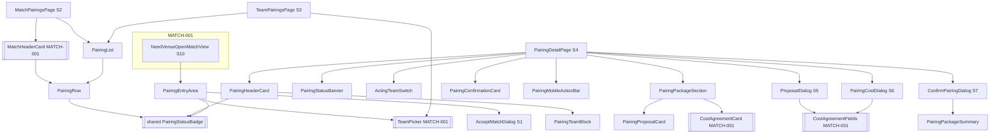

# Component Design — MATCH-002 Thương lượng ghép kèo luồng B (Pairing)

| Mục | Giá trị |
|---|---|
| Mã chức năng | `MATCH-002` |
| Phạm vi tầng | frontend (ArenaFlow-fe) |
| Repo/stack | ArenaFlow-fe · React 19 + TypeScript + Tailwind CSS 4 · React Hook Form + Zod (FE ADR-0005) |
| Nguồn | `UI_Design.md` v1.1 (S1–S7, S4a–S4e, §3) · `docs/agent/upstream/api/MATCH-002/API_Spec.md` v3.1 · MATCH-001 `Component_Design.md` v1.1 (§2, §4, §5.2, §6, §8) · SHARED/APP-SHELL `Component_Design.md` v1.2 |
| Quy ước áp dụng | `docs/agent/convention-frontend.md` §2–§4, §10 · `docs/agent/non-functional-standards.md` §4 |
| Tác giả / Ngày / Phiên bản | `solution-architect` (agent) / `2026-11-27` / `v1.1` (lịch sử: `CHANGELOG.md`) |

> Route, điều hướng, chọn view S4: `Screen_Flow.md` §3. Query key, endpoint, revision, lỗi, số call: `State_API_Integration.md`.
> Mọi thành phần **mới** (repo chưa có code). Đường dẫn bảng §2–§6 tương đối với `src/modules/match/` (module của MATCH-001 — MATCH-001 Component_Design §8.1). Thành phần `shared/` mới → `reuse-scan` trước khi tạo (`CLAUDE.md` §8).
> **Tái dùng từ MATCH-001 (cùng module, import trực tiếp):** `useMatchDetail`, `useMatchViewerTeams`, `useMatchViewer` (qua props), `matchKeys`, `getDisplayStatus`, `MatchHeaderCard`, `CostAgreementCard`, `MoneyInput`, `TeamPicker`, `COST_TYPE_LABELS`, `COST_SPLIT_LABELS`, `buildCostAgreementBody`, `CostAgreementFields` + `costAgreementFieldsSchema` (Screen_Flow §6 C7). **Shared:** SHARED §3 (`Dialog`, `ConfirmDialog`, `AlertBanner`, `Tabs`, `Pagination`, `QueryStateView`, `Breadcrumb`, `SegmentedRadioGroup`, `FormField`, `FormErrorBanner`, `Skeleton`, `Avatar`, `StatusBadge`, `Button`, `useToast`), `useUrlParam`, `useNowMs` (MERCENARY-001 C5), `formatVnd`, `formatVnDateTime`, `formatMatchTimeRange` (MATCH-001 C5, C6), `ROUTE_PATHS` + hàm dựng.
> Không có component trong phòng chat (Screen_Flow §6 C5).

## 1. Cây component



## 2. Component theo màn hình

| Component | Đường dẫn | Loại | Props chính | Trách nhiệm |
|---|---|---|---|---|
| `PairingEntryArea` | `components/detail/pairing-entry-area.component.tsx` | feature | `PairingEntryAreaProps` (MATCH-001 Component_Design §8.3 — giữ nguyên) | Vùng S10 (Screen_Flow §3 S1): đội tạo kèo → link S2; đội khác → `TeamPicker` (> 1 đội) + `useTeamPairingForMatch(teamId, matchId)` → "Nhận kèo" / badge + "Xem thương lượng" + "Nhắn tin"; giữ state mở S1 |
| `AcceptMatchDialog` | `components/pairing/entry/accept-match-dialog.component.tsx` | feature | `open`, `onClose`, `match: MatchDetail`, `team: CaptainTeamOption`, `onMatchChanged`, `onExistingPairing(teamId)` | S1: `ConfirmDialog` tone `primary`, tóm tắt kèo (số lựa chọn địa điểm / khung giờ, `expiresAt`), "Nhận kèo với tư cách <đội>"; `useCreatePairing`; lỗi trong dialog qua prop `error` (State §5.2); `PAIRING_003` → link "Mở thương lượng đã có" gọi `onExistingPairing` |
| `MatchPairingsPage` | `pages/match-pairings.page.tsx` | page | — (`:matchId`, `status`, `page`) | S2: `useMatchDetail` + `useMatchPairings`; `Breadcrumb`, `MatchHeaderCard`, dòng giải thích, `Tabs` trạng thái, `QueryStateView`, `PairingList variant="match"`, `Pagination` |
| `TeamPairingsPage` | `pages/team-pairings.page.tsx` | page | — (`:teamId`, `role`, `status`, `page`) | S3: `useMatchViewerTeams` (ô chọn đội) + `useTeamPairings`; `TeamPicker`, `SegmentedRadioGroup` vai trò, `Tabs` trạng thái, `PairingList variant="team"`, `Pagination` |
| `PairingList` | `components/pairing/list/pairing-list.component.tsx` | feature | `items: PairingSummary[]`, `variant: 'match' \| 'team'`, `perspectiveTeamId: string`, `match?: MatchDetail` (S2 — tra tên phương án) | Desktop bảng (`<th scope="col">`, cột theo UI S2) / mobile thẻ (`useMediaQuery('(min-width: 768px)')`); empty theo UI |
| `PairingRow` | `components/pairing/list/pairing-row.component.tsx` | ui (module) | `item: PairingSummary`, `variant`, `layout: 'row' \| 'card'`, `perspectiveTeamId`, `proposalLabel: string \| null` | Tên đội, uy tín (`interestedTeamReliabilityScore`), `PairingStatusBadge` (theo `getPairingDisplayStatus`), dòng tiến độ (`describePairingProgress` §6), thời điểm, "Mở thương lượng"/"Xem" + "Nhắn tin" (`aria-label` có tên đội kia) |
| `PairingDetailPage` | `pages/pairing-detail.page.tsx` | page | — (`:pairingId`) | S4: kiểm UUID; `usePairingDetail`, `useMatchDetail(pairing.matchId)`, `usePairingViewer`, `usePairingRealtime`, `useNowMs(60_000)`; tính `displayStatus` + `getPairingPermissions`; giữ state dialog đang mở, `conflict` (S4e), `realtimeNotice`; desktop 2 cột (gói 2/3, xác nhận 1/3 sticky), mobile 1 cột + `PairingMobileActionBar`; `<h1>` "Thương lượng ghép kèo" |
| `PairingHeaderCard` | `components/pairing/detail/pairing-header-card.component.tsx` | ui (module) | `pairing: PairingDetail`, `displayStatus`, `match: MatchDetail \| undefined`, `viewerSides: PairingSide[]`, `chatAction: ReactNode` | Badge, "Bộ môn · định dạng" (từ `match`; chưa có → bỏ dòng), "Hạn thương lượng" khi `NEGOTIATING`; 2 `PairingTeamBlock` ("VS" desktop) |
| `PairingTeamBlock` | `components/pairing/detail/pairing-team-block.component.tsx` | ui (module) | `team: PairingTeam`, `role: PairingSide`, `isViewer: boolean` | `Avatar`, tên, "Đội tạo kèo / Đội nhận kèo", chip "Bên của bạn", "Đội trưởng: <captainName ?? '—'>" (hiện nguyên chuỗi BE, gồm "Người dùng đã xóa"), "Uy tín n/100" |
| `ActingTeamSwitch` | `components/pairing/detail/acting-team-switch.component.tsx` | ui (module) | `options: { side; teamId; teamName }[]`, `value`, `onChange` | Chỉ render khi người xem là đội trưởng cả hai đội (BR-M18) — `SegmentedRadioGroup` legend "Thao tác với tư cách" `[cần xác nhận]` #9 |
| `PairingStatusBanner` | `components/pairing/detail/pairing-status-banner.component.tsx` | ui (module) | `pairing`, `displayStatus`, `permissions: PairingPermissions`, `conflict: PairingConflict \| null`, `realtimeNotice: string \| null`, `onDismissNotice` | Một chỗ chọn banner (thứ tự ưu tiên): S4e xung đột (`AlertBanner error`) → S4c thành công (+ link "Xem kèo") → S4d `SUPERSEDED` / `EXPIRED` → đội mình tạm ngưng → địa điểm `INACTIVE` → vừa quá hạn → thông báo realtime (`role="status"`) |
| `PairingPackageSection` | `components/pairing/detail/pairing-package-section.component.tsx` | feature | `pairing`, `permissions`, `changed: { proposal: boolean; cost: boolean }`, `onEditProposal`, `onEditCost` | Tiêu đề "Gói thương lượng" + dòng phụ; nhãn "Vừa thay đổi" (icon + chữ) trên thẻ có `changed` |
| `PairingProposalCard` | `components/pairing/detail/pairing-proposal-card.component.tsx` | ui (module) | `proposal: PairingProposal \| null`, `optionCounts: { venues; times } \| null`, `action?: ReactNode` | Có: tên + địa chỉ sân (nhãn "Đã ngừng hoạt động" khi `venueStatus = INACTIVE`), `formatMatchTimeRange(startsAt, endsAt)`; rỗng: câu S4a |
| `CostAgreementCard` (MATCH-001) | — | ui (module) | `cost`, `action` | Tái dùng nguyên (đã có dòng tiền cọc + người giữ); `action` = "Nhập chi phí" / "Sửa chi phí". Ghi chú "ArenaFlow không thu, giữ hay hoàn tiền…" do `PairingPackageSection` đặt ngay dưới thẻ (không đổi props MATCH-001) |
| `PairingConfirmationCard` | `components/pairing/detail/pairing-confirmation-card.component.tsx` | feature | `pairing`, `permissions`, `viewerSide: PairingSide \| null`, `onConfirm` | Hai dòng xác nhận (icon + "Đã xác nhận <formatVnDateTime>" / "Chưa xác nhận"); vùng nút theo `permissions.confirm` (§6): nút "Xác nhận gói này" (`disabled` + `aria-busy` khi `refreshing`) · "Đã xác nhận, chờ <đội kia>" · câu lý do ẩn nút; dòng phụ UI S4 |
| `PairingMobileActionBar` | `components/pairing/detail/pairing-mobile-action-bar.component.tsx` | ui (module) | `chatHref`, `chatLabel`, `confirm: ReactNode \| null` | `md:hidden`, dính đáy: "Nhắn tin" + nút xác nhận (cùng handler với thẻ) |
| `ProposalDialog` | `components/pairing/detail/proposal-dialog.component.tsx` | feature | `open`, `onClose`, `basePairing: PairingDetail`, `stale: boolean`, `match: MatchDetail`, `actingTeamId`, `onConflict(error)`, `onEnded(error)` | S5: RHF + `proposal.schema.ts` (§3.1), giá trị đầu từ `basePairing`; 2 `fieldset` radio; `useSavePairingProposal`; chọn trùng phương án đang chốt → đóng, không gọi API |
| `PairingCostDialog` | `components/pairing/detail/pairing-cost-dialog.component.tsx` | feature | `open`, `onClose`, `basePairing`, `stale`, `actingTeamId`, `onConflict`, `onEnded` | S6: RHF + `pairing-cost.schema.ts` (§3.2), giá trị đầu từ `basePairing.costAgreement`; `CostAgreementFields` + khối tiền cọc; cảnh báo xoá xác nhận khi có; `useSavePairingCost`; `Dialog` rộng (`max-w-2xl`), mobile toàn màn |
| `ConfirmPairingDialog` | `components/pairing/detail/confirm-pairing-dialog.component.tsx` | feature | `open`, `onClose`, `basePairing`, `stale`, `actingTeamId`, `viewerSide`, `onConflict`, `onEnded`, `onConfirmed(result)` | S7: `ConfirmDialog` tone `primary` + `PairingPackageSummary pairing={basePairing}` (gói đang thấy, không đọc cache); câu theo đội kia đã xác nhận chưa; `useConfirmPairing`; lỗi không đóng dialog → prop `error` |

> **Chung S5–S7:** `baseRevision = basePairing.revision` (State §6.1). `stale = cache.revision ≠ basePairing.revision` (page tính) → `AlertBanner warning` trong dialog + nút chính `disabled`. `onConflict` truyền `basePairing` cho `conflict.previous` (S4e).
| `PairingPackageSummary` | `components/pairing/detail/pairing-package-summary.component.tsx` | ui (module) | `pairing: PairingDetail` | Tóm tắt chỉ đọc phương án + chi phí + khoản khác + cọc (S7); field `null` không hiện dòng |
| `PairingStatusBadge` | `src/shared/components/match-status/pairing-status-badge.component.tsx` | ui (shared) | `status: string` | Screen_Flow §6 C6 — trên `StatusBadge`, chữ + icon (UI §2 "Nhãn cố định") |

> `PairingList`, `PairingRow` dùng ở S2, S3 (cùng module). Không đưa lên `shared/`.

## 3. Form & validation

> Câu lỗi FE theo field (SHARED Component_Design §4); câu là bản nháp UI S6 `[cần xác nhận]` #15. Chống double-submit: nút submit `loading = mutation.isPending`; dialog `dismissible = false` khi đang gửi; `handleSubmit` bỏ qua khi `isPending`.

### 3.1. S5 — `components/pairing/detail/proposal.schema.ts`

| Trường | Điều khiển | Validation client | Map BE (API 2.5) | Hiển thị lỗi |
|---|---|---|---|---|
| `venueId` | `fieldset` legend "Địa điểm" + radio theo `match.venueOptions` (đúng thứ tự); `venueStatus = INACTIVE` → `disabled` + "Đã ngừng hoạt động" | bắt buộc; thuộc `venueOptions` `ACTIVE` | `venueId`; `422 VENUE_002`; `422 PAIRING_008` | Dưới nhóm (`aria-describedby`); `VENUE_002` → "Địa điểm đã ngừng hoạt động" (message BE) |
| `timeOptionId` | `fieldset` "Khung giờ" + radio theo `match.timeOptions` (`formatMatchTimeRange`) | bắt buộc; thuộc `timeOptions` | `timeOptionId`; `422 PAIRING_008` | Dưới nhóm |

- Giá trị đầu: `basePairing.proposal.venueId` / `.timeOptionId` (phương án đang chốt có nhãn "Đang chốt"). Nút "Chốt phương án" `disabled` khi chưa đủ hai mục.
- Cảnh báo "Đổi phương án sẽ xoá xác nhận của cả hai đội." khi `authorConfirmedAt` hoặc `interestedConfirmedAt` ≠ `null`.
- Body: `{ teamId: actingTeamId, revision: baseRevision, venueId, timeOptionId }`.
- `400 VALIDATION_ERROR` → `applyServerValidationErrors` (`venueId`, `timeOptionId`; `revision` / `teamId` / khác → `FormErrorBanner`).

### 3.2. S6 — `components/pairing/detail/pairing-cost.schema.ts`
`costAgreementFieldsSchema` (MATCH-001 §5.2) `.extend({ depositAmount, depositHolder })` `.superRefine((v, ctx) => { refineCostAgreement(v, ctx); refineDeposit(v, ctx) })`.

| Trường | Điều khiển | Validation client | Map BE (API 2.6) |
|---|---|---|---|
| `costType`, `venueAmount`, `drinksAmount`, `costSplit`, `customItems[i]` | `CostAgreementFields` (MATCH-001) — "Không có" = `NONE` | Như MATCH-001 §5.2 (BR-C04) | Như MATCH-001 §5.2 (`fieldMap` dùng chung) |
| `depositAmount` | `MoneyInput` "Tiền cọc (đ)", không bắt buộc | trống = không cọc; có → số nguyên 1..1 000 000 000 | `depositAmount` |
| `depositHolder` | input "Người giữ cọc", bộ đếm `n/100`; `disabled` khi `depositAmount` trống | trim ≤ 100 | `depositHolder` |

- `depositAmount` bị xoá → đặt `depositHolder = ''` (không gửi nội dung khi không có cọc — API 2.6 `400`).
- Giá trị đầu: `basePairing.costAgreement` (`costType = null` → `NONE`).
- Body (`buildPairingCostBody(values, actingTeamId, baseRevision)` — §5): `{ teamId, revision, ...buildCostAgreementBody(values), depositAmount: số \| null, depositHolder: trim \|\| null }`.
- Không có nút "Xoá thoả thuận" riêng (UI S6: chọn "Không có", xoá khoản, xoá cọc rồi lưu).
- Luôn hiện "Mỗi lần lưu thay toàn bộ thoả thuận cũ."; cảnh báo xoá xác nhận khi có xác nhận.
- Lỗi BE `400` không map được field → `FormErrorBanner` "Dữ liệu gửi lên không hợp lệ, vui lòng kiểm tra lại".

### 3.3. S1, S7
Không có trường nhập (xác nhận). S1 gửi `{ teamId }`; S7 gửi `{ teamId: actingTeamId, revision: baseRevision }`.

## 4. Thành phần `shared/` mới

| Thành phần | Đường dẫn | Ghi chú |
|---|---|---|
| `PairingStatus` (`'NEGOTIATING' \| 'CONFIRMED' \| 'SUPERSEDED' \| 'EXPIRED'`), `PAIRING_STATUS_LABELS`, `PAIRING_STATUS_ICONS`, `PairingRoleFilter`, `PairingStatusFilter` | `src/shared/constants/pairing-status.constant.ts` | Nhãn UI §2; dùng ở module `match` và `chat` (badge đầu phòng S13 MATCH-001) — Screen_Flow §6 C6 |
| `PairingStatusBadge` | `src/shared/components/match-status/pairing-status-badge.component.tsx` | Cạnh `MatchStatusBadge` (MATCH-001 C6) |
| `buildPairingDetailPath`, `buildTeamPairingsPath`, `buildMatchPairingsPath` | `src/shared/constants/route-paths.constant.ts` | Screen_Flow §1 |

## 5. Hook / util riêng (module `match`)

| Tên | Đường dẫn | Mục đích |
|---|---|---|
| `usePairingDetail(pairingId)`, `useMatchPairings(matchId, p)`, `useTeamPairings(teamId, p)`, `useTeamPairingForMatch(teamId \| null, matchId)` | `hooks/*.hook.ts` | Query — key / tuỳ chọn: State §3.2 |
| `useCreatePairing`, `useSavePairingProposal`, `useSavePairingCost`, `useConfirmPairing` | `hooks/*.hook.ts` | Mutation — cập nhật cache: State §3.4 |
| `usePairingViewer(pairing \| undefined)` | `hooks/use-pairing-viewer.hook.ts` | Từ `useMatchViewerTeams()` (MATCH-001) → `PairingViewer` = `{ sides: PairingSide[]; actingSide; actingTeamId; setActingSide; actingTeamStatus: 'ACTIVE' \| 'INACTIVE' \| null; ready }` (Screen_Flow §3 S4) |
| `usePairingRealtime(pairing \| undefined, handlers)` | `hooks/use-pairing-realtime.hook.ts` | `useRealtimeSubscription` (SHARED §6) topic `/topic/conversations/{conversationId chữ thường}`; chỉ đọc `PAIRING_UPDATED` có `pairingId` khớp; `subscribe(dest, onFrame, { onError, onReady })` (SHARED v1.2 §6); `onReady(epoch)` → tải lại 2.4 khi dữ liệu có trước lần `SUBSCRIBE` của epoch đó (State §6.3). Nhận `conversationId` từ `location.state` hoặc 2.4 |
| `getPairingDisplayStatus(p: { status; matchExpiresAt }, nowMs)` | `utils/pairing-status.util.ts` | `NEGOTIATING` + `isPastVn(matchExpiresAt, nowMs)` → `EXPIRED` (API §1.3) |
| `getPairingPermissions(input)` | `utils/pairing-permissions.util.ts` | §6 — một nơi, test đủ bảng UI S4 |
| `describePairingProgress(item, perspectiveTeamId)` | `utils/pairing-progress.util.ts` | Dòng tiến độ S2 / S3 (UI: "Chưa chốt phương án", "<đội> đã xác nhận · Bạn chưa", "Hai đội đã xác nhận <confirmedAt>", "Chỉ xem"…) từ `proposalVenueId`, `…ConfirmedAt`, trạng thái hiển thị |
| `getProposalLabel(item, match)` | `utils/pairing-progress.util.ts` | S2: map `proposalVenueId` / `proposalTimeOptionId` vào `match.venueOptions` / `timeOptions` → "<tên sân> · <khung giờ>"; không khớp / `null` → "Chưa chốt" |
| `diffPairingPackage(prev, next)` | `utils/pairing-package-diff.util.ts` | `{ proposal: boolean; cost: boolean }` — nhãn "Vừa thay đổi" (S4e): so `venueId` + `timeOptionId`; so 6 field chi phí + `customItems` theo `itemName` / `amount` (bỏ `itemId`) |
| `classifyPairingWriteError(error)` | `utils/pairing-write-error.util.ts` | Mã lỗi 2.5–2.7 → nhóm hành động (State §5.3) |
| `mergePairingResult(detail, result)` | `utils/pairing-cache.util.ts` | Ghép response 2.5 / 2.6 / 2.7 (field cùng tên §4.2) vào `PairingDetail` trong cache — chỉ khi `result.revision ≥ cache.revision`, ngược lại invalidate (State §3.4) |
| `buildPairingCostBody(values, teamId, revision)` | `utils/pairing-request-body.util.ts` | §3.2 |
| `getPairingConversationId(queryClient, pairingId)` | `utils/pairing-conversation.util.ts` | Cho `useResolveMatchConversation` của MATCH-001 S8 kèo B; `fetchQuery` `staleTime: Infinity` (Screen_Flow §6 C4) |
| `PAIRING_ROLE_FILTERS`, `PAIRING_STATUS_TABS`, `PAIRING_SIDE_LABELS` | `constants/pairing-options.constant.ts` | Nhãn UI S2, S3, S4 |
| `pairingKeys` | `constants/pairing-query-keys.constant.ts` | State §3.1 |

## 6. `getPairingPermissions` — bảng hiển thị nút (UI S4 "Hiển thị nút theo trạng thái")

```ts
/** Đầu vào tính quyền thao tác trên S4; mọi giá trị đã có trong cache, không gọi API. */
interface PairingPermissionInput {
  pairing: PairingDetail
  /** Trạng thái hiển thị đã tính theo matchExpiresAt. */
  displayStatus: PairingStatus
  /** Bên người xem đang thao tác; null = người xem không còn là đội trưởng bên nào. */
  actingSide: PairingSide | null
  /** status của đội đang thao tác (USER-003 2.5); null khi chưa biết. */
  actingTeamStatus: 'ACTIVE' | 'INACTIVE' | null
  /** Đang tải lại 2.4 (sau frame realtime / xung đột). */
  refreshing: boolean
}
/** Kết quả: sửa gói, xác nhận, lý do hiển thị. */
interface PairingPermissions {
  canEditPackage: boolean
  confirm:
    | { kind: 'button'; disabled: boolean }
    | { kind: 'waiting' }                                   // "Đã xác nhận, chờ <đội kia>"
    | { kind: 'hidden'; reason: 'NO_PROPOSAL' | 'VENUE_INACTIVE' | 'TEAM_INACTIVE' | 'CLOSED' | 'NOT_CAPTAIN' }
}
```

| Điều kiện (xét theo thứ tự) | `canEditPackage` | `confirm` |
|---|---|---|
| `actingSide = null` | false | `hidden NOT_CAPTAIN` |
| `displayStatus ≠ NEGOTIATING` (gồm vừa quá hạn) | false | `hidden CLOSED` |
| `actingTeamStatus = INACTIVE` | false | `hidden TEAM_INACTIVE` |
| `proposal = null` | true | `hidden NO_PROPOSAL` |
| `proposal.venueStatus = INACTIVE` | true | `hidden VENUE_INACTIVE` |
| `…ConfirmedAt` bên mình ≠ `null` | true | `waiting` |
| còn lại | true | `button`, `disabled = refreshing` |

- Kiểm lại ngay lúc bấm (S5–S7) bằng `Date.now()` — quá hạn → không mở dialog, tải lại 2.4 (State §6.4).
- "Nhắn tin" luôn hiện (khoá ô chat do 2.19 quyết).

## 7. A11y
- `<h1>`: S2 "Đội đang thương lượng", S3 "Thương lượng ghép kèo", S4 "Thương lượng ghép kèo"; `useDocumentTitle`.
- Badge trạng thái, "Bên của bạn", tình trạng xác nhận, "Vừa thay đổi", "Đã ngừng hoạt động": chữ + icon, không chỉ màu (`non-functional-standards.md` §4).
- Banner realtime `role="status"`; xung đột, lỗi `role="alert"` (`AlertBanner`).
- Dialog S1, S5–S7: `Dialog` / `ConfirmDialog` shared (focus trap, Esc, trả focus về nút mở); S5 hai `fieldset` + `legend`; S6 `fieldset` cho nhóm radio, `MoneyInput` `inputmode="numeric"`, dòng khoản phí mới nhận focus (`CostAgreementFields`).
- Sau S4e: focus tiêu đề "Gói thương lượng" (`tabIndex=-1`) để đọc lại gói mới. Sau S7 `CONFIRMED`: focus `<h1>`.
- Bảng S2: `<th scope>`; nút dòng có `aria-label` kèm tên đội ("Mở thương lượng với Team Beta").
- Bộ lọc vai trò S3: `SegmentedRadioGroup` (`radiogroup`); tab trạng thái: `Tabs` (`tablist`, mobile cuộn ngang).

## 8. `[cần xác nhận]`
> Nội dung đầy đủ + cột **Chặn code?**: `State_API_Integration.md` §9. Mục liên quan file này:

| # | Tóm tắt | Chặn code? |
|---|---|---|
| 3 | Chọn đội ở `PairingEntryArea`, dialog S1 không có radio list | Không |
| 4 | Bỏ "Uy tín n/100" của đội mình ở S1 (USER-003 2.5 không có điểm) | Không |
| 9 | `ActingTeamSwitch` cho đội trưởng cả hai đội | Không |
| 10 | Nhãn "70-30, đội chủ nhà bao 70%" ở luồng B giữ nguyên | Không |
| 15 | Câu validation / toast / banner không có trong SRS | Không |
| 16 | Định dạng khung giờ dùng `formatMatchTimeRange` (khác thứ tự chữ UI S5) | Không |
