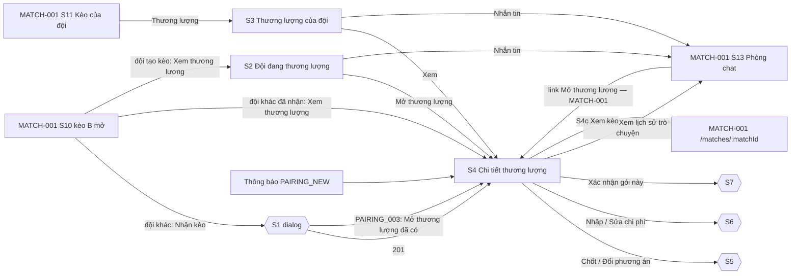

# Screen Flow — MATCH-002 Thương lượng ghép kèo luồng B (Pairing)

| Mục | Giá trị |
|---|---|
| Mã chức năng | `MATCH-002` |
| Phạm vi tầng | frontend (ArenaFlow-fe) — backend: ngoài phạm vi repo này (MATCH-002 `API_Spec.md`) |
| Repo/stack | ArenaFlow-fe · React 19 + TypeScript + Vite · React Router (FE ADR-0003) |
| Nguồn SRS/UI/API | `docs/agent/upstream/business-spec/SYSTEM-001/` — UC-M05, M06, M07, M09, UC-N01, UC-C01, C02 (luồng B); BR-M07, M08, M14, M17..M21, BR-C04, C05, BR-N05 · `UI_Design.md` v1.0 (S1–S7, S4a–S4e) · `docs/agent/upstream/api/MATCH-002/API_Spec.md` · MATCH-001 `API_Spec.md` 2.3, §1.6, §1.7, 2.19 · USER-003 `API_Spec.md` 2.5 |
| Căn cứ | `ArenaFlow-spec@53aee11` · API_Spec `v3.1` (MATCH-001 `v3.2`, USER-003 `v2.0`, NOTIFICATION-001 `v2.0`, SYSTEM-002 `v1.2`) |
| Nền / thiết kế dựa vào | MATCH-001 FE v1.0 (`docs/agent/design/MATCH-001/` — chưa merge, đang review; hợp đồng Component_Design §8) · SHARED/APP-SHELL v1.2 (nhánh `feature/USER-001-user-team`, chưa merge) · FE ADR-0002…0008 (`Proposed`) |
| Quy ước áp dụng | `docs/agent/design-standards.md`, `docs/agent/convention-frontend.md`, `docs/agent/security-frontend.md` |
| Tác giả / Ngày / Phiên bản | `solution-architect` (agent) / `2026-11-27` / `v1.1` (lịch sử: `CHANGELOG.md`) |

> Ba file: `Screen_Flow.md` (file này — route, quyền, điều hướng, **thay đổi cho mã khác §6**) · `Component_Design.md` (cây component, form) · `State_API_Integration.md` (endpoint, query key, realtime, revision, lỗi, số call, **danh sách `[cần xác nhận]` đầy đủ §9**).
> Code đặt trong **module `match`** (`src/modules/match/` — MATCH-001 Component_Design §8.1). Không có module mới, **không có slot** (FE ADR-0010 không cần cho MATCH-002).
> **Phòng chat:** tái dùng nguyên màn chat MATCH-001 (UI_Design §3). MATCH-002 **không** định nghĩa khối nào trong phòng chat; chỉ cấp route + hàm dựng `buildPairingDetailPath(pairingId)` để MATCH-001 đặt link "Mở thương lượng" (0 call) và `PairingStatusBadge` (shared) cho badge `pairingStatus` của 2.19 (§6 C5, C6).
> Hiển thị, nhãn, câu chữ: `UI_Design.md` §2 — **không lặp lại** ở đây. Chỗ lệch UI ghi `[cần xác nhận]`.

## 1. Danh sách màn hình

| # (UI_Design) | Màn hình | Route (`ROUTE_PATHS.*`) / vị trí | Quyền (FE chỉ ẩn/hiện) | Use case |
|---|---|---|---|---|
| S1 | Nhận kèo | Dialog mở từ `PairingEntryArea` trên chi tiết kèo luồng B (MATCH-001 S10, `/matches/:matchId`) | Đội trưởng ≥ 1 đội khác đội tạo kèo | UC-M05, BR-M08, M14, M15, M17, M21 |
| S2 | Đội đang thương lượng | `/matches/:matchId/pairings` (`matchPairings`) | Đội trưởng đội tạo kèo (BE: `403 TEAM_002`) | UC-M05 post, BR-M08 |
| S3 | Thương lượng của đội | `/teams/:teamId/pairings` (`teamPairings`) | Đội trưởng của `teamId` (BE: `403 TEAM_002`) | UC-M06, UC-M07, BR-M21 |
| S4 (S4a–S4e) | Chi tiết thương lượng — một route, view theo trạng thái (§3 S4) | `/pairings/:pairingId` (`pairingDetail`) | Đội trưởng một trong hai đội (BE: `403 PAIRING_002`) | UC-M06, M07, M09, UC-C01, C02 |
| S5 | Chốt phương án | Dialog trên S4 | Bên mình được sửa gói (Component_Design §6 `getPairingPermissions`) | UC-M06 b4, 4a, 4b |
| S6 | Chi phí & tiền cọc | Dialog trên S4 | ″ | UC-C01, UC-C02, BR-C05 |
| S7 | Xác nhận gói | Dialog trên S4 | Bên mình được xác nhận | UC-M07 |

**Thêm vào `src/shared/constants/route-paths.constant.ts`** (PR MATCH-002 — SHARED Screen_Flow §1.2):

| Tên | Giá trị | Hàm dựng URL |
|---|---|---|
| `pairingDetail` | `/pairings/:pairingId` | `buildPairingDetailPath(pairingId)` |
| `teamPairings` | `/teams/:teamId/pairings` | `buildTeamPairingsPath(teamId, { role?: PairingRoleFilter; status?: PairingStatusFilter })` |
| `matchPairings` | `/matches/:matchId/pairings` | `buildMatchPairingsPath(matchId, { status?: PairingStatusFilter })` |

- Ba route khai trong `src/modules/match/routes/match.routes.tsx` (file MATCH-001), nhóm `authenticated` · `MainLayout`, page `lazy` (SHARED Screen_Flow §1.1). Không đụng thứ tự `/matches/new` trước `/matches/:matchId` (MATCH-001 Screen_Flow §1).
- `PairingRoleFilter` = `'ALL' | 'AUTHOR' | 'INTERESTED'`, `PairingStatusFilter` = `'ALL' | PairingStatus` — khai ở `src/shared/constants/pairing-status.constant.ts` (hàm dựng ở `shared/` không import module).
- **Link nội bộ tới S4** (S1 sau 201, vùng S10, S2, S3) truyền `state: { conversationId }` (đã có trong dữ liệu §4.2 / §4.3) để S4 đăng ký realtime trước khi tải 2.4 (State §6.3). Không đưa vào URL. Thiếu `state` (URL gõ tay, thông báo, link từ module `chat`) vẫn chạy đúng.
- **Không thêm mục điều hướng** (nav). Lối vào S3: link trên S11 MATCH-001 (§6 C3) · breadcrumb S4 · URL. Lối vào S2: nút "Xem thương lượng" trên S10 · URL. `[cần xác nhận]` #5, #6.

## 2. Luồng điều hướng

## 3. Chi tiết từng màn hình

### S1 — Nhận kèo (dialog, chủ: `PairingEntryArea`)
- **Vùng nhận kèo** (`PairingEntryArea` trong `NeedVenueOpenMatchView`, chỉ khi `displayStatus = OPEN` — MATCH-001 Screen_Flow §3):

  | Người xem (`viewer` MATCH-001) | Vùng hiển thị |
  |---|---|
  | `viewer.ready = false` | Skeleton nhỏ |
  | Đội trưởng đội tạo kèo | Nút "Xem thương lượng" → `buildMatchPairingsPath(matchId)`. Không "Nhận kèo" bằng đội khác của mình (như MATCH-001 `[cần xác nhận]` #18) |
  | `viewer.sendableTeams` rỗng | Text "Bạn cần là đội trưởng của một đội đang hoạt động để nhận kèo" (UI S1) — không mở dialog |
  | Có đội nhận được | Ô "Nhận kèo bằng đội" (`TeamPicker`, chỉ khi > 1 đội; đội `INACTIVE` disable kèm "(tạm ngưng)"; mặc định đội `ACTIVE` đầu tiên) + trạng thái theo bảng dưới |

  | Thương lượng của đội đang chọn cho kèo này (`useTeamPairingForMatch` — State §3.2) | Hiển thị |
  |---|---|
  | Đang tải | Skeleton nút |
  | Chưa có | Nút "Nhận kèo" → S1; dòng "Hai đội sẽ chat để chốt địa điểm, giờ và chi phí." |
  | Có (mọi trạng thái) | `PairingStatusBadge` + "Xem thương lượng" → `buildPairingDetailPath` + "Nhắn tin" → `buildConversationPath(conversationId)` |
  | Đội đang chọn `INACTIVE` | "Nhận kèo" disable + "Đội đang tạm ngưng hoạt động không nhận kèo được" (BR-M14) |

- **Dialog S1:** xác nhận nhận kèo bằng **đội đang chọn ở vùng** (tên đội hiện trong dialog, không có radio list) `[cần xác nhận]` #3. Tóm tắt lấy từ chi tiết kèo đã tải (2.3 MATCH-001) — 0 call khi mở.
- **Ra tới:** 201 → đóng, toast (UI S4a), `navigate(buildPairingDetailPath(pairingId), { state: { conversationId } })` (push — "Quay lại" về kèo). Lỗi: State §5.2.
- Kiểm lại lúc bấm: quá `expiresAt` → không gửi, gọi `onMatchChanged` (host tải lại → S8).

### S2 — Đội đang thương lượng (`MatchPairingsPage`)
- **Tham số URL** (`useUrlParam`): `status` ∈ `ALL` (mặc định) \| `NEGOTIATING` \| `CONFIRMED` \| `SUPERSEDED` \| `EXPIRED` · `page`. Đổi tab → `replace` + `page = 1`; đổi trang → `push`.
- Thẻ tóm tắt kèo dùng chi tiết kèo (2.3, cache với S10). Breadcrumb: "Kèo <bộ môn · định dạng>" (`buildMatchDetailPath`) › "Đội đang thương lượng".
- **Thao tác dòng:** "Mở thương lượng" → `buildPairingDetailPath`; "Nhắn tin" → `buildConversationPath(conversationId)`. Không có thao tác ghi.
- Kèo không phải luồng B (`match.type ≠ NEED_VENUE` hoặc `422 MATCH_016`) → `<Navigate replace to={buildMatchDetailPath(matchId)}>`.
- **Lỗi:** `403 TEAM_002` → `ErrorState` "Chỉ đội trưởng đội tạo kèo xem được các đội đang thương lượng" + link về kèo (UI S2 "ẩn mục" — trang riêng nên hiện lỗi) · `422 TEAM_016` → `ErrorState` message BE · `404 MATCH_001` / id sai → `ErrorState` "Không tìm thấy kèo" + link `ROUTE_PATHS.matches`.

### S3 — Thương lượng của đội (`TeamPairingsPage`)
- **Tham số URL:** `role` ∈ `ALL` (mặc định) \| `AUTHOR` \| `INTERESTED` · `status` ∈ như S2 · `page`. Đổi lọc → `replace` + `page = 1`; đổi trang → `push`.
- **Ô chọn đội** (`TeamPicker` MATCH-001): đội người xem làm đội trưởng (kể cả `INACTIVE` — API 2.3 cho xem). Đổi đội → `navigate(buildTeamPairingsPath(newId), { replace: true })` (bỏ lọc). `teamId` không thuộc danh sách → không có ô chọn; BE quyết quyền.
- Breadcrumb "Kèo của đội" (`buildTeamMatchesPath(teamId)`) › "Thương lượng ghép kèo" — theo mẫu S12 MATCH-001 `[cần xác nhận]` #6.
- **Thao tác dòng:** "Xem" → `buildPairingDetailPath`; "Nhắn tin" → `buildConversationPath` (luôn có, kể cả chỉ xem — BR-N05). Empty có link "Tìm kèo" → `ROUTE_PATHS.matches`.
- **Lỗi:** `403 TEAM_002` → `ErrorState` "Chỉ đội trưởng xem được thương lượng của đội" · `404 TEAM_001` / id sai → `ErrorState` "Không tìm thấy đội" + link `ROUTE_PATHS.myTeams` · `422 TEAM_016` → `ErrorState` message BE · `400 VALIDATION_ERROR` (URL sửa tay) → về bộ lọc mặc định (`replace`).

### S4 — Chi tiết thương lượng (`PairingDetailPage`)
- **Tải:** 2.4 → (song song) chi tiết kèo 2.3 MATCH-001 theo `matchId` + đội của tôi (cache) — State §4.1. `pairingId` không phải UUID → `ErrorState` như `PAIRING_001`, không gọi API.
- **Bên của người xem** (`usePairingViewer` — Component_Design §6): đội người xem **làm đội trưởng** ∩ {`authorTeam.teamId`, `interestedTeam.teamId`}:
  - 1 phần tử → `actingTeamId` cố định.
  - 2 phần tử (BR-M18) → `SegmentedRadioGroup` "Thao tác với tư cách" (mặc định đội tạo kèo) — chỉ đổi `teamId` gửi ở S5–S7 `[cần xác nhận]` #9.
  - 0 phần tử (vừa chuyển quyền, cache cũ) → chỉ xem; invalidate đội của tôi.
- **Chọn view** theo `displayStatus = getPairingDisplayStatus(pairing, nowMs)` (`NEGOTIATING` + quá `matchExpiresAt` → `EXPIRED`; `useNowMs(60_000)` + kiểm lại lúc bấm):

  | `displayStatus` | Điều kiện thêm | View (UI) |
  |---|---|---|
  | `NEGOTIATING` | `proposal = null` | S4a |
  | `NEGOTIATING` | `proposal ≠ null` | S4b (biến thể "Đã xác nhận, chờ <đội kia>" khi `…ConfirmedAt` bên mình ≠ `null`) |
  | `CONFIRMED` | — | S4c |
  | `SUPERSEDED`, `EXPIRED` | — | S4d |
  | `NEGOTIATING` | vừa nhận `409 PAIRING_006` | S4a/S4b + banner xung đột S4e (State §6.2) |

  - Nút hiện / ẩn: bảng "Hiển thị nút theo trạng thái" UI S4 → một hàm `getPairingPermissions` (Component_Design §6).
  - Vừa qua `matchExpiresAt` khi dữ liệu còn `NEGOTIATING` → khoá nút ngay và tải lại 2.4 **một lần** (BE trả `EXPIRED`) — State §6.4.
- **Thao tác:** "Chốt phương án" / "Đổi phương án" → S5 · "Nhập chi phí" / "Sửa chi phí" → S6 · "Xác nhận gói này" → S7 · "Nhắn tin với <đội kia>" / "Xem lịch sử trò chuyện" → `buildConversationPath(conversationId)` · S4c "Xem kèo" → `buildMatchDetailPath(matchId)`.
- **Breadcrumb:** "Kèo của đội" (`buildTeamMatchesPath(actingTeamId)`) › "Thương lượng ghép kèo" (`buildTeamPairingsPath(actingTeamId)`) › "<đội kia>" `[cần xác nhận]` #7 (UI: "Đội của tôi › <đội> › Thương lượng"). Mobile: nút quay lại → `navigate(-1)`; không có lịch sử → `buildTeamPairingsPath(actingTeamId)`.
- **Realtime:** đăng ký topic cuộc trò chuyện của thương lượng khi đang ở S4 (`conversationId` từ `location.state`, không có thì từ 2.4); tải lại 2.4 theo `onReady(epoch)`; rời S4 → huỷ (State §6.3).
- **Lỗi tải:** `404 PAIRING_001` → `ErrorState` message BE + "Về danh sách" (`buildTeamPairingsPath` của đội đầu tiên làm đội trưởng; không có → `ROUTE_PATHS.matches`) · `403 PAIRING_002` → `ErrorState` message BE + "Quay lại" (`navigate(-1)`).

### S5 / S6 / S7 — dialog trên S4
- Mở chỉ khi `getPairingPermissions` cho phép; **chụp gói lúc mở** (`basePairing`, `baseRevision`): dialog hiển thị `basePairing` và gửi đúng `baseRevision` (API §1.4); gói trong cache đổi khi dialog đang mở → cảnh báo + khoá nút — State §6.1.
- Thành công → đóng, toast (UI), S4 cập nhật từ response. S7 trả `CONFIRMED` → view tự đổi sang S4c (cùng URL) + toast "Đã ghép kèo".
- Lỗi → State §5.4–§5.6 (đóng / giữ dialog theo từng mã).
- Đóng: Esc / nền / "Huỷ" khi không gửi; đang gửi → `dismissible = false`.

## 4. Route guard & phân quyền
- S2, S3, S4: `AuthGuard` (nhóm `authenticated`) — SHARED Screen_Flow §2. Không có guard vai trò đội trưởng; quyền thật ở BE (`TEAM_002`, `PAIRING_002`) — `security-frontend.md` §5.
- Nút ghi trên S4 hiện theo bên của người xem + `status` đội (đội của tôi, USER-003 2.5): đội mình `INACTIVE` → ẩn sửa / xác nhận + banner (BR-M14, API §1.2).
- Phòng chat: quyền và khoá ô chat theo 2.19 / `canSend` (MATCH-001), **không** suy từ `status` thương lượng (API §3 "Gợi ý hiển thị nút").

## 5. Điều hướng từ thông báo (cho NOTIFICATION-001)

| `referenceType` | Loại (NOTIFICATION-001 API §4.3) | Đích |
|---|---|---|
| `PAIRING` | `PAIRING_NEW` | `buildPairingDetailPath(referenceId)` |
| `MATCH` | `PAIRING_SUPERSEDED`, `PAIRING_EXPIRED` | `buildMatchDetailPath(referenceId)` (MATCH-001 Screen_Flow §5 — không đổi) |

## 6. Thay đổi cho MATCH-001 / SHARED / mã khác (nguồn duy nhất)

> MATCH-002 **không** sửa các file này; chủ thiết kế áp qua vòng lặp design của mã đó. "Chặn code?" là với phần MATCH-002 phụ thuộc.

| # | File · mục | Cũ | Mới | Chặn code? |
|---|---|---|---|---|
| C1 | MATCH-001 `Screen_Flow.md` §1 (bảng route + bảng hằng) | Chưa có route MATCH-002 | Ghi nhận 3 dòng §1 file này (`pairingDetail`, `teamPairings`, `matchPairings` + 3 hàm dựng); khai trong `match.routes.tsx` ở PR MATCH-002 | Không (PR MATCH-002 thêm) |
| C2 | MATCH-001 `Screen_Flow.md` §3 S10 + `Component_Design.md` §8.3 | "Vùng 'Nhận kèo' / 'Xem thương lượng': MATCH-002 cắm vào"; props `PairingEntryAreaProps` | **Chấp nhận nguyên props** §8.3. Ghi rõ: vùng tự chọn đội nhận kèo (mẫu S5 "Gửi yêu cầu bằng đội") và tự gọi MATCH-002 2.3 cho đội đang chọn (**+1 call** S10 phía đội khác — State §1; nằm trong "MATCH-002 còn tối đa 1 call ở (A)" của MATCH-001 State §1). Đội trưởng đội tạo kèo: "Xem thương lượng" → `buildMatchPairingsPath` (0 call) | Không |
| C3 | MATCH-001 `Screen_Flow.md` §3 S11 + `UI_Design.md` S11 | Link "Yêu cầu đã gửi" (chỉ đội trưởng) | Thêm link "Thương lượng" → `buildTeamPairingsPath(teamId)` cùng điều kiện; 0 call. Đổi UI → `ui-designer` | Không (S3 vào được qua breadcrumb S4 / URL) |
| C4 | MATCH-001 `Component_Design.md` §8.3, `State_API_Integration.md` §4.3 | `getPairingConversationId(pairingId)` (gọi 2.4 lúc bấm) | `getPairingConversationId(queryClient, pairingId): Promise<string>` — `src/modules/match/utils/pairing-conversation.util.ts`; `fetchQuery({ queryKey: pairingKeys.detail(pairingId), staleTime: Infinity })` (`conversationId` không đổi → có cache 2.4 thì không gọi). Lỗi → ném `ApiError`; `useResolveMatchConversation` xử lý như MATCH-001 `[cần xác nhận]` #8 | Không |
| C5 | MATCH-001 `Component_Design.md` §7 (dòng slot `conversationPairingPanel`), §8.4 · `State_API_Integration.md` §1 (dòng "S13 luồng B"), bảng ngưỡng S13, §8 #4, #24 | Slot `conversationPairingPanel` do MATCH-002 sở hữu, +1 call S13 luồng B | **Bỏ slot** (coordinator 2026-11-27 — ngoài UI đã duyệt). Phòng chat luồng B: link "Mở thương lượng" → `buildPairingDetailPath(pairingId)` (`pairingId` của 2.19, 0 call) + badge `PairingStatusBadge` theo `pairingStatus` 2.19 — MATCH-001 tự đặt. S13 luồng B đếm call như luồng A; đóng nhánh "luồng B" của MATCH-001 #4. **Đã áp** (MATCH-001 đã bỏ slot) | Không |
| C6 | MATCH-001 `Component_Design.md` §8.4 (badge) · SHARED `Component_Design.md` §3 + §5 | "`PAIRING_STATUS_LABELS` + `PairingStatusBadge` do MATCH-002 tạo ở `src/shared/`" | Chốt: `src/shared/constants/pairing-status.constant.ts` (`PairingStatus`, `PAIRING_STATUS_LABELS`, `PAIRING_STATUS_ICONS`, `PairingRoleFilter`, `PairingStatusFilter`) + `src/shared/components/match-status/pairing-status-badge.component.tsx` (`PairingStatusBadge`, props `status: string` — giá trị lạ → "Không xác định", tone `neutral`). Module `match` và `chat` cùng dùng | Không (mã code trước tạo, `reuse-scan`) |
| C7 | MATCH-001 `Component_Design.md` §2 (`CostAgreementDialog`), §5.2 (`cost-agreement.schema.ts`, `buildCostAgreementBody`) | Form chi phí nằm trọn trong dialog S7; schema không export phần dùng lại | Tách `CostAgreementFields` (`components/form/cost-agreement-fields.component.tsx` — loại chi phí, 2 ô tiền, cách chia, khoản khác; nhận `control`, `errors` RHF) và export `costAgreementFieldsSchema` (object, chưa refine) + `refineCostAgreement(value, ctx)` để S6 MATCH-002 ghép tiền cọc. `buildCostAgreementBody` giữ nguyên | Không — chưa tách thì PR MATCH-002 tách (`reuse-scan`), S7 MATCH-001 dùng lại |
| C8 | SHARED `State_API_Integration.md` §4 (bảng `QUERY_ROOTS`) | `'pairing'` — "thêm khi thiết kế" | `'pairing'` → module `match` (MATCH-002), factory `pairingKeys` ở `src/modules/match/constants/pairing-query-keys.constant.ts` (State §3.1) — đóng phần key của MATCH-001 `[cần xác nhận]` #24 | Không |
| C9 | NOTIFICATION-001 `Screen_Flow.md` §5 dòng `PAIRING`; §6 #5 | "chưa có — đề xuất `buildPairingDetailPath(pairingId)`" | Chốt `buildPairingDetailPath(pairingId)` → `/pairings/:pairingId` (§5 file này) | Không với MATCH-002 |
| C10 | MATCH-002 `UI_Design.md` (qua `ui-designer`) | S1 radio list đội + "Uy tín n/100"; S2 vị trí chưa chốt; S3/S4 breadcrumb "Đội của tôi" | Theo thiết kế này: chọn đội ở vùng S10, bỏ uy tín đội mình (#3, #4); S2 trang riêng (#5); breadcrumb "Kèo của đội" (#6, #7) — cập nhật khi chạy lại `ui-designer` sinh mockup (UI_Design §4 #1) | Không |
| C11 | MATCH-001 `Screen_Flow.md` §3 S8 (kèo B) | Không có lối vào thương lượng từ kèo B đã ghép | Đề xuất (tuỳ chọn): kèo B `CONFIRMED` → link "Xem thương lượng" `buildPairingDetailPath(confirmedPairingId)` cho đội trưởng hai đội; kèo B `EXPIRED` / `CANCELLED` không có (đội vào qua S3 / chat) `[cần xác nhận]` #17 | Không |
| C12 | MATCH-001 `Screen_Flow.md` §3 S13 (link "Mở thương lượng" luồng B) | `buildPairingDetailPath(pairingId)` | Thêm `state: { conversationId }` khi điều hướng (giảm deep link S4 — State §6.3, `[cần xác nhận]` #14 phương án iii); 0 call | Không |

## 7. `[cần xác nhận]`
> Đánh số chung 3 tài liệu; nội dung đầy đủ, phương án và cột **Chặn code?**: `State_API_Integration.md` §9. Mục liên quan file này:

| # | Tóm tắt | Chặn code? |
|---|---|---|
| 1 | Nền SHARED + MATCH-001 chưa merge; FE ADR-0002…0008 `Proposed` | **Có** — toàn bộ |
| 2 | Ngưỡng (B)/(C) khi tính request khung | **Có** — S2, S3, S4, vùng S10 tới khi chốt |
| 3 | Chọn đội nhận kèo ở vùng S10 thay radio trong dialog S1 | Không |
| 5 | S2 là trang riêng, vào từ "Xem thương lượng" S10 | Không |
| 6 | Lối vào S3 từ S11, không có mục nav | Không |
| 7 | Breadcrumb S4 "Kèo của đội › Thương lượng ghép kèo" | Không |
| 9 | Đội trưởng cả hai đội: "Thao tác với tư cách" | Không |
| 14 | Deep link S4 tải 2.4 hai lần (`onReady` đầu) → tối đa 4 ở (A) | **Có** — chỉ lần tải lại đó; trước khi chốt bỏ lần tải lại |
| 17 | Lối vào thương lượng từ kèo B đã ghép (C11) | Không |
