# Component Design — MERCENARY-001 Tuyển mercenary, ứng tuyển, chat theo đơn, uy tín cá nhân

| Mục | Giá trị |
|---|---|
| Mã chức năng | `MERCENARY-001` |
| Phạm vi tầng | frontend (ArenaFlow-fe) |
| Repo/stack | ArenaFlow-fe · React 19 + TypeScript + Tailwind CSS 4 · React Hook Form + Zod (FE ADR-0005) |
| Nguồn | `UI_Design.md` v1.0 (S1–S21, §3) · `docs/agent/upstream/api/MERCENARY-001/API_Spec.md` v3.0 · khung `docs/agent/design/SHARED/APP-SHELL/Component_Design.md` v1.2 · REPUTATION-001 `Component_Design.md` §3, §6 · VENUE-001 `Component_Design.md` §7 |
| Căn cứ | `ArenaFlow-spec@53aee11` · API_Spec `v3.0` |
| Quy ước áp dụng | `docs/agent/convention-frontend.md` §2–§4, §10 · `docs/agent/non-functional-standards.md` §4 · FE ADR-0010 (slot) |
| Tác giả / Ngày / Phiên bản | `solution-architect` (agent) / `2026-11-27` / `v1.3` (lịch sử: `CHANGELOG.md`) |

> Route, điều hướng, trạng thái màn: `Screen_Flow.md`. Query key, endpoint, bảng lỗi: `State_API_Integration.md`.
> Mọi thành phần **mới** (repo chưa có code). Đường dẫn bảng §2 tương đối với `src/modules/mercenary/`. Trước khi tạo thành phần `shared/` → `reuse-scan` (`CLAUDE.md` §8).

## 1. Cây component

```mermaid
graph TD
  subgraph HM [Host MATCH-001]
    MDP[match detail page] -. slot matchMercenarySection .-> MMS
    CHP[chat room page] -. slot conversationApplicationHeader .-> CAH
  end
  subgraph HR [Host REPUTATION-001 S6]
    TRP[team reports page · scope=mercenary] -. slot teamMercenaryReportsPanel .-> TMRP
  end
  MMS[MatchMercenarySection] --> RD[RecruitDialog S1] --> PQP[PositionQuantityPicker]
  CAH[ConversationApplicationHeader S19] --> ACD[ApplicationConfirmDialogs S5]
  CAH --> RMD[RateDialog S8]
  CAH --> RPD[ReportDialog S9] --> RTR[[shared ReportTypeRadioGroup]]
  TMRP[TeamMercenaryReportsPanel S10] --> MRC[MercenaryReportCard] -. slot reportDisputeDialog .-> RDD[[REPUTATION-001 ReportDisputeDialog]]
  S2[TeamMercenaryPage S2] --> RGL[RecruitmentGroupList] --> RRow[RecruitmentRow]
  S2 --> EML[ExternalMatchList]
  RRow --> EQD[EditQuantityDialog S4]
  RRow --> ACD
  S3[RecruitmentApplicantsPage S3] --> RSC[RecruitmentSummaryCard] & AC[ApplicantCard] --> PRS[PersonalReputationSummary]
  AC --> ACD & RMD & RPD
  S6[ExternalMatchNewPage S6] --> EMF[ExternalMatchForm] --> VPF[VenuePickerField] --> VPD[VenuePickerDialog] --> VS[[shared VenueSearchBar · VenueCard]]
  EMF --> PQP
  S7[ExternalMatchDetailPage S7] --> EMF
  S7 --> APD[AddPositionsDialog] --> PQP
  S11[TeamMercenaryRatingsPage S11] --> MRR[MercenaryRatingRow] --> SRD[[shared StarRatingDisplay]]
  S12[MercenarySearchPage S12] --> SF[RecruitmentSearchFilters] & RC[RecruitmentCard]
  S13[RecruitmentDetailPage S13] --> RAB[RecruitmentActionBar] --> WD[WithdrawDialog S16]
  S13 --> LVB[LockedVenueNotice · VenueInfoCard]
  S14[MyApplicationsPage S14] --> MAC[MyApplicationCard] --> WD & RMD
  S15[ApplicationDetailPage S15] --> VIC[VenueInfoCard] & WD & RMD & RPD
  S17[MyMercenaryReportsPage S17] --> MRC
  S18[UserReputationPage S18] --> PRC[PersonalReputationCard] --> RLB[[shared ReliabilityLevelBadge]]
  S20[AdminMercenaryDisputeListPage S20] --> ADT[AdminMercenaryDisputeTable · Card]
  S21[AdminMercenaryDisputeDetailPage S21] --> DRF[MercenaryDisputeResolveForm] & DRS[MercenaryDisputeResolutionSummary]
```



## 2. Component của module `mercenary`

| Component | Đường dẫn | Loại | Props chính | Trách nhiệm |
|---|---|---|---|---|
| `MatchMercenarySection` | `components/match-section/match-mercenary-section.component.tsx` | feature (slot) | `MatchMercenarySectionProps` (§6.1) | Nút "Tuyển mercenary" + link "Tin tuyển mercenary của <đội>" theo Screen_Flow S1; không gọi API khi tải; giữ `open` của `RecruitDialog` |
| `RecruitDialog` | `components/recruit/recruit-dialog.component.tsx` | feature | `open`, `onClose`, `matchId`, `teams: SlotTeamRef[]` (1–2 đội người xem làm đội trưởng), `onCreated(teamId)`, `onMatchChanged` | S1 — radio "Tuyển cho đội" khi `teams.length = 2` (`SegmentedRadioGroup`); `useTeamRecruitments` (tin `ACTIVE` của trận) → vị trí khoá; form §4.1; `useCreateRecruitments` |
| `AddPositionsDialog` | `components/recruit/add-positions-dialog.component.tsx` | feature | `open`, `onClose`, `externalMatchId`, `teamId`, `lockedPositions: ReadonlySet<PlayerPosition>` | Dialog "Thêm vị trí" ở S7 — form §4.1 không có chọn đội; `useAddExternalPositions` |
| `PositionQuantityPicker` | `components/recruit/position-quantity-picker.component.tsx` | ui (module) | `value: PositionDraft[]`, `onChange`, `locked: Partial<Record<PlayerPosition, ReactNode>>`, `disabledIncreaseAbove?: number`, `errors?` | 4 dòng checkbox + bộ tăng giảm 1–10 (UI_Design S1 a11y); dòng khoá hiện `locked[position]` (ghi chú + link) |
| `TeamMercenaryPage` | `pages/team-mercenary.page.tsx` | page | — (`:teamId`, `tab`, `status`, `matchId`, `page`) | S2 — `useTeamHeader` + tab; `Breadcrumb`, `<h1>` "Tuyển mercenary", `Tabs` (Tin tuyển / Trận ngoài), `SegmentedRadioGroup` bộ lọc trạng thái (Screen_Flow §6 C16), `QueryStateView`, `Pagination`; banner đội `INACTIVE` |
| `RecruitmentGroupList` | `components/team/recruitment-group-list.component.tsx` | feature | `items: Recruitment[]`, `teamStatus` | Gom tin theo trận (`groupRecruitmentsByMatch`, §5), tiêu đề nhóm UI_Design S2 |
| `RecruitmentRow` | `components/team/recruitment-row.component.tsx` | feature | `recruitment: Recruitment`, `teamStatus`, `showMatchLine?: boolean` | Vị trí, `RecruitmentStatusBadge`, "Đã duyệt x/y", badge "n đơn chờ duyệt", nút theo Screen_Flow S2; giữ state dialog S4 / S5 đóng tin. Dùng ở S2, S7 |
| `ExternalMatchList` | `components/team/external-match-list.component.tsx` | feature | `items: ExternalMatch[]`, `activeId?` | Thẻ trận ngoài (giờ, sân, đối thủ, `ExternalMatchStatusBadge`) → S7; dùng ở S2 tab trận ngoài và cột trái S7 |
| `RecruitmentApplicantsPage` | `pages/recruitment-applicants.page.tsx` | page | — (`:recruitmentId`, `status`, `page`) | S3 — `useRecruitmentDetail(id, null)` + `useApplicants`; `Tabs` trạng thái đơn |
| `RecruitmentSummaryCard` | `components/applicants/recruitment-summary-card.component.tsx` | feature | `recruitment: Recruitment` | Thẻ tóm tắt tin S3 + nút "Sửa số lượng", "Đóng tin" |
| `ApplicantCard` | `components/applicants/applicant-card.component.tsx` | feature | `applicant: Applicant`, `recruitment: Recruitment`, `tabStatus` | Avatar, tên, vị trí ưa thích, `PersonalReputationSummary`, "Ứng tuyển lúc …"; nút theo Screen_Flow S3; giữ state dialog S5 / S8 / S9 |
| `ApplicationConfirmDialogs` | `components/applicants/application-confirm-dialogs.component.tsx` | feature | `action: { kind: 'approve' \| 'reject'; applicationId; applicantName } \| null`, `recruitment: { recruitmentId; teamId; quantityApproved; quantityNeeded }`, `onClose`, `onDone?` | S5 duyệt / từ chối bằng `ConfirmDialog`; `useApproveApplication` / `useRejectApplication`. Dùng ở S3, S19 |
| `CloseRecruitmentDialog` | `components/team/close-recruitment-dialog.component.tsx` | feature | `recruitment`, `open`, `onClose` | S5 đóng tin — `ConfirmDialog` `tone="danger"`; `useCloseRecruitment` |
| `EditQuantityDialog` | `components/team/edit-quantity-dialog.component.tsx` | feature | `recruitment: Recruitment`, `open`, `onClose` | S4 — form §4.2; `useUpdateRecruitmentQuantity` |
| `ExternalMatchNewPage` | `pages/external-match-new.page.tsx` | page | — (`:teamId`, `state.createdVenue`) | S6 — `useTeamHeader`; `ExternalMatchForm mode="create"` (chọn sẵn `state.createdVenue` nếu có); `useCreateExternalMatch` |
| `ExternalMatchForm` | `components/external-match/external-match-form.component.tsx` | feature | `mode: 'create' \| 'edit'`, `defaultValues`, `locks: { venueTimeSkill: boolean; all: boolean }`, `onSubmit`, `pending`, `serverError?` | Form §4.3 (create: + vị trí) / §4.4 (edit); ô khoá `disabled` + icon + chú thích |
| `VenuePickerField` | `components/external-match/venue-picker-field.component.tsx` | feature | `value: PickedVenue \| null`, `onChange`, `disabled?`, `error?`, `returnTo: string` | Hiện sân đã chọn (tên, địa chỉ) + nút "Chọn sân" / "Đổi sân"; link "Chưa có sân? Thêm địa điểm" |
| `VenuePickerDialog` | `components/external-match/venue-picker-dialog.component.tsx` | feature | `open`, `onClose`, `onPick(venue: PickedVenue)` | `useVenueSearchState({ storage: 'memory' })` + shared `VenueSearchBar` + `VenueCard variant="row"` với `action` "Chọn"; `useVenuePicker` (VENUE-001 §7.1); `Pagination`; dòng "Chưa có sân? Thêm địa điểm" ở cuối danh sách. Trùng phần trình bày với bộ chọn sân của MATCH-001 → cân nhắc đưa phần trình bày lên `shared/` khi `reuse-scan` (`[cần xác nhận]` #24) |
| `ExternalMatchDetailPage` | `pages/external-match-detail.page.tsx` | page | — (`:teamId`, `:externalMatchId`, `state.phase`) | S7 — `useExternalMatch` + `useExternalMatchRecruitments`; cột trái `ExternalMatchList` từ cache; `ExternalMatchForm mode="edit"`; vùng nguy hiểm "Huỷ trận ngoài" (`ConfirmDialog`, `useCancelExternalMatch`); `AddPositionsDialog` |
| `RateDialog` | `components/review/rate-dialog.component.tsx` | feature | `open`, `onClose`, `applicationId`, `side: 'TEAM' \| 'MERCENARY'`, `targetName`, `subtitle`, `onNoShowSubmitted?` | S8 — `useApplicationRatings` khi mở; `given` → `RatingResultView`; không → form §4.4; `useRateApplication` |
| `RatingResultView` | `components/review/rating-result-view.component.tsx` | feature | `given: MercenaryRating`, `received: MercenaryRating \| null`, `targetName` | Kết quả đã gửi / nhận: `StarRatingDisplay` hoặc "Không đến", nhận xét, "Đã gửi <formatVnDateTime>" |
| `ReportDialog` | `components/review/report-dialog.component.tsx` | feature | `ReportDialogProps` (dưới bảng) | S9 — tải loại đã report khi mở; `ReportTypeRadioGroup`; form §4.5; `useReportApplication` |
| `TeamMercenaryReportsPanel` | `components/reports/team-mercenary-reports-panel.component.tsx` | feature (slot) | `TeamMercenaryReportsPanelProps` (§6.3) | S10 — `useTeamMercenaryReports`; danh sách `MercenaryReportCard` + `Pagination`; giữ `disputeTarget` mở slot `reportDisputeDialog` |
| `MercenaryReportCard` | `components/reports/mercenary-report-card.component.tsx` | feature | `report: MercenaryReport`, `viewpoint: 'TEAM' \| 'SELF'`, `nowMs`, `onDispute(report)` | Thẻ UI_Design S10 / S17: bên kia (mercenary hoặc đội), giờ trận + nhãn "Trận ngoài hệ thống", `ReportTypeChip`, `ReportStatusBadge`, lý do, "Điểm bị trừ: −n" (`RECEIVED`), "Hạn tranh chấp" + "Tranh chấp" khi `isDisputeOpen`, bằng chứng tranh chấp, "Đã hoàn n điểm" (`REJECTED`) |
| `TeamMercenaryRatingsPage` | `pages/team-mercenary-ratings.page.tsx` | page | — (`:teamId`, `page`) | S11 — `useTeamHeader` + `useTeamMercenaryRatings`; ghi chú UI_Design S11 |
| `MercenaryRatingRow` | `components/ratings/mercenary-rating-row.component.tsx` | feature | `rating: TeamMercenaryRating` | Avatar + tên ("Người dùng đã xóa" do BE trả), `StarRatingDisplay`, giờ trận + nhãn trận ngoài, nhận xét |
| `MercenarySearchPage` | `pages/mercenary-search.page.tsx` | page | — (`position`, `radiusKm`, `page`) | S12 — `useGeolocation`, `useRecruitmentSearch`; banner GPS `role="status"`; `QueryStateView`, `Pagination` |
| `RecruitmentSearchFilters` | `components/search/recruitment-search-filters.component.tsx` | feature | `mode: 'gps' \| 'area'`, `radiusKm`, `onRadiusChange`, `position`, `onPositionChange`, `onRequestLocation` | Chỉ báo vị trí, thanh trượt 1–20 km (`<input type="range">`, `aria-valuetext` "n km", ẩn ở `area`), chọn "Vị trí cần" (`SegmentedRadioGroup`: Tất cả + 4 vị trí) |
| `RecruitmentCard` | `components/search/recruitment-card.component.tsx` | feature | `recruitment: Recruitment`, `coords: Coords \| null` | Thẻ UI_Design S12: không tên sân / địa chỉ / toạ độ; khoảng cách `formatDistanceKm` + " từ bạn"; `area` "phường, tỉnh"; nhãn trận ngoài, "Bạn đã ứng tuyển"; link S13 kèm `state.coords` |
| `RecruitmentDetailPage` | `pages/recruitment-detail.page.tsx` | page | — (`:recruitmentId`, `state.coords`) | S13 — `useRecruitmentDetail(id, coords)`; khối trận, `LockedVenueNotice` / `VenueInfoCard`, khối đội tuyển, `RecruitmentActionBar` |
| `RecruitmentActionBar` | `components/detail/recruitment-action-bar.component.tsx` | feature | `recruitment: Recruitment` | Nút / lý do theo Screen_Flow S13; `useApplyRecruitment`; lỗi chặn giữ trong state trang; mobile cố định cuối màn |
| `LockedVenueNotice` | `components/detail/locked-venue-notice.component.tsx` | ui (module) | `variant: 'search' \| 'detail'` | Icon khoá + chữ "Tên sân và địa chỉ chỉ hiện sau khi bạn được duyệt" (S12) / "…và tên đội trưởng sẽ hiện…" (S13) |
| `VenueInfoCard` | `components/detail/venue-info-card.component.tsx` | ui (module) | `venue: RecruitmentVenue`, `captainName: string \| null` | Tên sân, địa chỉ, toạ độ dạng chữ, "Đội trưởng: …" (S13 đã duyệt, S15) |
| `MyApplicationsPage` | `pages/my-applications.page.tsx` | page | — (`status`, `page`) | S14 — `useMyApplications`; `SegmentedRadioGroup` bộ lọc trạng thái (Screen_Flow §6 C16); link "Report của tôi" |
| `MyApplicationCard` | `components/my/my-application-card.component.tsx` | feature | `application: MercenaryApplication` | Thẻ UI_Design S14; nút theo Screen_Flow S14; giữ state S16 / S8 |
| `ApplicationDetailPage` | `pages/application-detail.page.tsx` | page | — (`:applicationId`) | S15 — `useApplicationDetail`; phân luồng đội trưởng → `<Navigate>` S3; màn ứng viên |
| `WithdrawDialog` | `components/my/withdraw-dialog.component.tsx` | feature | `application: { applicationId; status: 'PENDING' \| 'APPROVED'; recruitmentId; startsAt }`, `open`, `onClose` | S16 — `ConfirmDialog` (`cancelLabel` "Giữ đơn") + bảng mức trừ; `estimateWithdrawPenalty`; `useWithdrawApplication` |
| `MyMercenaryReportsPage` | `pages/my-mercenary-reports.page.tsx` | page | — (`tab`, `page`) | S17 — `useMyMercenaryReports`; `Tabs`; `MercenaryReportCard viewpoint="SELF"`; slot `reportDisputeDialog` |
| `UserReputationPage` | `pages/user-reputation.page.tsx` | page | — (`:userId`, `state.displayName`) | S18 — `useUserReputation`; `PersonalReputationCard`; link S17 khi `userId = session.userId` |
| `PersonalReputationCard` | `components/reputation/personal-reputation-card.component.tsx` | feature | `reputation: PersonalReputation` | 4 ô UI_Design S18: điểm "n / 100" + `ReliabilityLevelBadge`; tỉ lệ hoàn thành hoặc "Mới tham gia x/5 trận" + thanh tiến độ (`<progress>` có nhãn); sao TB `formatDecimalVi` + "(n đánh giá)" / "Chưa có đánh giá"; huy hiệu "Đã xác minh" / "Chưa xác minh" + chú thích 4 điều kiện |
| `PersonalReputationSummary` | `components/reputation/personal-reputation-summary.component.tsx` | feature | `reputation: ApplicantReputation` | Khối rút gọn trong `ApplicantCard` (UI_Design S3): điểm + nhãn mức, "Mới tham gia x/5" / "Tỉ lệ hoàn thành n%", "★ 4,7 (3 đánh giá)", "Đã xác minh"; `aria-label` như UI_Design S18 |
| `ConversationApplicationHeader` | `components/conversation/conversation-application-header.component.tsx` | feature (slot) | `ConversationApplicationHeaderProps` (§6.2) | S19 — `useApplicationDetail` (thẻ tóm tắt), `useApplicationRealtime`; `Menu` "Report"; nút nhanh đội trưởng; dòng khoá theo lý do |
| `AdminMercenaryDisputeListPage` | `pages/admin-mercenary-dispute-list.page.tsx` | page | — (`status`, `page`) | S20 — `Tabs` 3 trạng thái, `QueryStateView`, `Pagination` |
| `AdminMercenaryDisputeTable` / `AdminMercenaryDisputeCard` | `components/admin/admin-mercenary-dispute-table.component.tsx`, `admin-mercenary-dispute-card.component.tsx` | feature | `items: AdminMercenaryDispute[]` | Bảng desktop (`hidden md:table`, `<th scope="col">`, cột UI_Design S20) / thẻ mobile; "Đội → Mercenary" / "Mercenary → Đội" theo `reporterSide`; `StatusBadge` trạng thái đội ≠ `ACTIVE`; `DeletedAccountTag` |
| `AdminMercenaryDisputeDetailPage` | `pages/admin-mercenary-dispute-detail.page.tsx` | page | — (`:disputeId`) | S21 — `useAdminMercenaryDispute`; khối trận, hai cột đội / mercenary, khối report, bằng chứng, `RatingResultView` cho `ratings` (0–2), ghi chú "Admin không xem được nội dung chat." |
| `MercenaryDisputeResolveForm` | `components/admin/mercenary-dispute-resolve-form.component.tsx` | feature | `dispute: AdminMercenaryDisputeDetail` | Form §4.6; `useResolveMercenaryDispute` |
| `MercenaryDisputeResolutionSummary` | `components/admin/mercenary-dispute-resolution-summary.component.tsx` | feature | `dispute: AdminMercenaryDisputeDetail` | "Quyết định: …", ghi chú, người xử lý + `DeletedAccountTag`, thời điểm |
| `RecruitmentStatusBadge`, `ApplicationStatusBadge`, `ExternalMatchStatusBadge`, `ExternalMatchTag` | `components/badges/*.component.tsx` | ui (module) | `status` / `opponentName` | `StatusBadge` + nhãn `mercenary-labels.constant.ts`; `ExternalMatchTag` "Trận ngoài hệ thống · Đối thủ: …" (đối thủ `null` → bỏ phần sau) |

```ts
/** Props của dialog report theo đơn ứng tuyển (S9). */
interface ReportDialogProps {
  open: boolean
  onClose: () => void
  applicationId: string
  /** Phía người gửi report; TEAM cần teamId để tải report đã gửi của đội. */
  reporter: { side: 'TEAM'; teamId: string } | { side: 'MERCENARY' }
  /** Tên bên bị report (đội hoặc mercenary). */
  targetName: string
  /** ALL_TYPES: trận đã kết thúc và đơn đã duyệt; BAD_COMMUNICATION_ONLY: chỉ có ngữ cảnh tin nhắn. */
  mode: 'ALL_TYPES' | 'BAD_COMMUNICATION_ONLY'
  /** Loại chọn sẵn (NOSHOW sau đánh giá "Không đến"); bị disable thì bỏ chọn. */
  initialType?: ReportType | null
  /** BE từ chối với mã cho thấy không report được nữa (MERCENARY_020, TEAM_016, MERCENARY_014, MERCENARY_002) — nơi gọi ẩn nút. */
  onBlocked?: (code: string) => void
}
```

> Tái dùng từ SHARED (không định nghĩa lại): `Dialog`, `ConfirmDialog`, `Button`, `AlertBanner`, `Tabs`, `Menu`, `Pagination`, `Breadcrumb`, `QueryStateView`, `Skeleton`, `EmptyState`, `ErrorState`, `Avatar`, `StatusBadge`, `DeletedAccountTag`, `FormField`, `FormErrorBanner`, `ChoiceChipGroup`, `SegmentedRadioGroup`, `useToast`, `useUrlParam`, `useDebouncedValue`, `useDocumentTitle`, `vn-datetime`, `isSafeInternalPath`.
> Tái dùng từ VENUE-001 (`shared/`, VENUE-001 §7): `VenueCard`, `VenueSearchBar`, `useGeolocation`, `useVenueSearchState`, `VenueSearchParams`, `VENUE_TYPE_LABELS` (nhãn `match.format` — cùng enum, MATCH-001 §4.1), `formatDistanceKm`.
> Tái dùng từ REPUTATION-001 (`shared/`, REPUTATION-001 §3): `StarRatingInput`, `StarRatingDisplay`, `ReportTypeRadioGroup`, `ReportTypeChip`, `ReportStatusBadge`, `ReliabilityLevelBadge`, `REPORT_TYPE_LABELS`, `REPORT_TYPE_DESCRIPTIONS`, `REPORT_STATUS_LABELS`, `RELIABILITY_LEVEL_LABELS`, type `ReportType` / `ReportStatus` / `ReliabilityLevel`, `teamDetailKey`, type `TeamDetail`, `teamReputationKey`, `formatDecimalVi`; slot `reportDisputeDialog`. Sau khi áp Screen_Flow §6 C5: `useNowMs`, `isDisputeOpen`.

## 3. Thành phần dùng chung mới (`src/shared/`)

| Thành phần | File | Props / giá trị | Căn cứ ≥ 2 module |
|---|---|---|---|
| `PLAYER_POSITIONS`, type `PlayerPosition`; `SKILL_LEVELS`, type `SkillLevel` | `constants/player-options.constant.ts` | 4 nhãn vị trí (`Thủ môn`…`Tiền đạo`); 9 nhãn trình độ (MATCH-001 §4.1) — giá trị gửi BE nguyên chữ | `account` (hồ sơ), `team`, `mercenary`, MATCH-001 — Screen_Flow §6 C3 |
| Type slot | `types/mercenary-slots.type.ts` | `MatchMercenarySectionProps`, `ConversationApplicationHeaderProps`, `TeamMercenaryReportsPanelProps` (§6) | FE ADR-0010 |

> Không đưa thẻ / badge của mercenary lên `shared/` — chỉ module `mercenary` dùng.

## 4. Form & validation

> Mẫu chung: SHARED Component_Design §4 (`zodResolver`, `mode: 'onTouched'`, `applyServerValidationErrors`, chống double-submit, focus lỗi đầu). Chuỗi bỏ khoảng trắng đầu/cuối trước khi kiểm và gửi; bộ đếm theo độ dài sau trim. Câu lỗi do FE chọn `[cần xác nhận]` #20.

### 4.1. S1 / "Thêm vị trí" — `recruit-positions.schema.ts`

| Trường | Kiểu | Validation client | Map BE | Hiển thị lỗi |
|---|---|---|---|---|
| `teamId` (chỉ S1) | `string` | bắt buộc (radio mặc định đội tạo kèo khi `CAPTAIN_OF_BOTH`; 1 đội → cố định) | 2.1 `teamId` | `FormErrorBanner` |
| `positions` | `{ position: PlayerPosition; quantity: number }[]` | 1..4 phần tử, không trùng, không gồm vị trí đang khoá → nút đăng disable khi rỗng | 2.1 / 2.33 `positions` | Dưới nhóm |
| `positions[].quantity` | `number` | nguyên 1..10 → "Số lượng từ 1 đến 10" | `positions[].quantity` | Cạnh dòng (`aria-describedby`) |

- Nhãn nút "Đăng n tin tuyển" (n = số vị trí đã chọn). `validationErrors[].field` dạng `positions[i].quantity` → `fieldMap` theo chỉ số; không map được → `FormErrorBanner`.

### 4.2. S4 — `edit-quantity.schema.ts`

| Trường | Kiểu | Validation client | Map BE (2.5) | Hiển thị lỗi |
|---|---|---|---|---|
| `quantityNeeded` | `number` | nguyên 1..10; ≥ `quantityApproved` → "Số lượng không được thấp hơn số người đã duyệt"; đã bắt đầu → ≤ giá trị hiện tại → "Trận đã bắt đầu — chỉ giảm được số lượng" | `quantityNeeded` | Dưới ô số (`aria-describedby`) |

- Không đổi giá trị → nút "Lưu" disable. Gợi ý "Bằng số đã duyệt → tin chuyển Đủ người; lớn hơn → tin mở lại".

### 4.3. S6 — `external-match.schema.ts` (tạo)

| Trường | Kiểu | Validation client | Map BE (2.28) | Hiển thị lỗi |
|---|---|---|---|---|
| `venue` | `PickedVenue \| null` | bắt buộc → "Vui lòng chọn sân" | `venueId` | Dưới `VenuePickerField` |
| `startDate`, `startTime` | `string` (`YYYY-MM-DD`, `HH:mm`) | bắt buộc; ghép `toVnDateTimeString` ≥ hiện tại + 1 giờ (`vnDateTimeToEpochMs` so `Date.now()`) → "Giờ bắt đầu phải sau hiện tại ít nhất 1 giờ" | `startsAt` | Dưới cặp ô |
| `endDate`, `endTime` | `string` | bắt buộc; sau giờ bắt đầu và ≤ 12 giờ → "Giờ kết thúc phải sau giờ bắt đầu và không quá 12 giờ" | `endsAt` | Dưới cặp ô |
| `skillLevels` | `SkillLevel[]` | ≤ 3 (`ChoiceChipGroup max=3`); rỗng = mọi trình độ | `skillLevels` | Dưới nhóm |
| `opponentName` | `string` | ≤ 100 → "Tên đối thủ tối đa 100 ký tự"; rỗng → **không gửi** | `opponentName` | Dưới ô + bộ đếm `n/100` |
| `positions` | như §4.1 | như §4.1 | `positions` | như §4.1 |

- Ô ngày giờ: `<input type="date">` + `<input type="time">` (không thêm thư viện); giá trị gửi BE giờ Việt Nam không múi giờ (SYSTEM-002 §1.1). `fieldMap`: `startsAt` → `startTime`, `endsAt` → `endTime`, `venueId` → `venue`.

### 4.4. S7 — `external-match-edit.schema.ts` (sửa) · S8 — `rate-application.schema.ts`

**S7** — cùng trường §4.3 trừ `positions`; ràng buộc như 2.31 (kiểm trên cặp giờ sau khi áp thay đổi). Body chỉ gồm field dirty (`buildPatchBody`); `skillLevels` dirty → gửi **cả mảng** (`[]` = mọi trình độ); xoá `opponentName` đã có → gửi `""` (2.31: `""` = xoá); ô đang khoá không vào body.

**S8**

| Trường | Kiểu | Validation client | Map BE (2.18) | Hiển thị lỗi |
|---|---|---|---|---|
| `mode` (chỉ phía đội) | `'STARS' \| 'NO_SHOW'` | mặc định `STARS`; đổi sang `NO_SHOW` → `resetField('score')` | → `isNoShow` | — |
| `score` | `number \| null` | `STARS`: bắt buộc nguyên 1..5 → "Vui lòng chọn số sao" | `score` | Dưới `StarRatingInput` |
| `comment` | `string` | ≤ 500 → "Nhận xét tối đa 500 ký tự"; rỗng → không gửi | `comment` | Dưới textarea + bộ đếm |

- `buildRatingBody(values, side)` (§5): `NO_SHOW` → `{ isNoShow: true, comment? }`; `STARS` → `{ isNoShow: false, score, comment? }`; phía mercenary **không** có `mode` (không gửi `isNoShow: true` — tránh `MERCENARY_016`). `fieldMap`: `isNoShow` → `mode`.

### 4.5. S9 — `report-application.schema.ts`

| Trường | Kiểu | Validation client | Map BE (2.20) | Hiển thị lỗi |
|---|---|---|---|---|
| `reportType` | `ReportType \| null` | bắt buộc → "Vui lòng chọn loại report"; loại đang disable không chọn được | `reportType` | Dưới nhóm loại |
| `reason` | `string` | trim 1..1000 → "Vui lòng nhập lý do" / "Lý do tối đa 1000 ký tự" | `reason` | Dưới textarea + bộ đếm |

- `disabledReasons`: `BAD_COMMUNICATION_ONLY` → 3 loại khác "Đơn này chỉ report được giao tiếp tệ" + `AlertBanner` info; loại trong `reportedTypes` → "Đã report"; loại vừa nhận `MERCENARY_022` → "Đã report" (trong phiên dialog).

### 4.6. S21 — `mercenary-dispute-resolve.schema.ts`

| Trường | Kiểu | Validation client | Map BE (2.27) | Hiển thị lỗi |
|---|---|---|---|---|
| `decision` | `'CONFIRMED' \| 'REJECTED' \| null` | bắt buộc → "Vui lòng chọn quyết định" | `decision` | Dưới nhóm radio |
| `note` | `string` | trim 1..500 → "Vui lòng nhập lý do" / "Lý do tối đa 500 ký tự" | `note` | Dưới textarea + bộ đếm |

- Nhãn radio: "Report đúng (giữ điểm đã trừ)" / "Bác report (hoàn `reliabilityPenalty` điểm cho <bên bị report>)" — bên bị report: `reporterSide = TEAM` → `mercenaryName`, `MERCENARY` → `team.name`.

## 5. Hook / util riêng của module

| Tên | Đường dẫn | Mục đích |
|---|---|---|
| `mercenary.api.ts`, `external-match.api.ts`, `mercenary-review.api.ts`, `admin-mercenary-dispute.api.ts`, `venue-picker.api.ts`, `team-detail.api.ts` | `api/` | Hàm gọi API — State_API_Integration §2 |
| `useRecruitmentSearch`, `useRecruitmentDetail`, `useTeamRecruitments`, `useApplicants`, `useMyApplications`, `useApplicationDetail`, `useApplicationRatings`, `useSentReportTypes`, `useTeamMercenaryReports`, `useMyMercenaryReports`, `useUserReputation`, `useTeamMercenaryRatings`, `useTeamExternalMatches`, `useExternalMatch`, `useExternalMatchRecruitments`, `useVenuePicker`, `useTeamHeader`, `useAdminMercenaryDisputes`, `useAdminMercenaryDispute` | `hooks/use-*.hook.ts` | Query — State_API_Integration §3.1 |
| `useCreateRecruitments`, `useAddExternalPositions`, `useUpdateRecruitmentQuantity`, `useCloseRecruitment`, `useApplyRecruitment`, `useApproveApplication`, `useRejectApplication`, `useWithdrawApplication`, `useRateApplication`, `useReportApplication`, `useCreateExternalMatch`, `useUpdateExternalMatch`, `useCancelExternalMatch`, `useResolveMercenaryDispute` | `hooks/use-*.hook.ts` | Mutation + cập nhật cache — State_API_Integration §3.2 |
| `useApplicationRealtime(conversationId, applicationId, onChanged)` | `hooks/use-application-realtime.hook.ts` | `useRealtimeSubscription('/topic/conversations/{id}', onFrame, { onReady })` (chữ ký và hành vi `onReady`: SHARED State_API_Integration §6 v1.2); trả `readyEpoch` để bật query 2.10; chỉ xử lý frame `APPLICATION_UPDATED` khớp `applicationId` (State_API_Integration §4.2) |
| `isMatchStarted(match, nowMs)` | `utils/match-time.util.ts` | `isPastVn(match.startsAt, nowMs)` |
| `isMatchFinished(match, nowMs)` | ″ | Đơn (2.9 / 2.10, có `match.status`): `source = SYSTEM` → `status ∈ {ARCHIVED, COMPLETED}`; `EXTERNAL` → `status = SCHEDULED` và `isPastVn(endsAt)`. Tin (2.4, không có trạng thái trận) → `isPastVn(endsAt)` |
| `isMatchCancelled(match)` | ″ | `match.status = CANCELLED` (kèo hoặc trận ngoài) |
| `formatMatchTimeRange(startsAt, endsAt)` | **SHARED** `src/shared/utils/vn-datetime.util.ts` (MATCH-001 Screen_Flow §6 C5) | Dùng lại, không tạo trong module: `"18:00 – 19:30 · Thứ Bảy 14/11/2026"`; khác ngày → `"22:00 05/12 – 01:00 06/12/2026"` |
| `estimateWithdrawPenalty(status, startsAt, nowMs)` | `utils/withdraw-penalty.util.ts` | `PENDING` → 0; `APPROVED`: còn ≥ 24 giờ → 1, ≥ 4 giờ → 3, < 4 giờ → 5 (API_Spec §1.5) — chỉ để cảnh báo; số thật lấy `reliabilityPenalty` response |
| `groupRecruitmentsByMatch(items)` | `utils/group-recruitments.util.ts` | Gom liên tiếp theo `matchId ?? match.externalMatchId`, giữ thứ tự BE |
| `formatArea(area)` | `utils/format-area.util.ts` | `"<wardName>, <provinceName>"`; `null` → không hiển thị (API_Spec §1.4) |
| `buildRatingBody` | `utils/rating-body.util.ts` | §4.4 |
| `buildExternalMatchBody`, `buildExternalMatchPatch` | `utils/external-match-body.util.ts` | §4.3, §4.4 |
| `toRecruitmentDisputeProps(report, viewpoint)` | `utils/dispute-props.util.ts` | Map `MercenaryReport` → `ReportDisputeDialogProps` (REPUTATION-001 §6.3): `reporterName` = `viewpoint TEAM` → `mercenary.displayName`, `SELF` → `team.name`; `matchStartsAt`, `reason`, `reliabilityPenalty`, `disputeDeadlineAt` |
| Nhãn | `constants/mercenary-labels.constant.ts` | `RECRUITMENT_STATUS_LABELS` (Đang mở · Đủ người · Đã đóng · Hết hạn), `APPLICATION_STATUS_LABELS` (Chờ duyệt · Đã duyệt · Bị từ chối · Đã rút), `EXTERNAL_MATCH_DISPLAY_LABELS` (Đã khai báo · Đã kết thúc · Đã huỷ), tab / chip lọc của S2, S3, S14, S20 — `[cần xác nhận]` #16 |
| `mercenaryKeys`, `adminMercenaryDisputeKeys` | `constants/mercenary-query-keys.constant.ts` | State_API_Integration §3.1 |
| `MERCENARY_NAV_ITEMS`, `MERCENARY_ADMIN_NAV_ITEMS` | `constants/mercenary-nav.constant.ts` | Screen_Flow §1 |
| `mercenaryRoutes: AppRouteGroups` | `routes/mercenary.routes.tsx` | Screen_Flow §1 |
| README module | `README.md` | Mục đích, UC-ME01..ME09, quy tắc chính (`convention-frontend.md` §2) |

## 6. Hợp đồng slot cho mã khác (FE ADR-0010)

> Type props ở `src/shared/types/mercenary-slots.type.ts`; khoá thêm vào `FeatureSlots` (`src/shared/types/feature-slots.type.ts`) trong PR của MERCENARY-001; đăng ký ở `src/app/app-feature-slots.constant.ts` bằng `lazy()`. `SlotTeamRef`, `SlotMatchViewer` theo Screen_Flow §6 C6. Đổi props = MAJOR ở cả hai mã.

```ts
/** Khoá do MERCENARY-001 thêm. */
interface FeatureSlots {
  matchMercenarySection: ComponentType<MatchMercenarySectionProps>
  conversationApplicationHeader: ComponentType<ConversationApplicationHeaderProps>
  teamMercenaryReportsPanel: ComponentType<TeamMercenaryReportsPanelProps>
}
```

### 6.1. `matchMercenarySection` — S1 (host: chi tiết kèo MATCH-001)

```ts
/** Ngữ cảnh kèo do trang chi tiết kèo cấp cho khối tuyển mercenary. */
interface MatchMercenarySectionProps {
  matchId: string
  /** Trạng thái hiển thị của kèo, đúng enum kèo của BE. */
  matchStatus: 'OPEN' | 'CONFIRMED' | 'ARCHIVED' | 'COMPLETED' | 'EXPIRED' | 'CANCELLED'
  /** Giờ bắt đầu, chuỗi giờ Việt Nam BE trả. */
  startsAt: string
  /** Đội tạo kèo. */
  authorTeam: SlotTeamRef
  /** Đội đã ghép; null = kèo chưa ghép. */
  opponentTeam: SlotTeamRef | null
  /** Vai trò người xem — cùng giá trị host truyền cho matchReputationSection. */
  viewer: SlotMatchViewer
  /** Gọi khi 2.1 trả một trong các mã MATCH_001, MATCH_009, TEAM_002, MERCENARY_003, MERCENARY_004, MERCENARY_013 (dữ liệu kèo / vai trò đã cũ) — host làm mới chi tiết kèo. Danh sách duy nhất; tài liệu khác trỏ về đây. */
  onMatchChanged: () => void
}
```
- `teams` cho `RecruitDialog`: `CAPTAIN` → đội có `teamId = viewer.myTeamId`; `CAPTAIN_OF_BOTH` → `[authorTeam, opponentTeam]`; `opponentTeam = null` → không render (kèo chưa ghép).
- **Vị trí:** dưới khối đối đầu của S8 MATCH-001, trên khối REPUTATION-001; host bọc `<Suspense fallback={null}>` (khối không có dữ liệu tải khi mount). **Phía host đã chốt** (MATCH-001 Component_Design §7): render khi `viewer.ready`; `matchStatus = displayStatus`; `authorTeam = { teamId, name: teamName }`; `onMatchChanged` = invalidate chi tiết kèo.

### 6.2. `conversationApplicationHeader` — S19 (host: phòng chat, module `chat` MATCH-001)

```ts
/** Ngữ cảnh cuộc trò chuyện theo đơn do phòng chat cấp cho phần đầu phòng. */
interface ConversationApplicationHeaderProps {
  conversationId: string
  /** applicationId của cuộc trò chuyện (2.19 MATCH-001). */
  applicationId: string
  /** applicationStatus của 2.19 — trạng thái hiệu lực. */
  applicationStatus: 'PENDING' | 'APPROVED' | 'REJECTED' | 'WITHDRAWN'
  /** parties[0] — đội tuyển; captainName null khi đội đã giải tán. */
  teamParty: { partyId: string; name: string; avatarUrl: string | null; captainName: string | null }
  /** parties[1] — ứng viên. */
  applicantParty: { partyId: string; name: string; avatarUrl: string | null }
  /** Bên của người xem, host tính từ viewerPartyId. */
  viewerSide: 'TEAM' | 'APPLICANT'
  /** canSend của 2.19 — slot hiện dòng lý do khoá khi false. */
  canSend: boolean
  /** Cuộc trò chuyện đã có ≥ 1 tin — điều kiện mục "Report" ngoài ngữ cảnh sau trận. */
  hasMessages: boolean
  /** Trạng thái đơn vừa đổi (thao tác ở header hoặc frame APPLICATION_UPDATED) — host tải lại 2.19. */
  onApplicationChanged: () => void
}
```
- Slot tự gọi 2.10 (thẻ tóm tắt "Ứng tuyển <vị trí> · <giờ trận>", trạng thái trận cho menu Report) — **+1 call** vào phòng chat (State_API_Integration §1; MATCH-001 State_API_Integration §1 dòng "S13 đơn" đã tính). Không gọi lại 2.19 / 2.16 của host.
- Realtime: slot tự `subscribe(destination, onFrame, { onReady })` cùng topic với host — đếm tham chiếu, mọi subscriber nhận mọi frame (SHARED State_API_Integration §6 v1.2); chỉ đọc `APPLICATION_UPDATED`, bỏ qua `MESSAGE_CREATED`.
- **Phía host (đã chốt — MATCH-001 Component_Design §7):** render khi `contextType = MERCENARY_APPLICATION` và `toSlotApplicationStatus(applicationStatus) ≠ null` (giá trị lạ → không render slot, host hiện đầu phòng tối thiểu); `viewerSide` = `viewerPartyId === parties[0].partyId` ? `TEAM` : `APPLICANT`; `hasMessages` = vùng tin có ≥ 1 tin; `onApplicationChanged` → host invalidate 2.19; `<Suspense fallback={<Skeleton variant="card"/>}>`.
- Host không render khối ngữ cảnh `TEAM_MATCH` cho loại này; host vẫn sở hữu ô soạn, vùng tin, `CHAT_002/003`.

### 6.3. `teamMercenaryReportsPanel` — S10 (host: REPUTATION-001 S6, `scope = mercenary`)

```ts
/** Tham số do màn report đội cấp cho panel report liên quan mercenary. */
interface TeamMercenaryReportsPanelProps {
  teamId: string
  /** Tab của host: RECEIVED = đội nhận, SENT = đội đã gửi. */
  direction: 'RECEIVED' | 'SENT'
  /** Trang hiện tại (host giữ trên URL). */
  page: number
  /** Đổi trang — host ghi URL (push). Trang rỗng mà page > 1 → panel gọi với max(1, totalPages). */
  onPageChange: (page: number) => void
}
```
- Panel tự lo loading / empty / lỗi / `Pagination` và mở slot `reportDisputeDialog` (REPUTATION-001 §6.3) bằng `toRecruitmentDisputeProps(report, 'TEAM')`.

## 7. A11y
- Mỗi page một `<h1>` (S2 "Tuyển mercenary", S3 "Ứng viên · <vị trí>", S6 "Khai báo trận ngoài hệ thống", S7 "Trận ngoài · Đối thủ: …", S11 "Mercenary đánh giá", S12 "Tìm kèo mercenary", S13 vị trí tin, S14 "Kèo mercenary của tôi", S15 "Đơn ứng tuyển", S17 "Report của tôi", S18 "Uy tín mercenary", S20 "Tranh chấp mercenary", S21 "Chi tiết tranh chấp"); slot S1 `<section aria-labelledby>` + `<h2>` "Tuyển mercenary"; slot S19 `<header>` của phòng chat do host đặt, slot dùng `<h2>` tên bên kia.
- Dialog: `Dialog` / `ConfirmDialog` SHARED (focus trap, `Esc`, trả focus); đang gửi → `dismissible = false`. S5, S16 `role="alertdialog"`, focus mặc định nút an toàn ("Huỷ" / "Giữ đơn" / "Để sau" — nhãn qua `cancelLabel`, Screen_Flow §6 C15).
- `PositionQuantityPicker`: checkbox có `label` = tên vị trí; nút giảm / tăng `aria-label` "Giảm/Tăng số lượng <vị trí>"; ô số `inputmode="numeric"`.
- Badge trạng thái, mức uy tín, khoá sân, "Không đến", mức trừ: luôn chữ + icon (không chỉ màu — `non-functional-standards.md` §4). Ô khoá ở S7: `disabled` + chú thích nối `aria-describedby`.
- Thanh trượt bán kính `aria-valuetext` "n km"; banner GPS `role="status"`.
- Sau thao tác thành công trong dialog: focus trả về nút mở (nếu còn) hoặc `<h1>` / `<h2>` của khối.

## 8. `[cần xác nhận]`
> Nội dung đầy đủ + cột **Chặn code?**: State_API_Integration §7. Mục liên quan file này:

| # | Tóm tắt | Chặn code? |
|---|---|---|
| 2 | FE ADR-0010 slot `Proposed` | **Có** — `MatchMercenarySection`, `ConversationApplicationHeader`, `TeamMercenaryReportsPanel`, gọi slot `reportDisputeDialog` |
| 4 | Props §6.2 đã được MATCH-001 chấp nhận; realtime đã chốt (SHARED §6 v1.2); còn ngưỡng phòng chat (MATCH-001 #4) | **Có** — nhúng vào phòng chat theo MATCH-001 #4; **Không** — code `ConversationApplicationHeader` |
| 5 | ~~Props §6.1 chờ MATCH-001~~ — Đóng (v1.1) | Không (cắm slot chờ #2) |
| 6 | Props §6.3 chờ REPUTATION-001 (Screen_Flow §6 C7) | **Có** — cắm `TeamMercenaryReportsPanel` |
| 8 | Nút "Đánh giá" luôn hiện, dialog tự hiện kết quả | Không |
| 9 | Loại đã report lấy từ trang 1 `SENT` | Không |
| 16 | Nhãn trạng thái tin / đơn / trận ngoài | Không |
| 20 | Câu chữ validation / toast | Không |
| 21 | ~~Định dạng giờ trận có thứ~~ — Đóng (v1.1): SHARED `formatMatchTimeRange` | Không |
