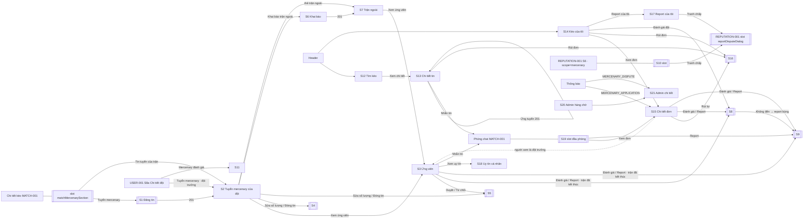

# Screen Flow — MERCENARY-001 Tuyển mercenary, ứng tuyển, chat theo đơn, uy tín cá nhân

| Mục | Giá trị |
|---|---|
| Mã chức năng | `MERCENARY-001` |
| Phạm vi tầng | frontend (ArenaFlow-fe) — backend: ngoài phạm vi repo này (`docs/agent/upstream/api/MERCENARY-001/API_Spec.md`) |
| Repo/stack | ArenaFlow-fe · React 19 + TypeScript + Vite · React Router (FE ADR-0003) |
| Nguồn SRS/UI/API | `docs/agent/upstream/business-spec/SYSTEM-001/` (UC-ME01..ME09, BR-ME01..ME19, BC-ME01..ME05, AC-ME01..ME11) · `UI_Design.md` v1.0 (S1–S21, đặc tả chữ là nguồn chuẩn) · `docs/agent/upstream/api/MERCENARY-001/API_Spec.md` |
| Căn cứ | `ArenaFlow-spec@53aee11` · API_Spec `v3.0` (MATCH-001 `v3.2`, REPUTATION-001 `v2.1`, VENUE-001 `v6.2`, USER-001 `v5.3`, USER-003 `v2.0`, NOTIFICATION-001 `v2.0`, SYSTEM-002 `v1.2`) |
| Quy ước áp dụng | `docs/agent/design-standards.md`, `docs/agent/convention-frontend.md`, `docs/agent/security-frontend.md` · khung `docs/agent/design/SHARED/APP-SHELL/` v1.2 · FE ADR-0003..0008 (Proposed, nhánh `feature/USER-001-user-team`) · FE ADR-0010 slot (Proposed, nhánh `feature/REPUTATION-001-…`) |
| Tác giả / Ngày / Phiên bản | `solution-architect` (agent) / `2026-11-27` / `v1.3` (lịch sử: `CHANGELOG.md`) |

> Khung (route registry `AppRouteGroups`, guard, layout, `ROUTE_PATHS`, `useUrlParam`, `Dialog`, `ConfirmDialog`): SHARED/APP-SHELL `Screen_Flow.md`, `Component_Design.md` — **chưa merge** (nhánh `feature/USER-001-user-team`), trỏ theo tên mục.
> Module mới: `src/modules/mercenary/` (một module cho tin tuyển, đơn, trận ngoài, đánh giá / report mercenary, uy tín cá nhân, tranh chấp Admin). **Không** thiết kế phòng chat / "Tin nhắn của tôi" (module `chat`, MATCH-001) — chỉ điều hướng tới và cấp slot đầu phòng (S19).
> Thành phần hiện trong page của module khác đi qua slot FE ADR-0010 (S1 trên chi tiết kèo, S10 trên màn report đội của REPUTATION-001, S19 trong phòng chat) — hợp đồng ở Component_Design §6. File này **không** sửa thiết kế mã khác; thay đổi cần áp gom ở §6.

## 1. Danh sách màn hình

| # | Màn hình | Route (`ROUTE_PATHS`) / vị trí | Nhóm route | Use case (SRS) |
|---|---|---|---|---|
| S1 | Đăng tin tuyển (dialog) | Slot `matchMercenarySection` trên chi tiết kèo MATCH-001 | authenticated (route MATCH-001) | UC-ME01, BR-ME01, BR-ME05, AC-ME01 |
| S2 | Tuyển mercenary của đội | `/teams/:teamId/mercenary` (`teamMercenary`) · `?tab=recruitments\|external&status=&matchId=&page=` | authenticated | UC-ME07, UC-ME01 A1, BR-ME05, BR-ME19 |
| S3 | Ứng viên của tin | `/mercenary-recruitments/:recruitmentId/applicants` (`mercenaryApplicants`) · `?status=&page=` | authenticated | UC-ME04, UC-ME06, UC-ME08, BR-ME06, BR-ME07, BR-ME10 |
| S4 | Sửa số lượng | Dialog trên S2, S3, S7 | — | UC-ME07, BR-ME08, AC-ME05 |
| S5 | Xác nhận duyệt / từ chối / đóng tin / huỷ trận ngoài | `ConfirmDialog` trên S2, S3, S7, S19 | — | UC-ME04 bước 3, UC-ME07, BR-ME09 |
| S6 | Khai báo trận ngoài | `/teams/:teamId/external-matches/new` (`teamExternalMatchNew`) | authenticated | UC-ME01 A1, BR-ME19, AC-ME11 |
| S7 | Chi tiết / sửa / huỷ trận ngoài | `/teams/:teamId/external-matches/:externalMatchId` (`externalMatchDetail`) | authenticated | BR-ME19, BR-ME09, AC-ME11 |
| S8 | Đánh giá sau trận | Dialog trên S3, S14, S15, S19 | — | UC-ME06, BR-ME12, BR-ME13, AC-ME07 |
| S9 | Report | Dialog trên S3, S8, S15, S19 | — | UC-ME08, BR-ME14, AC-ME08 |
| S10 | Report liên quan mercenary của đội | Slot `teamMercenaryReportsPanel` trên REPUTATION-001 S6 (`/teams/:teamId/reports?scope=mercenary`) | authenticated (route REPUTATION-001) | UC-ME08, BR-ME14, BR-R10 |
| S11 | Mercenary đánh giá đội | `/teams/:teamId/mercenary-ratings` (`teamMercenaryRatings`) · `?page=` | authenticated | UC-ME06 bước 4, BR-ME13 |
| S12 | Tìm kèo mercenary | `/mercenary-recruitments` (`mercenaryRecruitments`) · `?position=&radiusKm=&page=` | authenticated | UC-ME02, BR-ME03, BR-ME04, BR-ME17, AC-ME02 |
| S13 | Chi tiết tin tuyển | `/mercenary-recruitments/:recruitmentId` (`mercenaryRecruitmentDetail`) | authenticated | UC-ME02 bước 6, UC-ME03, BR-ME04, BR-ME06 |
| S14 | Kèo mercenary của tôi | `/me/mercenary-applications` (`myMercenaryApplications`) · `?status=&page=` | authenticated | UC-ME03, UC-ME05 |
| S15 | Chi tiết đơn (ứng viên) | `/mercenary-applications/:applicationId` (`mercenaryApplicationDetail`) — đội trưởng mở → chuyển S3 | authenticated | UC-ME05, UC-ME06, BR-ME04, BR-ME11 |
| S16 | Rút đơn / rút lui | `ConfirmDialog` trên S13, S14, S15 | — | UC-ME03 A1, UC-ME05, BR-ME11, AC-ME03 |
| S17 | Report của tôi (vai trò mercenary) | `/me/mercenary-reports` (`myMercenaryReports`) · `?tab=received\|sent&page=` | authenticated | UC-ME08, BR-ME14 |
| S18 | Uy tín cá nhân | `/users/:userId/reputation` (`userReputation`); khối rút gọn trong thẻ ứng viên S3 | authenticated | BR-ME15, AC-ME09 |
| S19 | Đầu phòng chat theo đơn | Slot `conversationApplicationHeader` trong phòng chat (module `chat`, MATCH-001) | authenticated (route MATCH-001) | UC-ME09, BR-ME16, AC-ME10 |
| S20 | Admin: hàng chờ tranh chấp mercenary | `/admin/mercenary-disputes` (`adminMercenaryDisputes`) · `?status=PENDING\|RESOLVED\|ALL&page=` | admin | UC-ME08 bước 4, BR-ME14 |
| S21 | Admin: chi tiết + quyết định | `/admin/mercenary-disputes/:disputeId` (`adminMercenaryDisputeDetail`) | admin | UC-ME08 bước 4, BR-R05, BR-R06 |

- Route khai trong `src/modules/mercenary/routes/mercenary.routes.tsx` (`AppRouteGroups`: `authenticated` = S2, S3, S6, S7, S11–S15, S17, S18; `admin` = S20, S21; page `lazy`).
- Hằng thêm vào `src/shared/constants/route-paths.constant.ts` trong PR của MERCENARY-001 (SHARED Screen_Flow §1.2):

| Khoá | Mẫu | Hàm dựng |
|---|---|---|
| `teamMercenary` | `/teams/:teamId/mercenary` | `buildTeamMercenaryPath(teamId, { tab?: 'recruitments' \| 'external', matchId? })` |
| `teamExternalMatchNew` | `/teams/:teamId/external-matches/new` | `buildTeamExternalMatchNewPath(teamId)` |
| `teamMercenaryRatings` | `/teams/:teamId/mercenary-ratings` | `buildTeamMercenaryRatingsPath(teamId)` |
| `externalMatchDetail` | `/teams/:teamId/external-matches/:externalMatchId` | `buildExternalMatchDetailPath(teamId, externalMatchId)` — `teamId` trên URL để S7 gọi 2.30 ‖ 2.2 song song; khai **sau** `teamExternalMatchNew` (segment tĩnh `new` ưu tiên) |
| `mercenaryRecruitments` | `/mercenary-recruitments` | — |
| `mercenaryRecruitmentDetail` | `/mercenary-recruitments/:recruitmentId` | `buildMercenaryRecruitmentDetailPath(recruitmentId)` |
| `mercenaryApplicants` | `/mercenary-recruitments/:recruitmentId/applicants` | `buildMercenaryApplicantsPath(recruitmentId, { status? })` |
| `mercenaryApplicationDetail` | `/mercenary-applications/:applicationId` | `buildMercenaryApplicationPath(applicationId)` (tên theo đề xuất NOTIFICATION-001 §5) |
| `myMercenaryApplications` | `/me/mercenary-applications` | `buildMyMercenaryApplicationsPath({ status? })` |
| `myMercenaryReports` | `/me/mercenary-reports` | `buildMyMercenaryReportsPath({ tab? })` |
| `userReputation` | `/users/:userId/reputation` | `buildUserReputationPath(userId)` |
| `adminMercenaryDisputes` | `/admin/mercenary-disputes` | `buildAdminMercenaryDisputesPath({ status? })` |
| `adminMercenaryDisputeDetail` | `/admin/mercenary-disputes/:disputeId` | `buildAdminMercenaryDisputePath(disputeId)` (tên theo đề xuất NOTIFICATION-001 §5) |

- Không trùng: `/teams/:teamId/{mercenary,external-matches/new,external-matches/:externalMatchId,mercenary-ratings}` khác `/teams/:teamId`, `/teams/:teamId/edit` (USER-001), `/teams/:teamId/{reports,reputation}` (REPUTATION-001); `/me/mercenary-*` khác `/me/{teams,invitations}` (USER-003); `/admin/mercenary-disputes` khác `/admin/disputes` (REPUTATION-001).
- Path của mã khác dùng tới (không định nghĩa ở đây): `buildConversationPath(conversationId)` → `/conversations/:conversationId` (`conversationDetail`, module `chat`), `buildMatchDetailPath(matchId)` → `/matches/:matchId` (`matchDetail`) — đã chốt ở MATCH-001 Screen_Flow §1; `buildTeamDetailPath`, `ROUTE_PATHS.profileEdit` — USER-001; `ROUTE_PATHS.venueNew`, `buildVenueDetailPath` — VENUE-001; `buildTeamReportsPath(teamId, { tab, scope })` — REPUTATION-001 (thêm `scope`, §6 C7).

**Mục điều hướng** (`src/modules/mercenary/constants/mercenary-nav.constant.ts`, SHARED Screen_Flow §3):

| Hằng | Mục | Đích | Vai trò |
|---|---|---|---|
| `MERCENARY_NAV_ITEMS` | "Tìm kèo mercenary", "Kèo mercenary của tôi" | `mercenaryRecruitments`, `myMercenaryApplications` | mọi người đã đăng nhập — `order` 50 / 55 (đề xuất SHARED Screen_Flow §6 #5) `[cần xác nhận]` #15 |
| `MERCENARY_ADMIN_NAV_ITEMS` | "Tranh chấp mercenary" | `adminMercenaryDisputes` | `ADMIN`, `order: 41` (sau "Tranh chấp report bùng" `40` của REPUTATION-001) |

## 2. Luồng điều hướng

## 3. Chi tiết từng màn hình

> Quy tắc thời gian dùng chung (Component_Design §5): **đã bắt đầu** = `isPastVn(startsAt)`; **đã kết thúc để đánh giá** = `isMatchFinished(match)`; **đã huỷ** = `match.status = CANCELLED`. Trạng thái tin / đơn luôn là trạng thái hiệu lực BE trả (API_Spec §1.3) — FE không tự suy.

### S1 — Đăng tin tuyển (dialog, trong slot `matchMercenarySection`)
- **Vào từ:** host MATCH-001 render slot trên chi tiết kèo (props Component_Design §6.1). Slot **không gọi API khi tải**; chỉ render khi `viewer.kind ≠ NONE`:
  - Nút "Tuyển mercenary" khi `matchStatus = CONFIRMED` và chưa bắt đầu.
  - Link "Tin tuyển mercenary của <đội>" → `buildTeamMercenaryPath(teamId, { matchId })` khi `matchStatus ∈ {CONFIRMED, ARCHIVED, COMPLETED, CANCELLED}` (một link mỗi đội người xem làm đội trưởng). Sau trận, đây là lối tắt tới S3 tab "Đã duyệt" để đánh giá / report (UI_Design §4 #11).
- **Mở dialog:** tải tin `ACTIVE` của đội đã chọn cho trận (State_API_Integration §1) → dòng vị trí đã có tin bị khoá + "Đã có tin đang mở · tăng số lượng ở tin đó" (link sang S2 `?matchId=` — không mở thẳng S4 `[cần xác nhận]` #22). `CAPTAIN_OF_BOTH` → radio "Tuyển cho đội" (mặc định đội tạo kèo); đổi đội → tải lại dòng khoá.
- **Ra tới:** 201 → toast "Đã đăng n tin tuyển", `navigate(buildTeamMercenaryPath(teamId, { matchId }))`. Huỷ / `Esc` → đóng.
- **Trạng thái:** đang tải dòng khoá → nhóm vị trí skeleton, nút đăng disable; lỗi tải → vẫn cho chọn (BE chặn `MERCENARY_023`); lỗi nghiệp vụ → `FormErrorBanner` trong dialog (State_API_Integration §5.1); mã báo dữ liệu kèo đã cũ (danh sách ở JSDoc `onMatchChanged`, Component_Design §6.1) → banner + `onMatchChanged()`.

### S2 — Tuyển mercenary của đội
- **Vào từ:** USER-001 S8a link "Tuyển mercenary" (§6 C9); slot S1; breadcrumb S3/S6/S7. **Ra tới:** breadcrumb "Đội của tôi › <đội> › Tuyển mercenary" (mục 1 `ROUTE_PATHS.myTeams`, mục 2 `buildTeamDetailPath`).
- **Tham số URL:** `tab` ∈ `recruitments` (mặc định) \| `external`; `status` theo tab — tin: `ACTIVE` (mặc định, "Đang tuyển") \| `OPEN` \| `FILLED` \| `CLOSED` \| `EXPIRED` \| `ALL`; trận ngoài: `UPCOMING` (mặc định) \| `ENDED` \| `CANCELLED` \| `ALL`; giá trị ngoài tập → mặc định của tab. `matchId` (UUID, chỉ tab tin) → dải `AlertBanner` info "Đang lọc theo một trận" + nút "Bỏ lọc". Đổi tab → xoá `status`, `matchId`, `page` (`replace`). `page` `push`.
- **Tab Tin tuyển:** nhóm theo trận ở phía client trên trang hiện tại (`matchId ?? match.externalMatchId`; nhóm có thể bị cắt giữa hai trang `[cần xác nhận]` #23). Tiêu đề nhóm: "Kèo đã ghép" (link `buildMatchDetailPath`) hoặc "Trận ngoài hệ thống · Đối thủ: …" (link S7), giờ, tên sân.
- **Nút theo trạng thái tin** (API_Spec §3.1): `OPEN`/`FILLED` → "Xem ứng viên" (S3), "Sửa số lượng" (S4 — ẩn khi đội `INACTIVE`), "Đóng tin" (S5); `CLOSED`/`EXPIRED` → chỉ "Xem ứng viên".
- **Tab Trận ngoài:** thẻ trận → S7. Nút "Khai báo trận ngoài hệ thống" → S6 (desktop: header màn; mobile: trong tab này) — ẩn khi đội `INACTIVE`.
- **Trạng thái:** skeleton dòng · empty theo tab (UI_Design S2) · đội `INACTIVE` (từ header đội) → `AlertBanner` warning UI_Design S2 · `403 TEAM_002` → `ErrorState` "Chỉ đội trưởng được quản lý tin tuyển của đội" + link S8a · `422 TEAM_016` / `404 TEAM_001` → `ErrorState` message BE · lỗi mạng → **Thử lại**.

### S3 — Ứng viên của tin
- **Vào từ:** S2, S7 "Xem ứng viên"; S15 (đội trưởng mở link đơn); S19 "Xem đơn" (đội trưởng). **Ra tới:** breadcrumb "… › <đội> › Tuyển mercenary › <vị trí>" (đội từ 2.4 `team`); "Nhắn tin" → `buildConversationPath(conversationId)`; "Xem uy tín" → `buildUserReputationPath(userId)` + `state.displayName`.
- **Tham số URL:** `status` ∈ `PENDING` (mặc định) \| `APPROVED` \| `REJECTED` \| `WITHDRAWN` \| `ALL`; `page`. Nhãn tab "Chờ duyệt (n)" lấy `pendingApplicationCount` của 2.4.
- **Thẻ tóm tắt tin:** UI_Design S3 (đội trưởng luôn thấy sân — BR-ME04); nút "Sửa số lượng", "Đóng tin" như S2.
- **Nút trên thẻ ứng viên** (đơn `PENDING`): "Nhắn tin"; "Từ chối" (khi tin `OPEN`/`FILLED`); "Duyệt" — tin `FILLED` → disable + chú thích "Tin đã đủ người — tăng số lượng để duyệt thêm"; đã bắt đầu hoặc đội `INACTIVE` (biết qua `TEAM_015`) → ẩn. Không có huỷ duyệt (BR-ME10).
- **Tab "Đã duyệt", sau giờ kết thúc** (`isPastVn(match.endsAt)` — 2.4 không có trạng thái trận `[cần xác nhận]` #10): "Đánh giá" (S8 phía đội) và "Report" (S9 phía đội, đủ 4 loại). Nút luôn hiện; đã đánh giá → S8 hiện kết quả thay form (không gọi 2.19 theo từng thẻ — `[cần xác nhận]` #8).
- **Trạng thái:** skeleton thẻ · empty theo tab "Chưa có ứng viên" · `MERCENARY_012` khi thao tác → toast "Trạng thái đơn đã thay đổi, vui lòng tải lại" + tải lại · `403 TEAM_002` / `404 MERCENARY_001` / `422 TEAM_016` → `ErrorState` message BE · lỗi mạng → **Thử lại**.

### S4 — Sửa số lượng (dialog)
- **Vào từ:** S2, S3, S7 (tin `OPEN`/`FILLED`). Form: Component_Design §4.2. Đã bắt đầu → nút "+" không vượt số hiện tại + chú thích "Trận đã bắt đầu — chỉ giảm được số lượng".
- **Ra tới:** 200 → đóng, toast "Đã cập nhật số lượng", nơi mở cập nhật theo cache (State_API_Integration §3.2). `MERCENARY_007` → toast, đóng, tải lại.

### S5 — Xác nhận (dùng `ConfirmDialog` SHARED)
- Biến thể và nội dung: UI_Design S5 (duyệt / từ chối / đóng tin) + huỷ trận ngoài (UI_Design S7 "Vùng nguy hiểm"). Dòng "Sau khi duyệt: x/y — tin chuyển Đủ người" khi `quantityApproved + 1 = quantityNeeded`. Đóng tin: n = `pendingApplicationCount`.
- **Ra tới:** thành công → đóng, toast ("Đã duyệt <tên>", "Đã từ chối <tên>", "Đã đóng tin · n đơn chờ bị từ chối" theo `rejectedApplicationCount`, "Đã huỷ trận ngoài"); lỗi → `error` trong dialog (State_API_Integration §5.4–§5.6, §5.9); lỗi trạng thái (`MERCENARY_007/012`) → đóng + toast + tải lại.

### S6 — Khai báo trận ngoài
- **Vào từ:** S2. **Ra tới:** 201 → toast "Đã khai báo trận và đăng n tin tuyển", `navigate(buildExternalMatchDetailPath(teamId, id), { replace: true })`; "Huỷ" → S2 tab `external`.
- **Sân:** ô chọn mở `VenuePickerDialog` (Component_Design §2); link "Chưa có sân? Thêm địa điểm" → `ROUTE_PATHS.venueNew?returnTo=<S6>` (VENUE-001 Screen_Flow §5 #4); quay lại với `state.createdVenue` (`venueId`, `name`, `address`) → chọn sẵn địa điểm đó, không gọi thêm API. Dữ liệu form đã nhập mất khi rời màn `[cần xác nhận]` #17.
- **Trạng thái:** đội `INACTIVE` (header đội) → banner, form disable; validation + lỗi BE: Component_Design §4.3, State_API_Integration §5.9; đang gửi → nút `loading`.

### S7 — Chi tiết / sửa / huỷ trận ngoài
- **Vào từ:** S2 tab trận ngoài; S6; nhóm tin S2 — các nơi này truyền `state.phase` ∈ `open` \| `closed` (chưa / đã kết thúc hoặc huỷ) để tải tin song song (State_API_Integration §1). **Ra tới:** breadcrumb "… › Tuyển mercenary › Trận ngoài" (mục "Tuyển mercenary" → `buildTeamMercenaryPath(teamId, { tab: 'external' })`, `teamId` từ URL). 2.30 trả `teamId` khác URL → `Navigate replace` sang `buildExternalMatchDetailPath(<teamId đúng>, id)`.
- **Khoá form** (UI_Design S7; API_Spec §3.4): `hasApprovedMercenary` → khoá Sân / Giờ / Trình độ + banner; đã bắt đầu → chỉ "Tên đối thủ", ẩn "Huỷ trận ngoài", "Thêm vị trí"; `CANCELLED` hoặc `isPastVn(endsAt)` → chỉ xem.
- **Khối "Tin tuyển của trận":** tải theo `[cần xác nhận]` #7 (State_API_Integration §1); dòng tin (như S2) + "Xem ứng viên"; "Thêm vị trí" → `AddPositionsDialog` (khung S1, không chọn đội; vị trí đã có tin `OPEN`/`FILLED` bị khoá theo danh sách đã tải).
- **Desktop cột trái:** danh sách trận ngoài của đội **chỉ khi đã có cache** từ S2 (cùng key); không có → link "← Danh sách trận ngoài" `[cần xác nhận]` #19. Mobile không có cột.
- **Trạng thái:** skeleton · `MERCENARY_025` / `MERCENARY_004` → toast + tải lại + khoá ô · `404 MERCENARY_024` → `ErrorState` "Không tìm thấy trận ngoài hệ thống" + về S2 · `403 TEAM_002` / `422 TEAM_016` → `ErrorState` message BE.

### S8 — Đánh giá sau trận (dialog)
- **Vào từ:** S3 tab "Đã duyệt" (phía đội), S14 / S15 / S19 (phía mercenary). **Khi mở:** tải 2.19 của đơn → `given ≠ null` → hiện kết quả đã gửi (+ `received` nếu có), không form; `given = null` → form (Component_Design §4.4).
- **Ra tới:** 201 sao → toast "Đã gửi đánh giá", dialog chuyển sang kết quả. 201 "Không đến" (phía đội) → `ConfirmDialog` "Bạn có muốn report bùng không?" ("Report bùng" → S9 `initialType = NOSHOW`; "Để sau" → đóng). `MERCENARY_017` → tải lại 2.19, hiện kết quả. `MERCENARY_015` → banner message BE + "Thử lại sau ít phút" (UC-ME06 3b).

### S9 — Report (dialog)
- **Vào từ:** S3 / S15 sau trận (`mode = ALL_TYPES`); S19 menu "Report" (`ALL_TYPES` nếu trận đã kết thúc và đơn `APPROVED`, ngược lại `BAD_COMMUNICATION_ONLY` khi đã có tin nhắn; chưa có tin → không có mục menu); S8 sau "Không đến".
- **Khi mở:** tải report **đã gửi** của phía mình (đội: 2.21 `SENT`; mercenary: 2.22 `SENT`), lọc `applicationId` → loại đã report bị disable + "Đã report" `[cần xác nhận]` #9.
- **Ra tới:** 201 → toast "Đã gửi report", đóng. Lỗi: State_API_Integration §5.8.

### S10 — Report liên quan mercenary của đội (slot trên REPUTATION-001 S6)
- **Vào từ:** REPUTATION-001 S6 tab cấp 1 "Mercenary" (`?scope=mercenary` — §6 C7). Host giữ breadcrumb, `tab` (`received` \| `sent` ↔ `direction`), `page`; panel nhận props (Component_Design §6.3).
- **Thẻ:** UI_Design S10; report bùng còn hạn ở `RECEIVED` → "Hạn tranh chấp: <giờ>" + "Tranh chấp" → slot REPUTATION-001 `reportDisputeDialog`.
- **Trạng thái:** skeleton · empty "Chưa có report nào" · `TEAM_015` / `TEAM_016` (BR-R10) / `TEAM_002` → `ErrorState` message BE trong panel · lỗi mạng → **Thử lại**.

### S11 — Mercenary đánh giá đội
- **Vào từ:** USER-001 S8a link "Mercenary đánh giá" (mọi người — §6 C9). Route riêng thay tab trong hồ sơ đội `[cần xác nhận]` #11. **Ra tới:** breadcrumb về S8a.
- **Trạng thái:** skeleton · empty "Chưa có đánh giá từ mercenary" · `404 TEAM_001` → `ErrorState` · lỗi mạng → **Thử lại**. `Pagination`.

### S12 — Tìm kèo mercenary
- **Vào từ:** header "Tìm kèo mercenary"; S14 empty. **Ra tới:** "Xem chi tiết" → `buildMercenaryRecruitmentDetailPath(id)` với `state.coords` (chỉ bộ nhớ lịch sử, không URL — `[cần xác nhận]` #14).
- **Vị trí:** mount → `useGeolocation().request()` (VENUE-001 §7.1). `idle`/`locating` → skeleton, **chưa gọi** API; `granted` → chế độ GPS; `denied`/`unavailable`/`timeout` → chế độ không GPS + banner "Bật GPS để tìm kèo gần bạn hơn" (nút "Bật GPS" gọi lại `request()`; quyền đã bị chặn → hướng dẫn mở quyền trong trình duyệt `[cần xác nhận]` #13).
- **Tham số URL:** `position` ∈ 4 vị trí \| vắng (Tất cả); `radiusKm` số nguyên 1..20, mặc định 3 (chỉ dùng ở chế độ GPS; thanh trượt debounce 300 ms rồi ghi `replace`); `page`. Đổi bộ lọc → `page = 1`. Toạ độ **không** vào URL (`security-frontend.md` §4).
- **Trạng thái:** UI_Design S12; `422 MERCENARY_018` → `EmptyState` "Bật GPS hoặc cập nhật khu vực trong hồ sơ để tìm kèo" + "Bật GPS" + "Cập nhật hồ sơ" (`ROUTE_PATHS.profileEdit`); nhãn chế độ không GPS dùng câu chung, không tên tỉnh/phường `[cần xác nhận]` #13. Phần "Không implement" của UI_Design S12 giữ nguyên.

### S13 — Chi tiết tin tuyển
- **Vào từ:** S12; link khác (`state.coords` vắng → không gửi toạ độ, không hiện khoảng cách). **Ra tới:** "Quay lại" → S12 (history).
- **Thanh hành động** (API_Spec §3.1, §3.2): `viewerRole = CAPTAIN` → link "Quản lý ứng viên" (S3), không nút ứng tuyển. `myApplication = null` → "Ứng tuyển" khi tin `OPEN` và chưa bắt đầu; ngược lại nút disable + lý do (UI_Design S13). `myApplication.status = PENDING` → badge "Đã ứng tuyển · Chờ duyệt", "Nhắn tin", "Rút đơn" (S16 biến thể chờ). `APPROVED` → hiện sân, đội trưởng; "Xem đơn" (S15).
- **Sau lỗi ứng tuyển** `MERCENARY_005/010/011/006/013` → nút disable + message BE trong phiên trang; `MERCENARY_009` / `007` → tải lại tin.
- **Trạng thái:** skeleton · `404 MERCENARY_001` → `ErrorState` "Không tìm thấy tin tuyển" + "Quay lại".

### S14 — Kèo mercenary của tôi
- **Vào từ:** header; S13. **Ra tới:** "Xem đơn" → S15; "Nhắn tin" / "Xem chat" → `buildConversationPath`; link "Report của tôi" (đầu màn) → S17; empty → S12.
- **Tham số URL:** `status` ∈ `ACTIVE` (mặc định) \| `PENDING` \| `APPROVED` \| `REJECTED` \| `WITHDRAWN` \| `ALL` (bộ lọc `SegmentedRadioGroup` — §6 C16); `page`.
- **Nút theo đơn** (UI_Design S14): `PENDING` → "Nhắn tin", "Rút đơn"; `APPROVED` chưa bắt đầu, chưa huỷ → "Nhắn tin", "Xem đơn"; `APPROVED` và `isMatchFinished` → "Đánh giá đội" (S8 — luôn hiện, dialog tự hiện kết quả nếu đã đánh giá `[cần xác nhận]` #8); `REJECTED`/`WITHDRAWN` → "Xem chat". Nhãn phụ "Trận đã huỷ — bạn không bị trừ điểm" / "Trận đã kết thúc".

### S15 — Chi tiết đơn
- **Vào từ:** S13, S14, S19, thông báo `MERCENARY_APPLICATION` (NOTIFICATION-001 §6 C12). **Phân luồng:** tải 2.10 → `applicant.userId ≠ session.userId` (người xem là đội trưởng) → `<Navigate replace to={buildMercenaryApplicantsPath(recruitmentId, { status })}>` (S3, tab theo trạng thái đơn). Còn lại → màn ứng viên.
- **Màn ứng viên** (mọi trạng thái đơn, UI_Design S15 vẽ `APPROVED`): badge + "Duyệt lúc …"; thẻ trận; thẻ sân + "Đội trưởng: …" khi `APPROVED` (toạ độ chỉ chữ, không "Mở bản đồ" `[cần xác nhận]` #18); "Nhắn tin với đội trưởng"; "Rút lui" (chưa bắt đầu, không huỷ) hoặc "Rút đơn" (`PENDING`) → S16; khối "Sau trận" mở khi `isMatchFinished` + `APPROVED` → "Đánh giá đội" (S8), "Report" (S9 `ALL_TYPES`); trận huỷ → banner UI_Design S15.
- **Trạng thái:** skeleton · `403 MERCENARY_014` → `ErrorState` "Bạn không tham gia đơn ứng tuyển này" + "Quay lại" · `404 MERCENARY_002` → `ErrorState` message BE.

### S16 — Rút đơn / rút lui (`ConfirmDialog`)
- Nội dung UI_Design S16. Mức trừ dự kiến tính ở client từ `startsAt` (Component_Design §5 `estimateWithdrawPenalty`), focus mặc định "Giữ đơn".
- **Ra tới:** 200 → toast "Đã rút lui · bị trừ x điểm" (`reliabilityPenalty` của response, không dùng số dự kiến) / "Đã rút đơn"; `MERCENARY_012` → toast "Trạng thái đơn đã thay đổi, vui lòng tải lại", đóng, tải lại (không rút); `MERCENARY_013` / `004` → `error` trong dialog, nút xác nhận disable.

### S17 — Report của tôi
- **Vào từ:** S14 link "Report của tôi"; S18 (khi xem chính mình). **Tham số URL:** `tab` ∈ `received` (mặc định) \| `sent` → `direction`; `page`.
- **Thẻ:** UI_Design S17; "Tranh chấp" → slot `reportDisputeDialog` (REPUTATION-001); `REJECTED` → "Đã hoàn n điểm".
- **Trạng thái:** skeleton · empty "Chưa có report nào" · lỗi mạng → **Thử lại**.

### S18 — Uy tín cá nhân
- **Vào từ:** S3 "Xem uy tín" (`state.displayName`); USER-001 S3 "Uy tín mercenary của tôi" (§6 C10). Tiêu đề: `state.displayName` nếu có, không thì "Uy tín mercenary" (2.23 không trả tên `[cần xác nhận]` #12). Xem chính mình → link "Report của tôi" (S17).
- **Trạng thái:** skeleton · `404 USER_001` → `ErrorState` "Không tìm thấy người dùng" (**không** kết thúc phiên — nghĩa "người được xem") · lỗi mạng → **Thử lại**.

### S19 — Đầu phòng chat theo đơn (slot trong phòng chat MATCH-001)
- **Vào từ:** host (phòng chat) render slot khi `contextType = MERCENARY_APPLICATION` (props Component_Design §6.2). Thân phòng, ô soạn, realtime tin nhắn, "Tin nhắn của tôi": MATCH-001.
- **Hiển thị:** UI_Design S19 "Phần riêng"; dòng khoá theo lý do khi `canSend = false` ("Đơn đã bị từ chối — …", "Bạn đã rút đơn — …", "Đội đã giải tán — …") đặt **trong slot**, dưới thẻ tóm tắt; host vẫn khoá ô soạn theo `canSend` `[cần xác nhận]` #4.
- **Thao tác:** "Xem đơn" → `buildMercenaryApplicationPath`; menu "Report" (S9; ẩn khi phía đội đã giải tán — `teamParty.captainName = null`); đội trưởng + đơn `PENDING` → nút nhanh "Từ chối", "Duyệt" (S5).
- **Đổi trạng thái đơn:** frame `APPLICATION_UPDATED` hoặc thao tác ở header → cập nhật badge + nút, gọi `onApplicationChanged()` để host tải lại đầu phòng (`canSend`).

### S20 — Admin: hàng chờ tranh chấp mercenary
- **Tham số URL:** `status` ∈ `PENDING` (mặc định) \| `RESOLVED` \| `ALL`; `page`. Bảng desktop / thẻ mobile (UI_Design S20); `DeletedAccountTag` theo `is…Deleted`. **Ra tới:** "Xem chi tiết" → S21.
- **Trạng thái:** skeleton · empty "Không có tranh chấp nào đang chờ" · `AUTH_004` → SHARED Screen_Flow §2 · lỗi mạng → **Thử lại**.

### S21 — Admin: chi tiết + quyết định
- **Vào từ:** S20; thông báo `MERCENARY_DISPUTE`. **Ra tới:** "← Hàng chờ tranh chấp mercenary" → S20 (giữ `status` qua `location.state.from`).
- **Theo `status`:** `PENDING` → form quyết định (Component_Design §4.6); `RESOLVED` → khối chỉ đọc. Gửi thành công → chỉ đọc ngay từ response, toast "Đã gửi quyết định". `DISPUTE_002` → toast + tải lại. `404 DISPUTE_001` → toast + `navigate(adminMercenaryDisputes, { replace: true })`.

## 4. Route guard & phân quyền
- S2, S3, S6, S7, S11–S15, S17, S18: `AuthGuard`. S20, S21: `AuthGuard → RoleGuard('ADMIN')` (`AdminLayout`).
- Quyền đội trưởng (S2, S3, S6, S7, thao tác tin / đơn) **không** kiểm bằng guard: BE trả `403 TEAM_002` / `MERCENARY_014` → `ErrorState` / ẩn nút (`security-frontend.md` §5). Lối vào S2 ở S8a chỉ hiện cho đội trưởng (USER-001 tính `captainId === session.userId`).
- `404 USER_001` ở 2.3, 2.7, 2.18, 2.20 → `endSession('ACCOUNT_DELETED')` (khai `accountGoneCodes` — State_API_Integration §2); ở 2.23 là "không tìm thấy người dùng".

## 5. Điều hướng từ thông báo (cho NOTIFICATION-001)

| `referenceType` | Đích | Ghi chú |
|---|---|---|
| `MERCENARY_APPLICATION` | `buildMercenaryApplicationPath(applicationId)` (S15) | Trang tự chuyển đội trưởng sang S3 — đóng NOTIFICATION-001 §6 #6 |
| `MERCENARY_DISPUTE` | `buildAdminMercenaryDisputePath(disputeId)` (S21) | Theo tên đề xuất của NOTIFICATION-001 |
| `REPORT` (report mercenary) | Chưa xác định — như REPUTATION-001 Screen_Flow §5 (thông báo không cho biết report đội / cá nhân) | Mercenary nhận report → đề xuất tạm `buildMyMercenaryReportsPath()` khi BE bổ sung loại; giữ `[cần xác nhận]` #7 của NOTIFICATION-001 |

## 6. Thay đổi phải áp ở thiết kế khác (nguồn duy nhất)

> MERCENARY-001 **không** sửa các file này; chủ thiết kế áp qua vòng lặp design của mã đó. Cột "Chặn code?" là với phần MERCENARY-001 phụ thuộc.

| # | File | Mục | Cũ | Mới | Chặn code? |
|---|---|---|---|---|---|
| C1 | SHARED `Screen_Flow.md` | §1.2 | Chưa có path MERCENARY-001 | Ghi nhận 13 khoá + hàm dựng ở §1 | Không (thêm trong PR MERCENARY-001) |
| C2 | SHARED `State_API_Integration.md` | §4 bảng `QUERY_ROOTS` | `'mercenary'` — "thêm khi thiết kế" | `'mercenary'`: MERCENARY-001 (gồm `[mercenary, 'admin-dispute', …]`) | Không |
| C3 | SHARED `Component_Design.md` §5 · USER-001 `Component_Design.md` §4 | Hằng `PREFERRED_POSITIONS` (`modules/account`), `SKILL_LEVELS` (`modules/team`) | Riêng module | Chuyển lên `src/shared/constants/player-options.constant.ts`: `PLAYER_POSITIONS` (4 nhãn vị trí — USER-001 §4.1 = MERCENARY-001 §4.1), `SKILL_LEVELS` (9 nhãn — USER-001 §4.1 = MATCH-001 §4.1); module `account`, `team` import từ đây | Không (mã code trước tạo ở `shared/` sau `reuse-scan`) |
| C4 | SHARED `State_API_Integration.md` + FE ADR-0007 — **đã áp ở SHARED v1.2 §6** | SHARED §6 bảng API `subscribe`; ADR-0007 (thêm mục `## Sửa đổi 2026-11-27` khi đã `Accepted`, sửa thẳng khi còn `Proposed`) | "Đếm tham chiếu: hai màn cùng topic → một `SUBSCRIBE`" | Ghi rõ: nhiều subscriber cùng destination **đều** nhận mọi frame; huỷ một subscriber không ảnh hưởng subscriber khác; `onError` gọi cho mọi subscriber. Cùng nội dung bổ sung vào FE ADR-0007 phần Quyết định (đếm tham chiếu = phát frame cho mọi listener). **Trùng MATCH-001 Screen_Flow §6 C7 — áp một lần**; MATCH-001 C16 thêm `onReady(epoch)` vào cùng API (`subscribe(destination, onFrame, { onError?, onReady? })`) — S19 dùng (State_API_Integration §4.2) | Không (đã áp; ADR-0007 `Accepted` theo #1) |
| C5 | REPUTATION-001 `Component_Design.md` | §5 `useNowMs`, `isDisputeOpen` | Riêng module `reputation` | Chuyển lên `src/shared/hooks/use-now-ms.hook.ts` và `src/shared/utils/dispute-window.util.ts` (`isDisputeOpen(r: { canDispute: boolean; disputeDeadlineAt: string \| null }, nowMs)`) — MERCENARY-001 S10, S17 dùng cùng logic | Không (`reuse-scan`; mã code trước tạo ở `shared/`) |
| C6 | REPUTATION-001 `Component_Design.md` | §6 type `SlotTeamRef`, `viewer` của `MatchReputationSectionProps` | Khai trong `reputation-slots.type.ts`, `viewer` khai inline | Đưa `SlotTeamRef` + `SlotMatchViewer` (union `CAPTAIN` / `CAPTAIN_OF_BOTH` / `NONE`) vào `src/shared/types/feature-slots.type.ts`; `MatchReputationSectionProps.viewer: SlotMatchViewer` — host MATCH-001 tính một lần cho cả hai slot | Không (cùng shape; MERCENARY-001 dùng lại tên ở `shared/types`) |
| C7 | REPUTATION-001 `Screen_Flow.md` S6 + `Component_Design.md` §2 `TeamReportsPage` | `[cần xác nhận]` #10 | Đề xuất slot `teamMercenaryReportsPanel: ComponentType<{ teamId; direction }>` | Chốt props `TeamMercenaryReportsPanelProps` (Component_Design §6.3: `teamId`, `direction`, `page`, `onPageChange`); S6 thêm `scope` ∈ `team` (mặc định) \| `mercenary` (`replace`, giữ `tab`, `page = 1`); `scope = mercenary` → render slot thay `TeamReportList` + `Pagination`, không gọi 2.4; `buildTeamReportsPath` thêm `scope?` | **Có** — cắm S10 |
| C8 | REPUTATION-001 `Component_Design.md` | §3 nhãn | — | Ghi nhận MERCENARY-001 dùng `RELIABILITY_LEVEL_LABELS`, `REPORT_TYPE_LABELS`, `REPORT_STATUS_LABELS`, `ReportStatusBadge`, `ReportTypeRadioGroup`, `ReportTypeChip`, `StarRatingInput`, `StarRatingDisplay`, `ReliabilityLevelBadge` (một nguồn — đóng MERCENARY UI_Design §4 #6 phần mức uy tín / report) | Không |
| C9 | USER-001 `Screen_Flow.md` + `Component_Design.md` | S8a | Không có lối vào mercenary | Link "Tuyển mercenary" → `buildTeamMercenaryPath(teamId)` (chỉ đội trưởng, đội không `DISBANDED`); link "Mercenary đánh giá" → `buildTeamMercenaryRatingsPath(teamId)` (mọi người); không thêm call | Không (vào được bằng URL / slot S1) |
| C10 | USER-001 `Screen_Flow.md` + `Component_Design.md` | S3 Hồ sơ cá nhân | — | Link "Uy tín mercenary của tôi" → `buildUserReputationPath(session.userId)`; không thêm call | Không |
| C11 | MATCH-001 — **đã áp** (MATCH-001 Screen_Flow §6 C12; Component_Design §7 dòng `matchMercenarySection`, `conversationApplicationHeader`; State_API_Integration §1 dòng "S13 đơn") | Chi tiết kèo S8; phòng chat S13; `ROUTE_PATHS` | — | (a) Cắm slot `matchMercenarySection` (Component_Design §6.1) cạnh slot `matchReputationSection`, cùng `viewer`; (b) phòng chat `contextType = MERCENARY_APPLICATION` → cắm slot `conversationApplicationHeader` (§6.2) thay khối ngữ cảnh đầu phòng, truyền `hasMessages`, tải lại 2.19 khi `onApplicationChanged`; cộng **+1 call** (2.10) vào tổng của phòng chat; (c) đăng ký `buildConversationPath(conversationId)`, `buildMatchDetailPath(matchId)` | **Có** — cắm S1, S19; nút "Nhắn tin" / link kèo |
| C12 | NOTIFICATION-001 `Screen_Flow.md` | §5 dòng `MERCENARY_APPLICATION`, `MERCENARY_DISPUTE`; §6 #5, #6 | Đề xuất tên hàm, chưa chốt vai trò | Chốt `buildMercenaryApplicationPath`, `buildAdminMercenaryDisputePath` (§1); vai trò do trang S15 tự phân luồng (§5) | Không với MERCENARY-001 |
| C13 | VENUE-001 `Screen_Flow.md` | §5 #4 (`returnTo`) | Nhánh `returnTo` chờ MERCENARY-001 / MATCH-001 chốt; đề xuất `state: { createdVenueId }` | MERCENARY-001 S6 dùng `?returnTo=<buildTeamExternalMatchNewPath(teamId)>`; VENUE-001 S2 trả `state: { createdVenue: { venueId, name, address } }` (lấy từ response 2.1 VENUE-001) để S6 chọn sẵn mà không gọi 2.3 | Không (thiếu nhánh → người dùng tự quay lại S6 chọn sân) |
| C14 | SHARED `Screen_Flow.md` / `Component_Design.md` | §3 `navItems`; §6 #3 | — | Gộp `MERCENARY_NAV_ITEMS`, `MERCENARY_ADMIN_NAV_ITEMS`; thứ tự nav chung với MATCH-001, VENUE-001 | Không |
| C15 | SHARED `Component_Design.md` | §3 `ConfirmDialog` | Props không có nhãn nút huỷ (cố định "Huỷ") | Thêm `cancelLabel?: string` (mặc định "Huỷ") — S16 "Giữ đơn", S8 gợi ý report bùng "Để sau"; prop tuỳ chọn → MINOR | Không (thiếu → nút hiện "Huỷ", đổi nhãn khi SHARED áp) |
| C16 | SHARED `Component_Design.md` | §3 — bộ lọc chọn một | Chỉ có `ChoiceChipGroup` (chọn nhiều) | **Không thêm component:** bộ lọc trạng thái chọn một (S2, S14, S12 "Vị trí cần") dùng `SegmentedRadioGroup` có sẵn (`role="radiogroup"`, cuộn ngang trên mobile bằng class Tailwind); tab trạng thái S3, S17, S20 dùng `Tabs`. Ghi nhận vào SHARED §3 cột "Ghi chú" của `SegmentedRadioGroup`: dùng cho bộ lọc chọn một dạng chip | Không |

## 7. `[cần xác nhận]`
> Đánh số chung cho 3 tài liệu; nội dung, phương án đề xuất và cột **Chặn code?** đầy đủ ở State_API_Integration §7. Mục liên quan file này:

| # | Tóm tắt | Chặn code? |
|---|---|---|
| 1 | Nền SHARED chưa merge + FE ADR-0002..0006, 0008 `Proposed` (0007 cho S19) | **Có** — toàn bộ |
| 2 | FE ADR-0010 slot `Proposed` | **Có** — S1 slot, S10, S19, gọi slot `reportDisputeDialog` (S10, S17) |
| 3 | Ngưỡng call ở (B)/(C): S2 (từ slot S1 / vào thẳng), S11 vào thẳng; S3, S7 mọi đường vào; S15 khi đội trưởng mở (chuyển S3) | **Có** — S3, S7, nhánh đội trưởng của S15 tới khi chốt SHARED §7 #1; S2, S11 luồng header khi vào thẳng (theo phương án giảm thì Không) |
| 7 | S7 lấy tin của trận ngoài bằng 2.2 rồi lọc client (`ACTIVE` khi trận chưa kết thúc / chưa huỷ, `ALL` khi đã kết thúc / huỷ) | **Có** — khối "Tin tuyển của trận" ở S7 tới khi user chấp nhận hoặc BE thêm lọc |
| 8 | Nút "Đánh giá" luôn hiện, dialog tự hiện kết quả (S3, S14, S15) | Không |
| 9 | Loại đã report lấy từ trang 1 `SENT` rồi lọc client | **Có** — phần disable loại đã report trong S9 tới khi user chấp nhận hoặc BE thêm lọc (thiếu → mọi loại chọn được, BE chặn `MERCENARY_022`) |
| 4 | Module `chat` (MATCH-001) đã chấp nhận slot S19 + đăng ký `buildConversationPath`; realtime đã chốt ở SHARED v1.2 §6; còn: ngưỡng phòng chat đơn (MATCH-001 #4) | **Có** — nhúng S19 theo ngưỡng MATCH-001 #4; **Không** — nút "Nhắn tin", code slot |
| 5 | ~~Host slot S1 + `buildMatchDetailPath`~~ — **Đóng (v1.1):** MATCH-001 chấp nhận §6.1, đã đăng ký hằng | Không (cắm slot còn chờ #2) |
| 6 | Host slot S10 trên REPUTATION-001 S6 (C7) | **Có** — S10 |
| 10 | S3 dùng `isPastVn(endsAt)` để hiện nút đánh giá | Không |
| 11 | S11, S18 là route riêng | Không |
| 12 | S18 không có tên người khi vào thẳng | Không |
| 13 | S12: nhãn khu vực hồ sơ, hướng dẫn khi quyền GPS bị chặn | Không |
| 14 | Toạ độ S12 → S13 qua state lịch sử | Không |
| 15 | Thứ tự / nhãn nav (đề xuất `order` 50 / 55 — SHARED #5) | Không |
| 17 | S6 mất dữ liệu khi đi thêm địa điểm | Không |
| 18 | S15 không có "Mở bản đồ" | Không |
| 19 | S7 cột trái chỉ từ cache | Không |
| 22 | S1 link dòng khoá sang S2 thay vì mở S4 | Không |
| 23 | S2 nhóm theo trận trên từng trang | Không |
