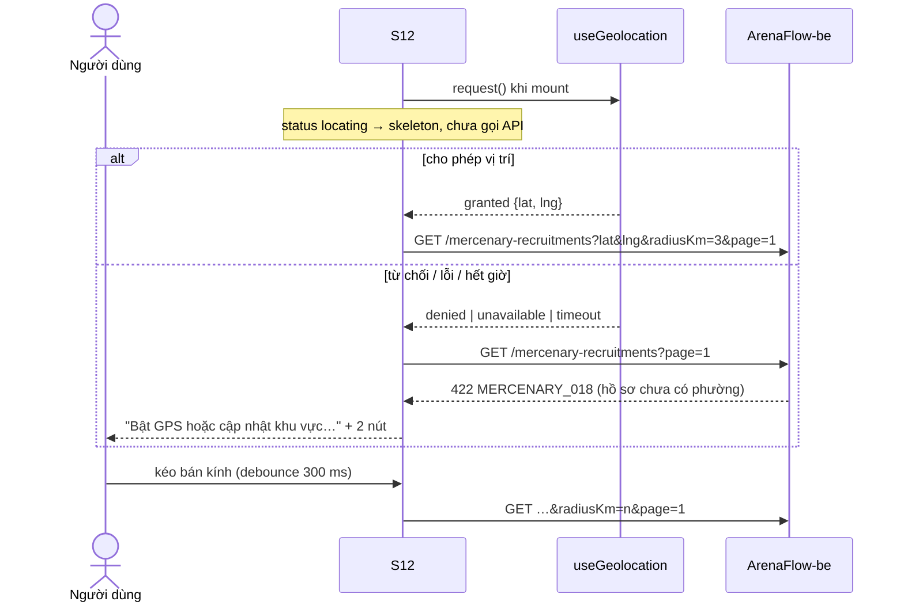
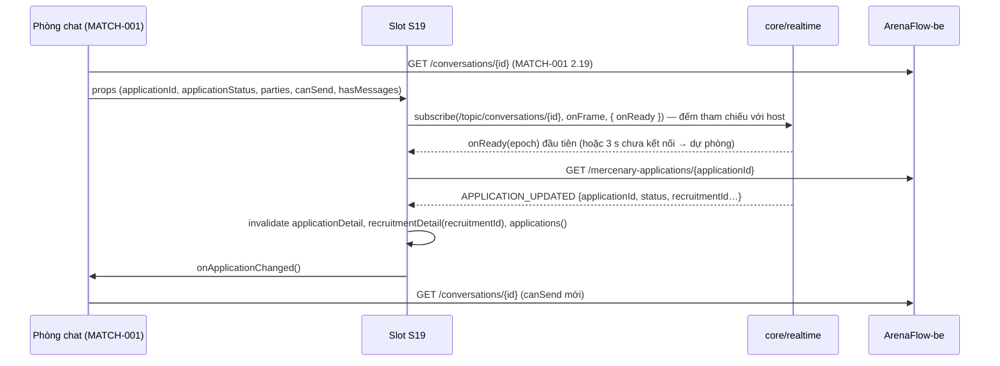
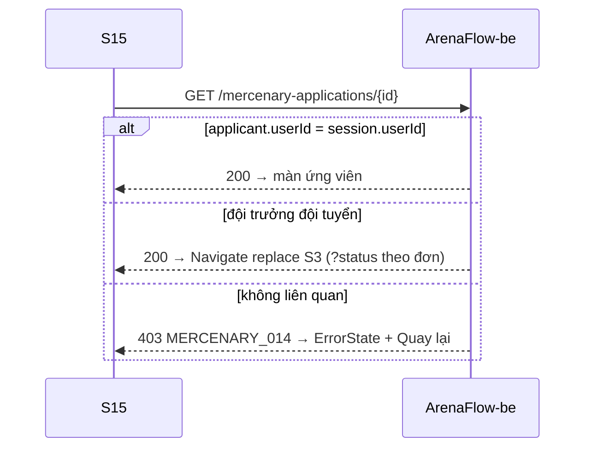

# State & API Integration — MERCENARY-001 Tuyển mercenary, ứng tuyển, chat theo đơn, uy tín cá nhân

| Mục | Giá trị |
|---|---|
| Mã chức năng | `MERCENARY-001` |
| Phạm vi tầng | frontend (ArenaFlow-fe) — hợp đồng API thuộc BE |
| Nguồn API | `docs/agent/upstream/api/MERCENARY-001/API_Spec.md` · `docs/agent/upstream/api/api-convention.md` · MATCH-001 `API_Spec.md` §1.7, §4.1, §4.7 · REPUTATION-001 `API_Spec.md` §4.1, 2.5 · VENUE-001 `API_Spec.md` 2.2, §4.3 · USER-001 `API_Spec.md` 2.9 (`TeamResponse` §4.2) · SYSTEM-002 `API_Spec.md` §1.1 |
| Căn cứ | `ArenaFlow-spec@53aee11` · API_Spec `v3.0` (MATCH-001 `v3.2`, REPUTATION-001 `v2.1`, VENUE-001 `v6.2`, USER-001 `v5.3`, NOTIFICATION-001 `v2.0`, SYSTEM-002 `v1.2`) |
| Khung dùng chung | `docs/agent/design/SHARED/APP-SHELL/State_API_Integration.md` v1.2 (nhánh `feature/USER-001-user-team`) — `http.service`, `ApiError`, 401 / `AUTH_004` / `SYS_*` / timeout, `QUERY_ROOTS`, realtime: **trỏ**, không định nghĩa lại |
| Quy ước áp dụng | `docs/agent/convention-frontend.md` §5, `docs/agent/non-functional-standards.md`, `docs/agent/security-frontend.md` · FE ADR-0004, 0005, 0007, 0008 (Proposed) · FE ADR-0010 (Proposed) |
| Tác giả / Ngày / Phiên bản | `solution-architect` (agent) / `2026-11-27` / `v1.3` (lịch sử: `CHANGELOG.md`) |

> Số mục `2.x` là mục của MERCENARY-001 `API_Spec.md` (trừ khi ghi mã khác). Field / JSON: trỏ API_Spec, không chép. Path tương đối với base `/api/v1`. Phân trang offset: `pageSize = PAGE_SIZE_DEFAULT` (20) trừ khi ghi khác.

## 1. Endpoint dùng theo màn hình

| Màn hình | Thời điểm gọi | Method + path | API_Spec | Số call khi tải |
|---|---|---|---|---|
| S1 (slot) | Khi tải | — | — | 0 |
| S1 | Mở dialog / đổi đội | `GET /teams/{teamId}/mercenary-recruitments?matchId&status=ACTIVE&page=1` | 2.2 | 0 (thao tác) |
| S1 | "Đăng n tin tuyển" | `POST /matches/{matchId}/mercenary-recruitments` | 2.1 | — |
| S2 | Khi tải | `GET /teams/{teamId}` (USER-001 2.9, header — `teamDetailKey`, 0 call khi đến từ S8a) | USER-001 2.9 | 0–1 |
| S2 | Khi tải / đổi bộ lọc · tab Tin | `GET /teams/{teamId}/mercenary-recruitments?status&matchId&page` | 2.2 | 1 |
| S2 | Khi tải / đổi bộ lọc · tab Trận ngoài | `GET /teams/{teamId}/external-matches?status&page` | 2.29 | (thay dòng trên) |
| S3 | Khi tải | `GET /mercenary-recruitments/{id}` (không toạ độ) ‖ `GET /mercenary-recruitments/{id}/applications?status&page` | 2.4, 2.8 | 2 |
| S3 | Duyệt / Từ chối | `POST /mercenary-applications/{id}/approve` · `…/reject` | 2.11, 2.12 | — |
| S4 | "Lưu" | `PATCH /mercenary-recruitments/{id}` | 2.5 | — |
| S5 | "Đóng tin" | `POST /mercenary-recruitments/{id}/close` | 2.6 | — |
| S6 | Khi tải | `GET /teams/{teamId}` (header, `teamDetailKey`; 0 khi đến từ S2) | USER-001 2.9 | 0–1 |
| S6 / S7 | Mở bộ chọn sân · gõ (debounce 300 ms) · đổi trang | `GET /venues?q&lat&lng&radiusKm&page` | VENUE-001 2.2 | 0 (thao tác) |
| S6 | "Khai báo và đăng tin" | `POST /teams/{teamId}/external-matches` | 2.28 | — |
| S7 | Khi tải | `GET /external-matches/{id}` ‖ `GET /teams/{teamId}/mercenary-recruitments?status=<ACTIVE\|ALL>&page=1&pageSize=100` → lọc `match.externalMatchId` (**#7, chặn code**). `teamId` từ URL. `status`: `ACTIVE` khi trận chưa kết thúc và chưa huỷ, `ALL` khi đã kết thúc / huỷ — đến từ S2 / S6 biết trước qua `location.state.phase` (gọi song song); vào thẳng → chờ 2.30 rồi gọi (tuần tự) | 2.30, 2.2 | 2 |
| S7 | Desktop cột trái | Chỉ đọc cache `teamExternalMatchList` (S2) — không gọi | 2.29 | 0 |
| S7 | Lưu / Huỷ trận / Thêm vị trí | `PATCH /external-matches/{id}` · `POST …/cancel` · `POST …/mercenary-recruitments` | 2.31, 2.32, 2.33 | — |
| S8 | Mở dialog | `GET /mercenary-applications/{id}/ratings` | 2.19 | 0 (thao tác) |
| S8 | "Gửi đánh giá" | `POST /mercenary-applications/{id}/ratings` | 2.18 | — |
| S9 | Mở dialog | Đội: `GET /teams/{teamId}/mercenary-reports?direction=SENT&page=1&pageSize=100` · mercenary: `GET /profile/mercenary-reports?direction=SENT&page=1&pageSize=100` → lọc `applicationId` (cache chung) | 2.21, 2.22 | 0 (thao tác) |
| S9 | "Gửi report" | `POST /mercenary-applications/{id}/reports` | 2.20 | — |
| S10 (slot) | Khi tải / đổi tab / trang (thay 2.4 của REPUTATION-001 S6) | `GET /teams/{teamId}/mercenary-reports?direction&page` | 2.21 | 1 |
| S10 / S17 | "Tranh chấp" | Slot REPUTATION-001 `reportDisputeDialog` → `POST /reports/{reportId}/dispute` | REPUTATION-001 2.5 | — |
| S11 | Khi tải | `GET /teams/{teamId}` (header, `teamDetailKey`) + `GET /teams/{teamId}/mercenary-ratings?page` | USER-001 2.9, 2.24 | 1–2 |
| S12 | Sau khi vị trí xong (không gọi khi `idle`/`locating`) · đổi bộ lọc | `GET /mercenary-recruitments?lat&lng&radiusKm&position&page` (không GPS: không `lat`/`lng`/`radiusKm`) | 2.3 | 1 |
| S13 | Khi tải | `GET /mercenary-recruitments/{id}?lat&lng` (toạ độ chỉ khi có `state.coords`) | 2.4 | 1 |
| S13 | "Ứng tuyển" | `POST /mercenary-recruitments/{id}/applications` | 2.7 | — |
| S14 | Khi tải / đổi bộ lọc | `GET /profile/mercenary-applications?status&page` | 2.9 | 1 |
| S15 | Khi tải | `GET /mercenary-applications/{id}` | 2.10 | 1 |
| S16 | Xác nhận | `POST /mercenary-applications/{id}/withdraw` | 2.13 | — |
| S17 | Khi tải / đổi tab / trang | `GET /profile/mercenary-reports?direction&page` | 2.22 | 1 |
| S18 | Khi tải | `GET /users/{userId}/reputation` | 2.23 | 1 |
| S19 (slot) | Khi tải — sau `onReady` đầu tiên của topic phòng, hoặc sau 3 s chưa kết nối (dự phòng, như host MATCH-001 State §4.4) | `GET /mercenary-applications/{applicationId}` | 2.10 | **+1** vào phòng chat (đã tính ở MATCH-001 State §1 dòng "S13 đơn") |
| S20 | Khi tải / đổi tab / trang | `GET /admin/mercenary-disputes?status&page` | 2.25 | 1 |
| S21 | Khi tải | `GET /admin/mercenary-disputes/{id}` | 2.26 | 1 |
| S21 | "Xác nhận quyết định" | `PATCH /admin/mercenary-disputes/{id}/resolve` | 2.27 | — |

**Tổng API call khi tải** — ngưỡng ≤ 3 (`non-functional-standards.md` §2, chỉ miễn refresh); cách tính có gồm request khung hay không **chưa chốt** (SHARED State_API_Integration §7 #1) → ghi cả ba cách:

| Màn | (A) Chỉ call của màn | (B) Vào thẳng URL, + hồ sơ cho header | (C) = (B) + `unread-count` (NOTIFICATION-001) | Kết luận |
|---|---|---|---|---|
| S2 | 1 (từ S8a, header có cache) · 2 (từ slot S1 — chi tiết kèo không nạp `teamDetailKey` — hoặc vào thẳng) | 2–3 | 3–**4** | Vượt ở (C) khi từ S1 / vào thẳng — #3 |
| S3 | 2 | 3 | **4** | Vượt ở (C) — #3 |
| S6 | 0 (từ S2) · 1 (vào thẳng) | 2 | 3 | Đạt |
| S7 | 2 | 3 | **4** | Vượt ở (C) — #3 |
| S11 | 1 (từ S8a) · 2 (vào thẳng) | 3 | **4** | Vượt ở (C) — #3 |
| S12, S13, S14, S15 (ứng viên), S17, S18, S20, S21 | 1 | 2 | 3 | Đạt |
| S15 → S3 (đội trưởng mở link đơn / thông báo) | 3 (2.10, rồi 2.4 ‖ 2.8) | **4** | **5** | Vượt ở (B), (C) — #3 |
| S10 (panel) | 1 + header của REPUTATION-001 S6 (0–1) | như REPUTATION-001 S6 | như REPUTATION-001 S6 | Không thêm call so với S6 `scope = team` |
| S1 (slot) | **0** vào chi tiết kèo | — | — | Không đổi tổng của MATCH-001 |
| S19 (slot) | **+1** vào phòng chat | — | — | MATCH-001 cộng vào tổng phòng chat (#4) |
| S4, S5, S8, S9, S16 (dialog) | 0 khi mở (S8: 1, S9: 0–1 — do thao tác) | — | — | Đạt |

- Header đội (S2, S6, S11) dùng **cùng key** `teamDetailKey` với S8a (USER-001) và REPUTATION-001 → đến từ S8a / S2 trong thời gian cache còn mới thì 0 call.
- S3 gọi 2.4 và 2.8 **song song** (không phụ thuộc). S7: `teamId` trên URL → 2.30 ‖ 2.2 khi biết trước trạng thái trận (dòng S7 ở bảng trên); vẫn 2 call.
- Không màn nào gọi API theo từng phần tử: trạng thái "đã đánh giá" (2.19) và "loại đã report" chỉ tải khi mở dialog của **một** đơn (#8, #9); uy tín ứng viên lấy trong 2.8 (`reputation`), không gọi 2.23 từng thẻ.

## 2. Hàm API & type

| Hàm | Đường dẫn (`src/modules/mercenary/`) | Request type | Response type | `http` |
|---|---|---|---|---|
| `createRecruitments(matchId, body)` | `api/mercenary.api.ts` | `CreateRecruitmentsRequest` (2.1) | `Recruitment[]` | `post` |
| `getTeamRecruitments(teamId, params, signal)` | ″ | `TeamRecruitmentParams { status, matchId?, page, pageSize }` | `Page<Recruitment>` | `getPage` |
| `searchRecruitments(params, signal)` | ″ | `RecruitmentSearchParams { lat?, lng?, radiusKm?, position?, page, pageSize }` | `Page<Recruitment>` | `getPage`, `accountGoneCodes: ['USER_001']` |
| `getRecruitment(recruitmentId, coords, signal)` | ″ | `Coords \| null` | `Recruitment` | `get` |
| `updateRecruitmentQuantity(recruitmentId, body)` | ″ | `{ quantityNeeded }` (2.5) | `Recruitment` | `patch` |
| `closeRecruitment(recruitmentId)` | ″ | — | `ClosedRecruitment` (= `Recruitment` + `rejectedApplicationCount`) | `post` |
| `applyRecruitment(recruitmentId)` | ″ | — | `MercenaryApplication` | `post`, `accountGoneCodes: ['USER_001']` |
| `getApplicants(recruitmentId, params, signal)` | ″ | `ApplicantParams { status, page, pageSize }` | `Page<Applicant>` | `getPage` |
| `getMyApplications(params, signal)` | ″ | `MyApplicationParams { status, page, pageSize }` | `Page<MercenaryApplication>` | `getPage` |
| `getApplication(applicationId, signal)` | ″ | — | `MercenaryApplication` | `get` |
| `approveApplication(applicationId)` | ″ | — | `ApproveResult` (2.11) | `post` |
| `rejectApplication(applicationId)` | ″ | — | `void` (204) | `post` |
| `withdrawApplication(applicationId, body)` | ″ | `{ expectedStatus: 'PENDING' \| 'APPROVED' }` | `WithdrawResult` (2.13) | `post` |
| `getUserReputation(userId, signal)` | ″ | — | `PersonalReputation` (§4.9) | `get` (**không** khai `USER_001` — nghĩa "không tìm thấy người được xem") |
| `getTeamMercenaryRatings(teamId, params, signal)` | ″ | `PageParams` | `Page<TeamMercenaryRating>` (2.24) | `getPage` |
| `rateApplication(applicationId, body)` | `api/mercenary-review.api.ts` | `RateApplicationRequest` (2.18) | `MercenaryRating` (§4.5) | `post`, `accountGoneCodes: ['USER_001']` |
| `getApplicationRatings(applicationId, signal)` | ″ | — | `ApplicationRatings` (2.19) | `get` |
| `reportApplication(applicationId, body)` | ″ | `{ reportType, reason }` (2.20) | `MercenaryReport` (§4.6) | `post`, `accountGoneCodes: ['USER_001']` |
| `getTeamMercenaryReports(teamId, params, signal)` | ″ | `MercenaryReportParams { direction, page, pageSize }` | `Page<MercenaryReport>` | `getPage` |
| `getMyMercenaryReports(params, signal)` | ″ | như trên | `Page<MercenaryReport>` | `getPage` |
| `createExternalMatch(teamId, body)` | `api/external-match.api.ts` | `CreateExternalMatchRequest` (2.28) | `ExternalMatchWithRecruitments` (§4.12 + `recruitments`) | `post` |
| `getTeamExternalMatches(teamId, params, signal)` | ″ | `ExternalMatchParams { status, page, pageSize }` | `Page<ExternalMatch>` | `getPage` |
| `getExternalMatch(externalMatchId, signal)` | ″ | — | `ExternalMatch` | `get` |
| `updateExternalMatch(externalMatchId, body)` | ″ | `UpdateExternalMatchRequest` (2.31, chỉ field dirty) | `ExternalMatch` | `patch` |
| `cancelExternalMatch(externalMatchId)` | ″ | — | `CancelExternalMatchResult` (2.32) | `post` |
| `addExternalPositions(externalMatchId, body)` | ″ | `{ positions }` (2.33) | `Recruitment[]` | `post` |
| `getAdminMercenaryDisputes(params, signal)` | `api/admin-mercenary-dispute.api.ts` | `{ status, page, pageSize }` | `Page<AdminMercenaryDispute>` (§4.10) | `getPage` |
| `getAdminMercenaryDispute(disputeId, signal)` | ″ | — | `AdminMercenaryDisputeDetail` (§4.11) | `get` |
| `resolveMercenaryDispute(disputeId, body)` | ″ | `{ decision, note }` (2.27) | `AdminMercenaryDisputeDetail` | `patch` |
| `searchVenuesForPicker(params, signal)` | `api/venue-picker.api.ts` | `VenueSearchParams` (shared, VENUE-001 §7.1) | `Page<VenuePickerItem>` (VENUE-001 §4.3 tối thiểu: `venueId`, `venueName`, `address`, `venueType`, `primaryImageUrl`, `distanceKm`) | `getPage` |
| `getTeamDetail(teamId, signal)` | `api/team-detail.api.ts` | — | `TeamDetail` (shared — **nguyên response**, không biến đổi trong `queryFn`; REPUTATION-001 State §3.1) | `get` |

- Type module: `types/mercenary-api.type.ts` — `Recruitment`, `RecruitmentMatch`, `RecruitmentVenue`, `Area`, `MyApplicationRef` (§4.2); `MercenaryApplication` (§4.3); `Applicant`, `ApplicantReputation` (§4.4); `MercenaryRating`, `ApplicationRatings` (§4.5, 2.19); `MercenaryReport` (§4.6); `PersonalReputation` (§4.9); `TeamMercenaryRating` (2.24); `AdminMercenaryDispute`, `AdminMercenaryDisputeDetail` (§4.10, §4.11); `ExternalMatch` (§4.12); `ApproveResult`, `WithdrawResult`, `CancelExternalMatchResult`; enum `RecruitmentStatus`, `ApplicationStatus`, `MatchSource`, `ExternalMatchStatus`; request types. Field trỏ API_Spec, không chép. `ReportType`, `ReportStatus`, `ReliabilityLevel`: `src/shared/types/reputation.type.ts` (REPUTATION-001). `PlayerPosition`, `SkillLevel`: `src/shared/constants/player-options.constant.ts`.
- Type UI: `Coords { lat: number; lng: number }` (làm tròn 4 chữ số thập phân như VENUE-001 `useVenueSearchState`); `PickedVenue { venueId; name; address }`; `PositionDraft { position; quantity }`.
- `contextType` / enum lạ từ BE → bỏ qua giá trị không biết (API_Spec §4.1).
- Thời gian: chuỗi giờ Việt Nam không múi giờ — hiển thị bằng `formatVnDateTime` / `formatVnDate` / `formatVnTime` / `formatMatchTimeRange`, so sánh bằng `isPastVn` (SHARED `vn-datetime`).

## 3. State

### 3.1. Server state — query key (FE ADR-0004)

```ts
// src/modules/mercenary/constants/mercenary-query-keys.constant.ts
export const mercenaryKeys = {
  all: [QUERY_ROOTS.mercenary] as const,
  recruitments: () => [...mercenaryKeys.all, 'recruitment'] as const,
  recruitmentSearch: (p: RecruitmentSearchParams) => [...mercenaryKeys.recruitments(), 'search', p] as const,
  recruitmentDetail: (id: string) => [...mercenaryKeys.recruitments(), 'detail', id] as const,
  recruitmentView: (id: string, coords: Coords | null) => [...mercenaryKeys.recruitmentDetail(id), 'view', coords] as const,
  applicants: (id: string) => [...mercenaryKeys.recruitmentDetail(id), 'applicants'] as const,
  applicantList: (id: string, p: ApplicantParams) => [...mercenaryKeys.applicants(id), p] as const,
  teamRecruitments: (teamId: string) => [...mercenaryKeys.recruitments(), 'team', teamId] as const,
  teamRecruitmentList: (teamId: string, p: TeamRecruitmentParams) => [...mercenaryKeys.teamRecruitments(teamId), p] as const,
  applications: () => [...mercenaryKeys.all, 'application'] as const,
  myApplicationList: (p: MyApplicationParams) => [...mercenaryKeys.applications(), 'mine', p] as const,
  applicationDetail: (id: string) => [...mercenaryKeys.applications(), 'detail', id] as const,
  applicationRatings: (id: string) => [...mercenaryKeys.applicationDetail(id), 'ratings'] as const,
  reports: () => [...mercenaryKeys.all, 'report'] as const,
  teamReportList: (teamId: string, p: MercenaryReportParams) => [...mercenaryKeys.reports(), 'team', teamId, p] as const,
  myReportList: (p: MercenaryReportParams) => [...mercenaryKeys.reports(), 'mine', p] as const,
  userReputation: (userId: string) => [...mercenaryKeys.all, 'user-reputation', userId] as const,
  teamRatings: (teamId: string) => [...mercenaryKeys.all, 'team-ratings', teamId] as const,
  teamRatingList: (teamId: string, p: PageParams) => [...mercenaryKeys.teamRatings(teamId), p] as const,
  externalMatches: () => [...mercenaryKeys.all, 'external-match'] as const,
  teamExternalMatchList: (teamId: string, p: ExternalMatchParams) => [...mercenaryKeys.externalMatches(), 'team', teamId, p] as const,
  externalMatchDetail: (id: string) => [...mercenaryKeys.externalMatches(), 'detail', id] as const,
}
export const adminMercenaryDisputeKeys = {
  all: [QUERY_ROOTS.mercenary, 'admin-dispute'] as const,
  lists: () => [...adminMercenaryDisputeKeys.all, 'list'] as const,
  list: (p: AdminMercenaryDisputeParams) => [...adminMercenaryDisputeKeys.lists(), p] as const,
  detail: (id: string) => [...adminMercenaryDisputeKeys.all, 'detail', id] as const,
}
// Bộ chọn sân: KHÔNG khai ở module — dùng venuePickerKey(p) = [QUERY_ROOTS.venue, 'picker', p] khai ở
// src/shared/constants/venue-picker-query-key.constant.ts (MATCH-001 Screen_Flow §6 C3, dùng chung với MATCH-001).
// Hợp đồng: queryFn dưới key này trả NGUYÊN Page của VENUE-001 2.2 (không map / lọc / đổi tên field); cần tập con → select
// Dùng chung (REPUTATION-001 State §3.1): teamDetailKey(teamId), teamReputationKey(teamId)
```

| State | Loại | Hook | Key | Ghi chú |
|---|---|---|---|---|
| Kết quả tìm kèo (S12) | server | `useRecruitmentSearch(params, { enabled })` | `recruitmentSearch` | `enabled` khi `geolocation ∉ {idle, locating}`; `placeholderData` giữ trang cũ |
| Chi tiết tin (S3, S13) | server | `useRecruitmentDetail(id, coords)` | `recruitmentView(id, coords)` | S3: `coords = null` |
| Ứng viên (S3) | server | `useApplicants(id, params)` | `applicantList` | `placeholderData` |
| Tin của đội (S2, S1, S7) | server | `useTeamRecruitments(teamId, params, { enabled })` | `teamRecruitmentList` | S1: `{ status: 'ACTIVE', matchId, page: 1, pageSize: 20 }` khi dialog mở; S7: `{ status: 'ACTIVE' \| 'ALL' (theo trạng thái trận), page: 1, pageSize: 100 }` + `select` lọc `match.externalMatchId` (`useExternalMatchRecruitments`, #7) |
| Trận ngoài của đội (S2, cột trái S7) | server | `useTeamExternalMatches(teamId, params, { enabled })` | `teamExternalMatchList` | S7: `enabled: false` — chỉ đọc cache (`queryClient.getQueryData`) |
| Chi tiết trận ngoài (S7) | server | `useExternalMatch(id)` | `externalMatchDetail` | — |
| Đơn của tôi (S14) | server | `useMyApplications(params)` | `myApplicationList` | `placeholderData` |
| Chi tiết đơn (S15, S19) | server | `useApplicationDetail(id)` | `applicationDetail` | S19: một cache với S15 |
| Đánh giá của đơn (S8) | server | `useApplicationRatings(id, { enabled: open })` | `applicationRatings` | Tải khi mở dialog |
| Loại đã report (S9) | server | `useSentReportTypes(reporter, applicationId, { enabled: open })` | đội: `teamReportList(teamId, { direction: 'SENT', page: 1, pageSize: 100 })`; mercenary: `myReportList({ direction: 'SENT', page: 1, pageSize: 100 })` | `select` lọc `applicationId` → `ReadonlySet<ReportType>` (#9) |
| Report đội (S10) / của tôi (S17) | server | `useTeamMercenaryReports`, `useMyMercenaryReports` | `teamReportList`, `myReportList` | `placeholderData` |
| Uy tín cá nhân (S18) | server | `useUserReputation(userId)` | `userReputation` | — |
| Đánh giá của mercenary cho đội (S11) | server | `useTeamMercenaryRatings(teamId, params)` | `teamRatingList` | — |
| Header đội (S2, S6, S11) | server | `useTeamHeader(teamId)` | `teamDetailKey(teamId)` + `select` `{ teamName, status, captainId }` | Một cache với S8a / REPUTATION-001 |
| Bộ chọn sân (S6, S7) | server | `useVenuePicker(params \| null)` | `venuePickerKey` | `enabled` khi dialog mở và `params ≠ null` |
| Hàng chờ / chi tiết tranh chấp (S20, S21) | server | `useAdminMercenaryDisputes`, `useAdminMercenaryDispute` | `adminMercenaryDisputeKeys.*` | — |
| Vị trí GPS (S12) | client (bộ nhớ) | `useGeolocation` (shared, VENUE-001) | — | Toạ độ không vào URL / storage; S13 nhận qua `location.state.coords` (#14) |
| Bộ lọc / tab / trang | URL | `useUrlParam` | S2 `tab`, `status`, `matchId`, `page`; S3 `status`, `page`; S11 `page`; S12 `position`, `radiusKm`, `page`; S14 `status`, `page`; S17 `tab`, `page`; S20 `status`, `page` | Screen_Flow §3 |
| Dialog đang mở, loại report chọn sẵn, lỗi chặn ứng tuyển trong phiên trang | client cục bộ | `useState` trong page / component | — | Không store toàn cục |

### 3.2. Sau mutation thành công

| Mutation | Cập nhật cache | Callback host |
|---|---|---|
| 2.1 | invalidate `teamRecruitments(teamId)` | — (điều hướng sang S2) |
| 2.33 | invalidate `teamRecruitments(teamId)` | — |
| 2.5 | `setQueryData(recruitmentView(id, null), response)`; invalidate `recruitmentDetail(id)` (tiền tố — gồm bản có toạ độ, ứng viên), `teamRecruitments(teamId)` | — |
| 2.6 | như 2.5 (response `ClosedRecruitment`) | — |
| 2.7 | invalidate `recruitmentDetail(id)`, `applications()` | — |
| 2.11 | invalidate `recruitmentDetail(recruitmentId)`, `teamRecruitments(teamId)`, `applicationDetail(applicationId)`, `externalMatches()` (đổi `hasApprovedMercenary`) | S19: `onApplicationChanged()` |
| 2.12 | invalidate `recruitmentDetail(recruitmentId)`, `teamRecruitments(teamId)`, `applicationDetail(applicationId)` | S19: `onApplicationChanged()` |
| 2.13 | invalidate `applications()`, `recruitmentDetail(recruitmentId)`; `reliabilityPenalty > 0` → invalidate `userReputation(session.userId)` | — |
| 2.18 | invalidate `applicationRatings(id)`; phía đội → `userReputation(mercenaryUserId)`; phía mercenary → `teamRatings(teamId)` | — |
| 2.20 | invalidate `reports()`; phía đội → `userReputation(mercenaryUserId)`; phía mercenary → `teamReputationKey(teamId)` (REPUTATION-001) | — |
| Tranh chấp (slot REPUTATION-001, `onDisputed`) | invalidate `reports()` | — |
| 2.27 | `setQueryData(adminMercenaryDisputeKeys.detail(id), response)`; invalidate `adminMercenaryDisputeKeys.lists()`, `userReputation(mercenaryId)`, `teamReputationKey(team.teamId)` | — |
| 2.28 | `setQueryData(externalMatchDetail(id), response bỏ recruitments)`; invalidate `externalMatches()`, `teamRecruitments(teamId)` | — |
| 2.31 | `setQueryData(externalMatchDetail(id), response)`; invalidate `externalMatches()` (danh sách), `teamRecruitments(teamId)` (tin hiện giờ / sân mới) | — |
| 2.32 | invalidate `externalMatchDetail(id)`, `externalMatches()`, `teamRecruitments(teamId)` | — |

- Invalidate chéo domain chỉ theo key dùng chung (`teamReputationKey`); dữ liệu của MATCH-001 / REPUTATION-001 / module `chat` do host làm mới qua callback (FE ADR-0010 mục 6).
- Lỗi trạng thái (`MERCENARY_007`, `MERCENARY_012`, `MERCENARY_025`, `MERCENARY_004`, `DISPUTE_002`, `MATCH_014`) → invalidate đúng các key của dòng mutation tương ứng để tải lại.

### 3.3. Dữ liệu dẫn xuất
- Nút theo trạng thái tin / đơn / trận: `isMatchStarted`, `isMatchFinished`, `isMatchCancelled` (Component_Design §5) trên dữ liệu đã tải; không gọi thêm API.
- Vị trí khoá ở S1 / "Thêm vị trí": tập `position` của tin `OPEN`/`FILLED` trong dữ liệu 2.2 đã tải.
- Mức trừ dự kiến (S16): `estimateWithdrawPenalty(status, startsAt, Date.now())` lúc mở dialog.
- Nút "Tranh chấp" (S10, S17): `isDisputeOpen(report, useNowMs(60_000))` (shared sau Screen_Flow §6 C5).

## 4. Luồng tương tác

### 4.1. S12 — tìm kèo theo GPS



### 4.2. S19 — đầu phòng chat theo đơn



- Frame có `applicationId` khác props → bỏ qua. Frame `MESSAGE_CREATED` → slot bỏ qua (host xử lý).
- Không có frame cho thay đổi tự động (tin đóng / hết hạn, ứng viên xoá tài khoản — API_Spec §1.3, §1.7): host biết qua `CHAT_004` / tải lại 2.19 → prop `applicationStatus` đổi → slot invalidate `applicationDetail(applicationId)`.
- `onReady(epoch)` (hợp đồng: SHARED State_API_Integration §6 v1.2): slot giữ `loadedEpoch` (epoch lúc 2.10 bắt đầu tải; −1 khi tải ở nhánh dự phòng). `onReady` với `epoch > loadedEpoch` (kết nối lại, hoặc nhánh dự phòng rồi mới kết nối) → invalidate `applicationDetail(applicationId)` để bù frame `APPLICATION_UPDATED` bị lỡ (nhánh dự phòng: +1 như host). Host tự bù tin + 2.19 (MATCH-001 State §4.4).
- Nút nhanh "Duyệt" / "Từ chối" → `ApplicationConfirmDialogs` (cùng mutation S3) → `onApplicationChanged()`.

### 4.3. S15 — phân luồng theo vai trò



## 5. Xử lý lỗi

> Chung (SHARED State_API_Integration §2.3): 401 refresh, `AUTH_004`, `SYS_*`, timeout 15 s / mất mạng → `ErrorState` + **Thử lại** (màn) hoặc `FormErrorBanner` (dialog). `400 VALIDATION_ERROR` → `applyServerValidationErrors` (Component_Design §4). `409 MATCH_014` ở mọi thao tác ghi → message BE trong dialog / toast, tải lại dữ liệu liên quan (§3.2), giữ dialog để bấm lại. `422 TEAM_015` / `TEAM_016` ở thao tác ghi → message BE trong dialog, nút gửi disable.

### 5.1. 2.1 (S1), 2.33 (Thêm vị trí)

| HTTP / mã | Hiển thị / hành động |
|---|---|
| `404 MATCH_001`, `404 TEAM_001`, `403 TEAM_002`, `403 MATCH_009`, `422 MERCENARY_003/004/013` | Banner message BE trong dialog, nút đăng disable; S1: mã thuộc danh sách JSDoc `onMatchChanged` (Component_Design §6.1) → `onMatchChanged()` (host làm mới → slot ẩn nút) |
| `404 MERCENARY_024`, `422 MERCENARY_004/013` (2.33) | Đóng dialog, toast message BE, invalidate `externalMatchDetail` |
| `409 MERCENARY_023` | Banner message BE; invalidate `teamRecruitmentList` → dòng vị trí đó khoá |

### 5.2. 2.2, 2.29, 2.30, 2.8 — tải danh sách của đội trưởng (S2, S3, S7)

| HTTP / mã | Hiển thị / hành động |
|---|---|
| `403 TEAM_002` | `ErrorState` "Chỉ đội trưởng được quản lý tin tuyển của đội" + link `buildTeamDetailPath` |
| `404 TEAM_001`, `404 MERCENARY_001`, `404 MERCENARY_024`, `422 TEAM_016` | `ErrorState` message BE + link về S2 / S8a |
| `400 VALIDATION_ERROR` (tham số URL sai) | `useUrlParam` đã chuẩn hoá — gặp vẫn hiện `ErrorState` message BE |

### 5.3. 2.3, 2.4 (S12, S13)

| HTTP / mã | Hiển thị / hành động |
|---|---|
| `422 MERCENARY_018` | S12 trạng thái "Bật GPS hoặc cập nhật khu vực…" (Screen_Flow S12) |
| `404 USER_001` (2.3) | Wrapper `endSession('ACCOUNT_DELETED')` |
| `404 MERCENARY_001` (2.4) | `ErrorState` "Không tìm thấy tin tuyển" + "Quay lại" |

### 5.4. 2.5, 2.6 (S4, S5 đóng tin)

| HTTP / mã | Hiển thị / hành động |
|---|---|
| `422 MERCENARY_008`, `422 MERCENARY_013` | Lỗi cạnh ô số (S4) |
| `409 MERCENARY_007`, `404 MERCENARY_001` | Đóng dialog, toast message BE, invalidate `recruitmentDetail`, `teamRecruitments` |
| `403 TEAM_002` | Đóng dialog, toast; tải lại màn (BE trả `TEAM_002` cho màn → `ErrorState`) |

### 5.5. 2.7 (S13)

| HTTP / mã | Hiển thị / hành động |
|---|---|
| `409 MERCENARY_006`, `422 MERCENARY_005/010/011/013` | Nút "Ứng tuyển" disable + message BE dưới nút (giữ trong phiên trang); `MERCENARY_013` / `006` → invalidate `recruitmentDetail` |
| `409 MERCENARY_009`, `409 MERCENARY_007` | Toast message BE, invalidate `recruitmentDetail` (hiện `myApplication` / trạng thái mới) |
| `404 MERCENARY_001` | Toast message BE, invalidate `recruitmentDetail` → `ErrorState` "Không tìm thấy tin tuyển" |
| `404 USER_001` | Wrapper `endSession('ACCOUNT_DELETED')` |

### 5.6. 2.11, 2.12 (S3, S19)

| HTTP / mã | Hiển thị / hành động |
|---|---|
| `409 MERCENARY_006`, `422 MERCENARY_010/011` | `error` trong `ConfirmDialog`; đơn giữ "Chờ duyệt" (UC-ME04 4a) |
| `422 MERCENARY_013` | `error` trong dialog; invalidate → nút "Duyệt" ẩn |
| `409 MERCENARY_012`, `409 MERCENARY_007`, `404 MERCENARY_002` | Đóng dialog, toast message BE, invalidate (§3.2 dòng 2.11 / 2.12) |
| `403 TEAM_002` | Đóng dialog, toast; S19: `onApplicationChanged()` |

### 5.7. 2.9, 2.10, 2.13 (S14, S15, S16, S19)

| HTTP / mã | Hiển thị / hành động |
|---|---|
| `403 MERCENARY_014` (2.10) | S15: `ErrorState` "Bạn không tham gia đơn ứng tuyển này" + "Quay lại"; S19: slot chỉ hiện tên hai bên từ props (không thẻ tóm tắt) |
| `404 MERCENARY_002` | S15: `ErrorState` message BE; S16: đóng, toast, invalidate `applications()` |
| `403 MERCENARY_014` (2.13) | Đóng dialog, toast message BE, invalidate `applicationDetail` → nút rút ẩn |
| `409 MERCENARY_012` (2.13) | Toast "Trạng thái đơn đã thay đổi, vui lòng tải lại", đóng dialog, invalidate `applicationDetail`, `applications()` — không rút |
| `422 MERCENARY_013`, `422 MERCENARY_004` (2.13) | `error` trong dialog, nút xác nhận disable; invalidate → nút "Rút lui" ẩn |

### 5.8. 2.18, 2.19, 2.20 (S8, S9)

| HTTP / mã | Hiển thị / hành động |
|---|---|
| `409 MERCENARY_017` | Invalidate `applicationRatings` → dialog hiện kết quả |
| `422 MERCENARY_015` | Banner message BE + "Thử lại sau ít phút" (trận vừa kết thúc) |
| `422 MERCENARY_016` | Lỗi lập trình (phía mercenary không có "Không đến") — banner message BE |
| `422 MERCENARY_019`, `422 TEAM_015` (2.18, 2.19, 2.20) | Banner message BE trong dialog, nút gửi disable / không form |
| `403 MERCENARY_014`, `404 MERCENARY_002` (2.18, 2.19, 2.20) | Đóng dialog, toast message BE; S9: `onBlocked(code)` → nơi gọi ẩn "Report"; invalidate `applicationDetail` |
| `422 MERCENARY_020`, `422 TEAM_016` (2.20) | Đóng dialog, toast, `onBlocked(code)` → nơi gọi ẩn "Report" |
| `422 MERCENARY_021` | Chuyển dialog sang `BAD_COMMUNICATION_ONLY` + banner |
| `409 MERCENARY_022` | Loại đó disable "Đã report", invalidate `reports()` |
| `404 USER_001` (2.18, 2.20) | Wrapper `endSession('ACCOUNT_DELETED')` |

### 5.9. 2.28, 2.31, 2.32 (S6, S7)

| HTTP / mã | Hiển thị / hành động |
|---|---|
| `404 VENUE_001`, `422 VENUE_002` | Lỗi dưới ô "Sân" ("Chọn sân khác"); bỏ sân đã chọn |
| `409 MERCENARY_025` | Toast message BE, invalidate `externalMatchDetail` → khoá Sân / Giờ / Trình độ, giữ giá trị "Tên đối thủ" đang sửa |
| `422 MERCENARY_013` (2.31) | Lỗi chung form "Trận đã bắt đầu — chỉ sửa được tên đối thủ", invalidate |
| `422 MERCENARY_004`, `404 MERCENARY_024` | Toast, invalidate / `ErrorState` (404) |
| `422 MERCENARY_013` (2.32) | `error` trong `ConfirmDialog`, ẩn "Huỷ trận ngoài" sau khi đóng |
| `403 TEAM_002`, `404 TEAM_001` (2.28) | `FormErrorBanner` message BE, nút gửi disable |

### 5.10. 2.21, 2.22, 2.23, 2.24 (S10, S11, S17, S18)

| HTTP / mã | Hiển thị / hành động |
|---|---|
| `422 TEAM_015`, `422 TEAM_016`, `403 TEAM_002` (2.21) | `ErrorState` message BE trong panel (không thử lại) |
| `404 TEAM_001` (2.21, 2.24) | `ErrorState` "Không tìm thấy đội" |
| `404 USER_001` (2.23) | `ErrorState` "Không tìm thấy người dùng" (không kết thúc phiên) |
| Lỗi tranh chấp (REPUTATION-001 2.5) | Do slot `reportDisputeDialog` xử lý (REPUTATION-001 State §5.6); host chỉ nhận `onDisputed()` |

### 5.11. 2.25, 2.26, 2.27 (S20, S21)

| HTTP / mã | Hiển thị / hành động |
|---|---|
| `403 AUTH_004` | SHARED Screen_Flow §2 |
| `404 DISPUTE_001` | Toast message BE, `navigate(adminMercenaryDisputes, { replace: true })` |
| `409 DISPUTE_002` | Toast message BE, invalidate `detail` → khối chỉ đọc |

### 5.12. Realtime (S19)

| Lỗi | Hành động |
|---|---|
| `CHAT_002` / `CHAT_003` khi `SUBSCRIBE` | Host xử lý ("Bạn không còn xem được cuộc trò chuyện này"); slot gỡ subscription, không tự báo lỗi |
| Mất kết nối | Host hiện "Đang kết nối lại…"; slot invalidate ở `onReady` epoch mới (§4.2) |

## 6. Phân trang / tìm kiếm / sort
- Offset `page` / `pageSize` theo `api-convention.md` §7; thứ tự cố định do BE (API_Spec từng mục) — FE không sort, không có điều khiển sắp xếp (UI_Design S12 "Không implement").
- `pageSize = PAGE_SIZE_DEFAULT` (20) cho S2, S3, S10, S11, S12, S14, S17, S20, bộ chọn sân. `pageSize = PAGE_SIZE_MAX` (100), chỉ trang 1, lọc phía client — **tạm, chặn code tới khi user chấp nhận**: tin của trận ngoài (S7, #7), loại đã report (S9, #9).
- Debounce 300 ms: ô tìm sân (bộ chọn sân), thanh trượt bán kính S12. Đổi bộ lọc → `page = 1`; trang rỗng mà `page > 1` → `replace` sang `max(1, totalPages)`.

## 7. `[cần xác nhận]`
> **Chặn code?** *Có* = developer không code phần nêu tới khi chốt · *Không* = code theo phương án đề xuất, đổi sau nếu user chọn khác. Đánh số chung cho 3 tài liệu.

| # | Nội dung | Chặn code? |
|---|---|---|
| 1 | **Nền SHARED + ADR:** SHARED/APP-SHELL v1.2 (http, session, `ROUTE_PATHS`, `QUERY_ROOTS`, shared component, `vn-datetime`, realtime) chưa merge; FE ADR-0002..0006, 0008 `Proposed`; ADR-0007 (realtime) `Proposed` — cần cho S19. Thành phần `shared/` của REPUTATION-001 (§3) và VENUE-001 (§7) chưa merge | **Có** — toàn bộ MERCENARY-001 |
| 2 | **FE ADR-0010 (slot) `Proposed`** — `FeatureSlotsProvider` / `useFeatureSlot` đã có ở SHARED v1.2; chỉ còn ADR chặn | **Có** — `MatchMercenarySection`, `ConversationApplicationHeader`, `TeamMercenaryReportsPanel`, gọi slot `reportDisputeDialog` ở S10 / S17. **Không** — các page |
| 3 | **Ngưỡng call ở (C)** (§1): S2, S11 vào thẳng URL = 4; S3, S7 = 4 mọi đường vào; S2 từ slot S1 = 4; S15 khi người mở là đội trưởng (chuyển S3) = (A) 3 / (B) 4 / (C) 5. Phụ thuộc SHARED State_API_Integration §7 #1 (đề xuất: request khung không tính). Phương án giảm nếu phải tính (C): S2, S11 không gọi header khi chưa có cache (breadcrumb không tên đội, banner `INACTIVE` chỉ hiện khi BE trả `TEAM_015`); S3, S7 **không** giảm được khi không đổi hợp đồng — đề xuất BE gộp tóm tắt tin vào 2.8 / thêm lọc `externalMatchId` cho 2.2 trả kèm 2.30 (repo BE) | **Có** — S3, S7, nhánh đội trưởng của S15 tới khi chốt SHARED §7 #1 (phương án giảm S15: thông báo `MERCENARY_APPLICATION` cho đội trưởng mang `recruitmentId` để đi thẳng S3 — đổi hợp đồng NOTIFICATION, repo BE); S2, S11: luồng header khi vào thẳng / từ S1 (theo phương án giảm thì **Không**) |
| 4 | **Module `chat` (MATCH-001) — đã chốt phần lớn (MATCH-001 Screen_Flow §6 C12):** (a) ✓ `buildConversationPath` → `/conversations/:conversationId`; (b) ✓ host cắm slot S19, `hasMessages`, invalidate 2.19 khi `onApplicationChanged`, thu hẹp `applicationStatus` (`toSlotApplicationStatus`); (d) ✓ host giữ thanh khoá chung, slot giữ dòng lý do; (c) **còn mở:** +1 call (2.10) đã tính ở MATCH-001 nhưng phòng chat đơn desktop vượt (A) khi 2.20 chưa có cache — MATCH-001 `[cần xác nhận]` #4 (đề xuất BE thêm `position`, `matchStartsAt` vào 2.19 cho loại đơn); (e) ✓ realtime nhiều subscriber + `onReady(epoch)` đã chốt ở SHARED State_API_Integration §6 v1.2 (ADR-0007 còn `Proposed` — #1) | **Có** — nhúng S19 theo ngưỡng MATCH-001 #4. **Không** — nút "Nhắn tin" / "Xem chat" (hằng đã chốt), phần còn lại của slot |
| 5 | ~~**Slot S1 trên chi tiết kèo**~~ — **Đóng (v1.1):** MATCH-001 chấp nhận §6.1 (Screen_Flow §6 C12; Component_Design §7), `viewer: SlotMatchViewer` dùng chung REPUTATION-001; `buildMatchDetailPath` → `/matches/:matchId` đã đăng ký | Không (cắm slot còn chờ #2) |
| 6 | **Slot S10 trên REPUTATION-001 S6** — props `TeamMercenaryReportsPanelProps` + tham số `scope` (Screen_Flow §6 C7) khác đề xuất `{ teamId; direction }` của REPUTATION-001 #10 | **Có** — cắm S10 |
| 7 | **2.2 không lọc theo `externalMatchId`:** S7 lấy trang 1 `pageSize=100` rồi lọc client — trái "lọc ở BE" (`non-functional-standards.md` §1). 2.2 sắp `startsAt` tăng dần → tin của các trận bắt đầu sớm hơn chiếm trang 1, tin của trận đang xem có thể rớt. Giảm rủi ro: `status=ACTIVE` khi trận chưa kết thúc / chưa huỷ (chỉ tin đang mở của các trận chưa kết thúc), `ALL` chỉ khi đã kết thúc / huỷ — vẫn không đúng tuyệt đối. Đề xuất BE thêm tham số `externalMatchId` cho 2.2 (`matchId` đã có) hoặc trả `recruitments` trong 2.30 (repo BE) | **Có** — khối "Tin tuyển của trận" ở S7 (và `lockedPositions` của "Thêm vị trí") tới khi user chấp nhận phương án tạm hoặc BE thêm lọc. **Không** — phần còn lại của S7 |
| 8 | **Trạng thái "đã đánh giá" theo từng đơn** chỉ có ở 2.19 → không gọi cho từng thẻ (N+1). Lệch UI: S3 tab "Đã duyệt" và S14 luôn hiện nút "Đánh giá" khi trận đã kết thúc; mở dialog mới biết đã đánh giá (hiện kết quả). S15 cũng tải 2.19 khi mở dialog (giữ S15 = 1 call). Đề xuất BE thêm cờ `myRatingGiven` vào 2.8 / 2.9 / 2.10 (repo BE) | Không |
| 9 | **Loại đã report của một đơn:** 2.21 / 2.22 không lọc `applicationId` → trang 1 `SENT` `pageSize=100` (mới nhất trước) rồi lọc client — trái "lọc ở BE"; report cũ hơn 100 report gần nhất không thấy → BE chặn bằng `MERCENARY_022`. Đề xuất BE thêm `applicationId` cho 2.21 / 2.22 (repo BE) | **Có** — phần tải + disable loại đã report trong S9 tới khi user chấp nhận hoặc BE thêm lọc; thiếu phần này S9 vẫn code được (mọi loại chọn được, `MERCENARY_022` → disable loại đó) |
| 10 | **S3 không biết trạng thái trận** (2.4 §4.2 không có `match.status`): nút "Đánh giá" / "Report" theo `isPastVn(endsAt)`; kèo đã huỷ vẫn hiện nút → BE trả `MERCENARY_015` / `MERCENARY_021`. Đề xuất BE thêm `match.status` vào §4.2 | Không |
| 11 | **S11, S18 là route riêng** (UI_Design §4 #3 — tab trong hồ sơ đội / hồ sơ người chơi chưa có): link từ S8a, S3 hồ sơ (Screen_Flow §6 C9, C10), giữ ngưỡng call của S8a / S3 (USER-001) | Không |
| 12 | **S18 không có tên người** khi vào thẳng URL (2.23 không trả `displayName`); dùng `state.displayName` từ S3 / tiêu đề chung. Đề xuất BE thêm `displayName`, `avatarUrl` vào 2.23 | Không |
| 13 | **S12:** (a) nhãn chế độ không GPS dùng câu chung "Đang tìm theo khu vực trong hồ sơ của bạn" (module `mercenary` không đọc cache hồ sơ của module `account`); (b) quyền vị trí đã bị chặn → hướng dẫn "Mở quyền vị trí trong cài đặt trình duyệt rồi thử lại" (UI_Design §4 #5; BC-ME05) | Không |
| 14 | **Toạ độ S12 → S13** qua `location.state` (bộ nhớ lịch sử phiên của tab, không URL / storage); mở S13 bằng link khác → không gửi toạ độ, không có khoảng cách | Không |
| 15 | **Mục nav** "Tìm kèo mercenary", "Kèo mercenary của tôi" — đề xuất `order` 50 / 55 (đồng bộ SHARED Screen_Flow §6 #5; sau nav `team` 10/20/30 và MATCH-001 5/15, trước "Tin nhắn" 90); chốt chung với SHARED #5, MATCH-001 `[cần xác nhận]` #11, VENUE-001 (UI_Design §4 #1); menu Admin "Tranh chấp mercenary" `order: 41` (UI_Design §4 #10) | Không |
| 16 | **Nhãn enum** (UI_Design §4 #6): mức uy tín, loại / trạng thái report theo hằng chung của REPUTATION-001 (Screen_Flow §6 C8 — khác đề xuất "Xuất sắc / Cảnh báo đỏ" của UI_Design MERCENARY-001); trạng thái tin / đơn / trận ngoài theo Component_Design §5 | Không |
| 17 | **"Chưa có sân? Thêm địa điểm" (S6):** rời S6 sang VENUE-001 S2 làm mất dữ liệu form đã nhập; quay lại cần VENUE-001 trả `state.createdVenue { venueId, name, address }` (Screen_Flow §6 C13) để chọn sẵn mà không gọi thêm API | Không |
| 18 | **"Mở bản đồ" (S15)** không implement — chỉ hiển thị toạ độ dạng chữ (UI_Design §4 #4) | Không |
| 19 | **S7 desktop cột trái** chỉ từ cache của S2; vào thẳng → link "← Danh sách trận ngoài" (lệch UI để không thêm call) | Không |
| 20 | **Câu chữ chưa có trong SRS:** lỗi validation (Component_Design §4), toast, tiêu đề `ErrorState` | Không |
| 21 | ~~**Định dạng giờ trận**~~ — **Đóng (v1.1):** dùng `formatMatchTimeRange` ở SHARED `vn-datetime` (MATCH-001 Screen_Flow §6 C5) | Không |
| 22 | **S1 dòng vị trí đã có tin** link sang S2 `?matchId=` thay vì mở thẳng S4 của tin đó | Không |
| 23 | **S2 nhóm tin theo trận** trên từng trang (2.2 phân trang theo tin, không theo trận) — nhóm có thể bị cắt giữa hai trang, tiêu đề nhóm lặp lại ở trang sau | Không |
| 24 | **Bộ chọn sân** (`VenuePickerDialog`) dựng trong module `mercenary`, MATCH-001 dựng bản của mình (mẫu VENUE-001 §7.1 — UI ở `shared/`, mỗi module tự gọi API) — hai component gần giống; cân nhắc đưa phần trình bày (danh sách + thẻ + nút "Chọn") lên `shared/` khi `reuse-scan`, mỗi module giữ hook gọi API dưới `venuePickerKey` chung | Không |
| 25 | **S15 khi người xem vừa là ứng viên vừa là đội trưởng** (`MERCENARY_019`): phân luồng theo `applicant.userId = session.userId` → màn ứng viên; đánh giá / report trả `MERCENARY_019` → banner | Không |
