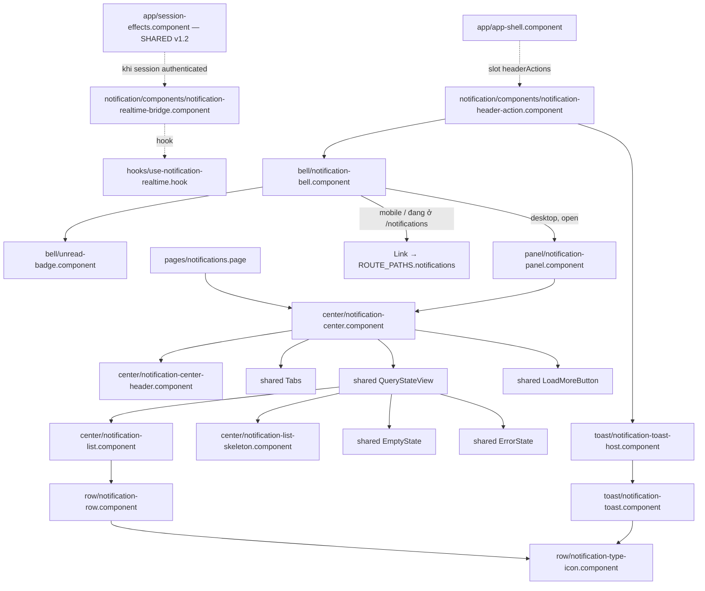

# Component Design — NOTIFICATION-001 Thông báo in-app

| Mục | Giá trị |
|---|---|
| Mã chức năng | `NOTIFICATION-001` |
| Phạm vi tầng | frontend (ArenaFlow-fe) |
| Repo/stack | ArenaFlow-fe · React 19 + TypeScript + Tailwind CSS 4 · TanStack Query (FE ADR-0004) · `@stomp/stompjs` qua `core/realtime` (FE ADR-0007) |
| Nguồn SRS/UI/API | `docs/agent/upstream/business-spec/SYSTEM-001/` (UC-N02; BR-N02, BR-N09, BR-N11, BR-N12) · `UI_Design.md` v1.0 (S1–S4) · `docs/agent/upstream/api/NOTIFICATION-001/API_Spec.md` |
| Căn cứ | `ArenaFlow-spec@53aee11` · API_Spec `v2.0` |
| Quy ước áp dụng | `docs/agent/convention-frontend.md` §2–§4, §6, §10 · `docs/agent/non-functional-standards.md` §4 · khung SHARED `Component_Design.md` v1.2 (nhánh `feature/USER-001-user-team`, chưa merge — **chặn code**, Screen_Flow §6 #8) |
| Tác giả / Ngày / Phiên bản | `solution-architect` (agent) / `2026-11-27` / `v1.3` (lịch sử: `CHANGELOG.md`) |

> Route + điều hướng: `Screen_Flow.md`. Query key, cache, realtime, lỗi: `State_API_Integration.md`.
> Module mới `src/modules/notification/` (+ `README.md` của module: mục đích, UC-N02, BR-N02/N09/N11/N12). Không import module khác (`convention-frontend.md` §2).

## 1. Cây component

## 2. Danh sách component

Đường dẫn tương đối `src/modules/notification/`. Loại: `page` · `feature` · `ui` (dùng chung) · `layout`.

| Component | Đường dẫn | Loại | Props chính | Trách nhiệm | Tái dùng / Mới |
|---|---|---|---|---|---|
| `NotificationsPage` | `pages/notifications.page.tsx` | page | — | S1 dạng trang: đọc `tab` bằng `useUrlParam`, `useDocumentTitle('Thông báo')`, render `NotificationCenter variant="page"`; một `<h1>` "Thông báo" | Mới |
| `NotificationRealtimeBridge` | `components/notification-realtime-bridge.component.tsx` | feature | — | Không render UI. Gọi `useNotificationRealtime()` (chỉ đăng ký frame / `onConnected` khi `isPersonalChannelEnabled()` — SHARED State_API_Integration §6; tắt hoặc kênh lỗi → fallback bật query số chưa đọc — State_API_Integration §4.2); cleanup chỉ khi phiên đã kết thúc (`session.status !== 'authenticated'` lúc cleanup — StrictMode mount–unmount–mount không xoá) → `notificationSyncStore.reset()` + `notificationToastStore.dismiss()`. Cắm vào `SessionEffects` (SHARED Component_Design §2 v1.1, `key={userId}`): mount **một lần mỗi phiên**, ngoài layout, chuyển `MainLayout` ↔ `AdminLayout` không huỷ kênh. Không xử lý `CONVERSATION_ACTIVITY` — `ConversationActivityBridge` của MATCH-001 cũng cắm vào `SessionEffects`, dùng chung kênh cá nhân qua `subscribePersonal` (MATCH-001 Screen_Flow §6 C2, C4) | Mới |
| `NotificationHeaderAction` | `components/notification-header-action.component.tsx` | feature | — | Điểm cắm slot `headerActions` (AppShell cắm cho cả `main` và `admin`): render `NotificationBell` + `NotificationToastHost`. Remount khi đổi layout: panel đóng; toast vẫn hiện (đọc từ store module) | Mới |
| `NotificationBell` | `components/bell/notification-bell.component.tsx` | feature | — | Đọc `useUnreadCount()`. Desktop (`hidden md:inline-flex`): `<button>` bật/tắt panel, `aria-haspopup="dialog"`, `aria-expanded`, `aria-controls={panelId}` **chỉ khi panel đang render**. Mobile (`md:hidden`) **và** desktop khi route hiện tại là `/notifications` (`useMatch`): `<Link to={ROUTE_PATHS.notifications}>`, có `aria-current="page"` khi đang ở route đó. `aria-label` = `"Thông báo"` + `", N chưa đọc"` khi N > 0. **Trạng thái chờ** (query số chưa đọc chưa bật / chưa có dữ liệu — State_API_Integration §3.2): chuông hiện bình thường, không badge, `aria-label="Thông báo"`; chuông vẫn bấm được. Hiệu ứng nhấp nháy một lần khi số tăng (không chạy ở lần có số đầu tiên) (`motion-safe:`) | Mới |
| `UnreadBadge` | `components/bell/unread-badge.component.tsx` | feature | `count: number` | Ẩn khi 0; `formatUnreadCount` (§4); `aria-hidden` (số đã nằm trong `aria-label` của chuông) | Mới |
| `NotificationPanel` | `components/panel/notification-panel.component.tsx` | feature | `id`, `onClose(): void` | Popover ~400px dưới chuông, `<section role="dialog" aria-modal="false" aria-label="Thông báo">` — dialog không modal (không khoá cuộn, không giữ focus); `Esc` / bấm ngoài (trừ chuông) → `onClose` + focus về chuông (`usePopoverDismiss`); focus vào `<h2>` khi mở; giữ tab bằng `useState('all')`; render `NotificationCenter variant="panel"` với `onNavigated={onClose}` | Mới |
| `NotificationCenter` | `components/center/notification-center.component.tsx` | feature | `variant: 'panel' \| 'page'`, `tab: NotificationTab`, `onTabChange(tab)`, `onNavigated?(): void` | Dùng chung panel + trang: `useNotificationList({ unreadOnly: tab === 'unread' })`, `useUnreadCount()`, `useOpenNotification()`, `useMarkAllNotificationsRead()`; mount → `notificationToastStore.dismiss()`; ghép header + `Tabs` + `QueryStateView` + `LoadMoreButton` + dòng lỗi tải thêm + dòng phụ 30 ngày | Mới |
| `NotificationCenterHeader` | `components/center/notification-center-header.component.tsx` | feature | `variant`, `markAllDisabled: boolean`, `markAllPending: boolean`, `onMarkAll()`, `onBack?()` | Tiêu đề (`h1` ở trang, `h2` ở panel); nút chữ "Đánh dấu tất cả đã đọc" (`md:`) / "Đọc tất cả" (< `md`) — một `Button variant="ghost"`, đổi nhãn bằng class; nút quay lại khi `variant = 'page'` (< `md`) | Mới |
| `NotificationList` | `components/center/notification-list.component.tsx` | feature | `items: NotificationItem[]`, `onActivate(item)` | `<ul aria-label="Danh sách thông báo">`; `aria-busy` khi đang tải lại | Mới |
| `NotificationRow` | `components/row/notification-row.component.tsx` | feature | `item: NotificationItem`, `hasTarget: boolean`, `onActivate(item)` | `<li>` chứa một `<button>` cả dòng (Enter/Space). Icon + `title` (1 dòng, `truncate`) + `body` (`line-clamp-2`) + `formatNotificationTime(createdAt)`. Chưa đọc: nền nhạt, tiêu đề đậm, chấm primary, chữ ẩn "Chưa đọc". `hasTarget = false` → không kiểu link. Mobile cao ≥ 64px. Render text thường (React escape) | Mới |
| `NotificationTypeIcon` | `components/row/notification-type-icon.component.tsx` | feature | `type: string`, `size?: 'md' \| 'sm'` | Vòng tròn 40px, nền/màu theo tông `getNotificationTypeMeta(type)`; dùng `Icon` (SHARED) `aria-hidden` | Mới |
| `NotificationListSkeleton` | `components/center/notification-list-skeleton.component.tsx` | feature | `rows?: number` (mặc định 4) | 4 dòng: `Skeleton variant="avatar"` + 2 `Skeleton variant="text"` | Mới (ghép `Skeleton` SHARED) |
| `NotificationToastHost` | `components/toast/notification-toast-host.component.tsx` | feature | — | Đọc `useNotificationToast()`; vùng `role="status"` `aria-live="polite"` cố định (desktop góc trên phải dưới header, rộng ~380px; mobile dưới header, lề 12px); render tối đa một `NotificationToast` | Mới |
| `NotificationToast` | `components/toast/notification-toast.component.tsx` | feature | `item: NotificationItem`, `hasTarget: boolean`, `onView()`, `onDismiss()` | Hai phần tử anh em (không lồng nút): (1) vùng nội dung — viền trái primary 4px, icon, nhãn "Thông báo mới", `title`, `body` (2 dòng), thời điểm, chữ "Xem"; `hasTarget` → vùng này là **một `<button>`** gọi `onView` (bấm cả toast = "Xem"); không có target → `
`, không có chữ "Xem"; (2) `<button aria-label="Đóng thông báo">` gọi `onDismiss`. Không lấy focus. Hẹn giờ tự ẩn dừng khi `mouseenter` / `focusin`, chạy lại khi rời | Mới |
| `Tabs` | `src/shared/components/tabs/tabs.component.tsx` | ui | `items: [{ value: 'all', label: 'Tất cả' }, { value: 'unread', label: 'Chưa đọc' + (N > 0 ? \` (${formatUnreadCount(N)})\` : '') }]`, `ariaLabel: 'Lọc thông báo'` | Tab phân đoạn | Tái dùng SHARED §3 |
| `QueryStateView` | `src/shared/components/state/query-state-view.component.tsx` | ui | `status`, `error`, `isEmpty`, `onRetry`, `loading`, `empty` | Gom S2 | Tái dùng SHARED §3 |
| `EmptyState` | `src/shared/components/state/empty-state.component.tsx` | ui | `icon` (`notifications` / `done_all`), `title`, `description`, `action?` | Rỗng "Tất cả" / "Chưa đọc" (chữ: UI_Design S2); "Xem tất cả thông báo" = `action` → `onTabChange('all')` | Tái dùng SHARED §3 v1.1 (`icon?`) |
| `ErrorState` | `src/shared/components/state/error-state.component.tsx` | ui | `icon` (`error`), `title="Không tải được thông báo"`, `message` (= `ApiError.message`), `onRetry` | Lỗi tải trang đầu; `role="alert"` | Tái dùng SHARED §3 v1.1 (`title?`, `icon?`) |
| `LoadMoreButton` | `src/shared/components/pagination/load-more-button.component.tsx` | ui | `hasMore`, `loading`, `onLoadMore` | "Tải thêm" (spinner + disable khi đang tải) | Tái dùng SHARED §3 |
| `Button`, `Icon`, `Skeleton` | `src/shared/components/…` | ui | — | — | Tái dùng SHARED §3 |
| `useToast` | `src/shared/components/toast/use-toast.hook.ts` | ui | — | `toast.error(apiError.message)` khi "Đánh dấu tất cả" lỗi | Tái dùng SHARED §3 |

- **Toast S3 không dùng `ToastProvider` SHARED:** toast SHARED chỉ có `success` / `error` bằng chuỗi, tự ẩn 4 s, tối đa 3 (SHARED Component_Design §3); S3 cần icon nhóm, bấm được, 6 s, một toast — UI_Design §3 ghi rõ "kiểu toast khác". Giữ trong module; mã khác cần toast có hành động → đưa lên `shared/` qua `reuse-scan`. `[cần xác nhận]` #2.
- **Dòng lỗi tải thêm** (UI_Design S2): trong `NotificationCenter`, thay `LoadMoreButton` bằng `
` "Không tải thêm được thông báo." + `Button variant="ghost"` "Thử lại" (`fetchNextPage`).
- **Dòng phụ** "Chỉ hiển thị thông báo trong 30 ngày gần nhất" luôn ở cuối danh sách khi có ít nhất một dòng (BR-N02).

## 3. Form & validation

Không có form. Thao tác ghi: bấm dòng (2.3), "Đánh dấu tất cả đã đọc" (2.4) — không có trường nhập, không có lỗi field từ BE.

- **Chống double-submit:**
  - "Đánh dấu tất cả": `disabled` khi `isPending` hoặc danh sách đang tải lần đầu, hoặc không còn gì chưa đọc (`(unreadCount ?? 0) === 0` **và** không dòng nào `isRead = false` — số chưa đọc chưa có thì dựa vào danh sách); `loading = isPending`. Tab "Chưa đọc" không kèm số khi chưa có số.
  - Bấm dòng: chỉ gọi 2.3 khi `isRead = false` **và** id đó chưa có request 2.3 đang chạy (`useMutationState` lọc theo `mutationKey`, State_API_Integration §3.3); điều hướng không chờ API.

## 4. Hook / util / hằng riêng của feature

| Tên | Đường dẫn (`src/modules/notification/`) | Mục đích |
|---|---|---|
| `notification.api.ts` | `api/` | 4 hàm gọi 2.1–2.4 (State_API_Integration §2) |
| `notificationKeys` | `constants/notification-query-keys.constant.ts` | Factory query key (State_API_Integration §3.2) |
| Helper cache | `utils/notification-cache.util.ts` | Chèn / sửa / bỏ thông báo trong cache, bù sau kết nối, tải lại trang đầu (State_API_Integration §3.3) |
| `notificationRoutes` | `routes/notification.routes.tsx` | `AppRouteGroups` với `authenticated: [{ path: ROUTE_PATHS.notifications, lazy: notifications.page }]` (Screen_Flow §1; SHARED Screen_Flow §1.1) |
| `isNotificationItem` | `utils/notification-frame.util.ts` | Type guard frame (State_API_Integration §2) |
| `NOTIFICATION_PAGE_LIMIT = 20`, `NOTIFICATION_CATCH_UP_LIMIT = 100` | `constants/notification-limits.constant.ts` | `limit` gửi 2.1 khi tải trang / khi bù bằng `after` (State_API_Integration §3.3) |
| `NOTIFICATION_TOAST_DURATION_MS = 6000` | `constants/notification-limits.constant.ts` | Thời gian tự ẩn toast (`[cần xác nhận]` Screen_Flow #3) |
| `NOTIFICATION_REALTIME_FALLBACK_MS = 10000` | `constants/notification-limits.constant.ts` | Chờ kênh realtime tối đa trước khi gọi 2.2 fallback (State_API_Integration §4.2, `[cần xác nhận]` #3 ở đó) |
| `notificationSyncStore` | `store/notification-sync.store.ts` | `{ countEnabled: boolean; handledEpoch: number }`, `enableCount()`, `markEpochHandled(epoch)`, `reset()`, `subscribe`, `getSnapshot` — cổng bật query số chưa đọc + epoch kết nối đã xử lý (State_API_Integration §3.1, §4.2). Store module như session store (FE ADR-0006) |
| `NOTIFICATION_TYPE_META` + `getNotificationTypeMeta(type)` | `constants/notification-type-meta.constant.ts` | Map `type` → `{ icon, tone }` theo **bảng UI_Design S4** (nguồn chuẩn — không chép ở đây); `tone: 'positive' \| 'reminder' \| 'negative' \| 'neutral'`; `type` chưa biết → `{ icon: 'notifications', tone: 'neutral' }` |
| `NOTIFICATION_TONE_CLASSES` | cùng file | `tone` → class Tailwind dùng token `@theme` (UI_Design S4 "Tông màu"): `positive` → `bg-primary-container text-on-primary-container` · `reminder` → `bg-tertiary-container text-on-tertiary-container` · `negative` → nền error nhạt + `text-error` · `neutral` → `bg-surface-container-high text-on-surface-variant`. Token chưa có trong `src/index.css` → thêm cùng PR (SHARED Component_Design §6) |
| `resolveNotificationTarget(item)` | `utils/notification-target.util.ts` | `referenceType` + `referenceId` → path nội bộ hoặc `null`. Bảng `Record<NotificationReferenceType, ((id: string) => string) \| null>` theo Screen_Flow §5 (mục chưa có hằng = `null`). `referenceType` lạ, `referenceId` null hoặc **không khớp UUID** (`/^[0-9a-f]{8}-[0-9a-f]{4}-[0-9a-f]{4}-[0-9a-f]{4}-[0-9a-f]{12}$/i`) → `null`. Chỉ trả path nội bộ dựng từ `route-paths.constant.ts` — không bao giờ dùng URL từ dữ liệu |
| `formatUnreadCount(n)` | `utils/unread-count.util.ts` | `0` → `''`, `1..99` → số, `> 99` → `'99+'` |
| `formatNotificationTime(createdAt)` | `utils/notification-time.util.ts` | `` `${formatVnTime(s)} · ${formatVnDate(s)}` `` → `HH:mm · DD/MM/YYYY` (UI_Design S1; util `vn-datetime` SHARED §5, FE ADR-0008 — không qua `Date`) |
| `useUnreadCount()` | `hooks/use-unread-count.hook.ts` | Query 2.2, `enabled` theo `notificationSyncStore.countEnabled` (State_API_Integration §3.2) — mount chuông không tự gọi API |
| `useNotificationList(params)` | `hooks/use-notification-list.hook.ts` | Infinite query 2.1 + xử lý `NOTIFICATION_002` |
| `useMarkNotificationRead()` | `hooks/use-mark-notification-read.hook.ts` | Mutation 2.3, cập nhật lạc quan |
| `useMarkAllNotificationsRead()` | `hooks/use-mark-all-notifications-read.hook.ts` | Mutation 2.4 |
| `useOpenNotification(options?)` | `hooks/use-open-notification.hook.ts` | `open(item)`: gọi 2.3 khi cần + `navigate(target)` khi có + `options.onNavigated?.()`. Dùng ở `NotificationCenter` và toast |
| `useNotificationRealtime()` | `hooks/use-notification-realtime.hook.ts` | Đăng ký frame + xử lý kết nối (State_API_Integration §4.2) |
| `notificationToastStore` | `store/notification-toast.store.ts` | State client của toast S3: `{ current: NotificationItem \| null }`, `show(item)` (thay toast cũ), `dismiss()`, `subscribe`, `getSnapshot`. Store module nhỏ như session store (FE ADR-0006) — không thư viện |
| `useNotificationToast()` | `hooks/use-notification-toast.hook.ts` | `useSyncExternalStore(notificationToastStore.subscribe, notificationToastStore.getSnapshot)` |
| `usePopoverDismiss(ref, onDismiss, ignoreRef)` | `hooks/use-popover-dismiss.hook.ts` | `Esc` + `pointerdown` ngoài panel (trừ nút chuông). Ứng viên đưa lên `shared/hooks/` nếu mã khác cần — chạy `reuse-scan` trước khi tạo |

## 5. A11y
- Chuông: `<button>` (desktop) / `<a>` (mobile, hoặc desktop khi đang ở `/notifications`) với `aria-label` gồm số chưa đọc; nút desktop thêm `aria-haspopup="dialog"`, `aria-expanded`, `aria-controls` (chỉ khi panel đã render).
- Panel: dialog không modal (`role="dialog"`, `aria-modal="false"`, `aria-label="Thông báo"`); mở → focus `<h2 tabIndex={-1}>`; `Esc` / bấm ngoài → đóng, focus về chuông; Tab đi hết panel thì ra ngoài tự nhiên (không bẫy focus).
- Danh sách `<ul>`; mỗi `<button>` có tên truy cập = tiêu đề + nội dung + thời điểm + "chưa đọc" (chữ ẩn `sr-only`).
- Chưa đọc không chỉ bằng màu: chữ đậm + chấm + chữ ẩn.
- `Tabs` SHARED: `role="tablist"`, mũi tên trái/phải.
- S2: lỗi `role="alert"` (ErrorState); skeleton `aria-hidden`, `<ul>` cha `aria-busy="true"`; icon trạng thái `aria-hidden`.
- Toast: vùng `role="status"`, `aria-live="polite"`, không lấy focus; nút nội dung có tên truy cập "Xem: <tiêu đề>"; vòng nhấp nháy badge chỉ chạy với `motion-safe:`.
- Sau khi điều hướng từ panel, focus theo quy ước khung (focus `<h1>` của màn mới — SHARED Component_Design §6).

## 6. `[cần xác nhận]`
1. *(Đã đóng v1.1)* Icon / tiêu đề cho `EmptyState`, `ErrorState` — SHARED v1.1 thêm `icon?`, `title?` (SHARED CHANGELOG v1.1 #6); dùng ở §2.
2. **Toast S3 riêng module** thay vì mở rộng `ToastProvider` SHARED (lý do ở §2). Nếu muốn một hệ toast duy nhất → SHARED thêm biến thể có icon + hành động.
3. **Bộ icon:** `Icon` SHARED dùng SVG nội tuyến cho tập icon dùng thật (SHARED Component_Design `[cần xác nhận]` #2 — nguồn icon chưa chốt). NOTIFICATION-001 cần ~26 icon trong bảng UI_Design S4 + `notifications`, `done_all`, `close`, `arrow_back`, `error`. Thêm vào tập icon cùng PR.
4. **Phụ thuộc SHARED v1.2** (slot `headerActions` nhận `NotificationHeaderAction`; `SessionEffects` cắm `NotificationRealtimeBridge`; `realtime.onConnected` phát cả lần đầu; `getConnectionEpoch()`; `PERSONAL_CHANNEL_ENABLED` / `isPersonalChannelEnabled()`) — nằm ở nhánh `feature/USER-001-user-team`, chưa merge → chặn code theo Screen_Flow §6 #8. SHARED đổi lại hợp đồng này → sửa §2 + State_API_Integration §4.2.
