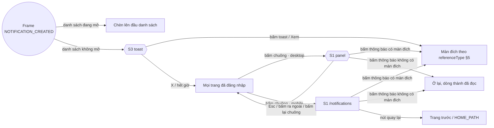

# Screen Flow — NOTIFICATION-001 Thông báo in-app

| Mục | Giá trị |
|---|---|
| Mã chức năng | `NOTIFICATION-001` |
| Phạm vi tầng | frontend (ArenaFlow-fe) — backend: ngoài phạm vi repo này (NOTIFICATION-001 `API_Spec.md`) |
| Repo/stack | ArenaFlow-fe · React 19 + TypeScript + Vite · React Router (FE ADR-0003) |
| Nguồn SRS/UI/API | `docs/agent/upstream/business-spec/SYSTEM-001/` (UC-N02, UC-N03; BR-N02, BR-N07..BR-N12; AC-N08) · `UI_Design.md` v1.0 (S1–S4) · `docs/agent/upstream/api/NOTIFICATION-001/API_Spec.md` |
| Căn cứ | `ArenaFlow-spec@53aee11` · API_Spec `v2.0` (SYSTEM-002 `v1.2`, MATCH-001 `v3.2` §1.7) |
| Quy ước áp dụng | `docs/agent/design-standards.md`, `docs/agent/convention-frontend.md`, `docs/agent/security-frontend.md` |
| Phụ thuộc thiết kế (chưa có trên nhánh này) | Khung `docs/agent/design/SHARED/APP-SHELL/` (v1.2) và FE ADR-0002..0008 (`docs/agent/decisions/`) — **chỉ có ở nhánh `feature/USER-001-user-team`, chưa commit / merge** → mọi trỏ "SHARED …", "FE ADR-000N" trong 3 tài liệu này là trỏ tới nhánh đó, theo tên mục. **Chặn code** — §6 #8 |
| Tác giả / Ngày / Phiên bản | `solution-architect` (agent) / `2026-11-27` / `v1.3` (lịch sử: `CHANGELOG.md`) |

> Route registry, guard, layout, slot `headerActions`, `ROUTE_PATHS`: SHARED `Screen_Flow.md` §1–§3. File này chỉ khai phần của NOTIFICATION-001.
> Màn đích khi bấm thông báo thuộc mã khác — chỉ map ở §5, không thiết kế.

## 1. Danh sách màn hình

| # (UI_Design) | Màn hình | Route (`ROUTE_PATHS`) | Nhóm route | Quyền | Use case (SRS) |
|---|---|---|---|---|---|
| S1 (desktop) | Chuông + badge, panel thả xuống | Không có route — panel mở trên mọi trang đã đăng nhập (slot `headerActions`) | — | Đăng nhập (`USER`, `ADMIN`) | UC-N02 người nhận bước 1–4, BR-N11, AC-N08 |
| S1 (mobile + mở thẳng URL) | Trang "Thông báo" | `/notifications` (`notifications`); `?tab=unread` | authenticated | Đăng nhập (`USER`, `ADMIN`) | như trên |
| S2 | Trạng thái danh sách (tải, rỗng, lỗi, tải thêm) | Trong S1 (panel / trang) | — | — | UC-N02, BR-N02, BR-N11 |
| S3 | Thông báo mới realtime — toast + badge tăng | Không có route — trên mọi trang đã đăng nhập | — | Đăng nhập | UC-N02 bước 4, BR-N10, AC-N08 |
| S4 | Biểu tượng theo nhóm loại | Không có màn hình — bảng tham chiếu dùng ở S1, S3 | — | — | Business_Rules §8.6, BR-N07 |

- **Một route dùng chung** — thiết kế theo đề xuất UI_Design §4 mục 2, chờ xác nhận `[cần xác nhận]` #1: mobile bấm chuông → `/notifications`; desktop bấm chuông → panel; mở thẳng `/notifications` trên desktop → cùng danh sách dạng trang.
- Desktop **đang ở** `/notifications`: chuông không mở panel (tránh hai danh sách cùng query key trên một màn) — chuông là link tới chính route, `aria-current="page"`.
- `/notifications` thuộc nhóm `authenticated` (khung `MainLayout`) — Admin cũng vào được; Admin bấm chuông ở `AdminLayout` trên mobile sẽ sang `MainLayout` — `[cần xác nhận]` #2.
- Route khai ở `src/modules/notification/routes/notification.routes.tsx`; hằng `notifications: '/notifications'` thêm vào `src/shared/constants/route-paths.constant.ts`.

## 2. Luồng điều hướng

## 3. Chi tiết từng màn hình

### S1 — Danh sách thông báo (panel desktop / trang `/notifications`)
- **Mục đích:** xem thông báo của mình trong 30 ngày, mới nhất trước; lọc "Chưa đọc"; tải thông báo cũ hơn; bấm để mở màn liên quan; đánh dấu tất cả đã đọc (UI_Design S1).
- **Vào từ:** chuông trên header (`MainLayout`; `AdminLayout` — `[cần xác nhận]` #2) · gõ / mở URL `/notifications`.
- **Ra tới:**
  - Bấm thông báo có màn đích → màn đích (§5); panel đóng.
  - Bấm thông báo không có màn đích / loại chưa biết → ở lại.
  - Panel: `Esc`, bấm ra ngoài, bấm lại chuông → đóng, focus về chuông.
  - Trang: nút quay lại → `navigate(-1)` khi có lịch sử trong app (`location.key !== 'default'`), không thì `HOME_PATH`.
- **Thao tác:** tab "Tất cả" / "Chưa đọc" · "Tải thêm" (chỉ bằng nút, không tự tải khi cuộn — UI_Design §4 mục 5 giao `solution-architect` quyết; lý do: dùng được bằng bàn phím, không gọi API ngoài ý muốn) · bấm một dòng (chuột / Enter) · "Đánh dấu tất cả đã đọc" (desktop) / "Đọc tất cả" (mobile).
- **Trạng thái:** S2 (State_API_Integration §5).
- **Tham số URL** (chỉ ở trang): `tab` ∈ {`all`, `unread`}, mặc định `all`; giá trị khác → `all` (`useUrlParam`, ghi bằng `replace` — SHARED Screen_Flow §1.3). Panel giữ tab bằng state cục bộ, mở panel luôn ở "Tất cả".
- **`document.title`:** "Thông báo · ArenaFlow" (chỉ ở trang).

### S2 — Trạng thái danh sách
- Không có route; là trạng thái của S1. Bảng hiển thị: UI_Design S2; nguồn trạng thái + mã lỗi: State_API_Integration §5.

### S3 — Thông báo mới realtime
- **Khi nào hiện toast:** nhận frame `NOTIFICATION_CREATED` và **không** có danh sách thông báo nào đang hiển thị (panel hoặc trang). Danh sách đang hiển thị → chèn lên đầu (hoặc tải lại trang đầu nếu đang tải — State_API_Integration §3.3), không toast.
- **Ra tới:** bấm vào toast hoặc "Xem" → như bấm một dòng ở S1 · `X` → đóng, vẫn chưa đọc · tự ẩn (`[cần xác nhận]` #3).
- **Không có màn đích** → toast không bấm được, không có "Xem", chỉ có `X`.
- Chuyển giữa `MainLayout` ↔ `AdminLayout`: toast đang hiện vẫn giữ (state toast ở store module — Component_Design §4).

### S4 — Biểu tượng theo nhóm
- Không có route. Bảng loại → icon → tông: UI_Design S4 (nguồn chuẩn); hằng code: Component_Design §4.

## 4. Route guard & phân quyền
- `/notifications` dưới `AuthGuard` (SHARED Screen_Flow §2); chưa đăng nhập → `/login` kèm `from`.
- Chuông chỉ có trong layout đã đăng nhập; không có guard vai trò. Mọi endpoint chỉ trả thông báo của người gọi (API_Spec §1.1) — FE không lọc theo vai trò.
- Màn đích tự kiểm quyền / trạng thái (API_Spec §4.3: đối tượng có thể đã đổi trạng thái, người dùng không còn quyền) — NOTIFICATION-001 không kiểm trước khi điều hướng.
- `404 USER_001` ở mọi endpoint → `endSession('ACCOUNT_DELETED')` → `AuthGuard` đưa về `/login` (SHARED State_API_Integration §2.3).

## 5. Điều hướng theo `referenceType`

> Nguồn: API_Spec §4.3 + UI_Design §2 "Điều hướng theo loại màn hình liên quan". `referenceType` / `referenceId` = `null`, loại chưa biết, hoặc `referenceId` không đúng định dạng UUID → không điều hướng (API_Spec §1.1).
> Path đi qua hằng / hàm dựng trong `src/shared/constants/route-paths.constant.ts` (SHARED Screen_Flow §1.2) — module `notification` **không** import module khác. Mã sở hữu màn đích thêm hằng trong PR của mã đó. Hằng chưa có lúc code → mục tương ứng trong bảng điều hướng (Component_Design §4) để `null` = không điều hướng, chỉ đánh dấu đã đọc (theo đề xuất UI_Design §4 mục 6 — `[cần xác nhận]` #5).

| `referenceType` | Màn đích | Mã sở hữu | Hằng / hàm dựng | Nguồn hằng |
|---|---|---|---|---|
| `TEAM` | Chi tiết đội — USER-001 S8a (đội đã giải tán: USER-002 S8b, cùng route) | USER-001 / USER-002 | `buildTeamDetailPath(teamId)` → `/teams/:teamId` | USER-001 `Screen_Flow.md` §1 + SHARED Screen_Flow §1.2 (nhánh `feature/USER-001-user-team`) |
| `USER` | Hồ sơ của tôi — USER-001 S3 | USER-001 | `ROUTE_PATHS.profile` → `/profile` (bỏ qua `referenceId` — luôn là chính người nhận) | USER-001 `Screen_Flow.md` §1 (nhánh `feature/USER-001-user-team`) |
| `TEAM_INVITATION` | "Lời mời của tôi" — USER-003 S15 (chấp nhận / từ chối) | USER-003 | `ROUTE_PATHS.myInvitations` → `/me/invitations` (không tham số; bỏ qua `referenceId`) | USER-003 `Screen_Flow.md` §1 (nhánh `feature/USER-003-lookup`, chưa commit) — làm nổi lời mời theo id: `[cần xác nhận]` #4 |
| `VENUE` | Admin: chi tiết địa điểm — VENUE-001 S4a/S4b (`AdminLayout`) | VENUE-001 | `buildAdminVenueDetailPath(venueId)` → `/admin/venues/:venueId` (chỉ Admin nhận `VENUE_ADMIN_ALERT` — API_Spec §4.2) | VENUE-001 `Screen_Flow.md` §1 (nhánh `feature/VENUE-001-venue`, chưa commit, đang viết) |
| `MATCH` | Chi tiết kèo (đánh giá sau trận — REPUTATION-001 S3 — hiện trong trang) | MATCH-001 | `buildMatchDetailPath(matchId)` → `/matches/:matchId` | MATCH-001 `Screen_Flow.md` §1, §6 C13 (nhánh `feature/MATCH-001-match-flow-a`, chưa commit) |
| `PAIRING` | Chi tiết thương lượng — MATCH-002 S4 | MATCH-002 | `buildPairingDetailPath(pairingId)` → `/pairings/:pairingId` | MATCH-002 `Screen_Flow.md` §1, §6 C9 (nhánh `feature/MATCH-002-match-flow-b`, chưa commit) |
| `MERCENARY_APPLICATION` | Chi tiết đơn — MERCENARY-001 S15; trang tự chuyển đội trưởng sang ứng viên của tin (S3) | MERCENARY-001 | `buildMercenaryApplicationPath(applicationId)` → `/mercenary-applications/:applicationId` | MERCENARY-001 `Screen_Flow.md` §1, §5, §6 C12 (nhánh `feature/MERCENARY-001-mercenary`, chưa commit) |
| `REPORT` | **Tạm:** "Đội của tôi" lọc đội trưởng — USER-003 S16 → chọn đội → chi tiết đội → report của đội | REPUTATION-001 (đề xuất), USER-003 (màn) | `buildMyTeamsPath({ role: 'CAPTAIN' })` → `/me/teams?role=CAPTAIN` (bỏ qua `referenceId`) | REPUTATION-001 `Screen_Flow.md` §5, §6 C6 (nhánh `feature/REPUTATION-001-reputation`); hàm dựng: USER-003 `Screen_Flow.md` §1 — tạm, `[cần xác nhận]` #7 |
| `DISPUTE` | Admin: chi tiết tranh chấp — REPUTATION-001 S10 | REPUTATION-001 | `buildAdminDisputeDetailPath(disputeId)` → `/admin/disputes/:disputeId` | REPUTATION-001 `Screen_Flow.md` §1, §5, §6 C6 |
| `MERCENARY_DISPUTE` | Admin: chi tiết tranh chấp mercenary — MERCENARY-001 S21 | MERCENARY-001 | `buildAdminMercenaryDisputePath(disputeId)` → `/admin/mercenary-disputes/:disputeId` | MERCENARY-001 `Screen_Flow.md` §1, §5, §6 C12 |
| `null` / chưa biết | Không điều hướng | — | — | — |

## 6. `[cần xác nhận]`
1. **Một route `/notifications` + panel desktop** (UI_Design §4 mục 2): thiết kế theo đề xuất của UI — desktop bấm chuông mở panel, mở thẳng URL hiện dạng trang. Panel không có link "Xem tất cả" (UI không vẽ).
2. **Chuông ở `AdminLayout`** (UI_Design §4 mục 3): thiết kế cắm chuông vào slot `headerActions` của cả `MainLayout` và `AdminLayout` (Admin nhận `VENUE_ADMIN_ALERT`, `DISPUTE_CREATED`). Trang `/notifications` thuộc nhóm `authenticated` → hiện trong `MainLayout` kể cả khi Admin mở từ khu quản trị.
3. **Hành vi toast S3** (UI_Design §4 mục 4): theo đề xuất UI — tự ẩn 6 giây, dừng khi rê chuột / focus, một toast một lúc (toast mới thay toast cũ).
4. **Làm nổi lời mời theo id ở "Lời mời của tôi"** (UI_Design §4 mục 1): USER-003 định nghĩa `myInvitations` không tham số → thiết kế này mở `/me/invitations` không làm nổi. Muốn làm nổi → USER-003 thêm tham số (vd `?invitationId=`) ở thiết kế của mình.
5. **Hằng route của mã khác chưa commit:** mọi đích ở §5 đã được mã sở hữu chốt tên trong thiết kế của mình (USER-001, USER-003, VENUE-001, MATCH-001, MATCH-002, MERCENARY-001, REPUTATION-001), nhưng các thiết kế đó chưa commit / merge. Mã sở hữu đổi tên → sửa §5 theo. Lúc code NOTIFICATION-001 mà hằng của mã nào chưa có trong `route-paths.constant.ts` → mục đó để `null`: không điều hướng, chỉ đánh dấu đã đọc (đề xuất UI_Design §4 mục 6).
6. *(Đã đóng v1.1)* `MERCENARY_APPLICATION` theo vai trò — MERCENARY-001 S15 tự chuyển đội trưởng sang S3 (MERCENARY-001 Screen_Flow §5).
7. **`REPORT` — đích tạm:** `referenceId` là id report, nhưng không có API tra report theo id để biết report của đội nào / cá nhân hay đội (REPUTATION-001 Screen_Flow `[cần xác nhận]` #8). Tạm theo REPUTATION-001: mở "Đội của tôi" lọc đội trưởng. Hạn chế: người nhận report **cá nhân** (mercenary — MERCENARY-001 2.22) có thể không làm đội trưởng đội nào → màn tạm không chứa report của họ; MERCENARY-001 Screen_Flow §5 đề xuất `buildMyMercenaryReportsPath()` khi BE bổ sung loại report vào thông báo. Cần đổi hợp đồng API → đề xuất ở repo BE.
8. **CHẶN CODE — nền SHARED + ADR:** thiết kế SHARED/APP-SHELL (v1.2) và FE ADR-0002..0008 đang untracked trên nhánh `feature/USER-001-user-team`. Trước khi code NOTIFICATION-001 MUST: SHARED đã merge vào `main` **và** FE ADR-0004 (TanStack Query), ADR-0006 (store không thư viện), ADR-0007 (STOMP — NOTIFICATION-001 có thể là mã realtime đầu tiên, tạo `core/realtime`; gồm thay đổi MATCH-001 C7, C16), ADR-0008 (ngày giờ) chuyển `Accepted`. Phụ thuộc SHARED: Component_Design §6 #4, State_API_Integration §4.2.
