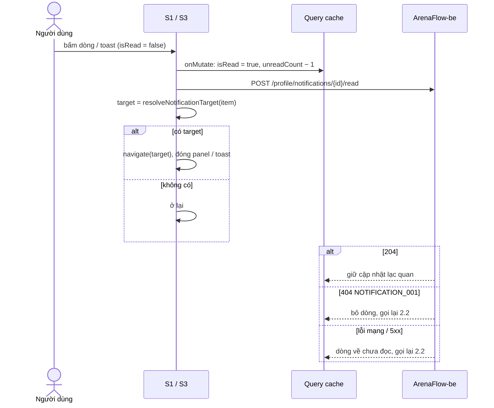
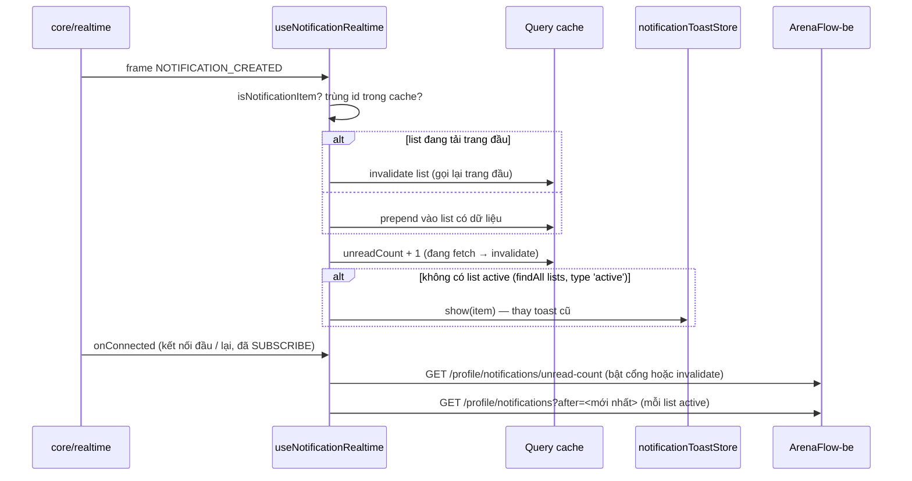

# State & API Integration — NOTIFICATION-001 Thông báo in-app

| Mục | Giá trị |
|---|---|
| Mã chức năng | `NOTIFICATION-001` |
| Phạm vi tầng | frontend (ArenaFlow-fe) — hợp đồng API thuộc BE |
| Nguồn API | `docs/agent/upstream/api/NOTIFICATION-001/API_Spec.md` · `docs/agent/upstream/api/api-convention.md` §7.2 · MATCH-001 `API_Spec.md` §1.7 (kết nối STOMP) · SYSTEM-002 `API_Spec.md` §1.1 (thời gian) |
| Căn cứ | `ArenaFlow-spec@53aee11` · API_Spec `v2.0` (MATCH-001 `v3.2`, SYSTEM-002 `v1.2`) |
| Quy ước áp dụng | `docs/agent/convention-frontend.md` §5, `docs/agent/non-functional-standards.md`, `docs/agent/security-frontend.md` |
| Phụ thuộc thiết kế (chưa có trên nhánh này) | SHARED `State_API_Integration.md` (v1.2) + FE ADR-0004, 0006, 0007, 0008 — chỉ có ở nhánh `feature/USER-001-user-team` (untracked, chưa merge), trỏ theo tên mục. **Chặn code** — Screen_Flow §6 #8 |
| Tác giả / Ngày / Phiên bản | `solution-architect` (agent) / `2026-11-27` / `v1.3` (lịch sử: `CHANGELOG.md`) |

> http wrapper, `ApiError`, 401 → refresh, `endSession`, `realtime.service`: SHARED §2, §3, §6 — không định nghĩa lại.

## 1. Endpoint dùng theo màn hình

| Màn hình | Thời điểm gọi | Method + path | API_Spec mục | Số call |
|---|---|---|---|---|
| Khung (chuông, mọi trang) | `onConnected` — kênh cá nhân sẵn sàng ở **lần kết nối đầu** và mỗi lần kết nối lại (§4.2). **Không** gọi lúc chuông mount | `GET /api/v1/profile/notifications/unread-count` | 2.2, §1.4 | 1 / lần kết nối |
| Khung | **Fallback** khi kênh không dùng được: kênh cá nhân tắt (`isPersonalChannelEnabled() = false` — SHARED §6), trình duyệt không có `WebSocket`, lần kết nối đầu lỗi (`useRealtimeStatus()` sang `'reconnecting'` trước khi từng `'connected'`), hoặc chưa `'connected'` sau `NOTIFICATION_REALTIME_FALLBACK_MS` = 10 s (§4.2) | như trên | 2.2 | 1 / phiên |
| Khung | App trở lại foreground (chỉ khi đã có số lần đầu) | như trên | 2.2 | 1 / lần |
| S1 panel | Mở panel | `GET /api/v1/profile/notifications?limit=20` (tab "Chưa đọc": `&unreadOnly=true`) | 2.1 | 1 |
| S1 trang `/notifications` | Vào trang | như trên | 2.1 | 1 |
| S1 | Đổi tab | như trên | 2.1 | 1 |
| S1 | "Tải thêm" | `…&before=<notificationId cuối đang hiển thị>` | 2.1 | 1 / lần bấm |
| S1 đang mở | Kênh cá nhân sẵn sàng sau kết nối lại — bù thông báo lỡ | `…&after=<notificationId mới nhất đang hiển thị>&limit=100` (mỗi danh sách đang hiển thị) | 2.1 | 1 (+1 khi phải tải lại trang đầu — §3.3) |
| S1, S3 | Bấm dòng / toast khi `isRead = false` | `POST /api/v1/profile/notifications/{notificationId}/read` | 2.3 | 1 (0 khi đã đọc) |
| S1 | "Đánh dấu tất cả đã đọc" | `POST /api/v1/profile/notifications/read` | 2.4 | 1 (+1 lần 2.2 nếu có frame mới trong lúc chờ — §3.3) |
| S3 | Nhận frame `NOTIFICATION_CREATED` | — (không gọi REST) | §1.4 | 0 (+1 lần 2.1 trang đầu nếu danh sách đang tải trang đầu — §3.3) |

**Tổng API call khi tải** (ngưỡng ≤ 3, `non-functional-standards.md` §2; không tính refresh token):
- **Request khung của NOTIFICATION-001 khi mở app (mọi màn):** đúng **1** lần 2.2 (trong `onConnected` lần đầu, hoặc fallback). Trường hợp hiếm: fallback 10 s đã gọi rồi kênh mới kết nối → `onConnected` gọi thêm 1 lần (cần để bù frame lỡ).
- **S1 panel:** 1 (2.1) — 2.2 do khung đảm nhận.
- **S1 trang, đi từ trong app:** 1 (2.1).
- **S1 trang, mở thẳng URL / tải lại trang:** 2.1 + 2.2 (khung) + `GET /profile` (header — USER-001) + `GET /profile/invitations` (huy hiệu "Lời mời của tôi" — USER-003 State_API_Integration §1) + `GET /profile/conversations?page=1&pageSize=20` (chấm "Tin nhắn", trong `onConnected` — MATCH-001 Screen_Flow §6 C2) = **5**. Chỉ 1 (2.1) là của màn; còn lại là request khung một lần mỗi phiên — vượt 3 nếu tính request khung. **Chặn code** — `[cần xác nhận]` #1.
- **S3:** 0 (dữ liệu nằm trong frame).
- Số call không tăng theo số thông báo hiển thị; không gọi API theo từng dòng.

## 2. Hàm API & type

| Hàm | Đường dẫn | Request | Response |
|---|---|---|---|
| `getNotifications(params, signal?)` | `src/modules/notification/api/notification.api.ts` | `NotificationListQuery { unreadOnly: boolean; before?: string; after?: string; limit: number }` → query `unreadOnly` (chỉ gửi khi `true`), `before` **hoặc** `after` (không bao giờ cả hai — `400 VALIDATION_ERROR`), `limit` | `CursorPage<NotificationItem>` (`http.get`, SHARED §2.1 — `{ items, hasMore }` trong `data`). Với `after`: `items` cũ nhất trước |
| `getUnreadCount(signal)` | như trên | — | `number` (bóc `data.unreadCount`) |
| `markNotificationRead(notificationId)` | như trên | path `encodeURIComponent(notificationId)`; không body | `void` (204) |
| `markAllNotificationsRead()` | như trên | không body | `void` (204) |

- Cả 4 hàm truyền `accountGoneCodes: ['USER_001']` (API_Spec 2.1–2.4: "Đăng xuất" — SHARED §2.3).

Type — `src/modules/notification/types/notification.type.ts` (field: API_Spec §4.1, không chép bảng):

| Type | Nguồn | Ghi chú |
|---|---|---|
| `NotificationType` | §4.2 (35 giá trị) | Union literal |
| `NotificationReferenceType` | §4.3 (10 giá trị) | Union literal |
| `NotificationItem` | §4.1 | `type: NotificationType \| (string & {})`, `referenceType: NotificationReferenceType \| (string & {}) \| null` — nhận giá trị chưa biết mà không ép kiểu (§1.1 "loại có thể tăng"); `createdAt` giờ Việt Nam không offset (JSDoc) |
| `NotificationTab` | — | `'all' \| 'unread'` |
| `NotificationCreatedFrame` | §1.4 | `{ type: 'NOTIFICATION_CREATED'; notification: NotificationItem }` |
| `isNotificationItem(x)` | — | Hàm ở `utils/notification-frame.util.ts`. Type guard cho frame: `notificationId`, `type`, `title`, `body`, `createdAt` là string; `isRead` boolean; `referenceType`, `referenceId` cùng là string hoặc cùng là `null` (§4.1 "`null` khi và chỉ khi"). Sai → bỏ frame |

## 3. State

### 3.1. Bảng state

| State | Loại | Nơi giữ | Key / tên | Làm mới khi |
|---|---|---|---|---|
| Số chưa đọc | server | TanStack Query | `notificationKeys.unreadCount()` | Frame mới (+1) · 2.3 (−1) · 2.4 (= 0) · foreground · `onConnected` · fallback |
| Cổng bật query số chưa đọc + epoch đã xử lý | client module | `store/notification-sync.store.ts` | `{ countEnabled: boolean; handledEpoch: number }` | `false` / `-1` khi bắt đầu phiên → `countEnabled = true` ở `onConnected` đầu tiên hoặc fallback; `handledEpoch` cập nhật mỗi `onConnected` mới (§4.2); reset khi phiên kết thúc |
| Danh sách | server (infinite) | TanStack Query | `notificationKeys.list({ unreadOnly })` | Mount (mở panel / trang / đổi tab) · frame mới (chèn đầu) · 2.3 / 2.4 (sửa `isRead`) · bù sau kết nối lại · `NOTIFICATION_002` |
| Tab trang | URL | query string | `tab` (`all` \| `unread`) | Người dùng đổi tab (`replace`) |
| Tab panel | client cục bộ | `useState` trong `NotificationPanel` | — | Mở panel → `all` |
| Panel mở / đóng | client cục bộ | `useState` trong `NotificationBell` | — | Bấm chuông, Esc, bấm ngoài, điều hướng, đổi layout (remount) |
| Toast S3 | client module | `store/notification-toast.store.ts` | `{ current }` | Frame mới khi không có danh sách hiển thị · `X` · hết giờ · danh sách mount · `NotificationRealtimeBridge` unmount (kết thúc phiên). **Không** mất khi đổi layout |
| Phiên | client toàn cục | `core/session` (SHARED §3.3) | — | — |

### 3.2. Query key & tuỳ chọn (FE ADR-0004)

```ts
/** Query key của domain thông báo. */
export const notificationKeys = {
  all: [QUERY_ROOTS.notification] as const,
  lists: () => [...notificationKeys.all, 'list'] as const,
  list: (params: { unreadOnly: boolean }) => [...notificationKeys.lists(), params] as const,
  unreadCount: () => [...notificationKeys.all, 'unread-count'] as const,
}
```

| Query | Tuỳ chọn | Lý do |
|---|---|---|
| `unreadCount` | `enabled: countEnabled` (store §3.1) · `staleTime: Infinity` · `refetchOnWindowFocus: 'always'` | Không tự gọi khi chuông mount; lần gọi đầu xảy ra khi cổng bật (`onConnected` đầu / fallback) — tránh gọi 2.2 hai lần khi mở app. Sau đó giữ đúng nhờ frame + mutation; gọi lại khi trở lại foreground (TanStack theo dõi `visibilitychange`, chỉ khi query đã bật) hoặc `onConnected` — API_Spec 2.2 "Dùng khi". Chưa có số → badge ở trạng thái chờ (Component_Design §2 `NotificationBell`) |
| `list` (`useInfiniteQuery`) | `initialPageParam: undefined` · `getNextPageParam: (last, all) => last.hasMore ? <notificationId cuối của mọi trang> : undefined` · `staleTime: Infinity` · `gcTime: 0` | Mỗi lần mở panel / trang / đổi tab tải trang đầu mới (2.1 "Dùng khi: mở màn hình"); đóng → bỏ cache; trong lúc mở, frame + mutation + bù `after` giữ dữ liệu đúng nên không tự refetch (refetch infinite gọi lại mọi trang đã tải) |

- Hook trả `items` = `pages.flatMap(p => p.items)` đã bỏ trùng theo `notificationId`.
- `QUERY_ROOTS.notification` đã có trong SHARED §4. Module khác (nếu cần) invalidate theo gốc `[QUERY_ROOTS.notification]`.

### 3.3. Cập nhật cache

Helper thuần ở `src/modules/notification/utils/notification-cache.util.ts` (nhận `QueryClient`): `prependNotifications` · `patchNotificationRead(id, isRead)` · `removeNotification(id)` · `markItemsRead(ids)` · `findCachedNotification(id)` · `resetListToFirstPage(queryKey)` (cắt `pages` / `pageParams` còn trang đầu rồi `invalidateQueries({ queryKey, exact: true })` → **1** request, không nháy skeleton) · `catchUpList(queryKey, unreadOnly)` (bên dưới). Áp cho mọi query khớp `notificationKeys.lists()` (`setQueriesData`).

| Sự kiện | Danh sách | Số chưa đọc |
|---|---|---|
| Frame `NOTIFICATION_CREATED` (không trùng), list **có dữ liệu và không đang tải trang đầu** (kể cả đang "Tải thêm") | `prependNotifications` vào trang đầu (cả `unreadOnly` `true` / `false`) | Query đang fetch → `invalidateQueries`; có dữ liệu → +1; chưa có → bỏ qua |
| Frame không trùng, list **đang tải trang đầu** (chưa có dữ liệu, hoặc đang tải lại sau `resetListToFirstPage`) | `invalidateQueries({ queryKey, exact: true })` — TanStack huỷ request đang chạy, gọi lại trang đầu (1 request) → thông báo mới có trong kết quả, không bị mất (AC-N08) | như dòng trên |
| Frame trùng `notificationId` đã có trong cache | Bỏ qua | Bỏ qua |
| Frame `type = TEAM_INVITATION` | — | — · thêm: `invalidateQueries({ queryKey: [QUERY_ROOTS.team, 'my-invitations'] })` để huy hiệu / danh sách "Lời mời của tôi" (USER-003) cập nhật. Tiền tố này là **hợp đồng của USER-003** = giá trị `teamKeys.myInvitations()` (USER-003 State_API_Integration §3.1); invalidate chéo theo tiền tố, không import factory module khác (SHARED State_API_Integration §4) — `[cần xác nhận]` #4 |
| 2.3 `onMutate` (item `isRead = false`) | `patchNotificationRead(id, true)` | −1 (không dưới 0) |
| 2.3 `onError` `404 NOTIFICATION_001` | `removeNotification(id)` | `invalidateQueries` |
| 2.3 `onError` khác (mạng, timeout, 5xx) | `patchNotificationRead(id, false)` | `invalidateQueries` |
| 2.4 `onMutate` | ghi id đang hiển thị (`ids`) + số chưa đọc hiện tại (`countAtStart`) vào context | — |
| 2.4 `onSuccess` | `markItemsRead(ids)` — thông báo đến sau khi bấm giữ chưa đọc (BR-N11) | Số hiện tại = `countAtStart` → đặt 0; khác (có frame trong lúc chờ) → `invalidateQueries` |
| 2.4 `onError` | Giữ nguyên | Giữ nguyên |
| `onConnected` (kết nối đầu + kết nối lại — §4.2) | `catchUpList` cho mỗi list đang active | Cổng chưa bật → bật (query tự gọi 2.2 lần đầu); đã bật → `invalidateQueries`. Gọi **trước** list (API_Spec §1.4) |
| Fallback (§4.2) | — | Cổng chưa bật → bật (gọi 2.2 một lần); đã bật → không làm gì |
| 2.1 tải thêm trả `422 NOTIFICATION_002` | `resetListToFirstPage` (không báo lỗi) | — |
| Kết thúc phiên | `queryClient.clear()` (SHARED §3.2) | như trái |

**`catchUpList(queryKey, unreadOnly)`** — giữ các trang đã tải khi kết nối lại (≈ mỗi giờ do refresh token — FE ADR-0007), thay vì tải lại trang đầu:
1. Chưa có dữ liệu → `invalidateQueries({ queryKey, exact: true })`.
2. Có → gọi thẳng `getNotifications({ unreadOnly, after: <notificationId đầu tiên của trang đầu>, limit: 100 })` (mốc đã đọc vẫn dùng được khi `unreadOnly = true` — API_Spec 2.1).
3. `hasMore = false` → đảo `items` (BE trả cũ nhất trước) → `prependNotifications` (bỏ trùng).
4. `hasMore = true` (lỡ > 100) hoặc `422 NOTIFICATION_002` (mốc quá 30 ngày) → `resetListToFirstPage`.
5. Lỗi khác → bỏ qua, giữ danh sách; lần kết nối lại sau bù tiếp. List đã unmount (cache bị bỏ) khi có kết quả → bỏ kết quả.
- Giới hạn chấp nhận: trạng thái đọc đổi trên thiết bị khác không cập nhật vào danh sách đang mở (API_Spec §1.4 — 2.3 / 2.4 không đẩy frame); chỉ số chưa đọc được cập nhật.

**Mutation:**
- `mutationKey`: `[...notificationKeys.all, 'mark-read']`, `[...notificationKeys.all, 'mark-all-read']`.
- Cập nhật cache đặt trong **options của `useMutation`** (không trong tham số của `mutate()`), vì panel / trang unmount ngay khi điều hướng. `[Unverified]` callback ở options vẫn chạy sau khi component unmount — dựa trên tài liệu TanStack Query; developer MUST có test: unmount trong lúc 2.3 đang chạy → cache vẫn cập nhật.
- Bấm dòng đã có request 2.3 đang chạy cho cùng id (`useMutationState({ filters: { mutationKey, status: 'pending' } })`) → không gọi lại, vẫn điều hướng.

## 4. Luồng tương tác

### 4.1. Bấm một thông báo (S1 / S3)



### 4.2. Realtime (FE ADR-0007, SHARED §6)

`useNotificationRealtime()` — gọi trong `NotificationRealtimeBridge`, cắm vào `SessionEffects` của SHARED (Component_Design §2 — mount một lần mỗi phiên, không huỷ khi đổi layout):
- **Cổng kênh cá nhân** (SHARED State_API_Integration §6 v1.2, dòng `subscribePersonal`: `PERSONAL_CHANNEL_ENABLED` / `isPersonalChannelEnabled()`): `isPersonalChannelEnabled() = false` → **không** gọi `subscribePersonal`, **không** đăng ký `onConnected`, không có toast realtime; bật cổng `countEnabled` ngay khi bridge mount (fallback mục 1 bên dưới — gọi 2.2 một lần, như nhánh không có `WebSocket`). `true` → làm như các mục sau.
- `useEffect`: `realtime.subscribePersonal('NOTIFICATION_CREATED', onCreated)` + `realtime.onConnected(onChannelReady)` (SHARED State_API_Integration §6 v1.2: phát sau khi `SUBSCRIBE` xong ở **mọi** lần kết nối, **gồm lần đầu**; đăng ký khi kết nối đã mở sẵn → SHARED gọi handler ngay sau `SUBSCRIBE` của listener mới). Không dùng thêm `onReconnected` (đã nằm trong `onConnected` — tránh gọi 2.2 hai lần). Cleanup gọi các hàm huỷ; chỉ khi phiên đã kết thúc mới `notificationSyncStore.reset()` + `notificationToastStore.dismiss()` (Component_Design §2).
- Kênh cá nhân dùng `subscribePersonal` + `onConnected`, **không** dùng `subscribe(dest, onFrame, { onReady })` của MATCH-001 C16 (API đó cho topic `/topic/conversations/{id}`).
- `onChannelReady`:
  1. **Bỏ trùng theo epoch** (`getConnectionEpoch()` — SHARED §6 v1.2): `epoch = realtime.getConnectionEpoch()`; `epoch === handledEpoch` → bỏ qua (handler được gọi lại cho cùng một kết nối, vd StrictMode đăng ký lại, hoặc SHARED gọi ngay khi đăng ký lúc đã kết nối) → không gọi 2.2 lần hai. Khác → `markEpochHandled(epoch)` rồi làm tiếp.
  2. Cổng `countEnabled` chưa bật → bật (query 2.2 tự gọi lần đầu); đã bật → `invalidateQueries(unreadCount)`.
  3. `catchUpList` cho mỗi list active (thứ tự API_Spec §1.4).
  - Vì 2.2 chỉ gọi **sau** `SUBSCRIBE`, không lỡ frame giữa lúc lấy số và lúc đăng ký kênh.
- **Fallback** (kênh không dùng được — badge không được chờ mãi): bật cổng một lần mỗi phiên khi xảy ra điều kiện đầu tiên trong các điều kiện sau:
  1. `isPersonalChannelEnabled() = false` hoặc `typeof WebSocket === 'undefined'` → bật ngay khi bridge mount.
  2. `useRealtimeStatus()` chuyển sang `'reconnecting'` trước khi từng đạt `'connected'` (lần kết nối đầu lỗi; service tiếp tục backoff theo SHARED §6).
  3. Hết `NOTIFICATION_REALTIME_FALLBACK_MS` (10 s) kể từ bridge mount mà chưa có `onConnected`.
  - Sau fallback, kênh kết nối được → `onConnected` chạy như trên (cổng đã bật → `invalidateQueries`, 1 lần 2.2 để bù frame lỡ). Trong lúc chưa có kênh: badge cập nhật nhờ foreground + mutation; không có thông báo realtime (UI_Design S3 không có banner mất kết nối).
- `CONVERSATION_ACTIVITY`: **không** xử lý ở đây — `ConversationActivityBridge` của MATCH-001 (cũng trong `SessionEffects`) đăng ký `subscribePersonal('CONVERSATION_ACTIVITY', …)` trên cùng kênh; service `SUBSCRIBE` kênh cá nhân một lần cho cả hai (MATCH-001 Screen_Flow §6 C2, C4; BR-N12). Hai bridge cùng chờ BE mở kênh cá nhân (phụ thuộc phát hành bên dưới).



- "Danh sách đang hiển thị" = có query khớp `notificationKeys.lists()` với `type: 'active'` (có observer, kể cả đang tải) — không cần thêm store.
- `NotificationCenter` mount → `notificationToastStore.dismiss()`.
- **Phụ thuộc phát hành:** BE chỉ nhận `SUBSCRIBE /user/queue/notifications` từ bản có NOTIFICATION-001 — bật `PERSONAL_CHANNEL_ENABLED` trong PR phát hành cùng BE (SHARED §6 v1.2). Trước đó NOTIFICATION-001 chạy ở chế độ fallback: badge từ 2.2 (khi mở app + foreground + sau mutation), danh sách vẫn đủ chức năng, không có realtime.

## 5. Xử lý lỗi

| Tình huống | HTTP / mã lỗi BE | Hiển thị / hành động |
|---|---|---|
| 2.1 trang đầu: hết giờ 15 s, mất mạng, 5xx, `INVALID_RESPONSE` | `TIMEOUT`, `NETWORK_ERROR`, `SYS_005`… | `ErrorState` (`ApiError.message`) + **Thử lại** (`refetch`) — UI_Design S2 "Lỗi tải"; nút "Đánh dấu tất cả" disable |
| 2.1 tải thêm: lỗi như trên | như trên | Giữ danh sách; cuối danh sách "Không tải thêm được thông báo." + **Thử lại** (`fetchNextPage`) |
| 2.1 mốc `before` / `after` không hợp lệ | `422 NOTIFICATION_002` | `resetListToFirstPage`, không báo lỗi (API_Spec 2.1) |
| 2.1 bù `after` lỗi khác | — | Bỏ qua, không báo lỗi (§3.3 `catchUpList`) |
| 2.1 tham số sai | `400 VALIDATION_ERROR` | Lỗi lập trình — xử lý như dòng 1 |
| 2.2 lỗi bất kỳ (trừ `USER_001`) | — | Không báo lỗi; badge giữ giá trị cũ (chưa có → không hiện số); thử lại ở lần foreground / `onConnected` kế tiếp |
| 2.3 thông báo không còn | `404 NOTIFICATION_001` | Bỏ dòng; vẫn mở màn đích (đã điều hướng); gọi lại 2.2 |
| 2.3 lỗi mạng / timeout / 5xx | — | Vẫn mở màn đích; dòng giữ chưa đọc; không toast `[cần xác nhận]` #2 |
| 2.4 lỗi bất kỳ (trừ `USER_001`) | — | `toast.error(ApiError.message)` (SHARED `useToast`); giữ nguyên trạng thái |
| Tài khoản đã xoá | `404 USER_001` (2.1–2.4) | Wrapper `endSession('ACCOUNT_DELETED')` → về `/login` (SHARED §2.3) |
| Chưa đăng nhập / token hết hạn | `401 AUTH_001` | Wrapper refresh 1 lần → thất bại về đăng nhập (SHARED §2.3) |
| Không đủ quyền | `403` | Không xảy ra (mọi endpoint chỉ thao tác thông báo của chính người gọi) |
| Lỗi realtime (`ERROR` frame, mất kết nối) | `AUTH_001`, `SYS_004`… | SHARED §6; không banner riêng cho thông báo (UI_Design S3) |
| Frame sai cấu trúc / `type` frame lạ | — | Bỏ qua (service + `isNotificationItem`) |
| `type` / `referenceType` chưa biết, `referenceId` sai định dạng | — | Icon mặc định, không điều hướng (API_Spec §1.1; Component_Design §4 `resolveNotificationTarget`) |
| Lỗi API của màn đích | — | Màn đích tự xử lý (API_Spec §4.3) |

- `ApiError` mã `ABORTED` (unmount / đổi tab) → không hiển thị.
- Không log nội dung thông báo (`title`, `body` có thể chứa tên đội / sân) ra console (`security-frontend.md` §4).

## 6. Phân trang / tìm kiếm / sort
- Phân trang **con trỏ** (`api-convention.md` §7.2; API_Spec 2.1): trang đầu không con trỏ; "Tải thêm" `before` = `notificationId` cuối đang hiển thị, `limit = 20` (`NOTIFICATION_PAGE_LIMIT`, = `PAGE_SIZE_DEFAULT`; BE mặc định 50, tối đa 100); bù sau kết nối lại `after` = `notificationId` mới nhất đang hiển thị, `limit = 100`. Không có tổng số.
- Thứ tự do BE (mới nhất trước; `after` trả cũ nhất trước → FE đảo trước khi chèn). Phần tử chèn từ frame đặt đầu trang đầu.
- Lọc `unreadOnly` ở BE; không có tìm kiếm → không debounce.
- "Tải thêm" chỉ bằng nút (Screen_Flow §3 S1); ẩn khi `hasMore = false`.

## 7. `[cần xác nhận]`
1. **CHẶN CODE — ngưỡng khi mở thẳng `/notifications`:** 2.1 (của màn) + request khung (2.2 × 1, `GET /profile`, `GET /profile/invitations` của USER-003, `GET /profile/conversations` của MATCH-001 C2) = 5 > 3. Cần user chốt cách hiểu ngưỡng ở SHARED State_API_Integration `[cần xác nhận]` #1 (request khung một lần mỗi phiên không tính vào ngưỡng màn) trước khi code. Nếu tính → cần gộp request khung (vd BE trả số chưa đọc kèm hồ sơ) → đề xuất ở repo BE.
2. **2.3 lỗi mạng** (UI_Design §4 mục 7): theo đề xuất UI — vẫn mở màn đích, dòng giữ chưa đọc, không báo lỗi. API_Spec 2.3 chỉ nêu `NOTIFICATION_001`.
3. **Fallback 2.2 khi kênh realtime không kết nối được** (§4.2): ngưỡng 10 s và điều kiện "lỗi trước lần `connected` đầu" là đề xuất; `onConnected` + `SessionEffects` đã có ở SHARED v1.1 (nhánh `feature/USER-001-user-team`, chưa merge — chặn code theo Screen_Flow §6 #8).
4. **Invalidate chéo "Lời mời của tôi":** USER-003 State_API_Integration `[cần xác nhận]` #2 đề xuất NOTIFICATION-001 invalidate khi có frame `TEAM_INVITATION`. Thiết kế dùng tiền tố `[QUERY_ROOTS.team, 'my-invitations']` — hợp đồng tiền tố do USER-003 sở hữu: giá trị của `teamKeys.myInvitations()` (USER-003 State_API_Integration §3.1, nhánh `feature/USER-003-lookup`, chưa commit). USER-003 MUST giữ tiền tố này hoặc báo NOTIFICATION-001 sửa cùng lúc.
