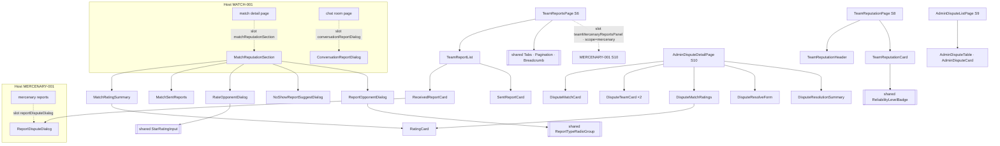

# Component Design — REPUTATION-001 Đánh giá, report, tranh chấp & uy tín đội

| Mục | Giá trị |
|---|---|
| Mã chức năng | `REPUTATION-001` |
| Phạm vi tầng | frontend (ArenaFlow-fe) |
| Repo/stack | ArenaFlow-fe · React 19 + TypeScript + Tailwind CSS 4 · React Hook Form + Zod (FE ADR-0005) |
| Nguồn | `UI_Design.md` v1.0 (S1–S10, §3) · `docs/agent/upstream/api/REPUTATION-001/API_Spec.md` v2.1 · Business_Rules §3.1 "Mức hiển thị", §6.1 · khung `docs/agent/design/SHARED/APP-SHELL/Component_Design.md` (nhánh `feature/USER-001-user-team`) |
| Căn cứ | `ArenaFlow-spec@53aee11` · API_Spec `v2.1` |
| Quy ước áp dụng | `docs/agent/convention-frontend.md` §2–§4, §10 · `docs/agent/non-functional-standards.md` §4 · FE ADR-0010 (slot) |
| Tác giả / Ngày / Phiên bản | `solution-architect` (agent) / `2026-11-27` / `v1.2` (lịch sử: `CHANGELOG.md`) |

> Route, điều hướng, trạng thái màn: `Screen_Flow.md`. Query key, endpoint, bảng lỗi: `State_API_Integration.md`.
> Mọi thành phần **mới** (repo chưa có code). Trước khi tạo thành phần `shared/` → `reuse-scan` (`CLAUDE.md` §8). Đường dẫn trong bảng §2 tương đối với `src/modules/reputation/`.

## 1. Cây component



## 2. Component của module `reputation`

| Component | Đường dẫn | Loại | Props chính | Trách nhiệm |
|---|---|---|---|---|
| `MatchReputationSection` | `components/match-section/match-reputation-section.component.tsx` | feature (slot) | `MatchReputationSectionProps` (§6.1) | Quyết định hiện/ẩn theo `viewer` × `matchStatus` (Screen_Flow S3); gọi `useMatchRatings`; giữ state dialog `'none' \| 'rating' \| 'no-show-suggest' \| 'report'` và `reportInitialType` |
| `MatchRatingSummary` | `components/match-section/match-rating-summary.component.tsx` | feature | `given: Rating`, `received: Rating \| null`, `opponentName` | Hai ô "Đánh giá của đội bạn" / "Đánh giá <đội> dành cho đội bạn"; `received = null` → không render ô thứ hai (BC-R04) |
| `RatingCard` | `components/rating/rating-card.component.tsx` | feature | `rating: Rating`, `title`, `showScoreLine: boolean` | Sao (`StarRatingDisplay`) hoặc "Đội kia không đến", tỷ số ("Tỷ số bạn nhập: a – b" khi `showScoreLine`), nhận xét, "Đã gửi <formatVnDateTime>". Dùng ở S3, S10 |
| `MatchSentReports` | `components/match-section/match-sent-reports.component.tsx` | feature | `myTeamId`, `matchId` | Nút "Xem report đã gửi" (`aria-expanded`) → bật `useMatchSentReports`; dòng: `ReportTypeChip`, thời điểm, `ReportStatusBadge`; rỗng → "Chưa gửi report nào trong trận này" |
| `RateOpponentDialog` | `components/rating/rate-opponent-dialog.component.tsx` | feature | `open`, `onClose`, `matchId`, `myTeamId`, `opponent: SlotTeamRef`, `subtitle`, `onSubmitted(isNoShow)` | S1 — form §4.1, `useRateOpponent` |
| `NoShowReportSuggestDialog` | `components/rating/no-show-report-suggest-dialog.component.tsx` | feature | `open`, `opponentName`, `onReport`, `onLater` | S2 — `Dialog role="alertdialog"`, `initialFocusRef` = "Để sau", footer 2 nút ("Report bùng" `danger`) |
| `ReportOpponentDialog` | `components/report/report-opponent-dialog.component.tsx` | feature | `open`, `onClose`, `matchId`, `myTeamId`, `opponent`, `subtitle`, `onlyBadCommunication: boolean`, `initialType: ReportType \| null`, `onSubmitted` | S4 — form §4.2; loại disable từ `useMatchSentReports` + `onlyBadCommunication`; `useReportOpponent` |
| `ConversationReportDialog` | `components/report/conversation-report-dialog.component.tsx` | feature (slot) | `ConversationReportDialogProps` (§6.2) | S5 — loại cố định "Giao tiếp tệ" (ô chỉ đọc + mô tả), form §4.3, `useReportConversation` |
| `TeamReportsPage` | `pages/team-reports.page.tsx` | page | — (`:teamId`, `scope`, `tab`, `page`) | S6 — `useTeamHeader`; `Breadcrumb`, `<h1>` "Report của đội", `Tabs` cấp 1 `scope` (chỉ khi `useFeatureSlot('teamMercenaryReportsPanel')` có) + `Tabs` cấp 2 `tab`; `scope=team` → `useTeamReports` + `QueryStateView` + `TeamReportList` + `Pagination`; `scope=mercenary` → slot panel (§6.4), không gọi 2.4 |
| `TeamReportList` | `components/team-reports/team-report-list.component.tsx` | feature | `reports: Report[]`, `direction`, `teamId` | Render thẻ theo `direction`; giữ `disputeTarget: Report \| null` mở S7 |
| `ReceivedReportCard` | `components/team-reports/received-report-card.component.tsx` | feature | `report: Report`, `nowMs`, `onDispute(report)` | Thẻ tab "Đội bị report" (UI_Design S6): "Bị trừ n điểm"; nút "Tranh chấp" khi `isDisputeOpen(report, nowMs)` (shared; `nowMs` từ `useNowMs(60_000)` ở `TeamReportList`) (`aria-label` "Tranh chấp report của <đội> trận <giờ>"); `DISPUTED` → bằng chứng + "Chờ Admin quyết định"; `REJECTED` → "Đã hoàn n điểm" + ghi chú Admin; `CONFIRMED` → ghi chú Admin nếu có |
| `SentReportCard` | `components/team-reports/sent-report-card.component.tsx` | feature | `report: Report` | Thẻ tab "Đội đã report"; không hiện điểm; `DISPUTED` → "Đội bị report đã gửi tranh chấp, chờ Admin quyết định." |
| `ReportDisputeDialog` | `components/dispute/report-dispute-dialog.component.tsx` | feature (slot) | `ReportDisputeDialogProps` (§6.3) | S7 — thẻ tóm tắt, form §4.4, trạng thái quá hạn, `useDisputeReport` |
| `TeamReputationPage` | `pages/team-reputation.page.tsx` | page | — (`:teamId`) | S8 — `useTeamHeader` (cache chung chi tiết đội) + `useTeamReputation`; `Breadcrumb` về S8a |
| `TeamReputationHeader` | `components/team-reputation/team-reputation-header.component.tsx` | feature | `name`, `avatarUrl`, `verification` | `Avatar`, `<h1>` tên đội, badge "Đã xác minh" khi `isVerified` |
| `TeamReputationCard` | `components/team-reputation/team-reputation-card.component.tsx` | feature | `reputation: TeamReputation` | 4 ô (UI_Design S8): điểm `n/100` + `ReliabilityLevelBadge`; tỉ lệ hoàn thành "`completionRate`%" + dòng phụ "`completedMatches`/`countedMatches` trận", hoặc "Mới tham gia X/5 trận" khi `isNewcomer` (X = `countedMatches`); sao TB `averageRating` định dạng `formatDecimalVi` (1 chữ số, dấu phẩy — "4,3" — `[cần xác nhận]` #20) + "(n đánh giá)" hoặc "Chưa có đánh giá"; "Đã xác minh · cấp <formatVnDate(verifiedAt)>" — ẩn dòng khi không có. Lưới `grid-cols-2 md:grid-cols-4`; mỗi ô có nhãn đọc màn hình ("Điểm uy tín 84 trên 100") |
| `AdminDisputeListPage` | `pages/admin-dispute-list.page.tsx` | page | — (`status`, `page`) | S9 — `Tabs` 3 trạng thái, dòng phụ thứ tự, `QueryStateView`, `Pagination` |
| `AdminDisputeTable` / `AdminDisputeCard` | `components/admin/admin-dispute-table.component.tsx`, `admin-dispute-card.component.tsx` | feature | `items: AdminDispute[]` | Desktop bảng (`hidden md:table`, `<th scope="col">`, cột UI_Design S9) / mobile thẻ (`md:hidden`); `StatusBadge` trạng thái đội khi ≠ `ACTIVE`; `DeletedAccountTag` theo `is…Deleted`; "Xem chi tiết" `aria-label` gồm tên hai đội |
| `AdminDisputeDetailPage` | `pages/admin-dispute-detail.page.tsx` | page | — (`:disputeId`) | S10 — `useAdminDispute`; desktop 2 cột đội (`md:grid-cols-2`); `PENDING` → `DisputeResolveForm`, `RESOLVED` → `DisputeResolutionSummary` |
| `DisputeMatchCard` | `components/admin/dispute-match-card.component.tsx` | feature | `match: DisputeMatch` | Môn, "<startsAt> – <formatVnTime(endsAt)>", sân (`venueName ?? '—'`), trạng thái trận |
| `DisputeTeamCard` | `components/admin/dispute-team-card.component.tsx` | feature | `side: 'reporter' \| 'reported'`, `dispute: AdminDisputeDetail` | Đội + badge trạng thái, điểm hiện tại, người (+ `DeletedAccountTag`), thời điểm, lý do report / bằng chứng, "Điểm đã bị trừ cho report này: n" (`reported`) |
| `DisputeMatchRatings` | `components/admin/dispute-match-ratings.component.tsx` | feature | `ratings: Rating[]`, `teamNames: Record<string, string>` | 0–2 `RatingCard` (tiêu đề "Đánh giá của <đội>" theo `raterTeamId`); rỗng → "Chưa có đánh giá" |
| `DisputeResolveForm` | `components/admin/dispute-resolve-form.component.tsx` | feature | `dispute: AdminDisputeDetail` | Form §4.5, `useResolveDispute` |
| `DisputeResolutionSummary` | `components/admin/dispute-resolution-summary.component.tsx` | feature | `dispute: AdminDisputeDetail` | "Quyết định: Xác nhận report / Bác report", ghi chú, "Người xử lý: <tên>" + `DeletedAccountTag`, "Lúc <resolvedAt>" |

> Tái dùng từ SHARED (không định nghĩa lại): `Dialog`, `Button`, `AlertBanner`, `Tabs`, `Pagination`, `Breadcrumb`, `QueryStateView`, `Skeleton`, `EmptyState`, `ErrorState`, `Avatar`, `StatusBadge`, `DeletedAccountTag`, `FormField`, `FormErrorBanner`, `SegmentedRadioGroup`, `useToast`, `useUrlParam`, `useDocumentTitle`, `vn-datetime`.

## 3. Thành phần dùng chung mới (`src/shared/`)

> MERCENARY-001 đã ghi nhận dùng các nhãn, `ReportStatusBadge`, `ReportTypeRadioGroup`, `ReportTypeChip`, `StarRatingInput`, `StarRatingDisplay`, `ReliabilityLevelBadge` ở bảng dưới (MERCENARY-001 Screen_Flow §6 C8) — một nguồn.
> Căn cứ `shared/` (≥ 2 module, Reuse Report khi code): MERCENARY-001 `UI_Design.md` dùng cùng 4 loại report + badge trạng thái (S9, S10, S17, S18 "Badge report"), sao 1–5 dạng `radiogroup` (đánh giá mercenary), 4 mức uy tín (S18 "4 mức theo REPUTATION-001"); MATCH-001 / MATCH-002 cần thẻ uy tín rút gọn (UI_Design S8 "điểm gắn MATCH-001"). Thuần trình bày, không gọi API. Ghi nhận vào SHARED qua Screen_Flow §6 C4.

| Thành phần | File | Props / giá trị | Ghi chú |
|---|---|---|---|
| `ReportTypeChip` | `components/report/report-type-chip.component.tsx` | `type: ReportType` | Chip chữ `REPORT_TYPE_LABELS` |
| `ReportStatusBadge` | `components/report/report-status-badge.component.tsx` | `status: ReportStatus` | `StatusBadge` + icon: `AUTO_ACCEPTED` neutral "Đã chấp nhận" · `DISPUTED` warning "Đang tranh chấp" · `CONFIRMED` danger "Đã xác nhận" · `REJECTED` success "Đã bác" |
| `ReportTypeRadioGroup` | `components/report/report-type-radio-group.component.tsx` | `name`, `legend`, `value: ReportType \| null`, `onChange`, `disabledReasons: Partial<Record<ReportType, string>>`, `errorId?` | `<fieldset>` radio-card 4 loại theo thứ tự enum, mô tả `REPORT_TYPE_DESCRIPTIONS`; loại có lý do disable → `disabled` + tag chữ (vd "Đã report") nối vào `aria-describedby` |
| `StarRatingInput` | `components/star-rating/star-rating-input.component.tsx` | `name`, `legend`, `value: number \| null`, `onChange`, `errorId?`, `disabled?` | `<fieldset role="radiogroup">` 5 `<input type="radio">` nhãn ẩn "n sao"; mũi tên đổi giá trị; chữ "n/5" cạnh |
| `StarRatingDisplay` | `components/star-rating/star-rating-display.component.tsx` | `value: number` (1..5) | `role="img"` `aria-label` "n sao trên 5" |
| `ReliabilityLevelBadge` | `components/reputation/reliability-level-badge.component.tsx` | `level: ReliabilityLevel` | `NORMAL` → không render; khác → icon + chữ `RELIABILITY_LEVEL_LABELS` (không chỉ màu) |
| `TeamReputationSummary` | `components/reputation/team-reputation-summary.component.tsx` | `reputation: TeamReputation` | Một dòng "84 · 86% · 4,3★ · Đã xác minh" / "Mới tham gia X/5 trận". **Không** dùng trong danh sách (N+1 — State_API_Integration §7 #19); mã đầu tiên dùng tạo |
| Nhãn | `constants/reputation-labels.constant.ts` | `REPORT_TYPE_LABELS` (Bùng · Chơi xấu · Giao tiếp tệ · Không đúng trình độ), `REPORT_TYPE_DESCRIPTIONS` (Business_Rules §6.1, cột "Mô tả"; `NOSHOW` thêm "Đội bị report có 24 giờ để tranh chấp."), `REPORT_STATUS_LABELS`, `RELIABILITY_LEVEL_LABELS` (`EXCELLENT` "Rất uy tín" · `WARNING` "Cảnh báo" · `CRITICAL` "Cảnh báo mạnh" — `[cần xác nhận]` #14) | Một nguồn nhãn cho REPUTATION-001 + MERCENARY-001 |
| Type | `types/reputation.type.ts` | `ReportType`, `ReportStatus`, `ReliabilityLevel` (API_Spec §4.1), `TeamReputation` (§4.8) | Field trỏ API_Spec, không chép |
| Type | `types/team-detail.type.ts` | `TeamDetail` = USER-001 `TeamResponse` (USER-001 `API_Spec.md` §4.2), đủ field | Dùng chung USER-001 + REPUTATION-001 (cùng một cache — State_API_Integration §3.1) |
| Query key | `constants/team-reputation-query-key.constant.ts` | `teamReputationKey(teamId)` | Uy tín đội (2.9) — REPUTATION-001, MATCH-001, MATCH-002 (State_API_Integration §3.1) |
| Query key | `constants/team-detail-query-key.constant.ts` | `teamDetailKey(teamId)` | Chi tiết đội (USER-001 2.9) — USER-001 `teamKeys.detail` trỏ tới hàm này (Screen_Flow §6 C10) |
| `formatDecimalVi(value, digits)` | `utils/format-decimal.util.ts` | `4.3, 1` → `"4,3"` (`Intl.NumberFormat('vi-VN')`) | `reuse-scan` trước (VENUE-001 `formatDistanceKm` cùng cơ chế) |
| Slot | `types/feature-slots.type.ts` (`FeatureSlots`, `SlotTeamRef`, `SlotMatchViewer`), `types/reputation-slots.type.ts`, `components/feature-slots/feature-slots-provider.component.tsx`, `hooks/use-feature-slot.hook.ts` | §6 | FE ADR-0010; `SlotTeamRef` / `SlotMatchViewer` dùng chung REPUTATION-001, MERCENARY-001, MATCH-001 (MERCENARY-001 Screen_Flow §6 C6) |
| `useNowMs(intervalMs)` | `hooks/use-now-ms.hook.ts` | → `number` (ms), cập nhật mỗi `intervalMs` | REPUTATION-001 S6, MERCENARY-001 S10, S17 (MERCENARY-001 C5) |
| `isDisputeOpen(r, nowMs)` | `utils/dispute-window.util.ts` | `r: { canDispute: boolean; disputeDeadlineAt: string \| null }` → `r.canDispute && r.disputeDeadlineAt !== null && !isPastVn(r.disputeDeadlineAt, nowMs)` | Như trên |

## 4. Form & validation

> Mẫu chung: SHARED Component_Design §4 (`zodResolver`, `mode: 'onTouched'`, `applyServerValidationErrors`, chống double-submit, focus lỗi đầu). Chuỗi bỏ khoảng trắng đầu/cuối trước khi kiểm và gửi; tuỳ chọn rỗng → **không gửi** field. Câu lỗi FE chưa có trong SRS `[cần xác nhận]` #15. Bộ đếm `FormField.counter` theo độ dài sau trim.

### 4.1. S1 — `rate-opponent.schema.ts`

| Trường | Kiểu | Validation client | Map BE (API_Spec 2.1) | Hiển thị lỗi |
|---|---|---|---|---|
| `mode` | `'STARS' \| 'NO_SHOW'` (UI) | mặc định `STARS` | → `isNoShow` | — |
| `score` | `number \| null` | `STARS`: bắt buộc, nguyên 1..5 → "Vui lòng chọn số sao" | `score` | Dưới `StarRatingInput` |
| `raterTeamScore`, `rateeTeamScore` | `number \| null` | Chỉ `STARS`; nguyên 0..999 → "Tỷ số từ 0 đến 999"; nhập một ô → lỗi ở ô còn trống "Nhập đủ tỷ số của hai đội" | cùng tên | Dưới cặp ô |
| `comment` | `string` | ≤ 500 → "Nhận xét tối đa 500 ký tự" | `comment` | Dưới textarea |

- `buildRatingBody(values)` (`utils/rating-body.util.ts`): `NO_SHOW` → `{ isNoShow: true, comment? }`; `STARS` → `{ isNoShow: false, score, comment?, raterTeamScore?, rateeTeamScore? }` (gửi cặp tỷ số chỉ khi đủ hai). Đổi `mode` sang `NO_SHOW` → `resetField` sao + tỷ số.
- `fieldMap` lỗi BE: `isNoShow` → `mode`.

### 4.2. S4 — `report-opponent.schema.ts`

| Trường | Kiểu | Validation client | Map BE (2.3) | Hiển thị lỗi |
|---|---|---|---|---|
| `reportType` | `ReportType \| null` | bắt buộc → "Vui lòng chọn loại report"; loại đang disable không chọn được | `reportType` | Dưới nhóm loại |
| `reason` | `string` | trim 1..1000 → "Vui lòng nhập lý do" / "Lý do tối đa 1000 ký tự" | `reason` | Dưới textarea |

- `disabledReasons`: `onlyBadCommunication` → 3 loại khác "Kèo đã huỷ chỉ report được giao tiếp tệ"; loại trong `reportedTypes` → "Đã report". `initialType` bị disable → bỏ chọn sẵn. Focus đầu vào loại đầu tiên còn chọn được.

### 4.3. S5 — `conversation-report.schema.ts`
- `reason` như §4.2 → body `{ reason }` (2.10). Loại hiển thị chỉ đọc, không gửi.

### 4.4. S7 — `report-dispute.schema.ts`
- `evidence`: trim 1..1000 → "Vui lòng nhập bằng chứng" / "Bằng chứng tối đa 1000 ký tự" → body `{ evidence }` (2.5). Quá hạn → form disable (Screen_Flow S7).

### 4.5. S10 — `dispute-resolve.schema.ts`

| Trường | Kiểu | Validation client | Map BE (2.8) | Hiển thị lỗi |
|---|---|---|---|---|
| `decision` | `'CONFIRMED' \| 'REJECTED' \| null` | bắt buộc → "Vui lòng chọn quyết định" | `decision` | Dưới nhóm radio |
| `note` | `string` | trim 1..500 → "Vui lòng nhập ghi chú lý do" / "Ghi chú tối đa 500 ký tự" | `note` | Dưới textarea |

- Nhãn radio: "Xác nhận report — giữ nguyên điểm đã trừ" / "Bác report — hoàn `reliabilityPenalty` điểm cho <`reportedTeam.name`>".

## 5. Hook / util riêng của module

| Tên | Đường dẫn | Mục đích |
|---|---|---|
| `reputation.api.ts`, `admin-dispute.api.ts`, `team-detail.api.ts` | `api/` | Hàm gọi API — State_API_Integration §2 |
| `useMatchRatings`, `useMatchSentReports`, `useTeamReports`, `useTeamReputation`, `useTeamHeader`, `useAdminDisputes`, `useAdminDispute` | `hooks/use-*.hook.ts` | Query — State_API_Integration §3.1 |
| `useRateOpponent`, `useReportOpponent`, `useReportConversation`, `useDisputeReport`, `useResolveDispute` | `hooks/use-*.hook.ts` | Mutation + invalidate — State_API_Integration §3.2 |
| `buildRatingBody` | `utils/rating-body.util.ts` | §4.1 |
| `reputationKeys`, `adminDisputeKeys` | `constants/reputation-query-keys.constant.ts` | State_API_Integration §3.1 |
| `REPUTATION_ADMIN_NAV_ITEMS` | `constants/reputation-nav.constant.ts` | Screen_Flow §1 |
| `reputationRoutes: AppRouteGroups` | `routes/reputation.routes.tsx` | Screen_Flow §1 |
| README module | `README.md` | Mục đích, UC-R01..R07, quy tắc chính (`convention-frontend.md` §2) |

## 6. Hợp đồng slot cho mã khác (FE ADR-0010)

> Type props ở `src/shared/types/reputation-slots.type.ts`, `FeatureSlots` ở `src/shared/types/feature-slots.type.ts`; đăng ký ở `src/app/app-feature-slots.constant.ts` bằng `lazy(() => import(…).then((m) => ({ default: m.Xxx })))`. Map khai `satisfies Required<FeatureSlots>` + test đủ khoá ở `app/` (FE ADR-0010 mục 4). Host lấy bằng `useFeatureSlot('…')`. Đổi props = MAJOR ở cả hai mã.

```ts
// src/shared/types/feature-slots.type.ts — dùng chung mọi slot (MERCENARY-001 C6)
/** Tham chiếu một đội trong props slot. */
interface SlotTeamRef {
  teamId: string
  /** Tên đội hiển thị. */
  name: string
}
/** Vai trò người xem trong một kèo; host chi tiết kèo tính một lần cho mọi slot. */
type SlotMatchViewer =
  | { kind: 'CAPTAIN'; myTeamId: string }
  | { kind: 'CAPTAIN_OF_BOTH' }
  | { kind: 'NONE' }

/** Khoá do REPUTATION-001 thêm (trong PR của REPUTATION-001). */
interface FeatureSlots {
  matchReputationSection: ComponentType<MatchReputationSectionProps>
  conversationReportDialog: ComponentType<ConversationReportDialogProps>
  reportDisputeDialog: ComponentType<ReportDisputeDialogProps>
}
```

### 6.1. `matchReputationSection` — khối S3 (host: chi tiết kèo MATCH-001)

```ts
/** Ngữ cảnh kèo do trang chi tiết kèo cấp cho khối đánh giá & report. */
interface MatchReputationSectionProps {
  matchId: string
  /** Trạng thái hiển thị của kèo, đúng giá trị enum kèo của BE. */
  matchStatus: 'OPEN' | 'CONFIRMED' | 'ARCHIVED' | 'COMPLETED' | 'EXPIRED' | 'CANCELLED'
  /** Đội tạo kèo. */
  authorTeam: SlotTeamRef
  /** Đội đã ghép; null = kèo chưa ghép (vẫn giữ khi kèo bị huỷ sau khi ghép). */
  opponentTeam: SlotTeamRef | null
  /** Giờ bắt đầu, chuỗi giờ Việt Nam BE trả. */
  startsAt: string
  /** Tên sân; null khi kèo chưa chốt sân. */
  venueName: string | null
  /** Vai trò người xem trong kèo, host tính; myTeamId là authorTeam hoặc opponentTeam. */
  viewer: SlotMatchViewer
  /** Gọi sau khi đánh giá / report thành công hoặc gặp lỗi cho thấy dữ liệu kèo đã cũ; host làm mới chi tiết kèo + danh sách kèo của đội. */
  onMatchChanged: () => void
}
```

- `authorTeam`, `opponentTeam` lấy thẳng từ MATCH-001 2.3 (§4.2 object Đội: `teamId`, `teamName`). Khối tự suy đội còn lại của người xem (`myTeamId === authorTeam.teamId ? opponentTeam : authorTeam`); `viewer.kind = 'CAPTAIN'` mà `opponentTeam = null` → không render (kèo chưa ghép không có đối phương).
- **Host tính `viewer`** (MATCH-001 đã chốt — MATCH-001 Screen_Flow §4 "Vai trò trong kèo", §6 C11): `useMatchViewer` từ `myTeamsKey({ role: null, page: 1, pageSize: 100 })` (USER-003 2.5, cache chung USER-001 S8a), lọc `role = CAPTAIN` phía FE, giao `{ authorTeam.teamId, opponentTeam?.teamId }` → 2 phần tử `CAPTAIN_OF_BOTH`, 1 phần tử `CAPTAIN` (`myTeamId` = phần tử đó), 0 → `NONE`. Cùng dữ liệu MATCH-001 cần cho nút huỷ kèo theo vai trò (MATCH-001 `API_Spec.md` §3.1). Chuỗi tải và số call: State_API_Integration §7 #5.
- **Vị trí:** dưới thẻ đầu kèo; host bọc `<Suspense fallback={<Skeleton variant="card"/>}>`. Khối tự lo loading / lỗi của mình, không chặn trang host.
- **Gọi `onMatchChanged`:** sau 2.1 / 2.3 thành công; khi 2.1 / 2.3 trả `RATING_001`, `REPORT_002`, `REPORT_003`, `MATCH_001`, `MATCH_014`.

### 6.2. `conversationReportDialog` — S5 (host: phòng chat MATCH-001, cả luồng B MATCH-002)

```ts
/** Ngữ cảnh cuộc trò chuyện giữa hai đội do phòng chat cấp cho dialog report giao tiếp tệ. */
interface ConversationReportDialogProps {
  open: boolean
  onClose: () => void
  conversationId: string
  /** Đội của người xem trong cuộc trò chuyện (viewerPartyId). */
  viewerTeamId: string
  /** Đội bị report — bên còn lại của cuộc trò chuyện. */
  reportedTeam: SlotTeamRef
  /** Giờ bắt đầu kèo cho dòng phụ; null khi host chưa có. */
  matchStartsAt: string | null
  /** Report thành công — host ẩn mục menu trong phiên. */
  onReported: () => void
  /** BE từ chối với mã không cho report nữa (REPORT_004, REPORT_005, REPORT_010, REPORT_011, TEAM_016, CHAT_002, CHAT_003) — host ẩn mục menu / tải lại phòng. */
  onBlocked: (code: string) => void
}
```

- Host sở hữu mục menu "Báo cáo giao tiếp tệ" (điều kiện: Screen_Flow S5) và state `open`; dialog không tự kiểm điều kiện hiện mục.

### 6.3. `reportDisputeDialog` — S7 (host: S6 của mã này; MERCENARY-001 S10/S17)

```ts
/** Dữ liệu report bùng cần tranh chấp, đủ để hiện thẻ tóm tắt mà không gọi thêm API. */
interface ReportDisputeDialogProps {
  open: boolean
  onClose: () => void
  reportId: string
  /** Bên đã report: tên đội hoặc tên mercenary. */
  reporterName: string
  /** Giờ bắt đầu trận; null khi không có. */
  matchStartsAt: string | null
  /** Lý do của bên report. */
  reason: string
  /** Điểm đã bị trừ; null khi không có (report nhắm vào cá nhân). */
  reliabilityPenalty: number | null
  /** Hạn tranh chấp, chuỗi giờ Việt Nam. */
  disputeDeadlineAt: string
  /** Tranh chấp tạo thành công hoặc report đã đổi trạng thái (REPORT_007, REPORT_008) — host làm mới danh sách của host. */
  onDisputed: () => void
}
```

### 6.4. Slot do REPUTATION-001 làm host — `teamMercenaryReportsPanel` (mã sở hữu: MERCENARY-001 §6.3)

- Host: `TeamReportsPage` (S6) khi `scope = mercenary`; vị trí thay `TeamReportList` + `Pagination`, dưới hai tầng `Tabs`; bọc `<Suspense fallback={<Skeleton variant="card" count={3}/>}>`.
- Giá trị props (`TeamMercenaryReportsPanelProps` — định nghĩa ở MERCENARY-001 Component_Design §6.3): `teamId` = `:teamId`; `direction` = `tab` (`received` → `RECEIVED`, `sent` → `SENT`); `page` = URL `page`; `onPageChange(p)` → ghi URL `page` (`push`; panel gọi với `max(1, totalPages)` khi trang rỗng → host ghi `replace`).
- Khoá chưa có trong `FeatureSlots` (MERCENARY-001 chưa merge) → không hiện tab cấp 1, `scope` luôn `team` (FE ADR-0010 mục 5).
- Header đội (`useTeamHeader`) và breadcrumb dùng chung cho cả hai `scope`; lỗi quyền / trạng thái đội của panel do panel hiển thị (MERCENARY-001 2.21 trả cùng nhóm mã `TEAM_*`).

## 7. A11y
- Mỗi page một `<h1>` (S6 "Report của đội", S8 tên đội, S9 "Tranh chấp report bùng", S10 "Chi tiết tranh chấp"); khối S3 dùng `<section aria-labelledby>` + `<h2>` "Đánh giá & report".
- Dialog: `Dialog` SHARED (focus trap, `Esc`, trả focus); đang gửi → `dismissible = false`. S2 `role="alertdialog"`, focus "Để sau". Lỗi chung trong dialog → `FormErrorBanner` (`role="alert"`).
- Nhóm sao / loại report / quyết định là `radiogroup` có `legend`; mục disable có lý do bằng chữ.
- Badge trạng thái, mức uy tín, quá hạn: luôn chữ + icon (`non-functional-standards.md` §4).
- Sau gửi thành công: focus trả về nút mở dialog (nếu còn) hoặc `<h2>` của khối S3.

## 8. `[cần xác nhận]`
> Nội dung đầy đủ + cột **Chặn code?**: State_API_Integration §7. Mục liên quan file này:

| # | Tóm tắt | Chặn code? |
|---|---|---|
| 2 | FE ADR-0010 slot (Proposed); SHARED v1.2 đã có provider / hook | **Có** — `MatchReputationSection`, `ConversationReportDialog`, đăng ký slot S7 |
| 5 | ~~Props §6.1, §6.2 chờ MATCH-001~~ — **MATCH-001 đã chấp nhận** (MATCH-001 Screen_Flow §6 C11) | Không (còn #2) |
| 10 | ~~Tab "Mercenary" trên S6~~ — **đã chốt** §6.4 | Không |
| 14 | Nhãn 4 mức uy tín | Không |
| 15 | Câu chữ lỗi validation / toast | Không |
| 19 | `TeamReputationSummary` không dùng trong danh sách | Không |
| 20 | Số thập phân sao TB "4,3" (vi-VN) thay "4.3" của mockup | Không |
