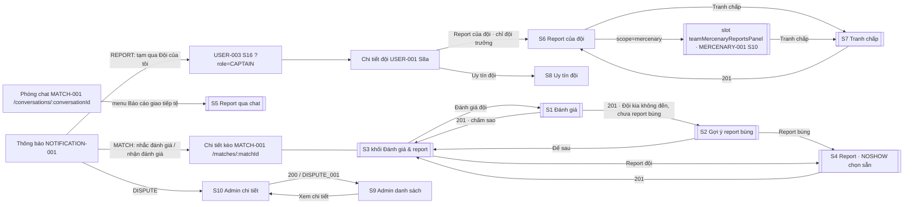

# Screen Flow — REPUTATION-001 Đánh giá, report, tranh chấp & uy tín đội

| Mục | Giá trị |
|---|---|
| Mã chức năng | `REPUTATION-001` |
| Phạm vi tầng | frontend (ArenaFlow-fe) — backend: ngoài phạm vi repo này (REPUTATION-001 `API_Spec.md`) |
| Repo/stack | ArenaFlow-fe · React 19 + TypeScript + Vite · React Router |
| Nguồn SRS/UI/API | `docs/agent/upstream/business-spec/SYSTEM-001/` (UC-R01..R07, BR-R01..R10, BC-R03/R04, AC-R01..R08) · `UI_Design.md` v1.0 (S1–S10) · `docs/agent/upstream/api/REPUTATION-001/API_Spec.md` |
| Căn cứ | `ArenaFlow-spec@53aee11` · API_Spec `v2.1` (MATCH-001 `v3.2`, USER-001 `v5.3`, USER-003 `v2.0`, NOTIFICATION-001 `v2.0`, MERCENARY-001 `v3.0`, SYSTEM-002 `v1.2`) |
| Quy ước áp dụng | `docs/agent/design-standards.md`, `docs/agent/convention-frontend.md`, `docs/agent/security-frontend.md` · khung: `docs/agent/design/SHARED/APP-SHELL/` · FE ADR-0003, 0004, 0005, 0006, 0008 (Proposed, nhánh `feature/USER-001-user-team`) · FE ADR-0010 (Proposed, nhánh này) |
| Tác giả / Ngày / Phiên bản | `solution-architect` (agent) / `2026-11-27` / `v1.2` (lịch sử: `CHANGELOG.md`) |

> Khung (route registry `AppRouteGroups`, guard, layout, `ROUTE_PATHS`, `useUrlParam`, `Dialog`): `SHARED/APP-SHELL/Screen_Flow.md`, `Component_Design.md` — nhánh `feature/USER-001-user-team` (chưa merge), trỏ theo tên mục.
> Module mới: `src/modules/reputation/`. S3, S5 hiện trên màn của MATCH-001 qua slot (FE ADR-0010) — hợp đồng ở Component_Design §6. File này **không** sửa thiết kế USER-001, USER-003, NOTIFICATION-001, SHARED; thay đổi cần áp gom ở §6.

## 1. Danh sách màn hình

| # | Màn hình | Route (`ROUTE_PATHS`) | Nhóm route | Use case (SRS) |
|---|---|---|---|---|
| S1 | Đánh giá đối phương | Dialog trên S3 | authenticated | UC-R01, AC-R01 |
| S2 | Gợi ý report bùng | Dialog (`alertdialog`) sau S1 | authenticated | UC-R01 bước 5 |
| S3 | Khối "Đánh giá & report" | Khối trong chi tiết kèo MATCH-001 (slot `matchReputationSection`) | authenticated (route của MATCH-001) | UC-R01, UC-R02, AC-R07, BC-R03/R04, BR-R08 |
| S4 | Report đối phương | Dialog trên S3 / sau S2 | authenticated | UC-R02, AC-R02, BR-R06, BR-R07 (1)(2) |
| S5 | Report "giao tiếp tệ" qua chat | Dialog trong phòng chat MATCH-001 (slot `conversationReportDialog`) | authenticated (route của MATCH-001) | UC-R02, AC-R08, BR-R07 (3) |
| S6 | Report của đội | `/teams/:teamId/reports` (`teamReports`); `?scope=team\|mercenary&tab=received\|sent&page=` | authenticated | AC-R07, UC-R03 bước 1–2 (`scope=mercenary`: MERCENARY-001 S10 qua slot `teamMercenaryReportsPanel`) |
| S7 | Tranh chấp report bùng | Dialog trên S6 (slot `reportDisputeDialog` cho MERCENARY-001) | authenticated | UC-R03, AC-R03 |
| S8 | Uy tín đội | `/teams/:teamId/reputation` (`teamReputation`) | authenticated | UC-R05..R07 |
| S9 | Admin — danh sách tranh chấp | `/admin/disputes` (`adminDisputes`); `?status=PENDING\|RESOLVED\|ALL&page=` | admin | UC-R04 |
| S10 | Admin — chi tiết + quyết định | `/admin/disputes/:disputeId` (`adminDisputeDetail`) | admin | UC-R04, AC-R03 |

- Route khai trong `src/modules/reputation/routes/reputation.routes.tsx` (`AppRouteGroups`: `authenticated` = S6, S8; `admin` = S9, S10; page `lazy`).
- Hằng thêm vào `src/shared/constants/route-paths.constant.ts` trong PR của REPUTATION-001 (SHARED Screen_Flow §1.2):

| Khoá | Mẫu | Hàm dựng |
|---|---|---|
| `teamReports` | `/teams/:teamId/reports` | `buildTeamReportsPath(teamId, { scope?: 'team' \| 'mercenary'; tab?: 'received' \| 'sent' })` |
| `teamReputation` | `/teams/:teamId/reputation` | `buildTeamReputationPath(teamId)` |
| `adminDisputes` | `/admin/disputes` | `buildAdminDisputesPath({ status?: 'PENDING' \| 'RESOLVED' \| 'ALL' })` |
| `adminDisputeDetail` | `/admin/disputes/:disputeId` | `buildAdminDisputeDetailPath(disputeId)` |

- `/teams/:teamId/reports`, `/teams/:teamId/reputation` không trùng route của module `team` (`/teams/:teamId`, `/teams/:teamId/edit` — USER-001 §1). `/admin/disputes` khác hàng chờ mercenary (`/admin/mercenary-disputes` — MERCENARY-001 Screen_Flow §1).
- Mục nav Admin: `REPUTATION_ADMIN_NAV_ITEMS` (`src/modules/reputation/constants/reputation-nav.constant.ts`) = `{ label: 'Tranh chấp report bùng', to: ROUTE_PATHS.adminDisputes, roles: ['ADMIN'], order: 40 }` → `adminNavItems` của `AdminLayout`. Không có mục nav người dùng. MERCENARY-001 đặt "Tranh chấp mercenary" `order: 41` ngay sau.

## 2. Luồng điều hướng

## 3. Chi tiết từng màn hình

### S3 — Khối "Đánh giá & report" (trong chi tiết kèo MATCH-001)
- **Vào từ:** host MATCH-001 (`SettledMatchView` trên `/matches/:matchId`, dưới slot mercenary — MATCH-001 Component_Design §7) render slot `matchReputationSection` khi đã biết vai trò (props: Component_Design §6.1). Thông báo "Trận đấu hôm nay thế nào?" / `RATING_RECEIVED` (`referenceType = MATCH`) → `buildMatchDetailPath(matchId)` (MATCH-001 Screen_Flow §1), không tự mở S1 `[cần xác nhận]` #9.
- **Hiện / ẩn theo `viewer` × trạng thái kèo** (API_Spec §3.1):

| `viewer.kind` | `ARCHIVED` / `COMPLETED` | `CANCELLED` có `opponentTeam` | Trạng thái khác |
|---|---|---|---|
| `CAPTAIN` | Tải 2.2 → *chưa đánh giá* hoặc *đã đánh giá* (UI_Design S3) | Không gọi API; chỉ dòng "Kèo đã huỷ sau khi ghép" + nút "Report <đội>" (S4 chỉ cho "Giao tiếp tệ") | Không render |
| `CAPTAIN_OF_BOTH` | Banner BR-R08, không nút, không gọi API | Như cột trái | Không render |
| `NONE` | Không render | Không render | Không render |

- **Nút:** "Đánh giá <đội>" khi `given = null`; "Report <đội>" luôn hiện ở hai cột đầu (loại đã report bị disable trong S4 — State_API_Integration §3.3) — lệch UI (UI chỉ hiện khi còn loại chưa report) `[cần xác nhận]` #6. Không ẩn nút theo trạng thái đội đối phương (API_Spec §1.2).
- **"Report đã gửi trong trận này":** mục thu gọn, bấm "Xem report đã gửi" mới tải (State_API_Integration §1) `[cần xác nhận]` #6.
- **Trạng thái:** skeleton khối; `403 TEAM_002` / `403 MATCH_009` / `404` → không render; `TEAM_015` / `TEAM_016` → `AlertBanner` thay nội dung, ẩn nút (BR-R10); lỗi mạng → "Không tải được đánh giá" + **Thử lại** (chỉ khối, không chặn trang host).

### S1 — Đánh giá đối phương (dialog)
- **Vào từ:** S3 "Đánh giá <đội>". **Ra tới:** 201 chấm sao → đóng, toast "Đã gửi đánh giá", S3 tải lại; 201 "Đội kia không đến" → toast + kiểm đã report bùng chưa → chưa: S2; rồi: về S3.
- **Thao tác:** `SegmentedRadioGroup` "Chấm sao" / "Đội kia không đến"; đổi sang "Đội kia không đến" → xoá sao + tỷ số (không gửi — 400). Form: Component_Design §4.1.
- **Trạng thái:** đang gửi → `Dialog dismissible = false`, nút `loading`; lỗi nghiệp vụ: State_API_Integration §5.1.

### S2 — Gợi ý report bùng (alertdialog)
- **Vào từ:** S1 thành công với `isNoShow = true` khi danh sách report đã gửi (2.4 `SENT`) chưa có `NOSHOW` của `matchId`. Không gọi API riêng của S2.
- **Ra tới:** "Report bùng" → S4 `initialType = 'NOSHOW'`; "Để sau" / `Esc` → đóng. Focus mặc định "Để sau".

### S4 — Report đối phương (dialog)
- **Vào từ:** S3 "Report <đội>"; S2. **Ra tới:** 201 → đóng, toast "Đã gửi report", S3 làm mới mục report đã gửi.
- **Loại được chọn:** `CANCELLED` sau ghép → chỉ `BAD_COMMUNICATION` + banner; loại đã report của trận → disable + tag "Đã report"; đủ 4 loại đã report → thông báo "Đội bạn đã report đủ các loại trong trận này", nút gửi disable. Form: Component_Design §4.2.
- **Trạng thái:** đang tải danh sách đã report (lần mở đầu) → nhóm loại skeleton, nút gửi disable; tải lỗi → vẫn cho chọn mọi loại hợp lệ (BE chặn bằng `REPORT_004`).

### S5 — Report "giao tiếp tệ" qua chat (dialog)
- **Vào từ:** mục menu "⋮ › Báo cáo giao tiếp tệ" của `TeamMatchConversationHeader` (phòng chat MATCH-001 `/conversations/:conversationId`, cả kèo luồng B) — host tự hiện / ẩn mục, mở slot `conversationReportDialog` (Component_Design §6.2; MATCH-001 Component_Design §7).
- **Điều kiện hiện mục (host tính từ 2.19 + lịch sử 2.17 của MATCH-001):** `contextType = TEAM_MATCH`; đã có ≥ 1 tin; bên của người xem là đội còn đội trưởng (`captainName ≠ null`). Đã report "giao tiếp tệ" kèo này → host chỉ biết sau `REPORT_004` (dialog gọi `onBlocked`) `[cần xác nhận]` #7.
- **Ra tới:** 201 → toast "Đã gửi report", `onReported()` → host ẩn mục trong phiên. `CHAT_002` / `CHAT_003` / `TEAM_016` / `REPORT_010` / `REPORT_011` / `REPORT_004` / `REPORT_005` → đóng + `onBlocked(code)` (State_API_Integration §5.4).

### S6 — Report của đội
- **Vào từ:** S8a "Report của đội" (chỉ đội trưởng — §6 C3); quay lại từ S7. **Ra tới:** breadcrumb "Đội của tôi › <đội> › Report" (mục 2 → `buildTeamDetailPath(teamId)`; mục 1 theo USER-003 C12).
- **Tham số URL:** `scope` ∈ `team` (mặc định) \| `mercenary` — tab cấp 1 "Giữa hai đội" \| "Mercenary"; giá trị khác → `team`; đổi `scope` `replace`, giữ `tab`, `page = 1`. `tab` ∈ `received` (mặc định) \| `sent` → `direction` `RECEIVED` / `SENT` (tab cấp 2 "Đội bị report" / "Đội đã report"); giá trị khác → `received`; đổi tab `replace` + `page = 1`. `page` ≥ 1, `push` khi đổi trang (SHARED Screen_Flow §1.3). Trang rỗng mà `page > 1` → `replace` sang `max(1, totalPages)`.
- **`scope = team`:** thẻ UI_Design S6. Nút "Tranh chấp" khi `isDisputeOpen(report, nowMs)` (shared — đánh giá lại mỗi 60 s bằng `useNowMs` — Component_Design §3).
- **`scope = mercenary`:** render slot `teamMercenaryReportsPanel` (`teamId`, `direction`, `page`, `onPageChange` — Component_Design §6.4) **thay** `TeamReportList` + `Pagination`; **không** gọi 2.4; panel tự lo loading / empty / lỗi / phân trang và mở S7. Tab cấp 1 "Mercenary" chỉ hiện khi slot có trong `FeatureSlots` (MERCENARY-001 đã merge); chưa có → `scope=mercenary` coi như `team`.
- **Trạng thái:** skeleton 3 thẻ · empty theo tab · `403 TEAM_002` → `ErrorState` "Chỉ đội trưởng được xem report của đội" + link về S8a · `TEAM_015` / `TEAM_016` / `TEAM_001` → `ErrorState` message BE · lỗi mạng → **Thử lại**. Phân trang `Pagination` (không "Tải thêm") `[cần xác nhận]` #12.

### S7 — Tranh chấp report bùng (dialog)
- **Vào từ:** S6 "Tranh chấp" (report `RECEIVED`); MERCENARY-001 qua slot `reportDisputeDialog` (report bùng do mercenary gửi). **Ra tới:** 201 → đóng, toast "Đã gửi tranh chấp", S6 tải lại (thẻ "Đang tranh chấp"), `onDisputed()`.
- **Quá hạn:** mở dialog khi `isPastVn(disputeDeadlineAt)` hoặc nhận `REPORT_007` → banner `role="alert"` "Đã quá hạn 24 giờ để tranh chấp. Report đã được xác nhận.", textarea + "Gửi tranh chấp" disable, chỉ còn "Đóng"; đóng → invalidate danh sách.
- **Mobile:** `Dialog` dạng bottom sheet (khung SHARED), không phải trang riêng như mockup `[cần xác nhận]` #11.

### S8 — Uy tín đội
- **Vào từ:** S8a "Uy tín đội" (mọi người đã đăng nhập — §6 C3); link từ màn khác bằng `buildTeamReputationPath`. **Ra tới:** breadcrumb về S8a.
- **Hiển thị:** header đội (tên, ảnh — USER-001 2.9; huy hiệu từ 2.9 REPUTATION) + thẻ "Uy tín đội" (UI_Design S8). Đội đã giải tán vẫn xem được. Không có mục "Các trường hợp hiển thị khác" (chỉ minh hoạ).
- **Trạng thái:** skeleton 4 ô · `404 TEAM_001` → `ErrorState` "Không tìm thấy đội" + link S6 USER-001 · lỗi mạng → **Thử lại**.
- **Vị trí:** route riêng thay vì khối trong S8a (giữ ngưỡng call của S8a — State_API_Integration §1) `[cần xác nhận]` #4.

### S9 — Admin: danh sách tranh chấp
- **Tham số URL:** `status` ∈ `PENDING` (mặc định) \| `RESOLVED` \| `ALL` (tab "Chờ xử lý" / "Đã xử lý" / "Tất cả"), `replace` + `page = 1`; `page`. Dòng phụ cố định theo tab ("Cũ nhất trước" khi `PENDING`, còn lại "Mới nhất trước").
- **Ra tới:** "Xem chi tiết" → `buildAdminDisputeDetailPath(disputeId)`.
- **Trạng thái:** skeleton · empty "Không có tranh chấp nào" · `AUTH_004` → SHARED Screen_Flow §2 · lỗi mạng → **Thử lại**.

### S10 — Admin: chi tiết + quyết định
- **Vào từ:** S9; thông báo `DISPUTE_CREATED` (`referenceType = DISPUTE`). **Ra tới:** "← Danh sách tranh chấp" → S9 (giữ `status` nếu đến từ S9 qua `location.state.from`, không thì mặc định).
- **Theo `status`:** `PENDING` → form quyết định; `RESOLVED` → khối chỉ đọc (UI_Design S10 "Đã xử lý"). Gửi thành công → khối chỉ đọc ngay (dữ liệu từ response), toast "Đã gửi quyết định". Không có bước xác nhận thêm `[cần xác nhận]` #13.
- **Trạng thái:** skeleton · `404 DISPUTE_001` → toast message BE + `navigate(adminDisputes, { replace: true })` · lỗi mạng → **Thử lại**.

## 4. Route guard & phân quyền
- S6, S8: `AuthGuard`. S9, S10: `AuthGuard → RoleGuard('ADMIN')` (`AdminLayout`).
- Quyền đội trưởng (S3, S4, S5, S6, S7) **không** kiểm bằng guard: BE trả `403 TEAM_002` / `CHAT_003` → ẩn khối / `ErrorState` (security-frontend §5). Lối vào S6 chỉ hiện cho đội trưởng (USER-001 tính `captainId === session.userId`).
- `404 USER_001` ở 2.10 → `endSession('ACCOUNT_DELETED')` (SHARED State_API_Integration §2.3).

## 5. Điều hướng từ thông báo (cho NOTIFICATION-001)

| `type` (`referenceType`) | Đích đề xuất | Ghi chú |
|---|---|---|
| Nhắc đánh giá, `RATING_RECEIVED` (`MATCH`) | `buildMatchDetailPath(matchId)` (MATCH-001 Screen_Flow §1, bảng thông báo `MATCH`) | S3 hiện trong trang |
| `REPORT_RECEIVED`, `REPORT_DISPUTED`, `DISPUTE_RESOLVED` (`REPORT`) | **Tạm:** `buildMyTeamsPath({ role: 'CAPTAIN' })` (USER-003 S16) → chọn đội → S8a → S6 | Không có API tra report theo `reportId` để biết đội / chiều → `[cần xác nhận]` #8 |
| `DISPUTE_CREATED` (`DISPUTE`) | `buildAdminDisputeDetailPath(disputeId)` (S10) | Thay tên đề xuất `buildAdminDisputePath` của NOTIFICATION-001 §5 |

## 6. Thay đổi phải áp ở thiết kế khác (nguồn duy nhất)

> REPUTATION-001 **không** sửa các file này; chủ thiết kế áp qua vòng lặp design của mã đó. Cột "Chặn code?" là với phần REPUTATION-001 phụ thuộc.

| # | File | Mục | Cũ | Mới | Chặn code? |
|---|---|---|---|---|---|
| C1 | SHARED `Screen_Flow.md` | §1.2 | Chưa có path REPUTATION-001 | Ghi nhận 4 khoá + hàm dựng ở §1 | Không (thêm trong PR REPUTATION-001) |
| C2 | SHARED `Screen_Flow.md` + `Component_Design.md` | §1.1 cây route; §1 cây khung, §2 `AppProviders` | Không có slot nghiệp vụ | `AppProviders` bọc `FeatureSlotsProvider` (`src/shared/components/feature-slots/`), hook `useFeatureSlot` (`src/shared/hooks/`), map ở `src/app/app-feature-slots.constant.ts` — FE ADR-0010. **Đã áp ở SHARED v1.2** (props slot theo `src/shared/types/reputation-slots.type.ts`) | Không (còn #2 — ADR-0010 `Proposed`) |
| C3 | USER-001 `Screen_Flow.md` + `Component_Design.md` | S8a | Không có lối vào uy tín / report | Link "Uy tín đội" → `buildTeamReputationPath(teamId)` (mọi người xem); link "Report của đội" → `buildTeamReportsPath(teamId)` (chỉ đội trưởng, đội `ACTIVE`); không thêm call | Không (S6, S8 vào được bằng URL) |
| C4 | SHARED `Component_Design.md` | §3, §5 | — | Thêm thành phần dùng chung ở Component_Design §3 của tài liệu này (`ReportTypeChip`, `ReportStatusBadge`, `StarRatingDisplay`, `StarRatingInput`, `ReliabilityLevelBadge`, `TeamReputationSummary`, hằng nhãn, type, `teamReputationKey`) | Không (REPUTATION-001 tạo đúng props nếu code trước, `reuse-scan`) |
| C5 | SHARED `State_API_Integration.md` | §4 bảng `QUERY_ROOTS` + danh sách key dùng chung | `'reputation'` — "thêm khi thiết kế"; key dùng chung chỉ có `catalogKeys` | `'reputation'`: REPUTATION-001; thêm `teamReputationKey` (`src/shared/constants/team-reputation-query-key.constant.ts`) và `teamDetailKey` (`src/shared/constants/team-detail-query-key.constant.ts`) cạnh `catalogKeys` (State_API_Integration §3.1) | Không |
| C6 | NOTIFICATION-001 `Screen_Flow.md` | §5 dòng `REPORT`, `DISPUTE`; §6 #5, #7 | Đề xuất `buildAdminDisputePath`; `REPORT` chưa xác định | `DISPUTE` → `buildAdminDisputeDetailPath`; `REPORT` → tạm `buildMyTeamsPath({ role: 'CAPTAIN' })` theo §5 | Không với REPUTATION-001 |
| C7 | MATCH-001 `Component_Design.md` §7, `Screen_Flow.md` §3, `State_API_Integration.md` §1 | Chi tiết kèo; phòng chat; thẻ đội | — | **Đã áp ở MATCH-001** (MATCH-001 Screen_Flow §6 C11 — chấp nhận props §6.1, §6.2; `viewer = SlotMatchViewer`; nguồn vai trò `myTeamsKey({ role: null, page: 1, pageSize: 100 })` lọc `CAPTAIN`); thẻ đội trong danh sách chỉ dùng `reliabilityScore` (MATCH-001 State §1) | Không còn chặn ở phía hợp đồng; vẫn theo #2 |
| C8 | MERCENARY-001 `Component_Design.md` §6.3, `Screen_Flow.md` S10, §6 C5–C8 | Tranh chấp; panel report mercenary; nhãn | — | **Đã áp ở MERCENARY-001**: dùng slot `reportDisputeDialog` (`toRecruitmentDisputeProps`), cung cấp slot `teamMercenaryReportsPanel` cho S6 `scope=mercenary`, dùng hằng / component dùng chung ở C4 | Không với REPUTATION-001 |
| C9 | SHARED `Component_Design.md` | §5 Hook & util dùng chung | — | Thêm `teamDetailKey`, `teamReputationKey`, type `TeamDetail` (`src/shared/types/team-detail.type.ts` = USER-001 `TeamResponse` §4.2), `formatDecimalVi` | Không (REPUTATION-001 tạo nếu code trước, `reuse-scan`) |
| C10 | USER-001 `State_API_Integration.md` + `Component_Design.md` | §3.1 factory `teamKeys`; hàm `getTeam` / type `TeamResponse` | `detail: (teamId) => [...teamKeys.all, 'detail', teamId]`; type khai trong module `team` | `detail: teamDetailKey` (cùng giá trị, giữ tiền tố `members` / `captainHistory`…); `queryFn` dưới key này trả **nguyên** `TeamDetail` (shared), biến đổi chỉ qua `select`; mọi invalidate / `setQueryData` giữ nguyên | Không — key cùng giá trị với `teamKeys.detail` hiện tại; điều kiện duy nhất: `queryFn` của USER-001 không biến đổi dữ liệu (kiểm ở `code-reviewer`) |
| C11 | SHARED `Component_Design.md` | §5 Hook & util; type slot | — | Thêm `useNowMs` (`src/shared/hooks/use-now-ms.hook.ts`), `isDisputeOpen` (`src/shared/utils/dispute-window.util.ts`), `SlotTeamRef` + `SlotMatchViewer` (`src/shared/types/feature-slots.type.ts`) — theo MERCENARY-001 C5, C6 | Không (mã code trước tạo, `reuse-scan`) |

## 7. `[cần xác nhận]`
> Đánh số chung cho 3 tài liệu; nội dung, phương án đề xuất và cột **Chặn code?** đầy đủ ở State_API_Integration §7. Mục liên quan file này:

| # | Tóm tắt | Chặn code? |
|---|---|---|
| 1 | Nền SHARED chưa merge + FE ADR-0003..0006, 0008 `Proposed` | **Có** — toàn bộ |
| 2 | FE ADR-0010 (slot) `Proposed` (C2 đã áp ở SHARED v1.2) | **Có** — S3, S1, S2, S4, S5, slot S7 |
| 3 | Ngưỡng call S6/S8 khi vào thẳng URL (header chung cache với S8a) | **Có** — luồng gọi header khi vào thẳng URL |
| 4 | S8 là route riêng, không phải khối trong S8a | Không |
| 5 | ~~Hợp đồng slot với MATCH-001~~ — **đã đồng bộ hai phía** (C7) | Không (còn #2) |
| 6 | "Report đã gửi trong trận này" thu gọn, tải khi bấm; nút "Report" luôn hiện | Không |
| 7 | Mục chat report chỉ ẩn sau `REPORT_004` | Không |
| 8 | Đích thông báo `REPORT` (tạm qua USER-003 S16) | Không (REPUTATION-001) |
| 9 | Không tự mở S1 từ thông báo nhắc đánh giá | Không |
| 10 | ~~Tab "Mercenary" trên S6~~ — **đã chốt** `scope` + slot `teamMercenaryReportsPanel` (C8) | Không |
| 11 | S7 mobile là bottom sheet | Không |
| 12 | S6 phân trang thay "Tải thêm" | Không |
| 13 | S10 không có bước xác nhận thêm | Không |
