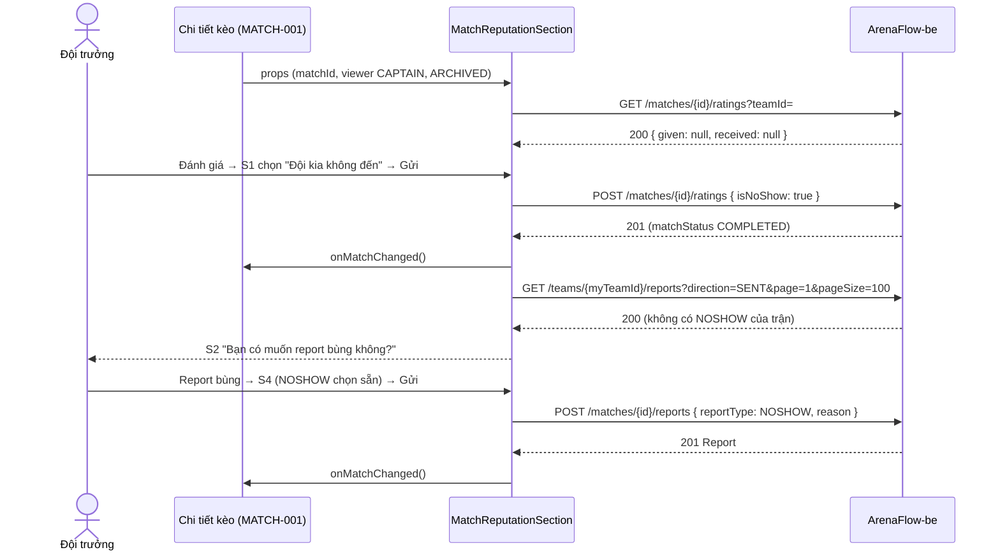
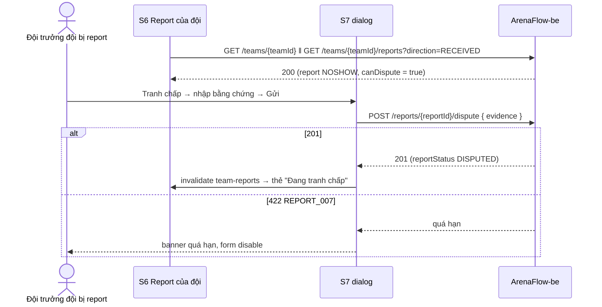

# State & API Integration — REPUTATION-001 Đánh giá, report, tranh chấp & uy tín đội

| Mục | Giá trị |
|---|---|
| Mã chức năng | `REPUTATION-001` |
| Phạm vi tầng | frontend (ArenaFlow-fe) — hợp đồng API thuộc BE |
| Nguồn API | `docs/agent/upstream/api/REPUTATION-001/API_Spec.md` · `docs/agent/upstream/api/api-convention.md` · USER-001 `API_Spec.md` 2.9 (`TeamResponse` §4.2) · USER-003 `API_Spec.md` 2.5 (đề xuất cho host) · MATCH-001 `API_Spec.md` §1.6, §3.1, §4.2, §4.7 · NOTIFICATION-001 `API_Spec.md` §4.2–§4.3 · SYSTEM-002 `API_Spec.md` §1.1 |
| Căn cứ | `ArenaFlow-spec@53aee11` · API_Spec `v2.1` (USER-001 `v5.3`, USER-003 `v2.0`, MATCH-001 `v3.2`, NOTIFICATION-001 `v2.0`, MERCENARY-001 `v3.0`, SYSTEM-002 `v1.2`) |
| Khung dùng chung | `docs/agent/design/SHARED/APP-SHELL/State_API_Integration.md` (nhánh `feature/USER-001-user-team`) — `http.service`, `ApiError`, xử lý 401 / `AUTH_004` / `SYS_*` / timeout, `QUERY_ROOTS`: **trỏ**, không định nghĩa lại |
| Quy ước áp dụng | `docs/agent/convention-frontend.md` §5, `docs/agent/non-functional-standards.md`, `docs/agent/security-frontend.md` · FE ADR-0004 (TanStack Query), 0005, 0008 (Proposed, nhánh `feature/USER-001-user-team`) · FE ADR-0010 (Proposed, nhánh này) |
| Tác giả / Ngày / Phiên bản | `solution-architect` (agent) / `2026-11-27` / `v1.2` (lịch sử: `CHANGELOG.md`) |

> Số mục `2.x` là mục của REPUTATION-001 `API_Spec.md` (trừ khi ghi mã khác). Field / JSON: trỏ API_Spec, không chép. Path tương đối với base `/api/v1`.

## 1. Endpoint dùng theo màn hình

| Màn hình | Thời điểm gọi | Method + path | API_Spec | Số call khi tải |
|---|---|---|---|---|
| S3 | Khi tải, `viewer.kind = CAPTAIN` và kèo `ARCHIVED` / `COMPLETED` | `GET /matches/{matchId}/ratings?teamId={myTeamId}` | 2.2 | 1 (0 ở mọi trường hợp khác) |
| S3 | Bấm "Xem report đã gửi" | `GET /teams/{myTeamId}/reports?direction=SENT&page=1&pageSize=100` → lọc `matchId` | 2.4 | 0 (thao tác) |
| S1 | "Gửi đánh giá" | `POST /matches/{matchId}/ratings` | 2.1 | 0 khi mở |
| S2 | Sau 2.1 `isNoShow = true`, trước khi hiện | Như dòng "Xem report đã gửi" (cache chung) | 2.4 | 0 (thao tác) |
| S4 | Mở dialog | Như dòng "Xem report đã gửi" (cache chung) | 2.4 | 0–1 (thao tác) |
| S4 | "Gửi report" | `POST /matches/{matchId}/reports` | 2.3 | — |
| S5 | "Gửi report" | `POST /conversations/{conversationId}/reports` | 2.10 | 0 khi mở |
| S6 | Khi tải / đổi tab / đổi trang | `GET /teams/{teamId}` (USER-001 2.9, header — key chung `teamDetailKey`, 0 call khi đến từ S8a) + `GET /teams/{teamId}/reports?direction&page&pageSize=20` | USER-001 2.9, 2.4 | 1–2 (đến từ S8a / đổi tab / trang: 1) — `scope=mercenary`: không gọi 2.4; panel MERCENARY-001 gọi MERCENARY-001 2.21 (cùng số call, MERCENARY-001 State §1) |
| S7 | "Gửi tranh chấp" | `POST /reports/{reportId}/dispute` | 2.5 | 0 khi mở |
| S8 | Khi tải | `GET /teams/{teamId}` (USER-001 2.9, header — key chung `teamDetailKey`, 0 call khi đến từ S8a) + `GET /teams/{teamId}/reputation` | USER-001 2.9, 2.9 | 1–2 (đến từ S8a: 1) |
| S9 | Khi tải / đổi tab / đổi trang | `GET /admin/disputes?status&page&pageSize=20` | 2.6 | 1 |
| S10 | Khi tải | `GET /admin/disputes/{disputeId}` | 2.7 | 1 |
| S10 | "Gửi quyết định" | `PATCH /admin/disputes/{disputeId}/resolve` | 2.8 | — |

**Tổng API call khi tải** — ngưỡng ≤ 3 (`non-functional-standards.md` §2, chỉ miễn refresh); cách tính có gồm request khung hay không **chưa chốt** (SHARED State_API_Integration §7 #1) → ghi cả ba cách như USER-001 State_API_Integration §1:

| Màn | (A) Chỉ call của màn | (B) Vào thẳng URL, + hồ sơ cho header | (C) = (B) + `unread-count` (NOTIFICATION-001) | Kết luận |
|---|---|---|---|---|
| S3 (khối) | **+1** vào trang chi tiết kèo MATCH-001 | — | — | MATCH-001 cộng vào tổng của trang (#5) |
| S6 | 1 (từ S8a, header có cache) · 2 (vào thẳng) | 3 | **4** | Vượt ở (C) |
| S8 | 1 (từ S8a, header có cache) · 2 (vào thẳng) | 3 | **4** | Vượt ở (C) |
| S9 | 1 | 2 | 3 | Đạt |
| S10 | 1 | 2 | 3 | Đạt |
| S1, S2, S4, S5, S7 (dialog) | 0 khi mở (S4: 0–1 do thao tác, chung cache) | — | — | Đạt |

- **Header đội không gọi lại dữ liệu đã có** (`non-functional-standards.md` §2): S6, S8 dùng **cùng key** chi tiết đội với S8a (`teamDetailKey`, §3.1) → đến từ S8a trong thời gian cache còn mới thì 0 call.
- **Phương án giảm S6, S8 khi vào thẳng URL (nếu phải tính (C)):** không gọi header khi chưa có cache — `<h1>` / breadcrumb không kèm tên đội. Hoặc đề xuất BE thêm tên đội vào response 2.4 / 2.9 (đổi hợp đồng → làm ở repo BE). `[cần xác nhận]` #3.
- Không màn nào gọi API theo từng phần tử. Thẻ đội trong **danh sách** kèo / thương lượng không gọi 2.9 từng thẻ (#19).
- `useTeamHeader` và 2.4 / 2.9 chạy song song (không phụ thuộc nhau).

## 2. Hàm API & type

| Hàm | Đường dẫn (`src/modules/reputation/`) | Request type | Response type | `http` |
|---|---|---|---|---|
| `rateOpponent(matchId, body)` | `api/reputation.api.ts` | `RateOpponentRequest` (2.1) | `CreatedRating` (§4.3 + `matchStatus`) | `post` |
| `getMatchRatings(matchId, teamId, signal)` | ″ | query `teamId` | `MatchRatings` (2.2: `given`, `received`) | `get` |
| `reportOpponent(matchId, body)` | ″ | `ReportOpponentRequest` (2.3) | `Report` (§4.4) | `post` |
| `getTeamReports(teamId, params, signal)` | ″ | `TeamReportsParams { direction, page, pageSize }` | `Page<Report>` | `getPage` |
| `disputeReport(reportId, body)` | ″ | `DisputeReportRequest` (2.5) | `CreatedDispute` (2.5) | `post` |
| `reportConversation(conversationId, body)` | ″ | `ConversationReportRequest` (2.10) | `Report` | `post`, `accountGoneCodes: ['USER_001']` |
| `getTeamReputation(teamId, signal)` | ″ | — | `TeamReputation` (shared, §4.8) | `get` |
| `getAdminDisputes(params, signal)` | `api/admin-dispute.api.ts` | `AdminDisputeListParams { status, page, pageSize }` | `Page<AdminDispute>` (§4.6) | `getPage` |
| `getAdminDispute(disputeId, signal)` | ″ | — | `AdminDisputeDetail` (§4.7) | `get` |
| `resolveDispute(disputeId, body)` | ″ | `ResolveDisputeRequest` (2.8) | `AdminDisputeDetail` | `patch` |
| `getTeamDetail(teamId, signal)` | `api/team-detail.api.ts` | — | `TeamDetail` (shared — USER-001 `TeamResponse` §4.2, **nguyên response**, không biến đổi trong `queryFn`) | `get` |

- Type module: `types/reputation-api.type.ts` (`Rating`, `MatchRatings`, `Report`, `ReportDisputeInfo`, `AdminDispute`, `AdminDisputeDetail`, `DisputeMatch`, request types). Enum + `TeamReputation`: `src/shared/types/reputation.type.ts` (Component_Design §3).
- Thời gian: chuỗi giờ Việt Nam không múi giờ (SYSTEM-002 §1.1) — hiển thị bằng `formatVnDateTime` / `formatVnDate` / `formatVnTime`, so hạn bằng `isPastVn` (SHARED `vn-datetime`).

## 3. State

### 3.1. Server state — query key (FE ADR-0004)

```ts
// src/modules/reputation/constants/reputation-query-keys.constant.ts
export const reputationKeys = {
  all: [QUERY_ROOTS.reputation] as const,
  matchRatings: (matchId: string, teamId: string) => [...reputationKeys.all, 'match-ratings', matchId, teamId] as const,
  teamReports: (teamId: string) => [...reputationKeys.all, 'team-reports', teamId] as const,
  teamReportList: (teamId: string, p: TeamReportsParams) => [...reputationKeys.teamReports(teamId), p] as const,
}
export const adminDisputeKeys = {
  all: [QUERY_ROOTS.reputation, 'admin-dispute'] as const,
  lists: () => [...adminDisputeKeys.all, 'list'] as const,
  list: (p: AdminDisputeListParams) => [...adminDisputeKeys.lists(), p] as const,
  detail: (disputeId: string) => [...adminDisputeKeys.all, 'detail', disputeId] as const,
}
// src/shared/constants/team-reputation-query-key.constant.ts — dùng chung (MATCH-001 / MATCH-002 gọi 2.9 bằng hàm của module mình)
export const teamReputationKey = (teamId: string) => [QUERY_ROOTS.reputation, 'team-reputation', teamId] as const
// src/shared/constants/team-detail-query-key.constant.ts — dùng chung USER-001 + REPUTATION-001 (mẫu `catalogKeys`, SHARED State_API_Integration §4)
export const teamDetailKey = (teamId: string) => [QUERY_ROOTS.team, 'detail', teamId] as const
```

- **Hợp đồng cache chung `teamDetailKey`:** mọi `queryFn` dưới key này trả **nguyên** `TeamDetail` (shared type) — không biến đổi; module cần tập con dùng `select` (REPUTATION-001: `useTeamHeader` = `useQuery({ queryKey: teamDetailKey(teamId), queryFn: getTeamDetail, select: (t) => ({ teamName, avatarUrl, status, captainId }) })`). USER-001 `teamKeys.detail` trỏ tới `teamDetailKey` → giữ nguyên tiền tố `members`, `captainHistory`… và mọi invalidate / `setQueryData` hiện có của USER-001 (Screen_Flow §6 C10).

| State | Loại | Hook | Key | Ghi chú |
|---|---|---|---|---|
| Đánh giá của trận (S3) | server | `useMatchRatings(matchId, teamId, { enabled })` | `matchRatings` | `enabled` theo bảng Screen_Flow S3 |
| Report đã gửi của trận (S3, S2, S4) | server | `useMatchSentReports(myTeamId, matchId, { enabled })` | `teamReportList(myTeamId, { direction: 'SENT', page: 1, pageSize: 100 })` | `select` lọc `matchId` → `{ reports, reportedTypes: ReadonlySet<ReportType> }`; chỉ trang 1 (#6) |
| Report của đội (S6) | server | `useTeamReports(teamId, { direction, page, pageSize: 20 })` | `teamReportList` | `placeholderData` giữ trang cũ khi đổi trang |
| Header đội (S6, S8) | server | `useTeamHeader(teamId)` | `teamDetailKey(teamId)` + `select` | Một cache với S8a (USER-001) |
| Uy tín đội (S8) | server | `useTeamReputation(teamId)` | `teamReputationKey` | — |
| Danh sách tranh chấp (S9) | server | `useAdminDisputes({ status, page, pageSize: 20 })` | `adminDisputeKeys.list` | `placeholderData` |
| Chi tiết tranh chấp (S10) | server | `useAdminDispute(disputeId)` | `adminDisputeKeys.detail` | — |
| Tab / trang / trạng thái lọc | URL | `useUrlParam` | S6 `scope`, `tab`, `page`; S9 `status`, `page` | Screen_Flow S6, S9 |
| Dialog đang mở, loại chọn sẵn, loại vừa bị `REPORT_004` | client cục bộ | `useState` trong `MatchReputationSection` / dialog | — | Không store toàn cục |

### 3.2. Sau mutation thành công

| Mutation | Cập nhật cache | Callback host |
|---|---|---|
| 2.1 | invalidate `matchRatings(matchId, myTeamId)` (tải lại để có `received`), `teamReputationKey(myTeamId)`, `teamReputationKey(opponentTeamId)` | `onMatchChanged()` (kèo → `COMPLETED`, điểm đổi) |
| 2.3 | invalidate `teamReports(myTeamId)`, `teamReputationKey(opponentTeamId)` | `onMatchChanged()` (`reliabilityScore` trong chi tiết kèo) |
| 2.10 | invalidate `teamReports(viewerTeamId)`, `teamReputationKey(reportedTeam.teamId)` | `onReported()` |
| 2.5 | invalidate tiền tố `[...reputationKeys.all, 'team-reports']` (S7 mở từ slot không biết `teamId`) | `onDisputed()` |
| 2.8 | `setQueryData(adminDisputeKeys.detail(disputeId), response)`; invalidate `adminDisputeKeys.lists()`, `teamReputationKey(reportedTeam.teamId)`, `teamReputationKey(reporterTeam.teamId)` | — |

- Invalidate chéo domain chỉ theo gốc / tiền tố của mã mình; dữ liệu MATCH-001 / MERCENARY-001 do host làm mới qua callback (FE ADR-0010 mục 5).

### 3.3. Dữ liệu dẫn xuất
- `reportedTypes` (S4 disable) = `useMatchSentReports().reportedTypes` ∪ loại vừa nhận `REPORT_004` trong phiên dialog.
- S2 hiện khi: 2.1 thành công với `isNoShow = true` → `queryClient.fetchQuery` khoá `teamReportList(myTeamId, SENT, 1, 100)` → không có report `NOSHOW` của `matchId`. `fetchQuery` lỗi → vẫn hiện S2 (BE chặn bằng `REPORT_004`).
- Nút "Tranh chấp" (S6): `isDisputeOpen(report, useNowMs(60_000))` — cả hai ở `shared/` (Component_Design §3; dùng chung MERCENARY-001).

## 4. Luồng tương tác





## 5. Xử lý lỗi

> Lỗi chung (`VALIDATION_ERROR` → `applyServerValidationErrors`, `AUTH_001`, `AUTH_004`, `SYS_*`, timeout 15 s, mất mạng): SHARED State_API_Integration §2.3. Bảng dưới chỉ mã riêng; message hiển thị = `ApiError.message` (BE) trừ khi ghi câu khác. "Lỗi trong dialog" = `FormErrorBanner`, giữ giá trị form, cho bấm lại.

### 5.1. 2.1 — Gửi đánh giá (S1)

| HTTP / mã | Hiển thị / hành động |
|---|---|
| `400 VALIDATION_ERROR` | Lỗi cạnh field (`fieldMap`: `isNoShow` → `mode`) |
| `404 MATCH_001` | Đóng dialog, toast; `onMatchChanged()` |
| `403 TEAM_002` | Đóng dialog, toast; invalidate `matchRatings` → khối ẩn |
| `422 TEAM_015` | Lỗi trong dialog, nút gửi disable; invalidate `matchRatings` (khối chuyển banner) |
| `422 RATING_003` | Đóng dialog, toast; `onMatchChanged()` (host tính lại `viewer`) |
| `422 RATING_001` | Lỗi trong dialog + "Trận vừa kết thúc có thể cần vài phút, vui lòng thử lại sau."; `onMatchChanged()` |
| `409 RATING_002` | Đóng dialog, toast; invalidate `matchRatings` (hiện đánh giá đã gửi) |
| `409 MATCH_014` | Lỗi trong dialog; invalidate `matchRatings` |

### 5.2. 2.2 — Đánh giá của trận (S3 khi tải)

| HTTP / mã | Hiển thị / hành động |
|---|---|
| `403 TEAM_002`, `403 MATCH_009`, `404 MATCH_001`, `404 TEAM_001`, `400` | Không render khối (`MATCH_009` / `TEAM_001` / `400` = host truyền sai `teamId` — lỗi lập trình) |
| `422 TEAM_015`, `422 TEAM_016` | `AlertBanner` (warning) message BE thay nội dung, ẩn nút (BR-R10) |
| Mạng / timeout / 5xx | "Không tải được đánh giá" + **Thử lại** trong khối |

### 5.3. 2.3 — Report đối phương (S4)

| HTTP / mã | Hiển thị / hành động |
|---|---|
| `400 VALIDATION_ERROR` | Lỗi cạnh field |
| `404 MATCH_001` | Đóng dialog, toast; `onMatchChanged()` |
| `403 TEAM_002` | Đóng dialog, toast; invalidate `matchRatings` |
| `422 TEAM_015` | Lỗi trong dialog, nút gửi disable |
| `422 REPORT_005` | Đóng dialog, toast; `onMatchChanged()` |
| `422 REPORT_002` | Lỗi trong dialog + "Nếu hai đội đã nhắn tin, bạn có thể report giao tiếp tệ trong phòng chat."; `onMatchChanged()` |
| `422 REPORT_003` | Bật `onlyBadCommunication` cục bộ, bỏ chọn loại khác; lỗi dưới nhóm loại; `onMatchChanged()` |
| `409 REPORT_004` | Thêm loại vào `reportedTypes`, bỏ chọn; lỗi dưới nhóm loại; invalidate `teamReports(myTeamId)` |
| `409 MATCH_014` | Lỗi trong dialog |
| 2.4 `SENT` lỗi khi mở dialog | Không chặn: mọi loại hợp lệ chọn được, BE chặn bằng `REPORT_004` |

### 5.4. 2.10 — Report qua chat (S5)

| HTTP / mã | Hiển thị / hành động |
|---|---|
| `400 VALIDATION_ERROR` | Lỗi cạnh `reason` |
| `404 USER_001` | Wrapper `endSession('ACCOUNT_DELETED')` (`accountGoneCodes`) |
| `404 CHAT_002`, `403 CHAT_003`, `422 REPORT_011`, `422 TEAM_016`, `422 REPORT_005`, `422 REPORT_010`, `409 REPORT_004` | Đóng dialog, toast; `onBlocked(code)` (`REPORT_011` = host mở sai loại chat — lỗi lập trình) |
| `422 TEAM_015` | Lỗi trong dialog, nút gửi disable |
| `409 MATCH_014` | Lỗi trong dialog |

### 5.5. 2.4 — Report của đội (S6; khối S3 "Xem report đã gửi")

| HTTP / mã | Hiển thị / hành động |
|---|---|
| `400 VALIDATION_ERROR` | `replace` tham số URL về mặc định (`tab=received`, `page=1`) |
| `404 TEAM_001` | `ErrorState` "Không tìm thấy đội" + link `ROUTE_PATHS.teams` |
| `403 TEAM_002` | `ErrorState` "Chỉ đội trưởng được xem report của đội" + link S8a |
| `422 TEAM_015`, `422 TEAM_016` | `ErrorState` message BE + link S8a |
| Mạng / timeout / 5xx | `ErrorState` + **Thử lại** (S3: trong mục thu gọn) |

### 5.6. 2.5 — Tranh chấp (S7)

| HTTP / mã | Hiển thị / hành động |
|---|---|
| `400 VALIDATION_ERROR` | Lỗi cạnh `evidence` |
| `404 REPORT_001`, `403 REPORT_009`, `403 TEAM_002`, `422 REPORT_006`, `409 REPORT_008` | Đóng dialog, toast; invalidate tiền tố `team-reports`; `onDisputed()` |
| `422 REPORT_007` | Chuyển dialog sang trạng thái quá hạn (Screen_Flow S7); invalidate tiền tố `team-reports`; `onDisputed()` |
| `422 TEAM_015`, `422 TEAM_016` | Lỗi trong dialog, nút gửi disable |
| `409 MATCH_014` | Lỗi trong dialog |

### 5.7. 2.6, 2.7 — Admin xem (S9, S10)

| HTTP / mã | Hiển thị / hành động |
|---|---|
| `403 AUTH_004` | SHARED Screen_Flow §2 (`ErrorState`, không đăng xuất) |
| `400 VALIDATION_ERROR` (2.6) | `replace` `status=PENDING`, `page=1` |
| `404 DISPUTE_001` (2.7) | Toast message BE, `navigate(ROUTE_PATHS.adminDisputes, { replace: true })` |
| Mạng / timeout / 5xx | `ErrorState` + **Thử lại** |

### 5.8. 2.8 — Quyết định (S10)

| HTTP / mã | Hiển thị / hành động |
|---|---|
| `400 VALIDATION_ERROR` | Lỗi cạnh `decision` / `note` |
| `404 DISPUTE_001` | Như 5.7 |
| `409 DISPUTE_002` | Toast message BE; invalidate `detail` + `lists()` (trang hiện khối chỉ đọc) |
| `409 MATCH_014` | `FormErrorBanner`; invalidate `detail`, giữ giá trị form |

### 5.9. 2.9 + header đội (S8; header S6)

| HTTP / mã | Hiển thị / hành động |
|---|---|
| `404 TEAM_001`, `400 VALIDATION_ERROR` (`teamId` trên URL sai định dạng) | `ErrorState` "Không tìm thấy đội" + link `ROUTE_PATHS.teams` |
| Mạng / timeout / 5xx | `ErrorState` + **Thử lại** (thử lại cả hai query) |

## 6. Phân trang / tìm kiếm / sort
- Offset `page` / `pageSize` theo `api-convention.md` §7; thứ tự cố định do BE (2.4: mới nhất trước; 2.6: `PENDING` cũ nhất trước, còn lại mới nhất trước) — FE không sort, không có ô tìm kiếm.
- S6, S9: `pageSize = PAGE_SIZE_DEFAULT` (20). Tra loại đã report: `pageSize = PAGE_SIZE_MAX` (100), chỉ trang 1.

## 7. `[cần xác nhận]`
> **Chặn code?** *Có* = developer không code phần nêu tới khi chốt · *Không* = code theo phương án đề xuất, đổi sau nếu user chọn khác. Đánh số chung cho 3 tài liệu.

| # | Nội dung | Chặn code? |
|---|---|---|
| 1 | **Nền SHARED + ADR:** SHARED/APP-SHELL (http, session, `ROUTE_PATHS`, `QUERY_ROOTS`, shared component, `vn-datetime`) chưa merge vào `main`; FE ADR-0003, 0004, 0005, 0006, 0008 còn `Proposed` (SHARED Screen_Flow §6 #4) | **Có** — toàn bộ REPUTATION-001 |
| 2 | **FE ADR-0010 (slot) `Proposed`** — SHARED v1.2 đã ghi `FeatureSlotsProvider` / `useFeatureSlot` và props slot theo `reputation-slots.type.ts` (Screen_Flow §6 C2 đã áp); chỉ còn ADR chặn. Phương án loại: UI ở `shared/` + host tự gọi API (ADR mục "Phương án đã loại") | **Có** — S3 (gồm S1, S2, S4 chỉ mở từ S3), S5, đăng ký slot S7. **Không** — S6, S7 trong S6, S8, S9, S10 |
| 3 | **Ngưỡng call S6, S8:** vào thẳng URL = 2 / 3 / 4 ở (A) / (B) / (C); từ S8a = 1 ở (A) (header chung cache `teamDetailKey`) (§1). Phụ thuộc SHARED State_API_Integration §7 #1. Phương án giảm: không gọi header khi chưa có cache (§1), hoặc BE thêm tên đội vào 2.4 / 2.9 | **Có** — luồng gọi header khi vào thẳng URL tới khi chốt cách tính; code theo phương án giảm thì **Không** |
| 4 | **Vị trí uy tín đội (UI_Design §4 #2, S8 desktop):** thiết kế chọn route riêng `/teams/:teamId/reputation` + link từ S8a thay vì khối trong S8a (khối sẽ làm S8a (A) thành 3–4 call). Trang "hồ sơ đội công khai" chưa có | Không |
| 5 | **Hợp đồng slot với MATCH-001 — đã đồng bộ hai phía** (MATCH-001 Screen_Flow §6 C11; Component_Design §7): MATCH-001 chấp nhận props §6.1, §6.2 (`authorTeam`, `opponentTeam: SlotTeamRef \| null`, `viewer: SlotMatchViewer`, `onMatchChanged` = invalidate chi tiết kèo + danh sách kèo của đội; `matchStatus` = `displayStatus`; `matchStartsAt` của §6.2 từ cache 2.20 hoặc `null`). Nguồn vai trò: `myTeamsKey({ role: null, page: 1, pageSize: 100 })` (USER-003 2.5, cache chung USER-001 S8a), lọc `CAPTAIN` phía FE — thay đề xuất `role=CAPTAIN` trước đây. **Chuỗi tải** chi tiết kèo: 2.3 ‖ USER-003 2.5 → khi có cả hai → 2.2 (S3); MATCH-001 tính S8 = (A) 1–3, (B) 5, (C) 7 (MATCH-001 State §1) — phụ thuộc SHARED §7 #1 ở phía MATCH-001 | Không ở phía hợp đồng (còn #2) |
| 6 | **Loại đã report của một trận (UI_Design §4 #5):** 2.4 không lọc `matchId` → FE lấy trang 1 `SENT` `pageSize=100` rồi lọc; report cũ hơn 100 report gần nhất của đội không thấy → BE vẫn chặn bằng `REPORT_004`. Lệch UI để không thêm call khi tải S3: (a) mục "Report đã gửi trong trận này" thu gọn, tải khi bấm (UI vẽ mở sẵn); (b) nút "Report <đội>" luôn hiện (UI: chỉ hiện khi còn loại chưa report) — đủ 4 loại thì S4 báo "Đội bạn đã report đủ các loại trong trận này". Đề xuất BE: thêm `matchId` cho 2.4 hoặc trả loại đã report trong 2.2 (đổi hợp đồng → repo BE) | Không |
| 7 | **Mục "Báo cáo giao tiếp tệ" trong chat** chỉ ẩn sau khi BE trả `REPORT_004` (không có dữ liệu biết trước mà không tải 2.4) | Không |
| 8 | **Đích thông báo `REPORT`** (NOTIFICATION-001 Screen_Flow §6 #7): `referenceId` = `reportId`, không có API tra report theo id → không biết đội / chiều. Tạm: `buildMyTeamsPath({ role: 'CAPTAIN' })` (USER-003 S16) → S8a → S6. Đề xuất BE: thêm `teamId` + `direction` vào thông báo hoặc `GET /reports/{reportId}` (repo BE) | Không với REPUTATION-001; **Có** với điều hướng thẳng tới S6 từ thông báo |
| 9 | **Tự mở S1 từ thông báo nhắc đánh giá:** thiết kế chỉ mở chi tiết kèo (S3 hiện nút "Đánh giá"); muốn tự mở cần tham số URL do MATCH-001 cấp (vd `?action=rate`) | Không |
| 10 | ~~**Report mercenary ↔ đội**~~ — **đã chốt** (MERCENARY-001 Screen_Flow §6 C7): S6 `scope` ∈ `team` \| `mercenary`; `scope=mercenary` render slot `teamMercenaryReportsPanel` (`teamId`, `direction`, `page`, `onPageChange`) thay danh sách 2.4 (Component_Design §6.4); tranh chấp report bùng của mercenary qua slot `reportDisputeDialog`; hàng chờ Admin tách (`/admin/mercenary-disputes`) | Không (cắm panel chờ MERCENARY-001 merge — FE ADR-0010 mục 5) |
| 11 | **S7 trên mobile:** `Dialog` dạng bottom sheet thay trang đầy đủ của mockup | Không |
| 12 | **S6 phân trang (UI_Design §4 #10):** `Pagination` như USER-001, không "Tải thêm" | Không |
| 13 | **S10 không có bước xác nhận** trước khi gửi quyết định (UI_Design §4 #11) | Không |
| 14 | **Nhãn 4 mức uy tín (UI_Design §4 #3):** đề xuất "Rất uy tín" / (không nhãn) / "Cảnh báo" / "Cảnh báo mạnh"; MERCENARY-001 UI §4 #6 đề xuất khác ("Xuất sắc / Bình thường / Cảnh báo / Cảnh báo đỏ") — một hằng `RELIABILITY_LEVEL_LABELS` dùng chung | Không |
| 15 | **Câu chữ chưa có trong SRS (UI_Design §4 #9):** lỗi validation (Component_Design §4), toast "Đã gửi đánh giá / report / tranh chấp / quyết định", câu gợi ý ở §5.1 (`RATING_001`), §5.3 (`REPORT_002`), `ErrorState` §5.5 | Không |
| 16 | **Định dạng ngày giờ:** UI_Design ghi `dd/MM/yyyy HH:mm`; SHARED `formatVnDateTime` trả `HH:mm dd/MM/yyyy` — dùng SHARED (một nguồn) | Không |
| 17 | **Desktop S6–S10 chưa vẽ (UI_Design §4 #8):** làm theo mô tả chữ trong UI_Design (user đã duyệt trước) | Không |
| 18 | **`received = null` sau khi đã đánh giá (UI_Design §4 #4):** ẩn hẳn ô, không câu trung tính | Không |
| 19 | **Thẻ uy tín rút gọn ở danh sách kèo / thương lượng (UI_Design S8, §4 #2):** gọi 2.9 cho từng thẻ là N+1 (`non-functional-standards.md` §2) → danh sách chỉ dùng `reliabilityScore` có sẵn trong response MATCH-001 / MATCH-002; `TeamReputationSummary` chỉ dùng ở trang chi tiết (tính vào ngưỡng của trang đó). Cần đủ 4 chỉ số trong danh sách → đề xuất BE gộp vào response danh sách | Không |
| 20 | **Định dạng số thập phân sao trung bình:** mockup "4.3"; thiết kế dùng "4,3" theo `vi-VN` (`formatDecimalVi`, Component_Design §3) cho S8 và `TeamReputationSummary` | Không |
