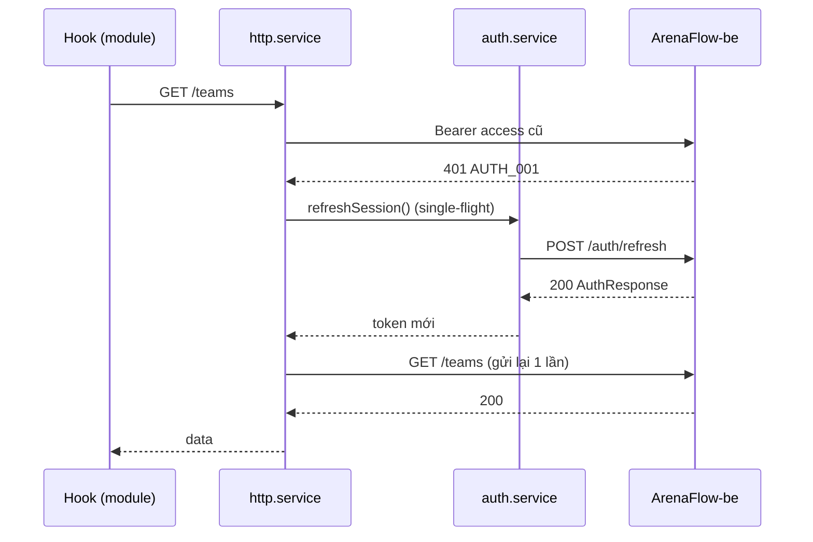

# State & API Integration — SHARED/APP-SHELL Khung ứng dụng dùng chung

| Mục | Giá trị |
|---|---|
| Mã chức năng | `APP-SHELL` |
| Phạm vi tầng | frontend (ArenaFlow-fe) — hợp đồng API thuộc BE |
| Nguồn API | `docs/agent/upstream/api/api-convention.md` · USER-001 `API_Spec.md` §1.1, §1.2, 2.4 · MATCH-001 `API_Spec.md` §1.7 · NOTIFICATION-001 `API_Spec.md` §1.4 · SYSTEM-002 `API_Spec.md` §1.1 |
| Căn cứ | `ArenaFlow-spec@53aee11` · USER-001 API_Spec `v5.3` · MATCH-001 `v3.2` · NOTIFICATION-001 `v2.0` · SYSTEM-002 `v1.2` |
| Quy ước áp dụng | `docs/agent/convention-frontend.md` §5, `docs/agent/non-functional-standards.md`, `docs/agent/security-frontend.md` · FE ADR-0002, 0004, 0006, 0007, 0008, 0016 (FE ADR-0016 **chưa có trên nhánh này** — thuộc PR VENUE-001, nhánh `feature/VENUE-001-venue`) |
| Tác giả / Ngày / Phiên bản | `solution-architect` (agent) / `2026-11-27` / `v1.2` (lịch sử: `CHANGELOG.md`) |

## 1. Request của khung

| Thời điểm | Request | Chủ sở hữu | Tính ngưỡng? |
|---|---|---|---|
| Mở app, có refresh token | `POST /api/v1/auth/refresh` (USER-001 2.4) | `core/auth` | Không (`non-functional-standards.md` §2) |
| Header hiện tên + avatar | `GET /api/v1/profile` (USER-001 2.5) — key `accountKeys.profile()`, dùng chung với màn Hồ sơ | USER-001 `AccountMenu` | Một lần mỗi phiên (cache) |
| Badge chuông | `GET /api/v1/profile/notifications/unread-count` (NOTIFICATION-001 2.2) | NOTIFICATION-001 | **Chỉ** trong `onConnected` (§6): 1 call khi kết nối realtime lần đầu của phiên, + 1 sau mỗi lần kết nối lại, + 1 khi app trở lại foreground. **Không** gọi lúc chuông mount (quyết định coordinator 2026-11-27) → tải một màn = đúng 1 call này. **Khi `PERSONAL_CHANNEL_ENABLED = false`** (mặc định, trước bản BE NOTIFICATION-001 — §6): không có `onConnected` của kênh cá nhân → gọi 2.2 **một lần lúc chuông mount** (+ foreground) — NOTIFICATION-001 State_API_Integration §4.2 v1.2 |
| Huy hiệu "Lời mời của tôi" | `GET /api/v1/profile/invitations?page=1&pageSize=20` (USER-003 §2.4) — key `teamKeys.myInvitationList({ page: 1, pageSize: 20 })`, dùng chung với khối lời mời S6 | USER-003 `MyInvitationsCountBadge` (qua `NavItem.badge`) | Một lần mỗi phiên — chờ USER-003 `[cần xác nhận]` #6 |
| Chấm "Tin nhắn" | `GET /api/v1/profile/conversations?page=1&pageSize=20` (MATCH-001 2.20) **chỉ** trong `onConnected` (như `unread-count`); frame `CONVERSATION_ACTIVITY` bật chấm không gọi API | MATCH-001 `ConversationActivityBridge` (key `conversationKeys.myList({ page: 1, pageSize: 20 })`) | 1 khi kết nối lần đầu, + sau kết nối lại. Chỉ khi kênh cá nhân bật (§6) |

- Request của khung chạy **một lần mỗi phiên**, không lặp lại khi đổi màn. Ngưỡng "≤ 3 call khi tải 1 màn hình" ở thiết kế từng mã tính **không** gồm các request trên — `[cần xác nhận]` #1.

## 2. `http.service` — wrapper duy nhất

File `src/core/services/http.service.ts` (type ở `src/core/services/http.type.ts`). **NEVER** gọi `fetch` ngoài file này (`convention-frontend.md` §5).

### 2.1. API

```ts
/** Tuỳ chọn của một request tới BE. */
interface HttpRequestOptions {
  /** Query string; bỏ qua giá trị undefined / null. */
  query?: Record<string, string | number | boolean | undefined | null>
  /** Body JSON (POST / PATCH / PUT). */
  body?: unknown
  /** Huỷ request (TanStack Query truyền khi unmount / đổi key). */
  signal?: AbortSignal
  /** false cho nhóm /auth/*: không gắn Bearer, không refresh khi 401. Mặc định true. */
  auth?: boolean
  /** Mã lỗi mà endpoint này dùng với nghĩa "tài khoản đang đăng nhập đã bị xoá" → endSession('ACCOUNT_DELETED'). */
  accountGoneCodes?: readonly string[]
}

http.get<T>(path, opts): Promise<T>              // trả data
http.getPage<T>(path, opts): Promise<Page<T>>   // trả { items: data, pagination }
http.post<T>(path, opts) · http.patch<T> · http.put<T> · http.delete<T>   // 204 → undefined
http.uploadFileDirect(opts: DirectUploadOptions): Promise<unknown>   // upload file thẳng tới nhà cung cấp lưu trữ — FE ADR-0016; hàm + test thêm trong PR VENUE-001 (nhánh feature/VENUE-001-venue)

/** Tuỳ chọn upload một file thẳng tới nhà cung cấp lưu trữ (không qua BE). */
interface DirectUploadOptions {
  /** URL upload do BE cấp; phải có tiền tố trong DIRECT_UPLOAD_ALLOWED_URL_PREFIXES. */
  url: string
  /** Field đã ký, gửi đúng như nhận, không thêm bớt. */
  fields: Record<string, string>
  /** File cần upload. */
  file: Blob
  /** Báo tiến trình (byte đã gửi, tổng byte). */
  onProgress?: (loaded: number, total: number) => void
  /** Huỷ upload (xhr.abort()). */
  signal?: AbortSignal
  /** Mặc định DIRECT_UPLOAD_TIMEOUT_MS. */
  timeoutMs?: number
}
```

- `path` tương đối với `import.meta.env.VITE_API_BASE_URL` (mặc định `/api/v1`); Bearer chỉ gắn cho URL bắt đầu bằng base này (`security-frontend.md` §1). `uploadFileDirect` không gắn Bearer, không đọc token; chỉ nhận `url` có tiền tố trong `DIRECT_UPLOAD_ALLOWED_URL_PREFIXES` (hiện `https://api.cloudinary.com/`), khác → ném `ApiError` `INVALID_REQUEST`, không gửi file.
- Header: `Accept: application/json`; có body → `Content-Type: application/json` (thiếu → `415 SYS_003`).
- Response thành công: bóc `data` (và `pagination` cho `getPage`); cursor (`{ items, hasMore }`) nằm trong `data` → dùng `http.get<CursorPage<T>>`.
- **Timeout 15 s** (`REQUEST_TIMEOUT_MS`): `AbortController` riêng, gộp với `signal` của caller; hết giờ → `ApiError` mã `TIMEOUT`. `uploadFileDirect`: `XMLHttpRequest` (cần tiến trình upload), timeout mặc định `DIRECT_UPLOAD_TIMEOUT_MS` = 120 s — ngoại lệ chờ duyệt (FE ADR-0016).

### 2.2. `ApiError` (chuẩn hoá lỗi)

```ts
/** Lỗi đã chuẩn hoá từ envelope BE hoặc lỗi mạng. */
class ApiError extends Error {
  /** HTTP status; 0 khi lỗi mạng / timeout / bị huỷ. */
  status: number
  /** error.code của BE, hoặc mã FE: 'NETWORK_ERROR' | 'TIMEOUT' | 'ABORTED' | 'INVALID_RESPONSE' | 'INVALID_REQUEST' | 'UPLOAD_REJECTED'. */
  code: string
  /** error.message của BE (hiển thị được), hoặc câu FE cho mã FE. */
  message: string
  /** [] khi không phải lỗi field. */
  validationErrors: { field: string; message: string }[]
  /** Giây phải chờ khi 429 (header Retry-After), null khi không có / không đọc được. */
  retryAfterSeconds: number | null
}
```

| Tình huống | `code` | `message` hiển thị |
|---|---|---|
| Envelope `error` hợp lệ | `error.code` | `error.message` (BE) — **không** dùng `details` (`security-frontend.md` §4) |
| Response không phải JSON envelope (proxy 502…) | `INVALID_RESPONSE` | "Đã xảy ra lỗi hệ thống" |
| `fetch` ném (mất mạng) | `NETWORK_ERROR` | "Không kết nối được máy chủ. Kiểm tra mạng và thử lại" |
| Hết 15 s | `TIMEOUT` | "Máy chủ phản hồi quá lâu. Vui lòng thử lại" |
| Caller huỷ | `ABORTED` | Không hiển thị |
| `uploadFileDirect`: URL ngoài danh sách cho phép | `INVALID_REQUEST` | "Tải ảnh thất bại" (không gửi file) |
| Upload trực tiếp bị nhà cung cấp trả HTTP ≠ 2xx | `UPLOAD_REJECTED` | "Tải ảnh thất bại" |
| `uploadFileDirect` gặp mất mạng / hết giờ / response không đọc được | `NETWORK_ERROR` / `TIMEOUT` / `INVALID_RESPONSE` | "Tải ảnh thất bại" (không dùng câu chung của request API; không hiện message của nhà cung cấp) |

### 2.3. Xử lý chung trong wrapper

| HTTP / mã | Wrapper làm | Màn hình làm |
|---|---|---|
| `401 AUTH_001` (request `auth: true`) | `refreshSession()` single-flight → gửi lại **một** lần. Refresh bị từ chối (`AUTH_002` / `AUTH_003`) → `endSession` (§3.2); refresh lỗi mạng / timeout / 5xx → ném `ApiError` mạng cho request gốc, **giữ** phiên và token | Bị từ chối: không gì (guard đưa về đăng nhập). Lỗi mạng: `ErrorState` + Thử lại |
| Lần gửi lại vẫn 401 | `endSession('EXPIRED')` | — |
| Mã trong `accountGoneCodes` | `endSession('ACCOUNT_DELETED')`, vẫn ném `ApiError` | — |
| `400 VALIDATION_ERROR` | Ném | `applyServerValidationErrors` (Component_Design §4) |
| `403 AUTH_004` | Ném | `ErrorState` "Bạn không có quyền…" (Screen_Flow §2) |
| `404 SYS_001`, `405 SYS_002`, `415 SYS_003` | Ném | Lỗi lập trình — hiện message chung |
| `SYS_004` | Ném | "Yêu cầu không hợp lệ" |
| `SYS_005` / 5xx | Ném | "Đã xảy ra lỗi hệ thống" + **Thử lại** |
| `409 TEAM_014` và mã nghiệp vụ khác | Ném | Theo bảng lỗi `State_API_Integration.md` của từng mã |

- `USER_001` **không** xử lý chung: có endpoint dùng nghĩa "tài khoản đang đăng nhập đã xoá" (USER-001 2.5, 2.6, 2.8; USER-003 2.4, 2.5; NOTIFICATION-001; VENUE-001 2.1), có endpoint dùng nghĩa "người được nhắm tới không tồn tại" (USER-001 2.12; MERCENARY-001). Hàm `*.api.ts` của từng endpoint khai `accountGoneCodes: ['USER_001']` khi API_Spec ghi "xoá token, về đăng nhập".
- Không log body request/response, token, PII (`security-frontend.md` §4).

## 3. Auth & session

### 3.1. Token (FE ADR-0002)
`src/core/services/token-storage.service.ts`:

| Hàm | Ghi chú |
|---|---|
| `getAccessToken()` / `isAccessTokenExpired(nowMs)` | Biến module; hết hạn = lúc nhận + `expiresIn` giây |
| `getRefreshToken()` | `localStorage`, bọc `try/catch` (trả `null` khi lỗi) |
| `saveTokens(authResponse, nowMs)` | Ghi cả hai |
| `clearTokens()` | Xoá cả hai |

### 3.2. `core/auth/auth.service.ts`

| Hàm | Làm gì |
|---|---|
| `startSession(auth: AuthResponse, afterLoginPath: string \| null)` | `saveTokens` → `sessionStore.setAuthenticated({ userId, role, afterLoginPath })` — **một** lần cập nhật snapshot (Screen_Flow §2 "Điều hướng sau đăng nhập"). Gọi từ màn đăng nhập (USER-001) sau 2.1 / 2.3; màn đăng nhập không tự `navigate` |
| `refreshSession(): Promise<void>` | Single-flight `POST /auth/refresh` (`auth: false`) với refresh token. 200 → `saveTokens` + cập nhật `role` (vai trò hiện tại — USER-001 2.4) + báo realtime kết nối lại. `401 AUTH_002` → `endSession('EXPIRED')`; `403 AUTH_003` → `endSession('ACCOUNT_DELETED')`; lỗi mạng / timeout / 5xx → ném, **không** xoá token, không đổi session (FE ADR-0002 mục 4) |
| `bootstrapSession()` | Không có refresh token → `setAnonymous(null)`; có → `refreshSession()`; lỗi mạng lúc khởi động → `setAnonymous('NETWORK')`, **giữ** refresh token để lần mở sau / bấm Thử lại refresh lại (FE ADR-0002 mục 4) |
| `endSession(reason: 'LOGOUT' \| 'EXPIRED' \| 'ACCOUNT_DELETED')` | `clearTokens` → `queryClient.clear()` → `realtime.disconnect()` → `setAnonymous(reason)` |
| Đồng bộ nhiều tab | `SessionBootstrap` nghe `storage` trên khoá refresh token — theo FE ADR-0002 mục 6 (bị xoá → `endSession('LOGOUT')`; ghi token mới → refresh, khác `userId` → xoá cache, đổi session, về `HOME_PATH`) |
| `logout()` | `endSession('LOGOUT')` (BE không có endpoint đăng xuất — BE ADR-0001) |

`AuthResponse` type: USER-001 `API_Spec.md` §4.2 — khai một lần ở `src/core/auth/auth.type.ts` (core cần cho refresh).

### 3.3. `core/session/session.store.ts` (FE ADR-0006)

```ts
/** Trạng thái phiên đăng nhập toàn cục; không chứa token. */
interface SessionState {
  /** unknown = đang khởi động (đang refresh). */
  status: 'unknown' | 'authenticated' | 'anonymous'
  /** Id tài khoản đang đăng nhập; null khi chưa đăng nhập. */
  userId: string | null
  /** Vai trò tài khoản; null khi chưa đăng nhập. */
  role: 'USER' | 'ADMIN' | null
  /** Lý do phiên vừa kết thúc, để màn đăng nhập hiện banner; NETWORK = khởi động không refresh được do mạng (token vẫn giữ); null khi không có. */
  endReason: 'LOGOUT' | 'EXPIRED' | 'ACCOUNT_DELETED' | 'NETWORK' | null
  /** Đích điều hướng ngay sau khi đăng nhập, do màn đăng nhập đặt qua startSession; GuestOnlyGuard dùng rồi xoá. */
  afterLoginPath: string | null
}
```

- Action: `setAuthenticated({ userId, role, afterLoginPath })`, `setAnonymous(reason)`, `consumeAfterLoginPath()`, `setRole(role)` (sau refresh).

- Hook: `useSession()` (`src/core/session/use-session.hook.ts`). Không đặt hồ sơ (tên, avatar) vào store — đó là server state (`accountKeys.profile()`).

## 4. Server state — quy ước query key (FE ADR-0004)

- `QUERY_ROOTS` (`src/shared/constants/query-roots.constant.ts`) — phần tử đầu của mọi key, một gốc mỗi domain:

| Gốc | Domain / module | Mã |
|---|---|---|
| `'account'` | Hồ sơ, đăng nhập | USER-001 |
| `'catalog'` | Danh mục chỉ đọc dùng chung nhiều module (tỉnh/thành, phường/xã) | USER-003, VENUE-001 |
| `'team'` | Đội, thành viên, lời mời | USER-001, USER-002, USER-003 |
| `'admin-team'` | Quản trị đội | USER-001, USER-002 |
| `'notification'` | Thông báo | NOTIFICATION-001 |
| `'conversation'` | Chat (module `chat`) | MATCH-001 |
| `'match'`, `'sport'` | Kèo, bộ môn (module `match`) | MATCH-001 |
| `'pairing'` | Thương lượng luồng B (module `match`, factory `pairingKeys` ở `src/modules/match/constants/pairing-query-keys.constant.ts`) | MATCH-002 |
| `'mercenary'` | Tuyển mercenary (gồm `['mercenary', 'admin-dispute', …]`) | MERCENARY-001 |
| `'reputation'` | Uy tín, đánh giá, report, tranh chấp | REPUTATION-001 |
| `'venue'`, `'admin-venue'`, `'admin-venue-report'` | Địa điểm | VENUE-001 |

- Mỗi module có factory `modules/<domain>/constants/<domain>-query-keys.constant.ts`, dạng phân cấp từ rộng tới hẹp:

```ts
/** Query key của domain đội. */
export const teamKeys = {
  all: [QUERY_ROOTS.team] as const,
  lists: () => [...teamKeys.all, 'list'] as const,
  list: (params: TeamListParams) => [...teamKeys.lists(), params] as const,
  detail: (teamId: string) => [...teamKeys.all, 'detail', teamId] as const,
  members: (teamId: string, params: PageParams) => [...teamKeys.detail(teamId), 'members', params] as const,
}
```

- Key dùng chung nhiều module (vd danh mục) khai **một lần** ở `src/shared/constants/<tên>-query-keys.constant.ts`; module chỉ khai hàm API + hook. Hiện có:

```ts
/** Query key danh mục khu vực, dùng chung module account và venue. */
export const catalogKeys = {
  all: [QUERY_ROOTS.catalog] as const,
  provinces: () => [...catalogKeys.all, 'provinces'] as const,
  wards: (provinceId: string) => [...catalogKeys.provinces(), provinceId, 'wards'] as const,
}
```

- Key dùng chung khác (một file mỗi key ở `src/shared/constants/`):

| Key | Giá trị | File | Mã cần | Ghi chú |
|---|---|---|---|---|
| `teamDetailKey(teamId)` | `[QUERY_ROOTS.team, 'detail', teamId]` | `team-detail-query-key.constant.ts` | USER-001 (`teamKeys.detail`), REPUTATION-001 | Cùng giá trị `teamKeys.detail` — tiền tố `members`, `captain-history`… của USER-001 giữ nguyên |
| `teamReputationKey(teamId)` | `[QUERY_ROOTS.reputation, 'team-reputation', teamId]` | `team-reputation-query-key.constant.ts` | REPUTATION-001, MATCH-001, MATCH-002, MERCENARY-001 | |
| `myTeamsKey(params)` | `[QUERY_ROOTS.team, 'mine', params]` | `my-teams-query-key.constant.ts` | USER-003 (`teamKeys.mineList`), USER-001 S8a bước 4, MATCH-001 | `params` đủ field `{ role, page, pageSize }` |
| `venuePickerKey(params)` | `[QUERY_ROOTS.venue, 'picker', params]` | `venue-picker-query-key.constant.ts` | MATCH-001, MERCENARY-001 | |

- **Hợp đồng `queryFn` dưới key dùng chung:** mỗi module tự khai hàm gọi endpoint (`shared/` không gọi endpoint) và `queryFn` trả **nguyên** response (đúng type ở `src/shared/types/`), **không** biến đổi; biến đổi chỉ qua `select`. Hai module cùng key → cùng dữ liệu cache (kiểm ở `code-reviewer`).
- Tham số trong key là object đã chuẩn hoá (giá trị mặc định điền sẵn) để `?page=1` và không có `page` dùng chung cache.
- Invalidate chéo domain: chỉ theo gốc / tiền tố, vd `invalidateQueries({ queryKey: [QUERY_ROOTS.team] })` — không import factory của module khác.
- Response đầy đủ (B4) → `setQueryData(detail)` rồi `invalidateQueries(lists)`; `204` → invalidate theo bảng của từng mã.
- Đăng xuất / kết thúc phiên → `queryClient.clear()`.

## 5. Luồng 401 → refresh



## 6. Realtime (FE ADR-0007)

> Triển khai cùng mã đầu tiên cần realtime (MATCH-001 chat hoặc NOTIFICATION-001). USER-001/USER-002 **không** dùng.

`src/core/realtime/realtime.service.ts` + `realtime.type.ts` + `realtime.constant.ts` + `use-realtime-subscription.hook.ts` (nhận và truyền `onReady`):

| API | Hợp đồng |
|---|---|
| `subscribe(destination, onFrame, { onError?, onReady? }) → unsubscribe` | Chỉ destination đúng mẫu `/topic/conversations/{uuid-chữ-thường}` (MATCH-001 §1.7). Đếm tham chiếu: nhiều subscriber cùng destination → một `SUBSCRIBE` với server, **mọi** subscriber đều nhận mọi frame; huỷ một subscriber không ảnh hưởng subscriber khác; `onError` gọi cho **mọi** subscriber của destination lỗi. `onReady(epoch)` gọi sau khi `SUBSCRIBE` destination đó được gửi ở mỗi epoch kết nối — kể cả khi đăng ký lúc đã `connected` (gọi ngay sau `SUBSCRIBE`); mỗi subscriber nhận `onReady` của mình; `unsubscribe` xoá trạng thái của subscriber (StrictMode mount–unmount–mount, phòng A→B→A đều nhận `onReady` mới). Nếu BE hỗ trợ `RECEIPT` → gọi `onReady` khi nhận `RECEIPT` (MATCH-001 `[cần xác nhận]` #29) |
| `getConnectionEpoch()` | Số nguyên tăng mỗi lần trạng thái thành `connected`; `-1` khi chưa `connected` |
| `subscribePersonal(frameType, onFrame) → unsubscribe` | Listener theo `type` (`NOTIFICATION_CREATED`, `CONVERSATION_ACTIVITY`); service `SUBSCRIBE /user/queue/notifications` một lần mỗi kết nối khi có ≥ 1 listener. **Kênh cá nhân chỉ bật khi BE đã mở** (trước bản BE có NOTIFICATION-001, `SUBSCRIBE /user/queue/notifications` → `ERROR SYS_004` và server đóng kết nối): hằng `PERSONAL_CHANNEL_ENABLED` (`src/core/realtime/realtime.constant.ts`, mặc định `false`, bật trong PR phát hành cùng BE NOTIFICATION-001) + hàm `isPersonalChannelEnabled()`. `false` → `subscribePersonal` không gửi `SUBSCRIBE`, trả hàm huỷ rỗng; bridge của NOTIFICATION-001 / MATCH-001 kiểm hàm này trước khi đăng ký `subscribePersonal` / gọi REST trong `onConnected` |
| `onConnected(handler) → off` | Gọi **sau khi** đã `SUBSCRIBE` xong mọi destination ở **mọi** lần kết nối, **gồm lần đầu** ("kênh sẵn sàng") — module lấy số liệu / bù REST tại đây để không lỡ frame giữa lúc gọi REST và lúc `SUBSCRIBE` (NOTIFICATION-001 State_API_Integration §4.2). Đăng ký handler (hoặc `subscribePersonal` / `subscribe` mới) khi kết nối **đã mở sẵn** → service gửi `SUBSCRIBE` cần thiết rồi gọi handler **một lần ngay sau đó** (không chờ lần kết nối sau) |
| `onReconnected(handler) → off` | Chỉ các lần kết nối **lại** (không phát ở lần đầu), sau khi đã `SUBSCRIBE` lại mọi destination; module bù REST tại đây |
| `useRealtimeStatus()` | `'idle' \| 'connecting' \| 'connected' \| 'reconnecting'` — màn chat có thể hiện "Đang kết nối lại…" |
| `disconnect()` | Gọi từ `endSession` |

| Sự kiện | Hành động |
|---|---|
| Subscription đầu tiên + session `authenticated` | Nạp động `@stomp/stompjs`; nếu access token đã hết hạn → `refreshSession()`; `CONNECT` `ws(s)://<origin>/ws/websocket` header `Authorization: Bearer …`, heartbeat `10000,10000` |
| Mất kết nối (không do ta đóng) | Backoff 1 s → 2 s → 4 s … tối đa 30 s; `status = reconnecting` |
| Kết nối (lần đầu hoặc lại) thành công | `SUBSCRIBE` kênh cá nhân (nếu có listener) → mọi topic còn đăng ký → phát `connected`; nếu là kết nối lại → phát thêm `reconnected` |
| `ERROR` `message: AUTH_001` | `refreshSession()` → kết nối lại; refresh lỗi → `endSession` |
| `ERROR` `CHAT_002` / `CHAT_003` / `USER_001` (khi `SUBSCRIBE` topic) | Gọi `onError` của subscription đó, bỏ topic khỏi danh sách đăng ký lại, kết nối lại cho phần còn lại; `USER_001` → `endSession('ACCOUNT_DELETED')` |
| `ERROR` `SYS_004` / `SYS_002` / `SYS_005` | Lỗi lập trình / hệ thống: ghi mã lỗi ra console ở dev (không token), bỏ destination lỗi, kết nối lại phần còn lại |
| `refreshSession()` thành công khi đang kết nối | Ngắt và kết nối lại bằng token mới (MATCH-001 §1.7 "Thời gian sống") |
| Không còn subscription | Đóng kết nối |
| Frame JSON không parse được / `type` lạ | Bỏ qua (NOTIFICATION-001 §1.1: loại mới không phá vỡ) |

- Bỏ trùng theo id (`messageId`, `notificationId`) và gộp kết quả REST với frame là việc của module (MATCH-001 §1.7 bước 3).
- Dev: thêm proxy `/ws` (`ws: true`) vào `vite.config.ts` cùng PR realtime đầu tiên.

## 7. `[cần xác nhận]`
1. **Ngưỡng API call của khung — chặn code:** request của khung (hồ sơ cho header, huy hiệu "Lời mời của tôi" — USER-003, số chưa đọc — 1 call trong `onConnected`, chấm "Tin nhắn" — MATCH-001 2.20, 1 call trong `onConnected`) chạy một lần mỗi phiên; khi mở app thẳng vào một màn (deep link) chúng chạy song song với request của màn → tổng có thể > 3 ở lần tải đầu. Đề xuất: không tính vào ngưỡng của màn (giống request refresh), vì không lặp lại theo màn. Cần user xác nhận cách hiểu ngưỡng `non-functional-standards.md` §2 (hiện chỉ miễn refresh). Chưa chốt → màn nào vượt 3 khi tính cả khung (bảng §1 của từng mã) không được code.
2. **Mất mạng lúc khởi động — cách hiển thị:** đã chốt giữ refresh token (FE ADR-0002 mục 4); hiển thị đề xuất: banner "Không kết nối được máy chủ" ở màn đăng nhập kèm nút **Thử lại** (gọi `bootstrapSession()`). Phương án khác: màn lỗi toàn trang.
3. **`Retry-After` qua CORS:** chỉ ảnh hưởng nếu FE và BE khác origin khi deploy (USER-003 `API_Spec.md` §6 #1). Dev dùng proxy cùng origin nên đọc được.
4. **Timeout upload 120 s — chặn code upload:** `DIRECT_UPLOAD_TIMEOUT_MS` = 120 s vượt ngưỡng 15 s của `non-functional-standards.md` §2; chờ user duyệt (FE ADR-0016, PR VENUE-001).
