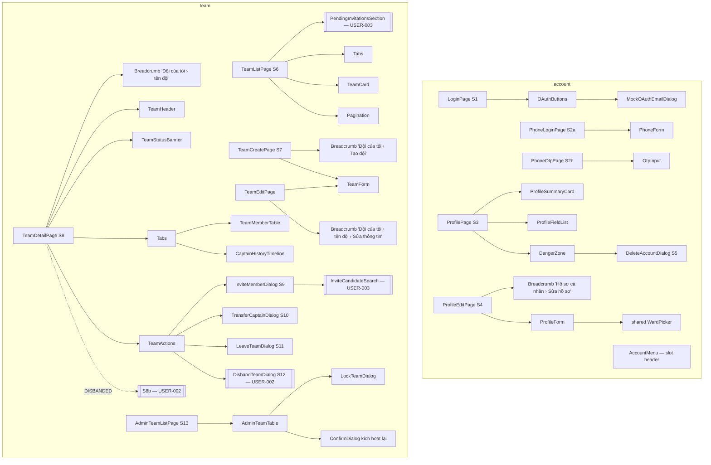

# Component Design — USER-001 Tài khoản & đội

| Mục | Giá trị |
|---|---|
| Mã chức năng | `USER-001` |
| Phạm vi tầng | frontend (ArenaFlow-fe) |
| Repo/stack | ArenaFlow-fe · React 19 + TypeScript + Tailwind CSS 4 · React Hook Form + Zod (FE ADR-0005) |
| Quy ước áp dụng | `docs/agent/convention-frontend.md` §2–§4 · shared component / form helper: `docs/agent/design/SHARED/APP-SHELL/Component_Design.md` |
| Tác giả / Ngày / Phiên bản | `solution-architect` (agent) / `2026-11-27` / `v1.2` (lịch sử: `CHANGELOG.md` — mục "Thiết kế kỹ thuật") |

> Hai module: `src/modules/account/` (S1–S5) và `src/modules/team/` (S6–S13; USER-002, USER-003 thêm vào cùng module).
> Tên chốt (USER-003 Component_Design §2.2–§2.3): `WardPicker` ở **`src/shared/components/ward-picker/`** (props: SHARED Component_Design §3.1 — không còn là chỗ cắm trong module `account`), `InviteCandidateSearch`, `PendingInvitationsSection` (module `team`, USER-003 thiết kế). Nút `[[… — USER-003]]` trong cây là component USER-003 định nghĩa — không định nghĩa lại ở đây. Shared component (`Dialog`, `ConfirmDialog`, `Pagination`, `Tabs`, `QueryStateView`, `FormField`, `ChoiceChipGroup`…) **tái dùng** từ SHARED §3 — không định nghĩa lại.

## 1. Cây component

## 2. Danh sách component

### 2.1. Module `account` (`src/modules/account/`)

| Component | Đường dẫn | Loại | Props chính | Trách nhiệm |
|---|---|---|---|---|
| `LoginPage` | `pages/login.page.tsx` | page | — | S1: banner `endReason`, `OAuthButtons`, link S2a; điều hướng sau đăng nhập (`useAfterLogin`) |
| `OAuthButtons` | `components/login/oauth-buttons.component.tsx` | feature | `pendingProvider`, `onSelect(provider)` | 3 nút full-width; disable cả 3 khi đang gọi |
| `MockOAuthEmailDialog` | `components/login/mock-oauth-email-dialog.component.tsx` | feature | `open`, `provider`, `onSubmit(email)`, `onClose` | Hỏi email cho đăng nhập mock (`[cần xác nhận]` Screen_Flow #2) |
| `PhoneLoginPage` | `pages/phone-login.page.tsx` | page | — | S2a |
| `PhoneForm` | `components/login/phone-form.component.tsx` | feature | `defaultPhone?`, `pending`, `onSubmit(phone)`, `serverError?` | Ô SĐT + validate |
| `PhoneOtpPage` | `pages/phone-otp.page.tsx` | page | — | S2b; đọc `location.state.phone` |
| `OtpInput` | `components/login/otp-input.component.tsx` | feature | `value`, `onChange`, `invalid`, `disabled` | 6 ô 1 chữ số, dán 6 số một lần, Backspace lùi ô, `aria-label` "Chữ số n", `inputmode="numeric"`, `autocomplete="one-time-code"` ở ô đầu |
| `ProfilePage` | `pages/profile.page.tsx` | page | — | S3 |
| `ProfileReputationLink` (trong `ProfilePage`) | — | — | — | Link "Uy tín mercenary của tôi" (Screen_Flow S3) — không tách component riêng |
| `ProfileSummaryCard` | `components/profile/profile-summary-card.component.tsx` | feature | `profile` | Avatar, tên, nút "Sửa hồ sơ" |
| `ProfileFieldList` | `components/profile/profile-field-list.component.tsx` | feature | `profile` | 7 trường chỉ đọc (UI S3); `null` → "Chưa cập nhật"; ngày sinh `formatVnDate`; khu vực "<wardName>, <provinceName>" |
| `DangerZone` | `components/profile/danger-zone.component.tsx` | feature | `onDelete` | Dòng nhắc + nút "Xoá tài khoản" |
| `DeleteAccountDialog` | `components/profile/delete-account-dialog.component.tsx` | feature | `open`, `onClose` | S5 trên `ConfirmDialog` (`tone="danger"`); gọi `useDeleteAccount`; banner chặn `USER_003` (USER-002) |
| `ProfileEditPage` | `pages/profile-edit.page.tsx` | page | — | S4; `?onboarding=1` đổi đích Lưu/Huỷ |
| `ProfileForm` | `components/profile-edit/profile-form.component.tsx` | feature | `profile`, `pending`, `onSubmit(patchBody)`, `onCancel`, `serverError?` | Form §3.2; ô khu vực render `WardPicker` (shared) với dữ liệu từ `useRegionCatalog` (USER-003) |
| `AccountMenu` | `components/account-menu/account-menu.component.tsx` | feature | — | Slot `accountMenu` của khung: `Avatar` + tên (từ `useProfile`), `Menu` "Hồ sơ cá nhân" / ("Quản trị" khi ADMIN — SHARED Screen_Flow #2) / "Đăng xuất" (`logout()`) |

### 2.2. Module `team` (`src/modules/team/`)

| Component | Đường dẫn | Loại | Props chính | Trách nhiệm |
|---|---|---|---|---|
| `TeamListPage` | `pages/team-list.page.tsx` | page | — | S6: tiêu đề "Đội bóng", nút "Tạo đội", khối lời mời (USER-003), tab `status`, lưới thẻ, phân trang |
| `TeamCard` | `components/list/team-card.component.tsx` | feature | `team: TeamSummary` | Link tới chi tiết; tên, `TeamStatusBadge`, tối đa 3 `SkillLevelTags`, số thành viên; "Đội trưởng: <captainName>" hoặc "Người giải tán: <disbandedByName>" khi `DISBANDED` |
| `TeamStatusBadge` | `components/team-status-badge.component.tsx` | ui (module) | `status` | `ACTIVE` "Hoạt động" / `INACTIVE` "Bị khoá" / `DISBANDED` "Đã giải tán" trên `StatusBadge` |
| `SkillLevelTags` | `src/shared/components/skill-level-tags/skill-level-tags.component.tsx` | ui (shared) | `levels: string[]` | Chip hiển thị nhãn trình độ — chuyển lên `shared/` (MATCH-001 C9) |
| `TeamCreatePage` | `pages/team-create.page.tsx` | page | — | S7 |
| `TeamEditPage` | `pages/team-edit.page.tsx` | page | — | Sửa đội; chặn khi không phải đội trưởng / không `ACTIVE` |
| `TeamForm` | `components/form/team-form.component.tsx` | feature | `mode: 'create' \| 'edit'`, `defaultValues?`, `pending`, `onSubmit(body)`, `onCancel`, `serverError?` | Form §3.3; chế độ sửa chỉ trả field dirty |
| `TeamDetailPage` | `pages/team-detail.page.tsx` | page | — | S8: tải đội; `DISBANDED` → nhánh S8b (USER-002); còn lại S8a |
| `TeamHeader` | `components/detail/team-header.component.tsx` | feature | `team` | Logo (`Avatar`), tên, badge, ngày tạo `formatVnDate`, "Đội trưởng"/"Người giải tán", nhãn trình độ, mô tả. Dùng chung S8a / S8b |
| `TeamStatusBanner` | `components/detail/team-status-banner.component.tsx` | feature | `team` | `INACTIVE` → banner lý do khoá; `DISBANDED` → banner giải tán (USER-002). Dùng chung |
| `TeamActions` | `components/detail/team-actions.component.tsx` | feature | `team`, `viewerRole` | Nút / `Menu` theo bảng Screen_Flow S8a; link sang mã khác (Screen_Flow S8a "Link sang mã khác" — `Link` + `ROUTE_PATHS`, 0 call); giữ state mở dialog S9–S12 |
| `TeamMemberTable` | `components/detail/team-member-table.component.tsx` | feature | `teamId`, `viewerUserId` | Tab "Thành viên (n)": bảng desktop / thẻ mobile, cột Thành viên · Vai trò · Ngày tham gia; dòng của mình nhãn "Bạn"; `Pagination` |
| `CaptainHistoryTimeline` | `components/detail/captain-history-timeline.component.tsx` | feature | `teamId` | Tab "Lịch sử đội trưởng": mốc "<from> → <to>" (`aria-label` "chuyển cho"), `formatVnDateTime(transferredAt)`, "Lý do: …" (`—` khi `null`); `fromUserId = null` → "Tạo đội — <to> trở thành đội trưởng"; "n bản ghi"; `Pagination`. Dùng chung S8a / S8b |
| `InviteMemberDialog` | `components/dialogs/invite-member-dialog.component.tsx` | feature | `team`, `open`, `onClose` | S9: dòng giải thích BR-T04, `InviteCandidateSearch` (USER-003); giữ `selectedUserId`; "Gửi lời mời" disable khi `null` / đang gửi; lỗi 2.12 `USER_001`, `TEAM_003` hiện dưới danh sách (`AlertBanner`) |
| `TransferCaptainDialog` | `components/dialogs/transfer-captain-dialog.component.tsx` | feature | `team`, `open`, `onClose` | S10: cảnh báo, `radiogroup` thành viên (trừ mình) + "Tải thêm", ô lý do ≤ 500; empty "Không có thành viên để chuyển quyền" + nút disable |
| `LeaveTeamDialog` | `components/dialogs/leave-team-dialog.component.tsx` | feature | `team`, `open`, `onClose` | S11 trên `ConfirmDialog` (`tone="danger"`) |
| `AdminTeamListPage` | `pages/admin/admin-team-list.page.tsx` | page | — | S13: tab `status`, bảng, phân trang |
| `AdminTeamTable` | `components/admin/admin-team-table.component.tsx` | feature | `teams: AdminTeamSummary[]`, `onLock`, `onReactivate`, `pendingTeamId?` | Bảng desktop (`<th scope="col">`) / thẻ mobile; cột Đội · Trạng thái · Đội trưởng · Thành viên · Ngày tạo · Thao tác; `DeletedAccountTag` theo `isCaptainDeleted` / `isDisbandedByDeleted`; nút có `aria-label` kèm tên đội |
| `LockTeamDialog` | `components/admin/lock-team-dialog.component.tsx` | feature | `team`, `open`, `onClose` | Dialog khoá đội: ô "Lý do *" ≤ 500 |

> Không có component nào đủ điều kiện đưa lên `shared/` ngoài những gì SHARED đã liệt kê: `TeamStatusBadge`, `TeamHeader` chỉ dùng trong module `team` (`SkillLevelTags` đã lên `shared/` — dòng `SkillLevelTags` ở bảng trên). Nếu mã khác (MATCH-001 hiển thị đội) cần → `reuse-scan` rồi chuyển lên `shared/` (`convention-frontend.md` §2).

## 3. Form & validation

> Ràng buộc chép từ API_Spec (cột "Map"); câu lỗi do FE chọn. Lỗi BE gắn bằng `applyServerValidationErrors` (SHARED Component_Design §4).

### 3.1. Đăng nhập (S2a, S2b, `MockOAuthEmailDialog`)

| Form | Trường | Kiểu | Validation client | Map (API_Spec USER-001) | Hiển thị lỗi |
|---|---|---|---|---|---|
| S2a | `phone` | text | `^0\d{9}$` → "Số điện thoại phải gồm 10 chữ số và bắt đầu bằng 0" | 2.2 `phone` (BR-U01) | Dưới ô, `aria-describedby` |
| S2b | `otp` | 6 ô số | đủ 6 chữ số `^\d{6}$` → "Nhập đủ 6 chữ số"; nút "Xác nhận" disable khi chưa đủ | 2.3 `otp` | Dưới nhóm ô; BE `VALIDATION_ERROR` field `otp` → "Mã xác thực không đúng" |
| Mock email | `email` | email | Email hợp lệ, ≤ 255, không khoảng trắng đầu/cuối (trim trước khi gửi) | 2.1 `email` (BR-U02) | Dưới ô |

### 3.2. `ProfileForm` (S4) — `profile-form.schema.ts`

| Trường | Kiểu | Validation client | Map (USER-001 2.6) | Hiển thị lỗi |
|---|---|---|---|---|
| `displayName` `*` | input, bộ đếm `n/100` | bắt buộc; `trim()` khác rỗng → "Tên hiển thị không được để trống"; ≤ 100 (độ dài chuỗi gửi) | `displayName` (BR-U03) | Dưới ô |
| `bio` | textarea, bộ đếm `n/1000` | ≤ 1000 | `bio` | Dưới ô |
| `preferredPosition` | `SegmentedRadioGroup` 4 giá trị | thuộc enum | `preferredPosition` (§4.1) | Dưới nhóm |
| `dateOfBirth` | `<input type="date">` | `YYYY-MM-DD`; < `todayVnDate()`; `ageOnVnDate ≥ 13` → "Bạn phải đủ 13 tuổi" | `dateOfBirth` (BR-U04) | Dưới ô |
| `gender` | `SegmentedRadioGroup` Nam/Nữ/Khác | `MALE`\|`FEMALE`\|`OTHER` | `gender` | Dưới nhóm |
| `provinceId` | `WardPicker` — ô Tỉnh/thành, **chỉ UI, không gửi** | Theo USER-003 Component_Design §3.1 | — | Theo USER-003 Component_Design §3.1 |
| `wardId` | `WardPicker` — ô Phường/xã | UUID hoặc `null` + refine (đã chọn tỉnh mà chưa chọn phường/xã) — USER-003 Component_Design §3.1 | `wardId` (BR-U05) | `400 USER_002` → "Khu vực không hợp lệ" dưới nhóm "Khu vực" |

- Gửi: `buildPatchBody(values, dirtyFields)` — chỉ field đã đổi; không đổi gì → nút "Lưu thay đổi" disable.
- Xoá giá trị đã có (để trống tiểu sử, bỏ ngày sinh / giới tính / vị trí): `PATCH` coi `null` = giữ nguyên → FE **không** cho bỏ chọn radio / ngày sinh; `bio` rỗng gửi `""` `[cần xác nhận]` #1.

### 3.3. `TeamForm` (S7, sửa đội) — `team-form.schema.ts`

| Trường | Kiểu | Validation client | Map (USER-001 2.8 / 2.11) | Hiển thị lỗi |
|---|---|---|---|---|
| `teamName` `*` | input, bộ đếm `n/100` | bắt buộc; `trim()` khác rỗng → "Tên đội không được để trống"; ≤ 100 | `teamName` (BR-T01; trùng tên được) | Dưới ô |
| `description` | textarea, bộ đếm `n/1000` | ≤ 1000 | `description` | Dưới ô |
| `skillLevels` | `ChoiceChipGroup` 9 nhãn, `max = 3` | ≤ 3, không trùng, thuộc enum §4.1; "Đã chọn n/3", đủ 3 → "Chọn tối đa 3 nhãn" | `skillLevels` (BR-T02) | Dưới nhóm |

- Tạo: gửi `teamName` (giá trị người dùng nhập), `description` (bỏ nếu rỗng), `skillLevels`. Sửa: chỉ field dirty; `skillLevels` dirty → gửi **cả mảng** (thay toàn bộ — 2.11). Xoá mô tả đã có → gửi `""` `[cần xác nhận]` #1.

### 3.4. Dialog có ô nhập

| Form | Trường | Validation client | Map | Hiển thị lỗi |
|---|---|---|---|---|
| S10 `TransferCaptainDialog` | `newCaptainId` | bắt buộc chọn (nút disable khi chưa chọn); danh sách đã loại chính mình (`TEAM_008`) | 2.15 `newCaptainId` | — |
| S10 | `reason` | ≤ 500, bộ đếm `n/500`; rỗng → không gửi field | 2.15 `reason` | Dưới ô |
| `LockTeamDialog` | `reason` `*` | `trim()` khác rỗng → "Vui lòng nhập lý do"; ≤ 500 | 2.19 `reason` | Dưới ô |

- Chống double-submit: nút xác nhận `loading = isPending`; dialog `dismissible = !isPending` (SHARED §4).

## 4. Hook / util riêng của feature

> Mỗi hook một file `hooks/use-<tên-kebab>.hook.ts` (vd `useTeamViewerRole` → `use-team-viewer-role.hook.ts`); cột "Thư mục" chỉ ghi module.

| Tên | Thư mục | Mục đích |
|---|---|---|
| `useOAuthLogin`, `useSendOtp`, `useVerifyOtp` | `modules/account/hooks/` | Mutation 2.1 / 2.2 / 2.3; thành công 2.1 / 2.3 → `startSession` |
| `useAfterLogin` | `modules/account/hooks/` | Nhận `AuthResponse`: tính đích (`isNewUser` → `/profile/edit?onboarding=1`; không → `state.from` hoặc `null`) rồi gọi `startSession(auth, đích)`. **Không** tự `navigate` — `GuestOnlyGuard` điều hướng (SHARED Screen_Flow §2) |
| `useOAuthCredential` | `modules/account/hooks/` | Lấy `{ oauthToken, email }` cho provider; hiện là mock qua dialog |
| `useProfile`, `useUpdateProfile`, `useDeleteAccount` | `modules/account/hooks/` | Query 2.5; mutation 2.6, 2.7 |
| `useTeamList`, `useTeam`, `useTeamMembers`, `useCaptainHistory` | `modules/team/hooks/` | Query 2.10, 2.9, 2.17, 2.16 |
| `useMemberPicker` | `modules/team/hooks/` | Infinite query 2.17 `pageSize = 100` cho S10 |
| `useTeamViewerRole` | `modules/team/hooks/` | Vai trò người xem (State_API_Integration §3) |
| `useCreateTeam`, `useUpdateTeam`, `useInviteMember`, `useTransferCaptain`, `useLeaveTeam` | `modules/team/hooks/` | Mutation 2.8, 2.11, 2.12, 2.15, 2.18 |
| `useAcceptInvitation`, `useRejectInvitation` | `modules/team/hooks/` | Mutation 2.13, 2.14 — dùng bởi khối lời mời USER-003 |
| `useAdminTeamList`, `useLockTeam`, `useReactivateTeam` | `modules/team/hooks/` | Query 2.21; mutation 2.19, 2.20 |
| `TEAM_STATUS_LABELS`, `TEAM_LIST_STATUS_TABS`, `ADMIN_TEAM_STATUS_TABS` | `modules/team/constants/team-options.constant.ts` | Nhãn / enum (USER-001 §4.1). `SKILL_LEVELS` dùng bản shared (`src/shared/constants/player-options.constant.ts`) |
| `GENDER_LABELS` | `modules/account/constants/profile-options.constant.ts` | Nhãn giới tính. Vị trí chơi dùng `PLAYER_POSITIONS` shared (MERCENARY-001 C3) |

## 5. A11y
- Breadcrumb (SHARED `Breadcrumb`) ở S4, S7, S8a, sửa đội theo UI; mục "Đội của tôi" trỏ `ROUTE_PATHS.myTeams` (chờ USER-003 `[cần xác nhận]` #7 — đích S16 hay S6, nhãn).
- Mỗi page một `<h1>` (S1 "Đăng nhập hoặc đăng ký", S3 "Hồ sơ cá nhân", S6 "Đội bóng", S8 = tên đội, S13 "Quản lý đội").
- Banner lỗi `role="alert"`; lỗi ô gắn `aria-describedby`; trường bắt buộc `*` + `aria-required`.
- S5, S11, S12: `role="alertdialog"`, focus mặc định "Huỷ"; S9, S10, khoá đội: `role="dialog"`, focus vào ô nhập đầu.
- Sau khi đóng dialog thành công → focus về nút đã mở dialog (nếu còn), không thì `<h1>`.
- Tab S6 / S8 / S13 là `Tabs` (`role="tablist"`); S10 `radiogroup`; chip trình độ là checkbox có nhãn.
- Badge trạng thái, nhãn "Bạn", "Đã xoá tài khoản" luôn là chữ.

## 6. `[cần xác nhận]`
1. **Xoá giá trị tuỳ chọn đã có** (`bio`, `description`, `preferredPosition`, `dateOfBirth`, `gender`, `wardId`): `PATCH` coi vắng mặt / `null` là giữ nguyên (USER-001 §1.1) → không có cách xoá. Tạm: radio / ngày sinh / khu vực không cho bỏ chọn; `bio` / `description` rỗng gửi `""` — API_Spec không nói BE lưu `""` hay từ chối. Cần BE xác nhận (đề xuất làm ở repo BE nếu cần xoá được).
