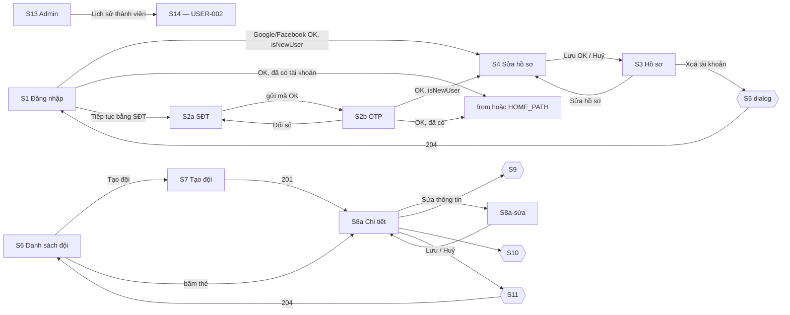

# Screen Flow — USER-001 Tài khoản & đội

| Mục | Giá trị |
|---|---|
| Mã chức năng | `USER-001` |
| Phạm vi tầng | frontend (ArenaFlow-fe) — backend: ngoài phạm vi repo này (USER-001 `API_Spec.md`) |
| Repo/stack | ArenaFlow-fe · React 19 + TypeScript + Vite · React Router (FE ADR-0003) |
| Nguồn SRS/UI/API | `docs/agent/upstream/business-spec/SYSTEM-001/` (UC-U01..U03, UC-T01..T05) · `UI_Design.md` v1.2 · `docs/agent/upstream/api/USER-001/API_Spec.md` |
| Căn cứ | `ArenaFlow-spec@53aee11` · API_Spec `v5.3` (USER-002 `v4.0`, USER-003 `v2.0`, SYSTEM-002 `v1.2`) |
| Quy ước áp dụng | `docs/agent/design-standards.md`, `docs/agent/convention-frontend.md`, `docs/agent/security-frontend.md` · khung: `docs/agent/design/SHARED/APP-SHELL/` |
| Tác giả / Ngày / Phiên bản | `solution-architect` (agent) / `2026-11-27` / `v1.2` (lịch sử: `CHANGELOG.md` — mục "Thiết kế kỹ thuật") |

> Route registry, guard, layout, `HOME_PATH`: `SHARED/APP-SHELL/Screen_Flow.md`. Phần USER-002 (S8b, S12, S14, trạng thái chặn S5, đội đã giải tán ở S13): `docs/agent/design/USER-002/Screen_Flow.md`.
> Phần do **USER-003** sửa — chọn tỉnh/phường ở S4, tìm người để mời ở S9, "Lời mời của tôi" (S15), "Đội của tôi" (S16) — **không** thiết kế ở đây; chỉ chừa chỗ cắm, trỏ USER-003 `UI_Design.md` theo tên mục (S4, S9, S15, S16, §3, §4). Thiết kế kỹ thuật USER-003 v1.1 đã có (`docs/agent/design/USER-003/`, nhánh `feature/USER-003-lookup`); thay đổi C1–C23 đã áp ở v1.1/v1.2 và đã qua `architect-reviewer` (§5 #8).
> `CHANGELOG.md` cùng thư mục ghi hai dòng phiên bản tách biệt: `UI_Design.md` và ba tài liệu kỹ thuật (mục "Thiết kế kỹ thuật") — `design-standards.md` §10.

## 1. Danh sách màn hình

| # | Màn hình | Route (`ROUTE_PATHS`) | Nhóm route | Use case (SRS) |
|---|---|---|---|---|
| S1 | Đăng nhập / đăng ký | `/login` (`login`) | guestOnly | UC-U01 |
| S2a | Nhập số điện thoại | `/login/phone` (`loginPhone`) | guestOnly | UC-U01, BR-U01 |
| S2b | Nhập OTP | `/login/phone/verify` (`loginPhoneVerify`) | guestOnly | UC-U01 |
| S3 | Hồ sơ cá nhân | `/profile` (`profile`) | authenticated | UC-U02 |
| S4 | Sửa hồ sơ | `/profile/edit` (`profileEdit`); `?onboarding=1` sau khi đăng ký | authenticated | UC-U02, UC-U01 bước 5 |
| S5 | Xoá tài khoản | Dialog trên S3 (không có route) | authenticated | UC-U03 |
| S6 | Danh sách đội | `/teams` (`teams`) | authenticated | UC-T03, BR-T13 |
| S7 | Tạo đội | `/teams/new` (`teamNew`) | authenticated | UC-T01 |
| S8a | Chi tiết đội | `/teams/:teamId` (`teamDetail`) | authenticated | UC-T01 post, BC-T04/T05 |
| S8a-sửa | Sửa thông tin đội | `/teams/:teamId/edit` (`teamEdit`) — form S7 chế độ sửa `[cần xác nhận]` #1 | authenticated | UC-T01 (API 2.11) |
| S9 | Mời thành viên | Dialog trên S8a | authenticated | UC-T02 |
| S10 | Chuyển quyền đội trưởng | Dialog trên S8a | authenticated | UC-T04 |
| S11 | Rời đội | Dialog trên S8a | authenticated | SYSTEM-001 §5 |
| S13 | Admin quản lý đội | `/admin/teams` (`adminTeams`) | admin | UC-T05 |

- `/teams/new` khai **trước** `/teams/:teamId` (React Router ưu tiên segment tĩnh, nhưng giữ thứ tự cho dễ đọc).
- Dialog không có route: mở/đóng bằng state của page; tải lại trang → dialog đóng.

## 2. Luồng điều hướng

## 3. Chi tiết từng màn hình

### S1 — Đăng nhập / đăng ký
- **Vào từ:** `AuthGuard` (chưa đăng nhập), đăng xuất, phiên hết hạn. **Ra tới:** S4 (`isNewUser = true`), `state.from` hoặc `HOME_PATH`.
- **Cơ chế điều hướng sau đăng nhập (S1, S2b):** page **không** tự `navigate`. `useAfterLogin` tính đích (`isNewUser` → `/profile/edit?onboarding=1`; không → `state.from` hoặc `null`) rồi gọi `startSession(auth, đích)`; `GuestOnlyGuard` điều hướng (SHARED Screen_Flow §2 "Điều hướng sau đăng nhập — một nguồn duy nhất"). Nhờ vậy guard không thể đưa người dùng mới đi trước khi biết đích S4.
- **Thao tác:** "Tiếp tục với Google/Facebook" → lấy `{ oauthToken, email }` qua `useOAuthCredential(provider)` → `POST /auth/oauth`. Bản hiện tại là **mock** (BE không xác minh — USER-001 §1): mở `MockOAuthEmailDialog` hỏi email `[cần xác nhận]` #2. "Tiếp tục bằng số điện thoại" → S2a.
- **Trạng thái:** đang gọi → nút đang chọn có spinner, cả 3 nút disable. Lỗi → banner (Component_Design §3). Banner theo `session.endReason`: `EXPIRED` "Phiên đăng nhập đã hết hạn, vui lòng đăng nhập lại"; `ACCOUNT_DELETED` "Tài khoản đã bị xoá"; `NETWORK` "Không kết nối được máy chủ"; `LOGOUT` / `null` không banner.

### S2a — Nhập số điện thoại
- **Ra tới:** S2b với `state = { phone, expiresIn }` sau `POST /auth/send-otp` 200; "Quay lại" → S1.
- **Thao tác:** ô `phone` (`inputmode="tel"`), nút "Gửi mã xác thực".

### S2b — Nhập OTP
- **Vào từ:** S2a. Không có `state.phone` (tải lại / gõ URL) → `Navigate` về S2a (không lưu SĐT vào storage — `security-frontend.md` §4).
- **Ra tới:** như S1 sau `POST /auth/verify-otp`; "Đổi số điện thoại" → S2a (điền sẵn số cũ qua `state`).
- **Ghi chú:** không có nút "Gửi lại mã" / đếm ngược (UI §4 #6 — `[cần xác nhận]` #3).

### S3 — Hồ sơ cá nhân
- **Ra tới:** S4 ("Sửa hồ sơ"); mở S5 ("Xoá tài khoản"); link "Uy tín mercenary của tôi" → `buildUserReputationPath(session.userId)` (MERCENARY-001 C10; 0 call; `UI_Design.md` v1.2 §2 S3).
- **Trạng thái:** loading skeleton thẻ hồ sơ; lỗi → `ErrorState` + Thử lại; field `null` → "Chưa cập nhật".

### S4 — Sửa hồ sơ
- **Vào từ:** S3; S1/S2b khi `isNewUser` (`?onboarding=1`).
- **Ra tới:** lưu OK → toast "Cập nhật thành công" → S3 (onboarding → `HOME_PATH`). "Huỷ" → S3 (onboarding → `HOME_PATH`) `[cần xác nhận]` #4. Rời trang khi form đã đổi → không chặn (UI không vẽ hộp xác nhận).
- **Ô "Khu vực":** `WardPicker` (shared — SHARED Component_Design §3.1; hành vi USER-003 Component_Design §2.3), dữ liệu qua hook `useRegionCatalog` của module `account`; form giữ `provinceId` (chỉ UI) + `wardId`; danh mục tải khi mở ô (0 call khi tải màn). USER-003 `Screen_Flow.md` §6 C5.
- **"Đổi ảnh":** ẩn tới khi có luồng upload ảnh hồ sơ `[cần xác nhận]` #5.

### S5 — Xoá tài khoản (dialog)
- **Thao tác:** "Xoá tài khoản" → `DELETE /profile`. `204` → `endSession('LOGOUT')` → S1 + toast "Tài khoản đã được xoá". Không cho đóng dialog khi đang gửi.
- **Trạng thái bị chặn (`422 USER_003`):** USER-002 Screen_Flow S5 (link `buildMyTeamsPath({ role: 'CAPTAIN' })`).

### S6 — Danh sách đội
- **Tham số URL:** `status` ∈ `ACTIVE` (mặc định) \| `INACTIVE` \| `DISBANDED` \| `ALL` — tab "Đang hoạt động / Bị khoá / Đã giải tán / Tất cả"; `page` (≥ 1). Đổi tab → `page = 1`.
- **Ra tới:** thẻ đội → `/teams/:teamId`; "Tạo đội" → S7.
- **Khối "Lời mời đang chờ":** giữ — `PendingInvitationsSection` (USER-003 Component_Design §2.2): 3 lời mời mới nhất + "Xem tất cả (n)" → `/me/invitations`; ẩn khi n = 0. Chờ USER-003 `[cần xác nhận]` #5 (phương án chỉ còn link). Chấp nhận / từ chối dùng hook USER-001 (2.13, 2.14) — Component_Design §4.
- **Trạng thái:** skeleton thẻ; empty theo tab "Chưa có đội nào"; lỗi + Thử lại.

### S7 — Tạo đội
- **Ra tới:** `201` → toast "Đội đã được tạo" → `/teams/{teamId}` (replace). "Huỷ" → S6.
- **"Chọn ảnh" (logo):** ẩn như S4 `[cần xác nhận]` #5.

### S8a — Chi tiết đội
- **Tham số:** `:teamId`; `?tab=members` (mặc định khi đội chưa giải tán) \| `captain-history`; `?page` của tab đang mở.
- **Hiển thị theo vai trò người xem × trạng thái đội** (USER-001 `API_Spec.md` §3.1). Vai trò người xem tính ở State_API_Integration §3:

| Người xem | `ACTIVE` | `INACTIVE` |
|---|---|---|
| Đội trưởng | "Mời thành viên" (S9), "Sửa thông tin", menu "Thao tác quản trị": "Chuyển quyền đội trưởng" (S10), "Giải tán đội" (S12 — USER-002) | Banner "Đội đang bị khoá. Lý do: <`inactiveReason`>"; chỉ menu "Giải tán đội" |
| Thành viên | "Rời đội" (S11) | Banner như trên; "Rời đội" |
| Người khác / chưa xác định | Chỉ xem | Banner; chỉ xem |

- **Link sang mã khác** (0 call; đã cập nhật trong `UI_Design.md` v1.2 §2 S8a, §5 #9):

| Link | Đích | Ai thấy | Mã |
|---|---|---|---|
| "Kèo của đội" | `buildTeamMatchesPath(teamId)` | Mọi người | MATCH-001 C10 |
| "Uy tín đội" | `buildTeamReputationPath(teamId)` | Mọi người | REPUTATION-001 C3 |
| "Report của đội" | `buildTeamReportsPath(teamId)` | Đội trưởng, đội `ACTIVE` | REPUTATION-001 C3 |
| "Tuyển mercenary" | `buildTeamMercenaryPath(teamId)` | Đội trưởng, đội không `DISBANDED` | MERCENARY-001 C9 |
| "Mercenary đánh giá" | `buildTeamMercenaryRatingsPath(teamId)` | Mọi người | MERCENARY-001 C9 |

- `DISBANDED` → nhánh S8b (USER-002); các nguồn chỉ yêu cầu link ở S8a — S8b có hiện "Kèo của đội" / "Uy tín đội" / "Mercenary đánh giá" hay không: `[cần xác nhận]` #9.
- **Trạng thái:** skeleton; `404 TEAM_001` → `ErrorState` "Không tìm thấy đội" + link về S6.

### S8a-sửa — Sửa thông tin đội
- **Vào:** nút "Sửa thông tin" (đội trưởng, `ACTIVE`). Mở URL trực tiếp khi không phải đội trưởng hoặc đội không `ACTIVE` → `Navigate` về `/teams/:teamId`.
- **Ra tới:** `200` → toast "Đã cập nhật thông tin đội" → S8a. "Huỷ" → S8a.

### S9 / S10 / S11 — Dialog trên S8a
- **S9:** `InviteCandidateSearch` (USER-003 Component_Design §2.2): `onSelect(userId | null)`, `onLostPermission`; S9 lo khung dialog, giữ `selectedUserId` và gửi `POST /teams/{teamId}/invitations`; lỗi 2.12 theo State_API_Integration §5 (dòng `USER_001`, `TEAM_003` — lỗi dưới danh sách, giữ dialog). Thành công → đóng, toast "Lời mời đã được gửi".
- **S10:** danh sách radio thành viên đang hoạt động trừ chính mình; "Lý do" ≤ 500. Thành công → đóng, toast "Đã chuyển quyền đội trưởng", S8a làm mới (người xem mất nút quản lý).
- **S11:** xác nhận → `204` → toast "Bạn đã rời đội <tên>" → S6. Câu UI "đội không còn trong danh sách của người dùng" chỉ đúng với "Đội của tôi" (USER-003 S16): S6 liệt kê **mọi** đội (2.10) nên đội vẫn hiện ở S6; S8a của đội đó không còn nút "Rời đội".

### S13 — Admin quản lý đội
- **Tham số URL:** `status` ∈ `ALL` (mặc định) \| `ACTIVE` \| `INACTIVE` \| `DISBANDED` — tab "Tất cả / Hoạt động / Bị khoá / Đã giải tán"; `page`.
- **Thao tác theo hàng:** `ACTIVE` → "Khoá đội" (dialog lý do), "Lịch sử thành viên" (S14); `INACTIVE` → "Lý do: …", "Kích hoạt lại" (ConfirmDialog `[cần xác nhận]` #6), "Lịch sử thành viên" (`[cần xác nhận]` #7); `DISBANDED` → USER-002.
- **Trạng thái:** skeleton bảng; empty "Không có đội"; lỗi + Thử lại; `403 AUTH_004` → `ErrorState` không đủ quyền.

## 4. Route guard & phân quyền
- Mục nav Admin "Quản lý đội" (`TEAM_ADMIN_NAV_ITEMS`, `order: 10`, `roles: ['ADMIN']`) → `/admin/teams` (bảng `order` SHARED Screen_Flow §3).
- Nhóm route + guard: `SHARED/APP-SHELL/Screen_Flow.md` §1–§2. S1–S2b `guestOnly`; S3–S11 `authenticated`; S13 `admin` (`RoleGuard(['ADMIN'])`).
- Nút quản lý ở S8a chỉ ẩn/hiện; BE vẫn kiểm (`TEAM_002`, `TEAM_015`, `TEAM_016`…) — xử lý theo State_API_Integration §5.
- 403 nghiệp vụ (`TEAM_002`, `TEAM_005`) không đăng xuất, chỉ tải lại dữ liệu.

## 5. `[cần xác nhận]`
1. **Màn sửa thông tin đội** chưa vẽ (UI §4 #7): dùng lại form S7 ở route `/teams/:teamId/edit`, tiêu đề "Sửa thông tin đội", nút "Lưu thay đổi".
2. **Đăng nhập Google/Facebook:** BE là mock, cần `email` do FE gửi. Đề xuất: dialog nhập email (chỉ khi `import.meta.env.DEV` hoặc tới khi có SDK thật); tích hợp SDK provider thật cần ADR FE + đổi hợp đồng BE (BE ADR-0001 sửa đổi 2026-11-04). Chưa có quyết định → build production không có cách lấy email.
3. **OTP:** không có "Gửi lại mã" / đếm ngược dù `send-otp` trả `expiresIn` (UI §4 #6; SRS không nêu).
4. **"Huỷ" ở S4 khi onboarding:** đề xuất về `HOME_PATH` (hồ sơ mặc định đã hợp lệ).
5. **Ảnh đại diện / logo đội:** API chỉ nhận URL (`avatarUrl`); chưa có luồng upload cho hồ sơ / đội (VENUE-001 có chữ ký Cloudinary riêng cho địa điểm). Ẩn "Đổi ảnh" / "Chọn ảnh" tới khi BE có luồng — đề xuất làm ở repo BE.
6. **Kích hoạt lại đội (S13):** UI không vẽ hộp xác nhận; đề xuất `ConfirmDialog` "Kích hoạt lại đội <tên>?" (thao tác ghi của Admin).
7. **"Lịch sử thành viên" cho đội `INACTIVE` (S13):** UI đã duyệt chỉ ghi nút này cho đội "Hoạt động" và "Đã giải tán"; USER-002 `API_Spec.md` §3 cho Admin xem lịch sử ở mọi trạng thái → giữ nút cho cả `INACTIVE`, cần user xác nhận.
8. **Phụ thuộc USER-003 — chặn code tới khi bản v1.1 (đã áp USER-003 `Screen_Flow.md` §6 C1–C23) qua `architect-reviewer`.** Từng mục trỏ USER-003 v1.0:
   - S4 ô "Khu vực" — C5, USER-003 Component_Design §2.3, §3.1;
   - S6 khối lời mời — C6, USER-003 Component_Design §2.2 (còn USER-003 `[cần xác nhận]` #5);
   - S9 ô tìm người — C7, USER-003 Component_Design §2.2, §3.2;
   - S5 link — C20 (USER-002 Screen_Flow S5);
   - vai trò người xem bước 4 — C15 (State_API_Integration §3.2);
   - invalidate key USER-003 — C14 (State_API_Integration §3.1);
   - mục điều hướng header — C2 (USER-003 Screen_Flow §4; huy hiệu còn USER-003 `[cần xác nhận]` #6).
   Phần không phụ thuộc (S1–S3, S7, S8a trừ bước 4 vai trò, S10, S11, S13) code được trước, sau khi các chặn chung khác đã chốt (SHARED Screen_Flow §6 #4, State_API_Integration §7). Ngoài ra USER-003 cần nhánh này merge trước (USER-003 Screen_Flow §7 #9).
9. **Link sang mã khác ở S3, S8a, S8b (v1.2)** — đã cập nhật đặc tả chữ trong `USER-001/UI_Design.md` v1.2 và `USER-002/UI_Design.md` v1.2 (S8b giữ 3 link chỉ xem: "Kèo của đội", "Uy tín đội", "Mercenary đánh giá"); mockup S3/S8a/S8b giữ nguyên bản v1.0.
