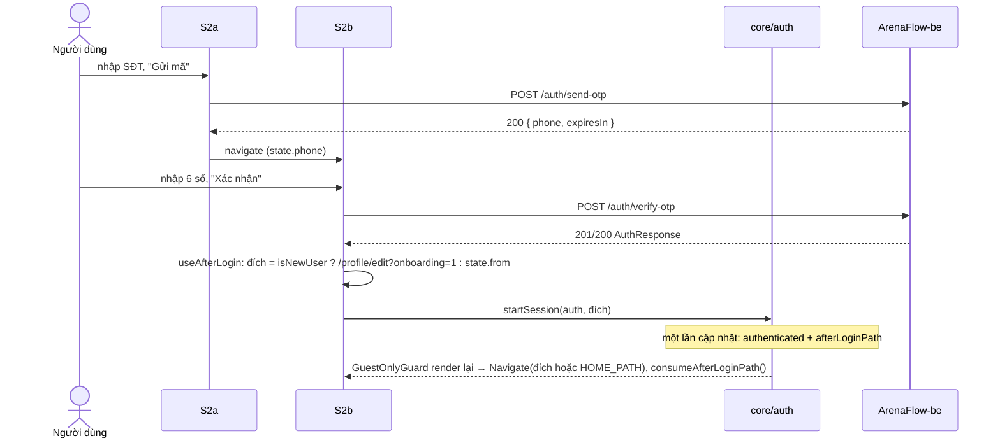

# State & API Integration — USER-001 Tài khoản & đội

| Mục | Giá trị |
|---|---|
| Mã chức năng | `USER-001` |
| Phạm vi tầng | frontend (ArenaFlow-fe) — hợp đồng API thuộc BE |
| Nguồn API | `docs/agent/upstream/api/USER-001/API_Spec.md` · `docs/agent/upstream/api/api-convention.md` · USER-002 `API_Spec.md` §2.1a (thứ tự lỗi) |
| Căn cứ | `ArenaFlow-spec@53aee11` · API_Spec `v5.3` (USER-002 `v4.0`, USER-003 `v2.0`, SYSTEM-002 `v1.2`) |
| Quy ước áp dụng | `docs/agent/convention-frontend.md` §5, `docs/agent/non-functional-standards.md`, `docs/agent/security-frontend.md` · khung http / session / query key: `docs/agent/design/SHARED/APP-SHELL/State_API_Integration.md` |
| Tác giả / Ngày / Phiên bản | `solution-architect` (agent) / `2026-11-27` / `v1.2` (lịch sử: `CHANGELOG.md` — mục "Thiết kế kỹ thuật") |

> Số mục `2.x` dưới đây là mục của USER-001 `API_Spec.md` (trừ khi ghi mã khác). Field / JSON: trỏ API_Spec, không chép. Path tương đối với base `/api/v1` (`VITE_API_BASE_URL`).

## 1. Endpoint dùng theo màn hình

| Màn hình | Thời điểm gọi | Method + path | API_Spec | Số call khi tải |
|---|---|---|---|---|
| S1 | Bấm Google/Facebook | `POST /auth/oauth` | 2.1 | 0 |
| S2a | Bấm "Gửi mã xác thực" | `POST /auth/send-otp` | 2.2 | 0 |
| S2b | Bấm "Xác nhận" | `POST /auth/verify-otp` | 2.3 | 0 |
| S3 | Khi tải (chung cache với `AccountMenu`) | `GET /profile` | 2.5 | 1 (0 nếu đã có cache) |
| S4 | Khi tải | `GET /profile` (cache); danh mục khu vực (USER-003 §2.1, §2.2) chỉ tải **khi mở ô** | 2.5 | 0–1 |
| S4 | Bấm "Lưu thay đổi" | `PATCH /profile` | 2.6 | — |
| S5 | Bấm "Xoá tài khoản" | `DELETE /profile` | 2.7 | — |
| S6 | Khi tải / đổi tab / đổi trang | `GET /teams?status&page&pageSize=20` + "Lời mời của tôi" (USER-003 §2.4) | 2.10 | 2 |
| S6 (khối lời mời) | Bấm Chấp nhận / Từ chối | `POST /invitations/{id}/accept` · `/reject` | 2.13, 2.14 | — |
| S7 | Bấm "Tạo đội" | `POST /teams` | 2.8 | 0 |
| S8a | Khi tải | `GET /teams/{teamId}` + tab đang mở: `GET /teams/{teamId}/members?page&pageSize=20` **hoặc** `GET /teams/{teamId}/captain/history?page&pageSize=20` + (khi cần) "Đội của tôi" (USER-003 §2.5) để biết vai trò (§3.2) | 2.9, 2.17, 2.16 | 2–3 |
| S8a-sửa | Khi tải / bấm "Lưu thay đổi" | `GET /teams/{teamId}` (cache) · `PATCH /teams/{teamId}` | 2.9, 2.11 | 0–1 |
| S9 | Bấm "Gửi lời mời" (tìm người: USER-003 §2.3) | `POST /teams/{teamId}/invitations` | 2.12 | 0 |
| S10 | Mở dialog / "Tải thêm" · Bấm "Chuyển quyền" | `GET /teams/{teamId}/members?page&pageSize=100` · `POST /teams/{teamId}/captain/transfer` | 2.17, 2.15 | 1 |
| S11 | Bấm "Rời đội" | `POST /teams/{teamId}/members/leave` | 2.18 | 0 |
| S13 | Khi tải / đổi tab / đổi trang | `GET /admin/teams?status&page&pageSize=20` | 2.21 | 1 |
| S13 | "Khoá đội" · "Kích hoạt lại" | `PATCH /admin/teams/{teamId}/mark-inactive` · `…/reactivate` | 2.19, 2.20 | — |

**Tổng API call khi tải** — ba cách tính (ngưỡng ≤ 3, `non-functional-standards.md` §2 chỉ miễn refresh; cách tính chưa chốt — SHARED State_API_Integration §7 #1). Request khung: hồ sơ (header), huy hiệu "Lời mời của tôi" (USER-003, nếu chốt — SHARED §1), `unread-count` (NOTIFICATION-001); request trùng key với màn chỉ tính một lần.

| Màn | (A) Chỉ call của màn | (B) Vào thẳng: + hồ sơ + huy hiệu lời mời | (C) = (B) + 2 call trong `onConnected`: `unread-count` (NOTIFICATION-001) + "Tin nhắn" 2.20 (MATCH-001) — SHARED §1 | Kết luận |
|---|---|---|---|---|
| S1, S2a, S2b | 0 | 0 (không có header) | 0 (chưa đăng nhập, không kết nối realtime) | Đạt |
| S3 | 1 (chung key hồ sơ với header) | 2 | **4** | Vượt ở (C) |
| S4 | 0–1 (danh mục tải khi mở ô) | 2 | **4** | Vượt ở (C) |
| S6 | 2 (khối lời mời chung key với huy hiệu) | 3 | **5** | Vượt ở (C) |
| S7 | 0 | 2 | **4** | Vượt ở (C) |
| S8a | 2–3 (chi tiết + tab + "Đội của tôi" khi cần) | **4–5** | **6–7** | Vượt ở (B) |
| S13 | 1 | 3 | **5** | Vượt ở (C) (bridge chạy theo phiên, cả ở `AdminLayout`) |
| S10 (mở dialog) | 1 | — | — | Đạt |

- **`[cần xác nhận]` chặn code** (§7 #3): chưa chốt cách tính → không code S3, S4, S6, S7, S8a, S13 theo luồng tải hiện tại. Phương án giảm nếu phải tính (B)/(C): S8a bỏ bước 4 vai trò (chờ BE thêm `viewerRole` — §7 #1); S6 chỉ còn link sang S15 (USER-003 `[cần xác nhận]` #5); bỏ huy hiệu header (USER-003 `[cần xác nhận]` #6).
- Không màn nào gọi API theo từng phần tử.

## 2. Hàm API & type

| Hàm | Đường dẫn | Request type | Response type | `http` options |
|---|---|---|---|---|
| `loginWithOAuth` | `src/modules/account/api/account.api.ts` | `OAuthLoginRequest` (2.1) | `AuthResponse` | `auth: false` |
| `sendOtp` | ″ | `SendOtpRequest` (2.2) | `SendOtpResponse` | `auth: false` |
| `verifyOtp` | ″ | `VerifyOtpRequest` (2.3) | `AuthResponse` | `auth: false` |
| `getProfile` | ″ | — | `Profile` (§4.2 `ProfileResponse`) | `accountGoneCodes: ['USER_001']` |
| `updateProfile` | ″ | `UpdateProfileRequest` (2.6, mọi field tuỳ chọn) | `Profile` | `accountGoneCodes: ['USER_001']` |
| `deleteAccount` | ″ | — | `void` (204) | — |
| `getTeams` | `src/modules/team/api/team.api.ts` | `TeamListParams { status, page, pageSize }` | `Page<TeamSummary>` (§4.2 `TeamSummaryResponse`) | — |
| `getTeam` | ″ | `teamId` | `TeamDetail` (`src/shared/types/team-detail.type.ts` = §4.2 `TeamResponse` + USER-002 §5.1) | `queryFn` dưới `teamDetailKey` trả **nguyên** response, biến đổi chỉ qua `select` (SHARED State §4) |
| `createTeam` | ″ | `CreateTeamRequest` (2.8) | `TeamDetail` | `accountGoneCodes: ['USER_001']` |
| `updateTeam` | ″ | `teamId`, `UpdateTeamRequest` (2.11) | `TeamDetail` | — |
| `inviteMember` | ″ | `teamId`, `{ userId }` (2.12) | `Invitation` | **không** khai `USER_001` (nghĩa: người được mời không tồn tại) |
| `acceptInvitation` / `rejectInvitation` | ″ | `invitationId` | `TeamMember` / `void` | — |
| `transferCaptain` | ″ | `teamId`, `{ newCaptainId, reason? }` (2.15) | `CaptainTransfer` | — |
| `getCaptainHistory` | ″ | `teamId`, `PageParams` | `Page<CaptainHistoryEntry>` | — |
| `getTeamMembers` | ″ | `teamId`, `PageParams` | `Page<TeamMember>` | — |
| `leaveTeam` | ″ | `teamId` | `void` (204) | — |
| `getAdminTeams` | `src/modules/team/api/admin-team.api.ts` | `TeamListParams` (mặc định `ALL`) | `Page<AdminTeamSummary>` | — |
| `markTeamInactive` | ″ | `teamId`, `{ reason }` (2.19) | `AdminTeam` | — |
| `reactivateTeam` | ″ | `teamId` | `AdminTeam` | — |

- Type đặt ở `src/modules/account/types/account.type.ts` và `src/modules/team/types/team.type.ts` (trừ `TeamDetail`, `MyTeam` ở `src/shared/types/` — dùng chung REPUTATION-001, MATCH-001); tên field giữ nguyên camelCase của BE; field trỏ USER-001 §4.2 (+ USER-002 §5 cho field giải tán). `AuthResponse`: `src/core/auth/auth.type.ts` (SHARED §3.2).
- Field `datetime` là `string` (giờ Việt Nam, SYSTEM-002 §1.1) — hiển thị qua `vn-datetime.util`; `dateOfBirth` là `string` `YYYY-MM-DD`.
- Enum: union string literal theo §4.1 (`preferredPosition`, `skillLevels` là nhãn tiếng Việt — giữ nguyên chuỗi).

## 3. State

### 3.1. Server state & client state

| State | Loại | Nơi giữ | Key / tên | Làm mới khi |
|---|---|---|---|---|
| Hồ sơ của tôi | server | TanStack Query | `accountKeys.profile()` = `['account','profile']`; `staleTime: Infinity` | `setQueryData` sau 2.6; xoá khi `endSession` |
| Danh sách đội | server | ″ | `teamKeys.list({ status, page, pageSize })` | invalidate `teamKeys.lists()` sau 2.8, 2.11, 2.13, 2.15, 2.18, 2.19, 2.20 |
| Chi tiết đội | server | ″ | `teamKeys.detail(teamId)` = `teamDetailKey(teamId)` (shared, cùng giá trị `['team','detail',teamId]`) | `setQueryData` sau 2.8, 2.11; invalidate (tiền tố, gồm thành viên + lịch sử) sau 2.13, 2.15, 2.18, 2.19, 2.20 |
| Thành viên (tab) | server | ″ | `teamKeys.members(teamId, { page, pageSize: 20 })` | Như chi tiết đội (cùng tiền tố) |
| Thành viên (S10) | server | `useInfiniteQuery` | `teamKeys.memberPicker(teamId)` = `[...detail, 'member-picker']` | Như chi tiết đội |
| Lịch sử đội trưởng | server | ″ | `teamKeys.captainHistory(teamId, { page, pageSize: 20 })` | Như chi tiết đội |
| Danh sách đội Admin | server | ″ | `adminTeamKeys.list({ status, page, pageSize })` (gốc `'admin-team'`) | invalidate `adminTeamKeys.lists()` sau 2.8, 2.11, 2.15, 2.19, 2.20 |
| "Đội của tôi", "Lời mời của tôi", gợi ý mời (USER-003) | server | ″ | Key theo USER-003 State_API_Integration §3.1 (`teamKeys.mine()`, `teamKeys.myInvitations()`, `teamKeys.invitationCandidates(...)`) | Invalidate `teamKeys.mine()` sau 2.8, **2.11**, 2.13, 2.15, 2.18; `teamKeys.myInvitations()` sau 2.13, 2.14; `[...teamKeys.detail(teamId), 'invitation-candidates']` sau 2.12 |
| Phiên | client toàn cục | `core/session` | `useSession()` | SHARED §3 |
| Tab / trạng thái lọc / trang | URL | search param | S6 `status`, `page` · S8 `tab`, `page` · S13 `status`, `page` | Người dùng đổi |
| Dialog đang mở, `userId` đã chọn ở S9 | client cục bộ | `useState` trong page / dialog | — | Đóng dialog → reset |
| `phone` giữa S2a → S2b | client | `location.state` | — | Không lưu storage |

- Factory: `src/modules/account/constants/account-query-keys.constant.ts`, `src/modules/team/constants/team-query-keys.constant.ts` (gồm `teamKeys`, `adminTeamKeys`) theo mẫu SHARED §4.
- Danh sách offset: `placeholderData` giữ trang cũ khi đổi trang / tab (không nháy trắng).

### 3.2. Vai trò người xem ở S8a (`useTeamViewerRole`)

`TeamResponse` không có vai trò của người gọi (§4.2) → tính như sau, dừng ở bước đầu có kết quả:

1. `team.captainId === session.userId` → `CAPTAIN`.
2. Tab "Thành viên" đang mở ở trang 1 và trang đó chứa `session.userId` → `MEMBER`.
3. Tab "Thành viên" đang mở ở trang 1 và `pagination.totalPages ≤ 1` (đã thấy đủ thành viên) → `NONE`.
4. Còn lại → `useMyTeams({ role: null, page: 1, pageSize: 100 })` (USER-003; key `teamKeys.mineList(…)` = `myTeamsKey({ role: null, page: 1, pageSize: 100 })` (shared, một cache với MATCH-001), hàm khai `accountGoneCodes: ['USER_001']`): có `teamId` → `MEMBER`, không → `NONE`. Đang tải → `UNKNOWN` (ẩn nút "Rời đội").

- Đội `DISBANDED` → không cần (mọi thao tác bị chặn).
- Giới hạn: người tham gia > 100 đội và đội này ngoài 100 đội đầu → không thấy "Rời đội" `[cần xác nhận]` #1.

## 4. Luồng tương tác

### 4.1. Đăng nhập bằng số điện thoại



### 4.2. Chuyển quyền đội trưởng (S10)

```mermaid
sequenceDiagram
  actor U as Đội trưởng
  participant D as S10
  participant Q as QueryClient
  participant API as ArenaFlow-be
  U->>D: mở dialog
  D->>API: GET /teams/{id}/members?page=1&pageSize=100
  API-->>D: 200 Page<TeamMember>
  U->>D: chọn thành viên, "Chuyển quyền"
  D->>API: POST /teams/{id}/captain/transfer
  API-->>D: 200 CaptainTransfer
  D->>Q: invalidate detail(id) · lists · mine · admin-team
  Q->>API: GET /teams/{id} (+ tab đang mở)
  D-->>U: đóng, toast; nút quản lý biến mất
```

## 5. Xử lý lỗi

> Lỗi chung (`VALIDATION_ERROR`, `AUTH_001`, `AUTH_004`, `SYS_*`, timeout, mất mạng): SHARED State_API_Integration §2.3. Bảng dưới chỉ mã riêng, theo thứ tự BE kiểm (USER-002 §2.1a). "Tải lại" = invalidate `teamKeys.detail(teamId)`.

| Endpoint | HTTP / mã | Hiển thị / hành động |
|---|---|---|
| 2.1, 2.3 | `403 AUTH_003` | Banner "Tài khoản đã bị xoá" trên S1 / S2b; không đăng nhập |
| 2.1, 2.2, 2.3 | `400 VALIDATION_ERROR` | Gắn lỗi theo `field` (§3.1 Component_Design); `body` / không map → banner "Đăng ký thất bại, vui lòng thử lại" |
| 2.1, 2.2, 2.3 | `NETWORK_ERROR`, `TIMEOUT`, `SYS_005` | Banner "Đăng ký thất bại, vui lòng thử lại" (UC-U01 2a); nút bấm lại được |
| 2.5, 2.6, 2.8 | `404 USER_001` | Wrapper `endSession('ACCOUNT_DELETED')` → S1 banner "Tài khoản đã bị xoá" |
| 2.6 | `400 USER_002` | Lỗi dưới nhóm "Khu vực" "Khu vực không hợp lệ"; invalidate `catalogKeys.provinces()` (gồm phường/xã) |
| 2.6, 2.8, 2.11 | `400 VALIDATION_ERROR` | Lỗi dưới ô; `body` → `FormErrorBanner` |
| 2.7 | `422 USER_003` | USER-002 State_API_Integration §5 |
| 2.7 | `409 TEAM_014` | Banner trong dialog "Dữ liệu vừa được cập nhật bởi thao tác khác, vui lòng thử lại"; giữ dialog, bấm lại được |
| 2.9, 2.16, 2.17 | `404 TEAM_001` | `ErrorState` "Không tìm thấy đội" + link S6 |
| 2.11 | `404 TEAM_001` | Toast message → S6 |
| 2.11 | `422 TEAM_016` / `422 TEAM_015` / `403 TEAM_002` | Toast message → tải lại → về S8a (nút sửa tự ẩn theo dữ liệu mới) |
| 2.11, 2.12, 2.15, 2.18 | `409 TEAM_014` | Toast message; tải lại; giữ form / dialog để bấm lại |
| 2.12 | `404 TEAM_001` | Đóng dialog, toast → S6 |
| 2.12 | `422 TEAM_016` / `422 TEAM_015` / `403 TEAM_002` | Đóng dialog, toast message, tải lại (nút mời ẩn) |
| 2.12 | `404 USER_001` | Lỗi dưới danh sách "Không tìm thấy người dùng"; bỏ chọn; invalidate gợi ý mời; giữ dialog |
| 2.12 | `409 TEAM_003` | Giữ dialog; lỗi dưới danh sách "Người này đã là thành viên hoặc đã được mời"; bỏ chọn; invalidate gợi ý mời (nhãn cập nhật — UC-U05 6a) |
| 2.13, 2.14 | `404 TEAM_004` / `403 TEAM_005` / `422 TEAM_016` / `409 TEAM_006` | Toast message; invalidate `teamKeys.myInvitations()` (thẻ biến mất) |
| 2.13, 2.14 | `422 TEAM_015` | Toast "Đội đang tạm ngưng hoạt động"; invalidate `teamKeys.myInvitations()` (thẻ chuyển trạng thái khoá — UC-T07 3a) |
| 2.13, 2.14 | `409 TEAM_014` | Toast message; giữ thẻ, bấm lại được |
| 2.15 | `404 TEAM_001` | Đóng dialog, toast → S6 |
| 2.15 | `422 TEAM_016` / `422 TEAM_015` / `403 TEAM_002` | Đóng dialog, toast, tải lại |
| 2.15 | `422 TEAM_008` | Không xảy ra (đã loại chính mình); nếu có → lỗi trong dialog |
| 2.15 | `422 TEAM_007` | Lỗi trong dialog "Thành viên này không còn trong đội, vui lòng chọn lại"; invalidate `memberPicker`, bỏ chọn |
| 2.18 | `404 TEAM_001` | Đóng dialog, toast → S6 |
| 2.18 | `422 TEAM_016` / `422 TEAM_010` | Đóng dialog, toast, tải lại (nút rời đội ẩn) |
| 2.18 | `422 TEAM_009` | Đóng dialog, toast message (đội trưởng phải chuyển quyền trước); tải lại |
| 2.19, 2.20 | `404 TEAM_001` / `422 TEAM_016` / `409 TEAM_011` / `409 TEAM_012` | Đóng dialog, toast message, invalidate `adminTeamKeys.lists()` |
| 2.20 | `422 TEAM_013` | Toast message "Đội không còn đội trưởng, không thể kích hoạt lại"; không thử lại |
| 2.19, 2.20 | `409 TEAM_014` | Toast message; invalidate danh sách; bấm lại được |
| 2.19 | `400 VALIDATION_ERROR` field `reason` | Lỗi dưới ô lý do |
| 2.21 | `400 VALIDATION_ERROR` (tham số) | Đưa `status` / `page` về mặc định |

- Mọi toast lỗi dùng `ApiError.message` (message BE); câu ghi trong bảng là câu FE cho lỗi gắn ô hoặc khi cần nói rõ hơn.

## 6. Phân trang / tìm kiếm / sort
- Offset `page` / `pageSize` (`api-convention.md` §7.1); `pageSize = 20` ở S6, S8a, S13; `100` ở S10. Sort cố định theo BE (2.10, 2.16, 2.17, 2.21) — không có tham số `sort`.
- Trang vượt quá → BE trả `data: []` → hiện empty + link "Về trang 1".
- Không có ô tìm kiếm ở mã này (S13 lọc theo tab — UI S13 "Lưu ý"; tìm người để mời: USER-003).

## 7. `[cần xác nhận]`
1. **Vai trò người xem trong đội:** `TeamResponse` không có field cho biết người gọi có phải thành viên → FE phải đoán từ trang thành viên hoặc "Đội của tôi" (§3.2), tốn tới 1 call và sai với người > 100 đội. Đề xuất BE thêm field vai trò của người gọi (vd `viewerRole`) vào 2.9 — làm ở repo BE.
2. ~~**Ngưỡng S4**~~ — **Đóng (v1.1):** danh mục khu vực chỉ tải khi mở ô → S4 = 0–1 ở cột (A) (USER-003 C13).
3. **Cách tính ngưỡng có gồm call của khung — chặn code S3, S4, S6, S7, S8a, S13** (khớp kết luận bảng §1; SHARED State_API_Integration §7 #1). Ở (A) mọi màn đạt.
4. **Phụ thuộc USER-003 — chặn code** tới khi v1.1 qua `architect-reviewer` (Screen_Flow §5 #8).
