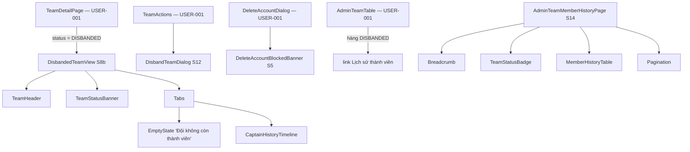

# Component Design — USER-002 Giải tán đội & quy tắc xoá tài khoản đội trưởng

| Mục | Giá trị |
|---|---|
| Mã chức năng | `USER-002` |
| Phạm vi tầng | frontend (ArenaFlow-fe) |
| Repo/stack | ArenaFlow-fe · React 19 + TypeScript + Tailwind CSS 4 · React Hook Form + Zod (FE ADR-0005) |
| Quy ước áp dụng | `docs/agent/convention-frontend.md` §2–§4 · `docs/agent/design/SHARED/APP-SHELL/Component_Design.md` · `docs/agent/design/USER-001/Component_Design.md` |
| Tác giả / Ngày / Phiên bản | `solution-architect` (agent) / `2026-11-27` / `v1.2` (lịch sử: `CHANGELOG.md` — mục "Thiết kế kỹ thuật") |

> Chỉ ghi phần thêm/sửa so với USER-001 Component_Design. Tái dùng: `TeamHeader`, `TeamStatusBanner`, `CaptainHistoryTimeline`, `TeamStatusBadge`, `AdminTeamTable`, `DeleteAccountDialog` (USER-001 §2) và `ConfirmDialog`, `AlertBanner`, `Tabs`, `Pagination`, `DeletedAccountTag`, `Avatar`, `Breadcrumb` (SHARED §3).

## 1. Cây component

## 2. Danh sách component

| Component | Đường dẫn | Loại | Props chính | Trách nhiệm | Tái dùng / Mới |
|---|---|---|---|---|---|
| `DisbandedTeamView` | `src/modules/team/components/detail/disbanded-team-view.component.tsx` | feature | `team: TeamDetail` | S8b: header, banner giải tán, tab (mặc định "Lịch sử đội trưởng"); tab Thành viên = `EmptyState` không gọi API | Mới |
| `TeamStatusBanner` | `…/detail/team-status-banner.component.tsx` | feature | `team` | Thêm nhánh `DISBANDED`: "Đội đã giải tán ngày `formatVnDate(disbandedAt)`. Lý do: `disbandReason`" (`role="status"`) | Tái dùng (USER-001), thêm nhánh |
| `TeamHeader` | `…/detail/team-header.component.tsx` | feature | `team` | `DISBANDED` → "Người giải tán: <`disbandedByName`>" thay "Đội trưởng" | Tái dùng (USER-001) |
| `DisbandTeamDialog` | `src/modules/team/components/dialogs/disband-team-dialog.component.tsx` | feature | `team`, `open`, `onClose` | S12 trên `ConfirmDialog` (`tone="danger"`, `role="alertdialog"`): cảnh báo, ô lý do + bộ đếm `n/100` + gợi ý lý do mặc định, nút "Giải tán đội" | Mới |
| `DeleteAccountBlockedBanner` | `src/modules/account/components/profile/delete-account-blocked-banner.component.tsx` | feature | `message`, `onOpenMyTeams` | S5 bị chặn: `AlertBanner tone="error"` + link "Xem các đội bạn đang làm đội trưởng →" | Mới |
| `AdminTeamTable` | `src/modules/team/components/admin/admin-team-table.component.tsx` | feature | (USER-001) | Hàng `DISBANDED`: không có "Khoá đội" / "Kích hoạt lại"; "Người giải tán" + `DeletedAccountTag` theo `isDisbandedByDeleted` | Tái dùng (USER-001), thêm nhánh |
| `AdminTeamMemberHistoryPage` | `src/modules/team/pages/admin/admin-team-member-history.page.tsx` | page | — | S14: tải tên đội + lịch sử thành viên | Mới |
| `MemberHistoryTable` | `src/modules/team/components/admin/member-history-table.component.tsx` | feature | `items: MemberHistoryEntry[]` | Desktop bảng `<th scope="col">` Thành viên · Vai trò · Trạng thái · Ngày tham gia · Ngày rời; mobile thẻ "Tham gia … • Rời …"; `Avatar` (ảnh thật, `null` → mặc định); `DeletedAccountTag` khi `isUserDeleted`; `leftAt = null` → "—" | Mới |

## 3. Form & validation

| Form | Trường | Kiểu | Validation client | Map validation BE | Hiển thị lỗi |
|---|---|---|---|---|---|
| `DisbandTeamDialog` | `reason` | textarea, bộ đếm `n/100` | ≤ 100 ký tự **tính cả khoảng trắng đầu/cuối** (độ dài chuỗi thô) → "Lý do tối đa 100 ký tự", bộ đếm đỏ, nút disable; không bắt buộc | USER-002 §2.1 `reason` | Dưới ô; `validationErrors[].field = "reason"` → dưới ô; `body` → `FormErrorBanner` trong dialog |

- Gửi: chuỗi rỗng → không gửi body; có nội dung (kể cả chỉ khoảng trắng) → `{ reason: <chuỗi thô> }` — BE tự bỏ khoảng trắng và dùng lý do mặc định (BR-T08). Không tự trim ở FE (giới hạn tính trên chuỗi FE gửi).
- Chống double-submit: `loading = isPending`, `dismissible = !isPending`; **không** tự gửi lại khi lỗi mạng (State_API_Integration §4).

## 4. Hook / util riêng của feature

> Mỗi hook một file `hooks/use-<tên-kebab>.hook.ts`.

| Tên | Thư mục | Mục đích |
|---|---|---|
| `useDisbandTeam` | `src/modules/team/hooks/` | Mutation USER-002 2.1 + xử lý mất mạng (tải lại chi tiết để biết kết quả) |
| `useAdminTeamMemberHistory` | `src/modules/team/hooks/` | Query USER-002 2.4 |

## 5. A11y
- S12: `role="alertdialog"`, focus mặc định "Huỷ"; bộ đếm `aria-live="polite"`; lỗi ô `aria-describedby`.
- S5 banner `role="alert"` — đọc ngay khi xuất hiện; link là `<a>`/`Link` thật, không phải `div`.
- S8b timeline: mũi tên "→" có `aria-label="chuyển cho"` (trong `CaptainHistoryTimeline`).
- S14 bảng `<th scope="col">`; trạng thái "Đang hoạt động" / "Đã rời" và "Đã xoá tài khoản" là chữ.

## 6. `[cần xác nhận]`
_(Không có mục mới — xem Screen_Flow §5.)_
