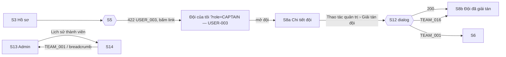

# Screen Flow — USER-002 Giải tán đội & quy tắc xoá tài khoản đội trưởng

| Mục | Giá trị |
|---|---|
| Mã chức năng | `USER-002` |
| Phạm vi tầng | frontend (ArenaFlow-fe) — backend: ngoài phạm vi repo này (USER-002 `API_Spec.md`) |
| Repo/stack | ArenaFlow-fe · React 19 + TypeScript + Vite · React Router (FE ADR-0003) |
| Nguồn SRS/UI/API | `docs/agent/upstream/business-spec/USER-002/` (UC-T06, UC-U03 sửa, UC-T05 sửa) · `UI_Design.md` v1.1 · `docs/agent/upstream/api/USER-002/API_Spec.md` |
| Căn cứ | `ArenaFlow-spec@53aee11` · API_Spec `v4.0` (USER-001 `v5.3`, USER-003 `v2.0`, SYSTEM-002 `v1.2`) |
| Quy ước áp dụng | `docs/agent/design-standards.md`, `docs/agent/convention-frontend.md`, `docs/agent/security-frontend.md` · khung: `docs/agent/design/SHARED/APP-SHELL/` |
| Tác giả / Ngày / Phiên bản | `solution-architect` (agent) / `2026-11-27` / `v1.2` (lịch sử: `CHANGELOG.md` — mục "Thiết kế kỹ thuật") |

> File này **chỉ ghi phần thêm/sửa** so với `docs/agent/design/USER-001/Screen_Flow.md` (cùng module `account` / `team`, cùng route registry).
> `CHANGELOG.md` cùng thư mục ghi hai dòng phiên bản tách biệt: `UI_Design.md` và ba tài liệu kỹ thuật (mục "Thiết kế kỹ thuật") — `design-standards.md` §10.

## 1. Danh sách màn hình

| # | Màn hình | Route (`ROUTE_PATHS`) | Nhóm route | Use case (SRS) |
|---|---|---|---|---|
| S5 | Xoá tài khoản — trạng thái bị chặn (sửa) | Dialog trên S3 (USER-001) | authenticated | UC-U03 (sửa), BR-T06, BR-T14 |
| S8b | Chi tiết đội đã giải tán (mới) | `/teams/:teamId` khi `status = DISBANDED` (cùng route S8a) | authenticated | BR-T11, BR-T13 |
| S12 | Giải tán đội (mới) | Dialog trên S8a | authenticated | UC-T06, BR-T07..T10, BR-T12 |
| S13 | Admin quản lý đội — đội đã giải tán (sửa) | `/admin/teams` (USER-001) | admin | UC-T05 (sửa), BR-T11 |
| S14 | Admin lịch sử thành viên (mới) | `/admin/teams/:teamId/members` (`adminTeamMemberHistory`) | admin | BR-T13, AC §5 mục 6 |

## 2. Luồng điều hướng

## 3. Chi tiết từng màn hình

### S5 — Xoá tài khoản: bị chặn
- **Khi nào:** `DELETE /profile` trả `422 USER_003`.
- **Hiển thị:** `AlertBanner` lỗi trong dialog: message của `USER_003` + link "Xem các đội bạn đang làm đội trưởng →". Không đăng xuất, dialog giữ mở; nút "Xoá tài khoản" vẫn bấm lại được (người dùng có thể đã xử lý ở tab khác).
- **Link:** đóng dialog → `navigate(buildMyTeamsPath({ role: 'CAPTAIN' }))` = `/me/teams?role=CAPTAIN` (USER-003 S16; USER-003 `Screen_Flow.md` §6 C20).

### S8b — Chi tiết đội đã giải tán
- **Vào từ:** S6 (thẻ đội `DISBANDED`), sau giải tán thành công (S12), sau lỗi `TEAM_016` ở mọi thao tác ghi trên S8a.
- **Hiển thị:** header đội (dùng chung S8a) với "Người giải tán: <`disbandedByName`>"; banner "Đội đã giải tán ngày <dd/mm/yyyy>. Lý do: <`disbandReason`>"; tab "Thành viên (0)" | "Lịch sử đội trưởng". Không có nút thao tác nào (BR-T11).
- **Tham số:** `?tab=captain-history` (mặc định ở S8b, khớp mockup) \| `members`; `?page`.
- **Tab Thành viên:** luôn empty "Đội không còn thành viên" — **không** gọi API (USER-002 §2.8: luôn rỗng).
- **Trạng thái:** skeleton; lịch sử chỉ có mốc tạo đội → vẫn hiện mốc đó.

### S12 — Giải tán đội
- **Vào:** menu "Thao tác quản trị › Giải tán đội" của đội trưởng, đội `ACTIVE` hoặc `INACTIVE` (BR-T12).
- **Ra tới:** `200` → dialog đóng, toast "Đã giải tán đội <tên>", trang chuyển sang S8b (cùng route, dữ liệu mới). "Huỷ" → đóng.
- **Không gửi lại mù:** mất mạng / hết giờ → tải lại chi tiết đội; đội đã `DISBANDED` → coi như thành công; chưa → lỗi trong dialog, cho bấm lại (USER-002 §2.1 "Không idempotent").

### S13 — Đội đã giải tán (sửa)
- Tab "Đã giải tán" (`status=DISBANDED`) đã có trong bộ tab USER-001.
- Hàng `DISBANDED`: badge "Đã giải tán", "Người giải tán: <`disbandedByName`>" (+ `DeletedAccountTag` khi `isDisbandedByDeleted`), thành viên 0; giữ "Lý do: <`inactiveReason`>" nếu đội từng bị khoá (BR-T12); chỉ có nút "Lịch sử thành viên".

### S14 — Admin lịch sử thành viên
- **Vào từ:** S13 "Lịch sử thành viên". **Ra tới:** breadcrumb "Quản lý đội" → S13.
- **Tham số:** `:teamId`; `?page`. Không có bộ lọc (UI không vẽ) → gửi mặc định `status = ALL`.
- **Hiển thị:** breadcrumb "Quản lý đội › <tên đội> › Lịch sử thành viên"; header tên đội + badge; dòng phụ "Gồm mọi người đã từng tham gia đội; không gồm lời mời"; bảng / thẻ; "Hiển thị n trên m" + phân trang.
- **Trạng thái:** skeleton bảng; empty "Chưa có ai tham gia đội"; `404 TEAM_001` → toast "Không tìm thấy đội" + về S13.

## 4. Route guard & phân quyền
- S14 thuộc nhóm `admin` (`RoleGuard(['ADMIN'])`) — người dùng thường không vào được (BR-T13).
- S12 chỉ hiện cho đội trưởng (vai trò người xem — USER-001 State_API_Integration §3.2); BE vẫn kiểm `TEAM_002`.
- Admin **không** có nút giải tán ở S13 (USER-002 §2.1: Admin không giải tán với tư cách admin).

## 5. `[cần xác nhận]`
1. ~~**Đích link ở S5**~~ — **Đóng (v1.1):** `buildMyTeamsPath({ role: 'CAPTAIN' })` (USER-003 C20). Còn chặn code cùng các phần phụ thuộc USER-003 tới khi v1.1 qua `architect-reviewer` (USER-001 Screen_Flow §5 #8).
2. **Kèo / trận đang có khi giải tán** (UI USER-002 §4 #1, AC §5 mục 1): S12 chưa cảnh báo / chặn; chốt khi thiết kế MATCH-001.
