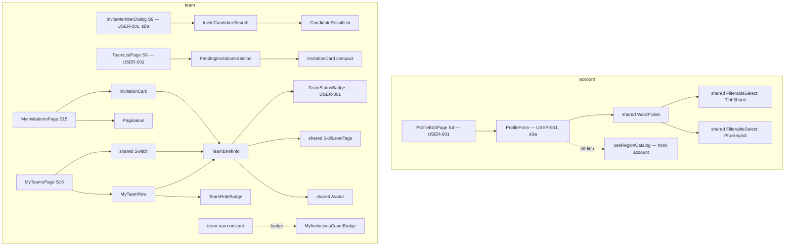

# Component Design — USER-003 Tra cứu cho người dùng

| Mục | Giá trị |
|---|---|
| Mã chức năng | `USER-003` |
| Phạm vi tầng | frontend (ArenaFlow-fe) |
| Repo/stack | ArenaFlow-fe · React 19 + TypeScript + Tailwind CSS 4 · React Hook Form + Zod (FE ADR-0005 — Proposed, nhánh `feature/USER-001-user-team`) |
| Quy ước áp dụng | `docs/agent/convention-frontend.md` §2–§4, §10 · `docs/agent/non-functional-standards.md` §4 · `SHARED/APP-SHELL/Component_Design.md` · `USER-001/Component_Design.md` · FE ADR-0006 (store không thư viện — khoá tìm §4), FE ADR-0008 (ngày giờ: `formatVnDate`, `formatVnTime`) — Proposed, nhánh `feature/USER-001-user-team` |
| Tác giả / Ngày / Phiên bản | `solution-architect` (agent) / `2026-11-27` / `v1.1` |

> Hai module có sẵn: `src/modules/account/` (S4) và `src/modules/team/` (S6, S9, S15, S16). Tái dùng từ SHARED §3: `Dialog`, `AlertBanner`, `Avatar`, `StatusBadge`, `Skeleton`, `EmptyState`, `ErrorState`, `QueryStateView`, `Pagination`, `FormField`, `Spinner`, `Icon`, `SkillLevelTags` (chuyển lên `shared/` theo MATCH-001 §6 C9), `WardPicker`, `useToast`; hook `useUrlParam`, `useDebouncedValue`, `useDocumentTitle`; util `vn-datetime`, `isSafeHttpUrl`; type `MyTeam` (`src/shared/types/my-team.type.ts`). Từ USER-001 §2.2: `TeamStatusBadge`, `InviteMemberDialog`, `ProfileForm`; hook `useAcceptInvitation`, `useRejectInvitation`, `useInviteMember`, `useProfile`.
> Thành phần **mới** dùng chung (§2.3) phải qua `reuse-scan` trước khi tạo (`CLAUDE.md` §8).

## 1. Cây component

## 2. Danh sách component

### 2.1. Module `account` (`src/modules/account/`)

| Component | Đường dẫn | Loại | Props chính | Trách nhiệm | Tái dùng / Mới |
|---|---|---|---|---|---|
| `ProfileForm` | `components/profile-edit/profile-form.component.tsx` | feature | (USER-001) | Thêm field UI `provinceId` + 2 `Controller`; render `WardPicker` (shared, §2.3) với dữ liệu từ `useRegionCatalog` (§4) và `initialWard` = `profile.ward` (USER-001 §4.2) | Tái dùng, sửa |

> `WardPicker` ở `shared/` (coordinator chốt 2026-11-27): VENUE-001 cũng dùng (form địa điểm) mà module không import module khác. Phần gọi API (2.1, 2.2) và xử lý `USER_004` nằm trong hook của **từng module** (`useRegionCatalog` ở `account`), dùng chung gốc query key `catalog` (State_API_Integration §3.1) → hai module chia sẻ cache.

### 2.2. Module `team` (`src/modules/team/`)

| Component | Đường dẫn | Loại | Props chính | Trách nhiệm | Tái dùng / Mới |
|---|---|---|---|---|---|
| `InviteMemberDialog` | `components/dialogs/invite-member-dialog.component.tsx` | feature | (USER-001) `team`, `open`, `onClose` | Giữ `selectedUserId` (`useState`); nút "Gửi lời mời" disable khi `null` hoặc đang gửi; lỗi 2.12 hiện dưới danh sách (`AlertBanner`) theo State_API_Integration §5; `initialFocusRef` = ô tìm | Tái dùng, sửa |
| `InviteCandidateSearch` | `components/dialogs/invite-candidate-search.component.tsx` | feature | `teamId`, `selectedUserId: string \| null`, `onSelect(userId: string \| null)`, `inputRef`, `disabled?`, `onLostPermission(error: ApiError)` | Ô tìm (`FormField` nhãn "Số điện thoại hoặc tên hiển thị", icon kính lúp, `maxLength=100`, gợi ý xám); debounce 300 ms; kiểm client (§3.2); gọi `useInvitationCandidates`; spinner trong ô khi đang tìm; khoá ô khi 429; đổi chuỗi → `onSelect(null)`; mã mất quyền → `onLostPermission` (dialog đóng + toast) | Mới |
| `CandidateResultList` | `components/dialogs/candidate-result-list.component.tsx` | feature | `items: InvitationCandidate[]`, `hasMore`, `selectedUserId`, `onSelect`, `dimmed: boolean` | `<fieldset role="radiogroup" aria-label="Kết quả tìm kiếm">`; mỗi dòng `<label>` bọc `<input type="radio">` + `Avatar` + tên; `membershipStatus` khác `null` → radio **`disabled` native** (chốt: thay `aria-disabled` của UI_Design S9 — trình đọc màn hình vẫn báo "không khả dụng", trình duyệt tự chặn chọn, không cần chặn tay) + nhãn chữ "Đã là thành viên" / "Đã được mời" nằm trong `<label>` (API_Spec §3.1); `hasMore` → dòng cuối "Nhập thêm để thu hẹp kết quả"; cuộn trong dialog; `dimmed` → mờ khi đang tải lại | Mới |
| `PendingInvitationsSection` | `components/list/pending-invitations-section.component.tsx` | feature | — | Khối S6: tiêu đề "Lời mời đang chờ (n)", tối đa 3 `InvitationCard variant="compact"`, link "Xem tất cả" → S15; đang tải lần đầu → `Skeleton` 1 thẻ; ẩn khi n = 0; lỗi → dòng lỗi nhỏ + "Thử lại" (không chặn S6) | Mới (chốt tên chỗ cắm USER-001) |
| `MyInvitationsPage` | `pages/my-invitations.page.tsx` | page | — | S15: `<h1>` "Lời mời của tôi", dòng phụ "<n> lời mời đang chờ", `QueryStateView` (skeleton 3 thẻ / empty / lỗi), `<ul>` thẻ, `Pagination`; giữ `pendingByInvitationId`; điều chỉnh `page` khi trang rỗng (Screen_Flow S15) | Mới |
| `InvitationCard` | `components/invitations/invitation-card.component.tsx` | feature | `invitation: MyInvitation`, `pendingAction: 'accept' \| 'reject' \| null`, `onAccept()`, `onReject()`, `variant: 'full' \| 'compact'` | `<li><article>`: `TeamBriefInfo` (tiêu đề `<h2>` = tên đội, meta "Mời lúc dd/mm/yyyy HH:mm"); `team.status = INACTIVE` → `AlertBanner tone="warning"` "Đội đang tạm ngưng — chưa thể chấp nhận/từ chối" + hai nút disable (API_Spec §3.2); nút "Xem đội" (link S8a), "Từ chối" (`secondary`), "Chấp nhận" (`primary`) có `aria-label` kèm tên đội; `pendingAction` → nút đó `loading`, nút còn lại disable. `compact` (S6): chỉ tên đội, thời điểm mời, hai nút; `INACTIVE` vẫn disable hai nút + nhãn chữ "Đội đang tạm ngưng" | Mới |
| `MyTeamsPage` | `pages/my-teams.page.tsx` | page | — | S16: `<h1>` "Đội của tôi", dòng phụ "<n> đội đang tham gia" (`totalItems`), `Switch` "Chỉ đội tôi làm đội trưởng" (`useUrlParam('role')`), `QueryStateView` (skeleton 4 hàng; empty theo lọc), `<ul>` `MyTeamRow`, `Pagination` | Mới |
| `MyTeamRow` | `components/my-teams/my-team-row.component.tsx` | feature | `team: MyTeam` (type shared) | `<li>` chứa `Link` cả hàng tới `buildTeamDetailPath(teamId)` (mũi tên ">" `aria-hidden`); `TeamBriefInfo` (`titleAs="span"`, `roleBadge` = `TeamRoleBadge`, meta "Tham gia dd/mm/yyyy HH:mm"); desktop hàng ngang, mobile thẻ | Mới |
| `TeamBriefInfo` | `components/team-brief-info.component.tsx` | ui (module) | `teamName`, `avatarUrl: string \| null`, `status: 'ACTIVE' \| 'INACTIVE'`, `skillLevels: string[]`, `captainName: string \| null`, `memberCount`, `meta: string`, `titleAs: 'h2' \| 'span'`, `roleBadge?: ReactNode` | "Thẻ đội rút gọn" (UI_Design §3): `Avatar` (logo, `null` → mặc định), tên, `TeamStatusBadge`, `roleBadge`, `SkillLevelTags`, dòng "Đội trưởng: <captainName>" (`null` → "—" `[cần xác nhận]` #1) · "<n> thành viên" · `meta`. Tên người đã xoá do BE trả sẵn "Người dùng đã xóa" — hiển thị nguyên chuỗi (BR-U17) | Mới |
| `TeamRoleBadge` | `components/team-role-badge.component.tsx` | ui (module) | `role: 'CAPTAIN' \| 'MEMBER'` | "Đội trưởng" (icon vương miện, `aria-hidden`) / "Thành viên" — luôn có chữ | Mới |
| `MyInvitationsCountBadge` | `components/nav/my-invitations-count-badge.component.tsx` | feature | — | Huy hiệu số cạnh nav "Lời mời của tôi": `useMyInvitationsCount()`; ẩn khi 0 / đang tải / lỗi; > 99 → "99+"; chữ ẩn "<n> lời mời đang chờ" cho trình đọc màn hình. Gắn qua `NavItem.badge` `[cần xác nhận]` Screen_Flow #6 | Mới |

- `TeamBriefInfo` chỉ dùng trong module `team` → không đưa lên `shared/`. `TeamCard` (USER-001, S6) giữ nguyên; gộp với `TeamBriefInfo` là refactor tuỳ chọn khi code, không bắt buộc.
- Thời điểm "dd/mm/yyyy HH:mm" (UI_Design §2): ghép `formatVnDate(s)` + `" "` + `formatVnTime(s)` — **không** dùng `formatVnDateTime` (thứ tự "HH:mm dd/mm/yyyy" — SHARED Component_Design §5).

### 2.3. Dùng chung mới (`src/shared/`)

| Thành phần | File | Props / chữ ký | Ghi chú |
|---|---|---|---|
| `FilterableSelect` | `components/filterable-select/filterable-select.component.tsx` | `id`, `label`, `placeholder`, `value: string \| null`, `selectedLabel: string \| null`, `options: readonly { value: string; label: string }[]`, `onChange(value)`, `onClear?()` (có → hiện nút "Bỏ chọn" cạnh ô khi `value ≠ null`), `onOpen?()`, `status: 'idle' \| 'loading' \| 'error' \| 'success'`, `errorMessage?`, `onRetry?`, `emptyText`, `noMatchText`, `sheetTitle`, `disabled?`, `invalid?`, `describedBy?` | "Combobox chọn từ danh sách tự lọc" (UI_Design §3). `md:` trở lên: ARIA `combobox` + `listbox` thả xuống. Dưới `md`: nút mở `Dialog` (bottom sheet) tiêu đề `sheetTitle`, ô lọc + listbox. Lọc: `foldVietnamese(label).includes(foldVietnamese(input.trim()))`. Trong listbox: `loading` → `Spinner` "Đang tải…"; `error` → message + nút "Thử lại"; `options` rỗng → `emptyText`; lọc không khớp → `noMatchText`. ↑/↓ di chuyển, Enter chọn, Esc đóng; `selectedLabel` hiển thị khi `options` chưa tải. Không chứa nghiệp vụ |
| `WardPicker` | `components/ward-picker/ward-picker.component.tsx` | `WardPickerProps`, `CatalogSelectData`, `WardSelection`: **SHARED Component_Design §3.1** (định nghĩa duy nhất — không lặp ở đây). USER-003 S4 truyền `onClear` (tuỳ chọn ở SHARED) | UI thuần, **không** gọi API (`convention-frontend.md` §2). Hành vi USER-003 S4: nhóm "Khu vực" (`<fieldset>` + `<legend>` + gợi ý xám "Chọn tỉnh/thành trước, rồi chọn phường/xã"); 2 `FilterableSelect` ("Tỉnh/thành" có "Bỏ chọn" khi có `onClear`; "Phường/xã" disable khi `provinceId = null`, `emptyText` "Chưa có dữ liệu phường/xã cho tỉnh/thành này"); nhãn ban đầu từ `initialWard` khi danh sách chưa tải; mở ô → `provinceCatalog.onOpen()` / `wardCatalog.onOpen()`. Tạo cần Reuse Report |
| `Switch` | `components/switch/switch.component.tsx` | `id`, `label`, `checked`, `onChange(checked)`, `disabled?` | `<button role="switch" aria-checked>` + `<label>`; trạng thái có chữ/vị trí núm, không chỉ màu |
| `useMediaQuery` | `hooks/use-media-query.hook.ts` | `(query: string) => boolean` | `matchMedia` + `useSyncExternalStore`; dùng `'(min-width: 768px)'` (breakpoint `md` Tailwind) cho `FilterableSelect` |
| `foldVietnamese` | `utils/vn-text.util.ts` | `(s: string) => string` | Bỏ dấu (NFD, xoá dấu kết hợp), `đ/Đ → d`, chữ thường. Dùng cho lọc phía client |

## 3. Form & validation

### 3.1. `ProfileForm` — ô "Khu vực" (sửa USER-001 Component_Design §3.2, dòng `wardId`)

| Trường | Kiểu | Validation client | Map (BE) | Hiển thị lỗi |
|---|---|---|---|---|
| `provinceId` | `FilterableSelect` "Tỉnh/thành" — field **chỉ UI, không gửi** | UUID hoặc `null`; mặc định `profile.ward?.provinceId ?? null` | — (USER-003 2.1, 2.2 path) | `404 USER_004` → "Không tìm thấy tỉnh/thành" dưới ô Tỉnh/thành |
| `wardId` | `FilterableSelect` "Phường/xã" — disable khi `provinceId = null` | UUID hoặc `null`; mặc định `profile.ward?.wardId ?? null`. Refine: `provinceId ≠ null` và `wardId = null` → lỗi `wardId` "Vui lòng chọn phường/xã" `[cần xác nhận]` Screen_Flow #1 | USER-001 2.6 `wardId` (BR-U05) | `400 USER_002` → "Khu vực không hợp lệ" dưới nhóm "Khu vực" (`<fieldset>` `aria-describedby`) |

- Đổi tỉnh: `setValue('provinceId', id, { shouldDirty: true })` + `setValue('wardId', null, { shouldDirty: true })` (UC-U04 3a).
- **"Bỏ chọn"** (`onClear` của ô Tỉnh/thành): `resetField('provinceId')` + `resetField('wardId')` → về giá trị mặc định của form (hồ sơ chưa có khu vực → `null`/`null`, refine không báo lỗi; đã có → khu vực ban đầu, hết dirty). Cho người dùng thoát khi tỉnh của mình chưa có trong danh mục (UC-U04 2b: các trường khác vẫn lưu được) hoặc đổi ý sau khi chọn tỉnh.
- Gửi: `buildPatchBody` (SHARED §4) trên giá trị đã **loại `provinceId`**; `wardId` chỉ gửi khi dirty và khác `null`.
- Không xoá được khu vực **đã lưu** (USER-001 Component_Design §6 #1 — `PATCH` coi `null` là giữ nguyên); "Bỏ chọn" chỉ huỷ thay đổi chưa lưu. Đóng nửa sau UI_Design §4 #8.

### 3.2. `InviteCandidateSearch` — kiểm chuỗi tìm trước khi gọi

Util `classifyCandidateQuery(raw: string)` — `src/modules/team/utils/candidate-query.util.ts` — mô phỏng cách BE hiểu `q` (USER-003 `API_Spec.md` §2.3 "BE hiểu `q` thế nào"); BE vẫn tự kiểm:

| Bước | Điều kiện (trên `t = raw.trim()`) | Kết quả | UI |
|---|---|---|---|
| 1 | `t = ""` | `empty` | Không gọi; hiện gợi ý ban đầu |
| 2 | `t` chỉ gồm chữ số, `+`, khoảng trắng, `.`, `-` | Chuẩn hoá: bỏ khoảng trắng / `.` / `-`; đầu `+84` hoặc `84` → `0`. Khớp `^0\d{9}$` → `phone`; không → `invalid-phone` | `invalid-phone`: không gọi; lỗi dưới ô "Số điện thoại không hợp lệ" (`USER_005`) |
| 3 | Còn lại: số ký tự chữ/số (`\p{L}\p{N}`) < 2 | `too-short` | Không gọi; "Nhập ít nhất 2 ký tự" (`USER_006`) |
| 4 | Còn lại | `name` | Gọi |

- Gửi `q = t` (chuỗi đã trim, chưa chuẩn hoá) cho cả `phone` và `name`; ô nhập `maxLength = 100` (`VALIDATION_ERROR` khi > 100).
- Kiểm chạy trên giá trị **đã debounce** (300 ms) — không hiện lỗi khi người dùng đang gõ dở.
- Kết quả khác `phone` / `name` (`empty`, `invalid-phone`, `too-short`) hoặc đang khoá 429 → **không** hiện danh sách (kể cả kết quả cũ giữ bởi `placeholderData`), `onSelect(null)` — State_API_Integration §3.2.
- Lệch giữa util và BE → BE trả `USER_005` / `USER_006` → hiện cùng câu (State_API_Integration §5); util có test bảng ví dụ của API_Spec §2.3.

### 3.3. Chống double-submit
- S9: "Gửi lời mời" `loading = isPending`, dialog `dismissible = !isPending`, ô tìm `disabled` khi đang gửi.
- S15 / khối S6: mỗi thẻ disable hai nút khi đang xử lý thẻ đó; thẻ khác vẫn bấm được (mutation tách theo `invitationId`).

## 4. Hook / util riêng của feature

> Mỗi hook một file `hooks/use-<tên-kebab>.hook.ts`.

| Tên | Thư mục | Mục đích |
|---|---|---|
| `useRegionCatalog({ provinceId, onProvinceGone })` | `modules/account/hooks/` | Trả `{ provinceCatalog, wardCatalog }` (`CatalogSelectData` — SHARED §3.1): query 2.1 bật khi `provinceCatalog.onOpen()`, query 2.2 bật khi chọn tỉnh / `wardCatalog.onOpen()`; key `catalogKeys.*` (State_API_Integration §3.1); `404 USER_004` → gọi `onProvinceGone()` (form đặt lỗi + `provinceId`/`wardId` = `null`) + xử lý cache theo State_API_Integration §5. VENUE-001 viết hook tương đương trong module của mình, cùng key |
| `useInvitationCandidates(teamId, q, { enabled })` | `modules/team/hooks/` | Query 2.3, giữ kết quả cũ khi đổi `q` |
| `candidateSearchLockStore` | `modules/team/store/candidate-search-lock.store.ts` | Store module (mẫu FE ADR-0006, không thư viện): `lockedUntilMs: number \| null`, `lock(retryAfterSeconds \| null, nowMs)` (= `nowMs + (retryAfterSeconds ?? 60)·1000`), `subscribe`. Một khoá cho **mọi đội** trong phiên (giới hạn BE theo người dùng). Đăng ký nghe `sessionStore` (core): `status ≠ authenticated` → xoá khoá — `core` không import module |
| `useCandidateSearchLock()` | `modules/team/hooks/` | Đọc store bằng `useSyncExternalStore`; trả `{ locked, lock }`; `setTimeout` tới `lockedUntilMs` để render lại khi hết khoá (huỷ timer khi unmount, khoá vẫn còn trong store) |
| `useMyInvitations({ page, pageSize })` | `modules/team/hooks/` | Query 2.4 (S15, khối S6) |
| `useMyInvitationsCount()` | `modules/team/hooks/` | Cùng key trang 1 của 2.4, `select` → `pagination.totalItems` (huy hiệu) |
| `useMyTeams({ role, page, pageSize })` | `modules/team/hooks/` | Query 2.5 (S16) |
| `classifyCandidateQuery` | `modules/team/utils/candidate-query.util.ts` | §3.2 |
| `MY_TEAMS_ROLE_FILTER = 'CAPTAIN'` | `modules/team/constants/team-options.constant.ts` (file USER-001) | Giá trị hợp lệ duy nhất của `?role` |
| `TEAM_NAV_ITEMS` | `modules/team/constants/team-nav.constant.ts` | 3 mục nav (Screen_Flow §4) |

## 5. A11y
- `<h1>`: S15 "Lời mời của tôi", S16 "Đội của tôi". Danh sách là `<ul>`; mỗi thẻ S15 có `<h2>` tên đội.
- `FilterableSelect`: `role="combobox"` + `aria-expanded`, `aria-controls`, `aria-activedescendant`; option `role="option"` + `aria-selected`; nhãn `<label>`; lỗi qua `aria-describedby`; bottom sheet theo quy tắc focus của `Dialog` (SHARED).
- S9: ô tìm có `<label>`; vùng kết quả `role="radiogroup"` có `aria-label`; số kết quả / "Không tìm thấy người dùng" / lỗi đọc qua vùng `aria-live="polite"`; dòng có nhãn là radio `disabled` native + chữ nhãn trong `<label>` (không chỉ độ mờ — §2.2 `CandidateResultList`).
- S15: nút có `aria-label` kèm tên đội; kết quả thao tác qua toast (`aria-live`); dải "tạm ngưng" là chữ + icon.
- S16: `Switch` `role="switch"`; mỗi hàng là link có tên đội; vai trò / trạng thái luôn có chữ.
- Sau thao tác ở S15 làm thẻ biến mất → focus chuyển tới `<h1>` (không rơi về `body`).

## 6. Thay đổi USER-001 / SHARED phải áp
Danh sách duy nhất: Screen_Flow §6 (C3, C9–C12, C23 liên quan component).

## 7. `[cần xác nhận]`
1. **`captainName = null`** (UI_Design §4 #5): đề xuất "Đội trưởng: —".
2. **Avatar không có ảnh ở S9:** UI_Design S9 vẽ chữ cái đầu tên; `Avatar` (SHARED §3) ghi "ảnh mặc định". Đề xuất `Avatar` fallback = chữ cái đầu của `name` cho mọi màn (đổi mô tả SHARED).
3. **Câu chữ `FilterableSelect` ở S4** (UI_Design §4 #7): đề xuất "Đang tải…", "Không có kết quả phù hợp", "Không tải được danh sách" + "Thử lại", danh mục tỉnh/thành rỗng "Chưa có dữ liệu tỉnh/thành".
