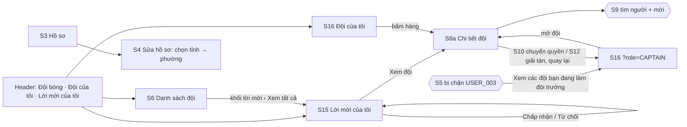

# Screen Flow — USER-003 Tra cứu cho người dùng

| Mục | Giá trị |
|---|---|
| Mã chức năng | `USER-003` |
| Phạm vi tầng | frontend (ArenaFlow-fe) — backend: ngoài phạm vi repo này (USER-003 `API_Spec.md`) |
| Repo/stack | ArenaFlow-fe · React 19 + TypeScript + Vite · React Router |
| Nguồn SRS/UI/API | `docs/agent/upstream/business-spec/USER-003/` (UC-U04, UC-U05, UC-T07, UC-T08) · `UI_Design.md` v1.0 · `docs/agent/upstream/api/USER-003/API_Spec.md` |
| Căn cứ | `ArenaFlow-spec@53aee11` · API_Spec `v2.0` (USER-001 `v5.3`, USER-002 `v4.0`, SYSTEM-002 `v1.2`) |
| Quy ước áp dụng | `docs/agent/design-standards.md`, `docs/agent/convention-frontend.md`, `docs/agent/security-frontend.md` · khung: `docs/agent/design/SHARED/APP-SHELL/` · module `account` / `team`: `docs/agent/design/USER-001/`, `docs/agent/design/USER-002/` · FE ADR-0003 (router), 0004 (TanStack Query), 0005 (form), 0006 (session store), 0008 (ngày giờ `formatVnDate` / `formatVnTime`) — đều Proposed, nhánh `feature/USER-001-user-team` |
| Tác giả / Ngày / Phiên bản | `solution-architect` (agent) / `2026-11-27` / `v1.1` |

> Khung (route registry `AppRouteGroups`, guard, layout, `ROUTE_PATHS`, `useUrlParam`): `SHARED/APP-SHELL/Screen_Flow.md`. Thiết kế SHARED, USER-001, USER-002 đang ở nhánh `feature/USER-001-user-team` (chưa merge) — trỏ theo tên mục.
> File này ghi 2 màn **mới** (S15, S16), phần **thay đổi** trên S4, S9 (USER-001) và các điểm chạm S5, S6, S8a, header. Không sửa file nào trong `design/USER-001/`, `design/USER-002/`, `design/SHARED/` — mọi thay đổi chúng phải áp gom **một nơi** ở §6.

## 1. Danh sách màn hình

| # | Màn hình | Route (`ROUTE_PATHS`) | Nhóm route | Use case (SRS) |
|---|---|---|---|---|
| S4 | Sửa hồ sơ — chọn khu vực (sửa) | `/profile/edit` (USER-001, không đổi) | authenticated | UC-U04, UC-U02 |
| S9 | Mời thành viên — tìm người (sửa) | Dialog trên S8a (USER-001, không đổi) | authenticated | UC-U05, UC-T02 |
| S15 | Lời mời của tôi (mới) | `/me/invitations` (`myInvitations`) | authenticated | UC-T07, UC-T03 |
| S16 | Đội của tôi (mới) | `/me/teams` (`myTeams`); `?role=CAPTAIN` khi bật lọc | authenticated | UC-T08 |

- Route S15, S16 khai trong `src/modules/team/routes/team.routes.tsx` (nhóm `authenticated`, page lazy). Hằng thêm vào `src/shared/constants/route-paths.constant.ts` trong PR của USER-003 (SHARED Screen_Flow §1.2): `myInvitations: '/me/invitations'`, `myTeams: '/me/teams'`, hàm `buildMyTeamsPath({ role?: 'CAPTAIN' })`.
- Đích link S5: USER-002 Screen_Flow S5 "Link" + §5 #1 giao USER-003 chọn path → chốt `buildMyTeamsPath({ role: 'CAPTAIN' })` = `/me/teams?role=CAPTAIN`.
- **Vì sao tiền tố `/me/*`:** `/profile`, `/profile/edit` là màn của module `account` (S3, S4); S15, S16 thuộc module `team` → đặt dưới `/profile/*` trộn route hai module trong một nhánh URL và gợi ý chúng là màn con của "Hồ sơ cá nhân". Không dùng `/teams/mine`: trùng mẫu `/teams/:teamId` (S8a), dễ nhầm là một `teamId`. `/me/*` là không gian "của tôi" độc lập màn hồ sơ, chưa mã nào dùng.
- Admin vào được S15, S16 như người dùng thường (chỉ thấy dữ liệu của chính mình — BR-U16); không cần `RoleGuard`.

## 2. Luồng điều hướng

## 3. Chi tiết từng màn hình

### S4 — Sửa hồ sơ: chọn khu vực (sửa)
- **Phạm vi sửa:** chỉ ô "Khu vực" của `ProfileForm` (USER-001). Vào/ra, nút, trường khác: USER-001 Screen_Flow S4.
- **Thao tác:** mở ô Tỉnh/thành → tải danh mục tỉnh/thành (lần đầu trong phiên); chọn tỉnh → ô Phường/xã bật, tải phường/xã của tỉnh đó; đổi tỉnh → bỏ phường/xã đã chọn (UC-U04 3a). Lọc khi gõ: phía ứng dụng, không gọi API (BR-U07). "Bỏ chọn" trên ô Tỉnh/thành → về khu vực ban đầu của hồ sơ (chưa có → trống) — tránh kẹt khi tỉnh của người dùng không có trong danh mục (UC-U04 2b; Component_Design §3.1).
- **Hồ sơ đã có khu vực (1a):** hai ô hiện sẵn tên từ `profile.ward` (`provinceName`, `wardName` — USER-001 2.5); **không** gọi danh mục khi tải trang.
- **Lưu:** chỉ khi bấm "Lưu thay đổi" (USER-001). Đã chọn tỉnh khác ban đầu nhưng chưa chọn phường/xã → chặn lưu, lỗi dưới ô Phường/xã "Vui lòng chọn phường/xã" `[cần xác nhận]` #1.
- **Trạng thái:** UI_Design S4. Lỗi `USER_004` / `USER_002`: State_API_Integration §5.

### S9 — Mời thành viên: tìm người (sửa)
- **Phạm vi sửa:** thay ô "ID hoặc username" bằng ô tìm + danh sách chọn một. Khung dialog, nút, thông báo thành công: USER-001 Screen_Flow S9.
- **Thao tác:** gõ → chờ 300 ms ngừng gõ → kiểm phía client (Component_Design §3.2) → gọi tìm. Đổi chuỗi → bỏ người đã chọn. Chọn người không có nhãn → bật "Gửi lời mời".
- **Mất quyền tìm** (`TEAM_001/002/015/016`): đóng dialog, toast message BE, tải lại chi tiết đội (nút "Mời thành viên" tự ẩn theo dữ liệu mới); `TEAM_001` → về S6 `[cần xác nhận]` #2.
- **Tìm quá nhanh** (`429 USER_007`): khoá ô tìm `retryAfterSeconds` giây (không đọc được → 60), không đếm ngược `[cần xác nhận]` #3. Khoá giữ ở phạm vi **phiên**, dùng chung **mọi đội** (giới hạn BE tính theo người dùng, gộp mọi đội — API_Spec §2.3): đóng/mở lại dialog hoặc mở dialog của đội khác trong thời gian chờ → ô vẫn khoá + cùng thông báo. Kết thúc phiên → xoá khoá (State_API_Integration §3.2).

### S15 — Lời mời của tôi (mới)
- **Vào từ:** header "Lời mời của tôi"; khối lời mời S6 "Xem tất cả". **Ra tới:** "Xem đội" → `buildTeamDetailPath(teamId)` (S8a).
- **S8a với người chưa là thành viên:** đã có — USER-001 Screen_Flow S8a hàng "Người khác / chưa xác định" (chỉ xem, không nút quản lý / Rời đội). Đóng UI_Design §4 #4.
- **Tham số URL:** `page` (≥ 1, sai → 1; `push` khi đổi trang).
- **Thao tác:** "Chấp nhận" / "Từ chối" trên từng thẻ, không hộp xác nhận `[cần xác nhận]` #4. Đang xử lý một thẻ → chỉ hai nút của thẻ đó disable.
- **Sau thao tác thành công:** toast, danh sách tải lại (thẻ biến mất, tổng giảm). Trang hiện tại thành rỗng mà `page > 1` → `replace` sang `page = max(1, totalPages)`.
- **Trạng thái:** loading skeleton 3 thẻ · empty "Bạn chưa có lời mời nào" (ẩn phân trang) · lỗi `ErrorState` + Thử lại · đội `INACTIVE` → dải cảnh báo + nút disable (Component_Design §2.2).
- **Tài khoản đã xoá, phiên còn hạn** (`404 USER_001`): wrapper `endSession('ACCOUNT_DELETED')` → S1.

### S16 — Đội của tôi (mới)
- **Vào từ:** header "Đội của tôi"; link S5 (`?role=CAPTAIN`); quay lại từ S8a.
- **Tham số URL:** `role` ∈ `CAPTAIN` \| vắng (mặc định = mọi đội; giá trị khác → vắng); `page`. Công tắc ghi `role` bằng `replace` và reset `page = 1` (SHARED Screen_Flow §1.3).
- **Ra tới:** bấm hàng → `buildTeamDetailPath(teamId)` (S8a; nút theo vai trò người xem — USER-001).
- **Luồng dọn đội trước khi xoá tài khoản (1a, AC-T08-03):** S5 → S16 `?role=CAPTAIN` → S8a → S10 / S12 → Back → S16 tải lại (`teamKeys.mine()` đã bị invalidate bởi mutation USER-001 / USER-002 — §6 C14, C21) → đội đã xử lý rời khỏi danh sách lọc. Danh sách lọc rỗng → "Bạn không làm đội trưởng đội nào".
- **Trạng thái:** loading skeleton 4 hàng (công tắc vẫn bấm được) · empty theo lọc · lỗi + Thử lại · `USER_001` như S15. Trang rỗng mà `page > 1` → như S15.

### Điểm chạm màn khác (thiết kế ở mã đó, USER-003 cung cấp nội dung)

| Màn | USER-003 cung cấp | Ghi chú |
|---|---|---|
| Header (khung) | 3 mục nav module `team` + huy hiệu số lời mời | §4; §6 C2–C4 |
| S6 (USER-001) | `PendingInvitationsSection`: tối đa 3 lời mời mới nhất + "Xem tất cả (n)" → S15; ẩn khi n = 0 | Giữ khối (mockup USER-001 S6 đã duyệt) `[cần xác nhận]` #5; §6 C6 |
| S5 (USER-002) | Đích link = `buildMyTeamsPath({ role: 'CAPTAIN' })` | Nhãn giữ "Xem các đội bạn đang làm đội trưởng →". Đóng UI_Design §4 #3; §6 C20 |
| S3 (USER-001) | — | Khu vực "<wardName>, <provinceName>" đã có ở `ProfileFieldList` (USER-001 Component_Design §2.1). Đóng nửa đầu UI_Design §4 #8 |

## 4. Route guard, điều hướng header & phân quyền
- S15, S16: `AuthGuard` (nhóm `authenticated`). Dữ liệu luôn của người đang đăng nhập — không có tham số người dùng trên URL (BR-U16).
- Nav module `team` (`src/modules/team/constants/team-nav.constant.ts`, `NavItem` — SHARED Component_Design §2):

| `order` | Nhãn | `to` | Huy hiệu |
|---|---|---|---|
| 10 | Đội bóng | `ROUTE_PATHS.teams` | — |
| 20 | Đội của tôi | `ROUTE_PATHS.myTeams` | — |
| 30 | Lời mời của tôi | `ROUTE_PATHS.myInvitations` | `MyInvitationsCountBadge` (ẩn khi 0) — cần `NavItem.badge` `[cần xác nhận]` #6 |

- Ghép với nav mã khác (thứ tự chung: SHARED Screen_Flow §3 / §6): MATCH-001 "Tìm kèo" `5`, "Kèo của đội" `15`, "Tin nhắn" `90` (MATCH-001 Screen_Flow §1) → thứ tự hiển thị Tìm kèo · Đội bóng · Kèo của đội · Đội của tôi · Lời mời của tôi · Tin nhắn. Vị trí MERCENARY-001, VENUE-001: chưa chốt ở các mã đó. `NavItem.badge` dùng chung với `ConversationUnreadDot` của MATCH-001 (C3).

- S9: nút "Mời thành viên" chỉ hiện cho đội trưởng đội `ACTIVE` (USER-001 S8a); BE vẫn kiểm (`TEAM_002`, `TEAM_015`, `TEAM_016`). Không đăng xuất khi gặp các mã này.

## 5. Breadcrumb
- UI USER-001 S7, S8a, sửa đội dùng "Đội của tôi › …" trong khi "Đội của tôi" nay là S16. Đề xuất: mục "Đội của tôi" trỏ `ROUTE_PATHS.myTeams` `[cần xác nhận]` #7; §6 C12.

## 6. Thay đổi USER-001 / USER-002 / SHARED phải áp (nguồn duy nhất)

> **Trạng thái (2026-11-28): C1–C23 đã áp vào SHARED v1.2 / USER-001 v1.2 / USER-002 v1.2 và đã qua `architect-reviewer` (0 CRITICAL / 0 MAJOR).** `WardPicker` chốt ở SHARED Component_Design §3.1 (`provinceCatalog` / `wardCatalog`, `onClear?`) — USER-003 trỏ tới đó.
> Áp trong worktree / nhánh `feature/USER-001-user-team` qua vòng lặp design của chủ thiết kế đó (USER-003 không sửa). **Chặn code** S4 ô "Khu vực", S6 khối lời mời, S9 ô tìm, S5 link, bước 4 vai trò S8a, invalidate key USER-003, nav header của USER-001 / USER-002 **tới khi C1–C23 được áp và qua `architect-reviewer`**. VENUE-001 dùng `WardPicker` + `catalogKeys` → cũng phụ thuộc C22, C23. Cũng chặn code USER-003 tới khi đó (§7 #9).

| # | File | Mục | Cũ | Mới |
|---|---|---|---|---|
| C1 | SHARED `Screen_Flow.md` | §1.2 | Chưa có path USER-003 | Ghi nhận path USER-003: `myInvitations: '/me/invitations'`, `myTeams: '/me/teams'`, `buildMyTeamsPath({ role?: 'CAPTAIN' })` (khai trong PR USER-003) |
| C2 | SHARED `Screen_Flow.md` | §6 #3 | "Đội của tôi" tạm `/teams`; chốt ở USER-003 | Đóng: nav module `team` = bảng §4 tài liệu này; "Đội của tôi" → `/me/teams` |
| C3 | SHARED `Component_Design.md` | §2 `interface NavItem` | 4 field `label`, `to`, `roles?`, `order` | Thêm `/** Huy hiệu động cạnh nhãn (tự lấy dữ liệu); bỏ trống = không có. */ badge?: ComponentType`; `DesktopNav`, `MobileNavDrawer` render `<item.badge />` sau nhãn (chờ #6) |
| C4 | SHARED `State_API_Integration.md` | §1 bảng request khung | Hồ sơ, chuông, "Tin nhắn" | Thêm dòng: "Huy hiệu 'Lời mời của tôi' · `GET /profile/invitations?page=1&pageSize=20` (USER-003 §2.4), key `teamKeys.myInvitationList({ page: 1, pageSize: 20 })` · USER-003 `MyInvitationsCountBadge` · một lần mỗi phiên" (chờ #6) |
| C5 | USER-001 `Screen_Flow.md` | S4 "Ô Khu vực" | "…S4 chỉ giữ giá trị `wardId`. Chặn code…" | "`WardPicker` (shared — USER-003 Component_Design §2.3), dữ liệu qua hook `useRegionCatalog` của module `account`; form giữ `provinceId` (chỉ UI) + `wardId`; danh mục tải khi mở ô" |
| C6 | USER-001 `Screen_Flow.md` | S6 "Khối Lời mời đang chờ" | "giữ, bỏ hay thay bằng link… chặn code" | "Giữ: `PendingInvitationsSection` (USER-003) — 3 lời mời mới nhất + 'Xem tất cả (n)' → `/me/invitations`; ẩn khi n = 0" (chờ #5) |
| C7 | USER-001 `Screen_Flow.md` | §3 "S9" | "ô tìm người theo USER-003 UI S9 (trả `userId`)… chặn code" | "`InviteCandidateSearch` (USER-003): `onSelect(userId \| null)`, `onLostPermission`; lỗi 2.12 theo C16, C17" |
| C8 | USER-001 `Screen_Flow.md` | §5 #8 | Danh sách phụ thuộc USER-003 "chặn code" | Mỗi mục trỏ USER-003 v1.0 (C5–C7, C14, C15, C20, C2); còn chặn tới khi C1–C23 áp + review |
| C9 | USER-001 `Component_Design.md` | Ghi chú đầu file (chỗ cắm) | Tên tạm; "chọn khu vực trả `wardId`" | Tên chốt `WardPicker` (**`shared/components/ward-picker/`**, không còn là chỗ cắm trong module `account`), `InviteCandidateSearch`, `PendingInvitationsSection`; props theo USER-003 Component_Design §2.2–§2.3; cây §1: `PFo --> WS[shared WardPicker]` |
| C10 | USER-001 `Component_Design.md` | §2.2 `InviteMemberDialog` | "`InviteCandidateSearch` (USER-003 — trả `userId`)" | "Giữ `selectedUserId`; 'Gửi lời mời' disable khi `null` / đang gửi; lỗi 2.12 `USER_001`, `TEAM_003` hiện dưới danh sách" |
| C11 | USER-001 `Component_Design.md` | §3.2 dòng `wardId` | Một trường `wardId` (`WardPicker`) | Hai dòng `provinceId` (chỉ UI) + `wardId` + refine — USER-003 Component_Design §3.1 |
| C12 | USER-001 `Component_Design.md` | Mục Breadcrumb ("mục 'Đội của tôi' trỏ `/teams`…") | `/teams` tạm | `ROUTE_PATHS.myTeams` (chờ #7) |
| C13 | USER-001 `State_API_Integration.md` | §1 dòng S4, S6 + bảng (A)/(B)/(C) | S4 ≤ 3 / 3 / 4; S6 2 / 3 / 4; "huy hiệu +1" | S4 0–1 / 2 / 3 (danh mục tải khi mở ô); S6 2 / 3 / 4 (khối lời mời dùng chung key với huy hiệu → huy hiệu không cộng ở S6); đóng USER-001 §7 #2 |
| C14 | USER-001 `State_API_Integration.md` | §3.1 dòng "Đội của tôi… (USER-003)" | "Key do USER-003 định nghĩa… chặn code" | Key theo USER-003 State_API_Integration §3.1; invalidate `teamKeys.mine()` sau 2.8, **2.11**, 2.13, 2.15, 2.18; `teamKeys.myInvitations()` sau 2.13, 2.14; `[...teamKeys.detail(teamId), 'invitation-candidates']` sau 2.12 |
| C15 | USER-001 `State_API_Integration.md` | §3.2 bước 4 | "dùng hàm + query do USER-003 thiết kế… chặn code" | `useMyTeams({ role: null, page: 1, pageSize: 100 })` — key `teamKeys.mineList(...)` |
| C16 | USER-001 `State_API_Integration.md` | §5 dòng 2.12 `404 USER_001` | "Lỗi trong dialog… giữ dialog" | "Lỗi dưới danh sách 'Không tìm thấy người dùng'; bỏ chọn; invalidate gợi ý mời; giữ dialog" |
| C17 | USER-001 `State_API_Integration.md` | §5 dòng 2.12 `409 TEAM_003` | "Đóng dialog, toast… (coi như đã mời)" | "Giữ dialog; lỗi dưới danh sách 'Người này đã là thành viên hoặc đã được mời'; bỏ chọn; invalidate gợi ý mời (nhãn cập nhật — UC-U05 6a)" |
| C18 | USER-001 `State_API_Integration.md` | §5 dòng 2.13, 2.14 `422 TEAM_015` | "Toast…; giữ thẻ lời mời" | "Toast 'Đội đang tạm ngưng hoạt động'; invalidate `teamKeys.myInvitations()` (thẻ chuyển trạng thái khoá — UC-T07 3a)" |
| C19 | USER-001 `State_API_Integration.md` | §5 dòng 2.6 `400 USER_002` | "Lỗi dưới ô khu vực…" | Thêm "invalidate `catalogKeys.provinces()`" |
| C22 | SHARED `State_API_Integration.md` | §4 bảng `QUERY_ROOTS` | Dòng `'account'` ghi "USER-001, USER-003 (khu vực)" | Dòng `'account'`: "USER-001"; thêm dòng `'catalog'` — "Danh mục chỉ đọc dùng chung nhiều module (tỉnh/thành, phường/xã) · USER-003, VENUE-001"; factory `catalogKeys` ở `src/shared/constants/catalog-query-keys.constant.ts` (USER-003 State_API_Integration §3.1). Thêm vào §5 Component_Design SHARED: `catalogKeys` cạnh `QUERY_ROOTS` |
| C23 | SHARED `Component_Design.md` | §3 Shared component | Chưa có | Thêm `WardPicker`, `FilterableSelect`, `Switch`; §5 thêm `useMediaQuery`, `foldVietnamese`, type `region.type.ts` — mô tả trỏ USER-003 Component_Design §2.3 (tạo trong PR USER-003, Reuse Report khi code) |
| C20 | USER-002 `Screen_Flow.md` | S5 "Link"; §5 #1 | "Path… chốt ở USER-003 — chặn code link" | `navigate(buildMyTeamsPath({ role: 'CAPTAIN' }))` = `/me/teams?role=CAPTAIN`; đóng §5 #1 |
| C21 | USER-002 `State_API_Integration.md` | §3 bước 3; §7 #2 | "key 'Đội của tôi' do USER-003 định nghĩa (chặn code)" | Invalidate `teamKeys.mine()`; đóng §7 #2 |

## 7. `[cần xác nhận]`
1. **Chọn tỉnh mà chưa chọn phường/xã rồi lưu (S4):** `PATCH` coi `wardId` vắng/`null` là giữ nguyên → khu vực cũ vẫn được lưu dù màn hình đã đổi tỉnh. Đề xuất chặn lưu + lỗi "Vui lòng chọn phường/xã" (câu chữ chưa có trong SRS/UI).
2. **S9 mất quyền tìm** (UI_Design §4 #10): đề xuất xử lý giống lỗi cùng mã khi gửi lời mời (USER-001 State_API_Integration §5, dòng 2.12) — đóng dialog, toast message BE, tải lại chi tiết đội.
3. **Đếm ngược khi tìm quá nhanh** (UI_Design §4 #9): đề xuất không đếm ngược; chỉ thông báo + khoá ô tới khi hết thời gian chờ. `Retry-After` qua CORS: USER-003 `API_Spec.md` §6 #1, SHARED State_API_Integration §7 #3.
4. **Từ chối không hỏi lại; câu toast** (UI_Design §4 #6): đề xuất toast "Bạn đã tham gia đội <tên>" / "Đã từ chối lời mời của đội <tên>"; 3c dùng message BE của `TEAM_006`.
5. **Khối lời mời ở S6** (UI_Design §4 #2): đề xuất giữ khối rút gọn (3 thẻ) + link "Xem tất cả (n)" sang S15; phương án khác: chỉ còn link (giảm S6 về 1 call — State_API_Integration §1).
6. **Huy hiệu số lời mời trên header** (UI_Design §4 #1): cần đổi `NavItem` (C3) và một request khung mỗi phiên (C4); ảnh hưởng ngưỡng — State_API_Integration §1 bảng (A)/(B)/(C).
7. **Breadcrumb "Đội của tôi" ở S7, S8a, sửa đội (USER-001):** đích S16 hay S6; nhãn giữ hay đổi "Đội bóng" khi vào từ S6.
8. **Nút "Tạo đội" ở S16** (UI_Design §4 #11): chưa đặt (UI không vẽ); chỉ có ở S6.
9. **Chặn code toàn bộ USER-003:** nhánh `feature/USER-001-user-team` (SHARED: `http.service`, session, `ROUTE_PATHS`, shared component; module `account` / `team`) chưa merge và FE ADR-0003, 0004, 0005, 0006, 0008 còn `Proposed` (SHARED Screen_Flow §6 #4). Thêm: C1–C23 chưa áp; cách tính ngưỡng có gồm request khung chưa chốt (State_API_Integration §9 #1).
