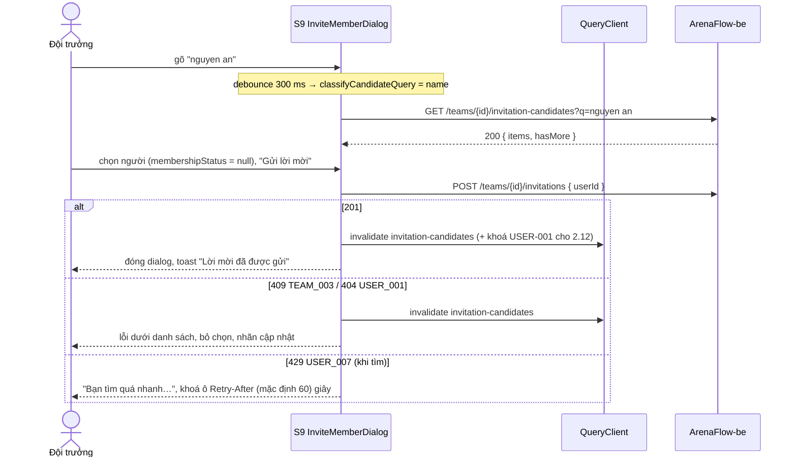

# State & API Integration — USER-003 Tra cứu cho người dùng

| Mục | Giá trị |
|---|---|
| Mã chức năng | `USER-003` |
| Phạm vi tầng | frontend (ArenaFlow-fe) — hợp đồng API thuộc BE |
| Nguồn API | `docs/agent/upstream/api/USER-003/API_Spec.md` · `docs/agent/upstream/api/USER-001/API_Spec.md` (2.5, 2.6, 2.12–2.14) · `docs/agent/upstream/api/api-convention.md` |
| Căn cứ | `ArenaFlow-spec@53aee11` · API_Spec `v2.0` (USER-001 `v5.3`, USER-002 `v4.0`, SYSTEM-002 `v1.2`) |
| Quy ước áp dụng | `docs/agent/convention-frontend.md` §5, `docs/agent/non-functional-standards.md`, `docs/agent/security-frontend.md` · khung http / session / query key: `SHARED/APP-SHELL/State_API_Integration.md` · FE ADR-0004 (TanStack Query), 0006 (store), 0008 (ngày giờ) — Proposed, nhánh `feature/USER-001-user-team` |
| Tác giả / Ngày / Phiên bản | `solution-architect` (agent) / `2026-11-27` / `v1.1` |

> Số mục `§2.x` là USER-003 `API_Spec.md`; `2.x` không có `§` là USER-001. Field / JSON: trỏ API_Spec, không chép. Path tương đối với base `/api/v1`.

## 1. Endpoint dùng theo màn hình

| Màn hình | Thời điểm gọi | Method + path | API_Spec | Số call khi tải |
|---|---|---|---|---|
| S4 | Khi tải | `GET /profile` (cache chung `AccountMenu` — USER-001) | 2.5 | 0–1 |
| S4 | Mở ô Tỉnh/thành lần đầu trong phiên | `GET /provinces` | §2.1 | — |
| S4 | Chọn tỉnh; hoặc mở ô Phường/xã với tỉnh có sẵn từ hồ sơ | `GET /provinces/{provinceId}/wards` | §2.2 | — |
| S4 | "Lưu thay đổi" | `PATCH /profile` (USER-001) | 2.6 | — |
| S9 | Mở dialog | — | — | 0 |
| S9 | Sau 300 ms ngừng gõ, chuỗi hợp lệ (Component_Design §3.2) | `GET /teams/{teamId}/invitation-candidates?q=` | §2.3 | — |
| S9 | "Gửi lời mời" | `POST /teams/{teamId}/invitations` (USER-001) | 2.12 | — |
| S15 | Khi tải / đổi trang | `GET /profile/invitations?page&pageSize=20` | §2.4 | 1 (0 ở trang 1 nếu cache còn mới) |
| S15, khối S6 | "Chấp nhận" / "Từ chối" | `POST /invitations/{invitationId}/accept` · `/reject` (USER-001) | 2.13, 2.14 | — |
| S6 (khối lời mời) | Khi tải S6 | `GET /profile/invitations?page=1&pageSize=20` (cùng key trang 1 S15 + huy hiệu) | §2.4 | 0–1 |
| S16 | Khi tải / bật-tắt lọc / đổi trang | `GET /profile/teams?[role=CAPTAIN]&page&pageSize=20` | §2.5 | 1 |
| Header (khung) | Một lần mỗi phiên | `GET /profile/invitations?page=1&pageSize=20` → `totalItems` cho huy hiệu | §2.4 | Request khung — Screen_Flow `[cần xác nhận]` #6 |

**Tổng API call khi tải** — ba cách tính như USER-001 State_API_Integration §1 (ngưỡng ≤ 3; `non-functional-standards.md` §2 chỉ miễn refresh; có tính request khung hay không **chưa chốt** — SHARED State_API_Integration §7 #1). Request khung khi vào thẳng bằng URL: hồ sơ cho header (1), huy hiệu "Lời mời của tôi" (1, nếu #6 Screen_Flow được duyệt; dùng chung key trang 1 lời mời → không cộng ở màn đã gọi key đó), `unread-count` NOTIFICATION-001 (1, khi mã đó có code).

| Màn | (A) Chỉ call của màn | (B) + hồ sơ + huy hiệu | (C) = (B) + `unread-count` | (B′)/(C′) nếu bỏ huy hiệu | Kết luận |
|---|---|---|---|---|---|
| S4 | 0–1 (hồ sơ chung header) | 2 | 3 | 1 / 2 | Đạt |
| S9 (mở, trên S8a) | 0 | — | — | — | Đạt (S8a theo USER-001) |
| S15 trang 1 | 1 (chung key huy hiệu) | 2 | 3 | 2 / 3 | Đạt |
| S15 trang > 1 | 1 | 3 | **4** | 2 / 3 | Vượt ở (C) |
| S16 | 1 | 3 | **4** | 2 / 3 | Vượt ở (C) |
| S6 (khối lời mời — USER-001) | 2 (đội + lời mời trang 1) | 3 | **4** | 3 / **4** | Vượt ở (C) |

- **`[cần xác nhận]` chặn code** (§9 #1): chưa chốt cách tính → **không** code S15, S16, khối lời mời S6, huy hiệu header. Phương án giảm nếu phải tính (C): bỏ huy hiệu (S15, S16 về 3); S6 bỏ khối lời mời, chỉ còn link "Lời mời của tôi" (S6 về 3 — Screen_Flow `[cần xác nhận]` #5).
- Không gọi API theo từng phần tử: thông tin đội trong lời mời / đội của tôi có sẵn trong response §2.4, §2.5.

**S9 khi gõ:** tối đa 1 call mỗi lần ngừng gõ ≥ 300 ms với chuỗi hợp lệ; chuỗi trùng chuỗi đã tìm trong 30 s → dùng cache, không gọi. Giới hạn BE 30 lần / 60 s (§2.3) → `429` xử lý ở §5.

## 2. Hàm API & type

| Hàm | Đường dẫn | Request | Response type | `http` options |
|---|---|---|---|---|
| `getProvinces` | `src/modules/account/api/region.api.ts` | — | `ProvinceItem[]` (§4.2) | `http.get` |
| `getWards` | ″ | `provinceId` | `WardItem[]` (§4.2) | `http.get` |
| `getInvitationCandidates` | `src/modules/team/api/team.api.ts` | `teamId`, `q` (đã trim) | `InvitationCandidateList` (§4.2) | `http.get`, truyền `signal` (huỷ khi đổi `q`) |
| `getMyInvitations` | ″ | `{ page, pageSize }` | `Page<MyInvitation>` (§4.2) | `http.getPage`, `accountGoneCodes: ['USER_001']` |
| `getMyTeams` | ″ | `{ role: 'CAPTAIN' \| null, page, pageSize }` — `role = null` → không gửi | `Page<MyTeam>` (§4.2) | `http.getPage`, `accountGoneCodes: ['USER_001']` |

- `getProvinces` / `getWards` thuộc module `account`; VENUE-001 tự viết hàm tương đương trong module của mình (module không import module khác) nhưng **cùng** query key §3.1.
- Type dùng chung (định nghĩa ở SHARED, không lặp ở đây): `src/shared/types/region.type.ts` (`ProvinceItem`, `WardItem`, `WardSelection` — SHARED Component_Design §3.1); `src/shared/types/my-team.type.ts` (`MyTeam`, `MyTeamRole = 'CAPTAIN' | 'MEMBER'`, `MyTeamsParams` — SHARED State_API_Integration §4 "key dùng chung"; MATCH-001 cũng đọc §2.5). Thêm vào `src/modules/team/types/team.type.ts`: `InvitationCandidate`, `InvitationCandidateList`, `MembershipStatus = 'ACTIVE' | 'PENDING'` (field nullable), `MyInvitation`, `MyInvitationTeam`. Field camelCase như BE, trỏ §4.1–§4.2.
- `getMyTeams` trùng endpoint với hàm của MATCH-001 (module `match`) — chấp nhận vì `shared/` không gọi endpoint; điều kiện: trả **nguyên** `Page<MyTeam>` (§3.1).
- `invitedAt`, `joinedAt`: `string` giờ Việt Nam (SYSTEM-002 §1.1) — hiển thị qua `vn-datetime` (Component_Design §2.2).
- `team.status` (§2.4), `status` (§2.5): `'ACTIVE' | 'INACTIVE'` — hợp với `TeamStatusBadge` (USER-001).

## 3. State

### 3.1. Query key (factory USER-001, thêm khoá)

- **Key dùng chung — định nghĩa ở SHARED State_API_Integration §4** (không lặp ở đây): `catalogKeys.provinces()`, `catalogKeys.wards(provinceId)` (gốc `catalog`); `myTeamsKey(p)` = `[QUERY_ROOTS.team, 'mine', p]` (`src/shared/constants/my-teams-query-key.constant.ts`); `teamDetailKey(teamId)` (= `teamKeys.detail` của USER-001, cùng giá trị).

```ts
// src/modules/team/constants/team-query-keys.constant.ts — thêm (khớp tiền tố USER-001 State_API_Integration §3.1)
mine: () => [QUERY_ROOTS.team, 'mine'] as const,                 // tiền tố invalidate, gồm mọi myTeamsKey(p)
mineList: (p: MyTeamsParams) => myTeamsKey(p),                   // p = { role, page, pageSize } đủ field
myInvitations: () => [...teamKeys.all, 'my-invitations'] as const,
myInvitationList: (p: PageParams) => [...teamKeys.myInvitations(), p] as const,
invitationCandidates: (teamId: string, q: string) =>
  [...teamKeys.detail(teamId), 'invitation-candidates', { q }] as const,  // detail = teamDetailKey
```

- **Hợp đồng key dùng chung** (MATCH-001, REPUTATION-001 cùng đọc cache): `queryFn` dưới `teamKeys.mineList` / `myTeamsKey` trả **nguyên** `Page<MyTeam>` như `getMyTeams` nhận (không lọc, không map); mọi biến đổi (vd `select` theo `role`, cắt phần tử) chỉ qua `select` của observer. `staleTime` đặt theo observer (S16 mặc định 30 s; MATCH-001 5 phút) — không xung đột.
- Bước 4 vai trò người xem ở S8a (USER-001 §3.2) dùng `useMyTeams({ role: null, page: 1, pageSize: 100 })` → key `teamKeys.mineList({ role: null, page: 1, pageSize: 100 })` (Screen_Flow §6 C15).

### 3.2. Bảng state

| State | Loại | Nơi giữ | Key / tên | Tuỳ chọn query | Làm mới khi |
|---|---|---|---|---|---|
| Danh mục tỉnh/thành | server | TanStack Query | `catalogKeys.provinces()` (chung USER-003 S4, VENUE-001) | `staleTime: Infinity` (danh mục chỉ đọc — BR-U08); `enabled` khi đã mở ô | `USER_004`, `USER_002` → invalidate `catalogKeys.provinces()` (gồm phường/xã) |
| Phường/xã của tỉnh | server | ″ | `catalogKeys.wards(provinceId)` | `staleTime: Infinity`; `enabled` khi có `provinceId` và đã chọn tỉnh / mở ô | Như trên; `USER_004` → `removeQueries` key của tỉnh đó |
| Gợi ý mời | server | ″ | `teamKeys.invitationCandidates(teamId, q)` | mặc định (`staleTime` 30 s, `retry: false`); `placeholderData` giữ kết quả cũ (làm mờ khi đang tải) **chỉ** khi chuỗi mới cũng hợp lệ; `enabled` = chuỗi hợp lệ và không bị khoá. Chuỗi `empty` / `too-short` / `invalid-phone` hoặc đang khoá → không render dữ liệu query (kể cả placeholder), `selectedUserId = null` | Sau 2.12 (thành công, `TEAM_003`, `USER_001`) → invalidate `[...teamKeys.detail(teamId), 'invitation-candidates']` |
| Lời mời của tôi (S15, khối S6, huy hiệu) | server | ″ | `teamKeys.myInvitationList({ page, pageSize: 20 })` — khối S6 và huy hiệu dùng trang 1 (`select`: 3 phần tử đầu / `totalItems`) | Huy hiệu: `staleTime: Infinity`; S15, S6: mặc định; `placeholderData` giữ trang cũ ở S15 | Invalidate `teamKeys.myInvitations()` sau 2.13, 2.14 (hook USER-001) và sau lỗi 2.13/2.14 ở §5 |
| Đội của tôi | server | ″ | `teamKeys.mineList({ role, page, pageSize: 20 })` | mặc định; `placeholderData` giữ trang cũ | Invalidate `teamKeys.mine()` sau 2.8, **2.11**, 2.13, 2.15, 2.18 (USER-001) và giải tán (USER-002 §3) |
| Tỉnh / phường đang chọn | client (form) | React Hook Form | `provinceId` (chỉ UI), `wardId` | — | Đổi tỉnh → `wardId = null` |
| Người đã chọn ở S9 | client cục bộ | `useState` trong `InviteMemberDialog` | `selectedUserId` | — | Đổi chuỗi tìm, đóng dialog, lỗi 2.12 → `null` |
| Khoá tìm sau 429 | client, phạm vi phiên, dùng chung mọi đội | store module `modules/team/store/candidate-search-lock.store.ts` (Component_Design §4) | `lockedUntilMs` | — | Đặt khi `429 USER_007` (`retryAfterSeconds ?? 60`); hết hiệu lực khi qua `lockedUntilMs`; xoá khi phiên kết thúc (store nghe `sessionStore`). Đóng/mở dialog, đổi đội **không** xoá |
| Thẻ đang xử lý (S15, S6) | client cục bộ | `useState` trong page / section | `pendingByInvitationId: Record<string, 'accept' \| 'reject'>` | — | Mutation kết thúc |
| Trang / lọc | URL | search param | S15 `page`; S16 `role`, `page` | — | Người dùng đổi; trang rỗng → Screen_Flow S15 |

- Đăng xuất / kết thúc phiên → `queryClient.clear()` xoá mọi key trên (SHARED §4).

## 4. Luồng tương tác

### 4.1. Tìm người rồi mời (S9)



### 4.2. Chấp nhận lời mời (S15)

```mermaid
sequenceDiagram
  actor U as Người được mời
  participant P as S15
  participant Q as QueryClient
  participant API as ArenaFlow-be
  P->>API: GET /profile/invitations?page=1&pageSize=20
  API-->>P: 200 Page<MyInvitation>
  U->>P: "Chấp nhận" (thẻ A)
  P->>API: POST /invitations/{id}/accept
  alt 200
    P->>Q: invalidate my-invitations · mine · lists · detail(teamId) (hook USER-001)
    Q->>API: GET /profile/invitations?page=1&pageSize=20
    P-->>U: thẻ biến mất, tổng giảm, toast
  else 422 TEAM_015
    P->>Q: invalidate my-invitations
    P-->>U: toast "Đội đang tạm ngưng hoạt động"; thẻ chuyển trạng thái khoá
  end
```

## 5. Xử lý lỗi

> Lỗi chung (`VALIDATION_ERROR`, `AUTH_001`, `SYS_*`, timeout, mất mạng): SHARED State_API_Integration §2.3. Toast lỗi dùng `ApiError.message` (message BE) trừ khi bảng ghi câu FE.

| Endpoint | HTTP / mã | Hiển thị / hành động |
|---|---|---|
| §2.1 | `NETWORK_ERROR`, `TIMEOUT`, `SYS_005` | Trong danh sách thả xuống: message + "Thử lại" (`refetch`); ô vẫn đóng/mở được |
| §2.2 | `404 USER_004` | Lỗi dưới ô Tỉnh/thành "Không tìm thấy tỉnh/thành"; `provinceId`, `wardId` → `null`; `removeQueries(catalogKeys.wards(provinceId))`; invalidate `catalogKeys.provinces()` (UC-U04 4a) |
| §2.2 | `200`, `data: []` | Danh sách trống "Chưa có dữ liệu phường/xã cho tỉnh/thành này" (UC-U04 4b) |
| §2.2 | `NETWORK_ERROR`, `TIMEOUT`, `SYS_005` | Như §2.1 |
| 2.6 (S4) | `400 USER_002` | USER-001 §5 ("Khu vực không hợp lệ" dưới nhóm) + invalidate `catalogKeys.provinces()` |
| §2.3 | `429 USER_007` | Dưới ô: "Bạn tìm quá nhanh, vui lòng thử lại sau"; khoá ô `ApiError.retryAfterSeconds ?? 60` giây; **không** tự gọi lại |
| §2.3 | `400 USER_005` | Dưới ô "Số điện thoại không hợp lệ" |
| §2.3 | `400 USER_006` | Dưới ô "Nhập ít nhất 2 ký tự" |
| §2.3 | `400 VALIDATION_ERROR` | Không xảy ra (client chặn rỗng, giới hạn 100); nếu có → "Nhập ít nhất 2 ký tự" dưới ô |
| §2.3 | `404 TEAM_001` | Đóng dialog, toast message → S6 |
| §2.3 | `422 TEAM_016` / `422 TEAM_015` / `403 TEAM_002` | Đóng dialog, toast message, invalidate `teamKeys.detail(teamId)` (nút "Mời thành viên" tự ẩn) — Screen_Flow `[cần xác nhận]` #2 |
| §2.3 | `500 SYS_005` | Trong vùng kết quả: "Đã xảy ra lỗi hệ thống" + "Nhập thêm chữ để thu hẹp kết quả" + "Thử lại" |
| §2.3 | `NETWORK_ERROR`, `TIMEOUT` | Trong vùng kết quả: message + "Thử lại" |
| §2.3 | `200`, `items: []` | "Không tìm thấy người dùng" (UC-U05 4c) |
| 2.12 (S9) | `404 USER_001` | **Đổi so với USER-001:** lỗi dưới danh sách "Không tìm thấy người dùng"; bỏ chọn; invalidate gợi ý mời; giữ dialog |
| 2.12 (S9) | `409 TEAM_003` | **Đổi so với USER-001:** lỗi dưới danh sách "Người này đã là thành viên hoặc đã được mời"; bỏ chọn; invalidate gợi ý mời (nhãn cập nhật — UC-U05 6a); giữ dialog |
| 2.12 (S9) | Mã khác | Như USER-001 State_API_Integration §5 |
| §2.4, §2.5 | `404 USER_001` | Wrapper `endSession('ACCOUNT_DELETED')` → S1 (khai `accountGoneCodes`) |
| §2.4, §2.5 | `400 VALIDATION_ERROR` (tham số) | Đưa `page` về 1, `role` về vắng |
| §2.4, §2.5 | `NETWORK_ERROR`, `TIMEOUT`, `SYS_005` | `ErrorState` + "Thử lại" (S15, S16); khối S6: dòng lỗi nhỏ + "Thử lại"; huy hiệu: ẩn |
| 2.13, 2.14 (S15, S6) | `422 TEAM_015` | Toast "Đội đang tạm ngưng hoạt động"; **đổi so với USER-001:** thêm invalidate `myInvitations()` để thẻ chuyển sang trạng thái khoá (UC-T07 3a) |
| 2.13, 2.14 | `422 TEAM_016` | Toast message ("Đội đã giải tán"); invalidate `myInvitations()` (UC-T07 3b) |
| 2.13, 2.14 | `409 TEAM_006` | Toast message (lời mời đã được xử lý); invalidate `myInvitations()` (UC-T07 3c) |
| 2.13, 2.14 | `404 TEAM_004` / `403 TEAM_005` | Toast message; invalidate `myInvitations()` |
| 2.13, 2.14 | `409 TEAM_014` | Toast message; giữ thẻ, bấm lại được |

## 6. Phân trang / tìm kiếm / sort
- S15, S16: offset `page` / `pageSize = 20` (`api-convention.md` §7.1); sort cố định theo BE (§2.4 `invitedAt` mới nhất trước; §2.5 đội trưởng trước rồi `joinedAt` mới nhất) — không có tham số `sort`.
- §2.1, §2.2: không phân trang (ngoại lệ có chặn trên — §1.1); lọc phía client bằng `foldVietnamese` (Component_Design §2.3), không gọi API khi gõ.
- §2.3: không phân trang, tối đa 20 + `hasMore`; debounce 300 ms (`non-functional-standards.md` §2); chỉ gọi khi chuỗi hợp lệ (Component_Design §3.2).

## 7. Bảo mật
- Kết quả §2.3 không có số điện thoại (BR-U11) — FE không hiển thị lại chuỗi người dùng gõ cạnh kết quả như "số điện thoại của <tên>"; không log `q` (có thể là SĐT — `security-frontend.md` §4); không đưa `q` lên URL.
- `avatarUrl` (người, đội) qua `Avatar` → `isSafeHttpUrl` (`security-frontend.md` §2).

## 8. Thay đổi USER-001 / USER-002 / SHARED phải áp
Danh sách duy nhất: Screen_Flow §6 (C4, C13–C19, C21, C22 liên quan state / API). Các dòng §5 ghi "Đổi so với USER-001" là hành vi đích; tới khi C16–C18 được áp, USER-001 §5 còn hành vi cũ → **chặn code** S9 và khối lời mời S6.

## 9. `[cần xác nhận]`
1. **Cách tính ngưỡng có gồm request khung — chặn code S15, S16, khối lời mời S6, huy hiệu** (§1; SHARED State_API_Integration §7 #1).
2. **Huy hiệu không tự cập nhật khi có lời mời mới:** `staleTime: Infinity` (một request mỗi phiên) → lời mời mới chỉ hiện khi mở S15 / S6 hoặc tải lại app. Đề xuất: khi NOTIFICATION-001 nhận frame thông báo `TEAM_INVITATION` thì invalidate `['team','my-invitations']` theo gốc (chốt ở thiết kế NOTIFICATION-001).
3. **Thêm 2.11 vào invalidate `mine`** (Screen_Flow §6 C14): cần chủ thiết kế USER-001 áp.
4. **Chặn code toàn bộ USER-003** tới khi nhánh `feature/USER-001-user-team` merge và FE ADR-0003–0006, 0008 `Accepted` — Screen_Flow `[cần xác nhận]` #9.
