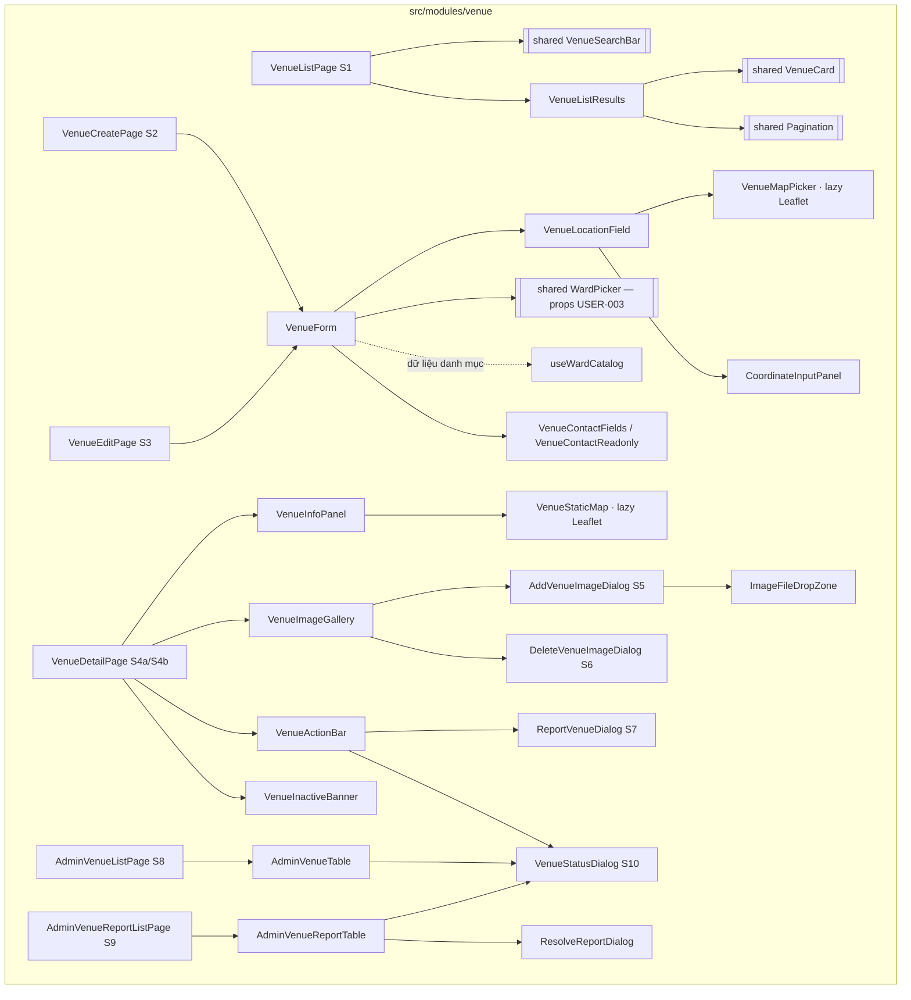

# Component Design — VENUE-001 Quản lý địa điểm sân

| Mục | Giá trị |
|---|---|
| Mã chức năng | `VENUE-001` |
| Phạm vi tầng | frontend (ArenaFlow-fe) |
| Repo/stack | ArenaFlow-fe · React 19 + TypeScript + Tailwind CSS 4 · React Hook Form + Zod (FE ADR-0005, Proposed, nhánh `feature/USER-001-user-team`) · Leaflet (FE ADR-0009, Proposed) |
| Nguồn | `UI_Design.md` (S1–S10) · `docs/agent/upstream/api/VENUE-001/API_Spec.md` §3.1, 2.1, 2.7, 2.12 · `docs/agent/design/SHARED/APP-SHELL/Component_Design.md` · USER-003 `Component_Design.md` §2 (`WardPicker`), §2.3 (`FilterableSelect`) — nhánh `feature/USER-003-lookup`, đang review |
| Căn cứ | `ArenaFlow-spec@53aee11` · API_Spec `v6.2` |
| Quy ước áp dụng | `docs/agent/convention-frontend.md` §2–§4, §6, §10 · `docs/agent/non-functional-standards.md` §4 |
| Tác giả / Ngày / Phiên bản | `solution-architect` (agent) / `2026-11-27` / `v1.2` (baseline `v1.0`; lịch sử: `CHANGELOG.md`) |

> Route / tham số URL: `Screen_Flow.md`. Endpoint, query key, xử lý lỗi: `State_API_Integration.md`.
> Shared component của khung (`Button`, `Dialog`, `ConfirmDialog`, `useToast`, `AlertBanner`, `Skeleton`, `EmptyState`, `ErrorState`, `QueryStateView`, `Pagination`, `Tabs`, `Menu`, `StatusBadge`, `DeletedAccountTag`, `FormField`, `FormErrorBanner`, `SegmentedRadioGroup`, `Icon`) và hook/util (`useUrlParam`, `useDebouncedValue`, `useDocumentTitle`, `vn-datetime`, `isSafeHttpUrl`, `applyServerValidationErrors`, `buildPatchBody`) **tái dùng** từ APP-SHELL Component_Design §3–§5 — không định nghĩa lại.
> Mọi thành phần **mới** dưới đây: chạy `reuse-scan` trước khi tạo (`CLAUDE.md` §8).

## 1. Cây component



`[[…]]` = thành phần ở `src/shared/` hoặc của mã khác.

## 2. Danh sách component

Đường dẫn tương đối `src/modules/venue/` trừ khi ghi `src/shared/`.

| Component | Đường dẫn | Loại | Props chính | Trách nhiệm | Tái dùng / Mới |
|---|---|---|---|---|---|
| `VenueListPage` | `pages/venue-list.page.tsx` | page | — | S1: `useVenueSearchState({ storage: 'url' })` + `useVenueList`; `<h1>` "Địa điểm sân"; nút "+ Thêm địa điểm" | Mới |
| `VenueListResults` | `components/list/venue-list-results.component.tsx` | feature | `page: Page<VenueSummary>`, `onPageChange`, `sortHint` | Lưới thẻ (desktop 3 cột, mobile danh sách) + dòng "Đang sắp xếp theo…" + `Pagination` | Mới |
| `VenueCreatePage` | `pages/venue-create.page.tsx` | page | — | S2: `useCreateVenue`; `returnTo` + `state.createdVenue` (Screen_Flow §3 S2 "Quay lại mã gọi") | Mới |
| `VenueEditPage` | `pages/venue-edit.page.tsx` | page | `context` (route `handle`) | S3: `useVenueDetail` + `useUpdateVenue`; chặn khi `!canEdit` | Mới |
| `VenueForm` | `components/form/venue-form.component.tsx` | feature | `mode: 'create' \| 'edit'`, `defaultValues: VenueFormValues`, `isAdmin`, `requireWard` (edit + `ward = null`), `readonlyContact?: { phone, website }`, `pending`, `onSubmit(values, dirtyFields)`, `onCancel`, `formError?` | Form §4.1 dùng chung S2/S3; nút dính đáy ở mobile | Mới |
| `VenueLocationField` | `components/form/venue-location-field.component.tsx` | feature | `value: LatLng \| null`, `onChange`, `error?` | Bản đồ chọn ghim + "Dùng vị trí hiện tại" (`useGeolocation`) + dòng "Toạ độ: lat, lng" chỉ đọc (`aria-live="polite"`) + nút **"Nhập toạ độ"** (§4.3) | Mới |
| `CoordinateInputPanel` | `components/form/coordinate-input-panel.component.tsx` | feature | `value: LatLng \| null`, `onApply(LatLng)`, `onCancel` | §4.3 — 2 ô số "Vĩ độ", "Kinh độ" + "Áp dụng" / "Huỷ"; mở tại chỗ dưới bản đồ (nút "Nhập toạ độ" có `aria-expanded`, `aria-controls`) | Mới |
| `VenueMapPicker` | `components/map/venue-map-picker.component.tsx` | feature | `value`, `onChange`, `height` | Bọc Leaflet (FE ADR-0009): bấm bản đồ đặt ghim, kéo ghim; nạp động (`React.lazy`) | Mới |
| `VenueStaticMap` | `components/map/venue-static-map.component.tsx` | feature | `lat`, `lng`, `label` | Bản đồ tĩnh có ghim (tắt kéo / zoom cuộn), nạp động | Mới |
| `VenueContactFields` | `components/form/venue-contact-fields.component.tsx` | feature | `register`, `errors` | Admin: ô "Số điện thoại", "Website" + chip "Chỉ quản trị viên" + gợi ý "Để trống và lưu để xoá thông tin" (chỉ mode `edit`) | Mới |
| `VenueContactReadonly` | `components/form/venue-contact-readonly.component.tsx` | feature | `phone`, `website` | S3 người tạo không phải Admin: khối khoá chỉ đọc + "Chỉ quản trị viên được cập nhật số điện thoại và website." (`aria-describedby`). S2 người không phải Admin: chỉ câu ghi chú | Mới |
| `VenueDetailPage` | `pages/venue-detail.page.tsx` | page | `context` | S4a/S4b: `useVenueDetail`; tính `getVenuePermissions`; quản lý dialog đang mở (state cục bộ) | Mới |
| `VenueInactiveBanner` | `components/detail/venue-inactive-banner.component.tsx` | feature | `inactiveSince: string \| null`, `showSince` (Admin) | `AlertBanner tone="warning"` (`role="status"`): "Địa điểm đã ngừng hoạt động" + "Không thể chọn địa điểm này cho kèo mới." (+ "Ngừng hoạt động từ HH:mm dd/MM/yyyy" cho Admin) | Mới |
| `VenueInfoPanel` | `components/detail/venue-info-panel.component.tsx` | feature | `venue: Venue` | Tên (`<h1>`), `VenueStatusBadge`, chip loại sân, địa chỉ, khu vực "<wardName>, <provinceName>" (ẩn khi `ward = null`), SĐT (`tel:`), website (chỉ `href` khi `isSafeHttpUrl`, không thì chữ thường), "Người tạo: …" (ẩn khi `createdByName = null`), "Cập nhật lúc …" (`formatVnDateTime`), `VenueStaticMap` + `VenueDirectionsLink` | Mới |
| `VenueDirectionsLink` | `components/detail/venue-directions-link.component.tsx` | feature | `lat`, `lng` | Link "Chỉ đường" tab mới, `rel="noopener noreferrer"`, URL từ `buildDirectionsUrl` (§6) | Mới |
| `VenueActionBar` | `components/detail/venue-action-bar.component.tsx` | feature | `permissions: VenuePermissions`, `onEdit`, `onReport`, `onReportWrongInfo`, `onChangeStatus`, `onViewReports` | Desktop: nút theo quyền; mobile: thanh dính đáy "Chỉ đường" + thao tác chính ("Sửa" nếu `canEdit`, không thì "Report"), còn lại trong `Menu` "⋯". Nút không có quyền → **ẩn** (không disable) | Mới |
| `VenueImageGallery` | `components/images/venue-image-gallery.component.tsx` | feature | `images: VenueImage[]`, `venueName`, `permissions`, `onAdd`, `onSetPrimary(imageId)`, `onDelete(image)`, `settingPrimaryId?` | Ảnh lớn (ảnh `isPrimary`, nhãn "Ảnh chính") + hàng ảnh nhỏ theo `displayOrder`; bộ đếm "n/5 ảnh"; ô "+ Thêm ảnh" khi `canAddImage`; đủ 5 → "Tối đa 5 ảnh mỗi địa điểm"; 0 ảnh → ô "Chưa có ảnh". Mobile: trượt ngang CSS `scroll-snap` + chấm vị trí (không thêm thư viện). Mỗi ảnh: `Menu` "Đặt làm ảnh chính" / "Xoá ảnh" theo quyền | Mới |
| `AddVenueImageDialog` | `components/images/add-venue-image-dialog.component.tsx` | feature | `open`, `onClose`, `venueId`, `imageCount`, `canAddMore` | S5 — §3.1; dùng `useVenueImageUpload` | Mới |
| `ImageFileDropZone` | `components/images/image-file-drop-zone.component.tsx` | feature | `onFileSelected(file)`, `disabled`, `error?` | `<button>` mở `<input type="file" accept>` ẩn có `label`; kéo-thả desktop; xem trước bằng `URL.createObjectURL` (thu hồi khi đổi file / unmount) | Mới — ứng viên lên `shared/` khi avatar dùng (BE ADR-0009 "dùng lại cho avatar") |
| `DeleteVenueImageDialog` | `components/images/delete-venue-image-dialog.component.tsx` | feature | `image`, `isOnlyPrimaryWithOthers`, `open`, `onClose` | S6 trên `ConfirmDialog tone="danger"` — §3.2 | Mới |
| `ReportVenueDialog` | `components/report/report-venue-dialog.component.tsx` | feature | `open`, `onClose`, `venue`, `initialReason?: VenueReportReason` | S7 — form §4.2 trong `Dialog` | Mới |
| `VenueStatusDialog` | `components/admin/venue-status-dialog.component.tsx` | feature | `open`, `onClose`, `venue: { venueId, venueName, status }`, `onDone?` | S10 trên `ConfirmDialog`: `ACTIVE` → nội dung "Ngừng hoạt động" (tone `danger`), `INACTIVE` → "Kích hoạt lại" (tone `primary`); không có ô lý do | Mới |
| `AdminVenueListPage` | `pages/admin-venue-list.page.tsx` | page | — | S8: `Tabs` trạng thái + ô tìm + `AdminVenueTable` + `Pagination` | Mới |
| `AdminVenueTable` | `components/admin/admin-venue-table.component.tsx` | feature | `items: VenueSummary[]`, `onChangeStatus(item)` | Desktop `<table>` (`<th scope="col">`): Địa điểm [ảnh nhỏ + tên] · Địa chỉ · Loại sân · Trạng thái · Lần được chọn gần nhất (`formatVnDateTime`, `null` → "Chưa được chọn") · Thao tác; mobile thẻ. Nút có `aria-label` kèm tên địa điểm | Mới |
| `AdminVenueReportListPage` | `pages/admin-venue-report-list.page.tsx` | page | — | S9: `Tabs` trạng thái report, chip lọc địa điểm, ghi chú dưới tab, `AdminVenueReportTable`, `Pagination` | Mới |
| `AdminVenueReportTable` | `components/admin/admin-venue-report-table.component.tsx` | feature | `items: AdminVenueReport[]`, `onResolve(item, status)`, `onDeactivate(item)` | Cột theo UI S9; người report / người xử lý đã xoá → tên thật + `DeletedAccountTag` (theo cờ `isReporterDeleted` / `isHandledByDeleted`); chi tiết dài cắt 2 dòng + "Xem thêm" (`aria-expanded`); report đã chốt → "Xử lý bởi <tên> lúc …"; nút chỉ cho `PENDING`; "Ngừng hoạt động địa điểm" chỉ khi `venueStatus = ACTIVE` | Mới |
| `ResolveReportDialog` | `components/admin/resolve-report-dialog.component.tsx` | feature | `report`, `targetStatus: 'VERIFIED' \| 'REJECTED'`, `open`, `onClose` | `ConfirmDialog` ngắn "Xác nhận report đúng?" / "Từ chối report?" | Mới |
| `VenueStatusBadge` | `components/common/venue-status-badge.component.tsx` | feature | `status` | `StatusBadge`: `ACTIVE` → "Đang hoạt động" (`success`); `INACTIVE` → "Ngừng hoạt động" (`neutral`) | Mới |
| `VenueReportStatusBadge` | `components/common/venue-report-status-badge.component.tsx` | feature | `status` | `PENDING` "Chờ xử lý" (`warning`) · `VERIFIED` "Đã xác nhận" (`success`) · `REJECTED` "Đã từ chối" (`neutral`) | Mới |
| `VenueCard` | `src/shared/components/venue-search/venue-card.component.tsx` | ui | §7.2 | Thẻ địa điểm thuần trình bày | Mới (shared) |
| `VenueSearchBar` | `src/shared/components/venue-search/venue-search-bar.component.tsx` | ui | §7.2 | Ô tìm + "Gần tôi" + bán kính + banner quyền vị trí | Mới (shared) |
| `WardPicker` | `src/shared/components/ward-picker/ward-picker.component.tsx` | ui | APP-SHELL Component_Design §3.1 (cách dùng: §7.3) | Nhóm "Khu vực" (`<fieldset>`): 2 `FilterableSelect` (USER-003 §2.3) Tỉnh/thành → Phường/xã; **thuần trình bày** — danh mục do module cấp qua props | Tái dùng — USER-003 thiết kế; chuyển lên `shared/` theo quyết định coordinator 2026-11-27 (`[cần xác nhận]` #2) |

## 3. Dialog

### 3.1. S5 — `AddVenueImageDialog`
| Trạng thái hook (`useVenueImageUpload`, State_API_Integration §4.2) | Hiển thị |
|---|---|
| `idle` | Bộ đếm "Địa điểm đang có n/5 ảnh"; `ImageFileDropZone` "Chọn ảnh JPG, PNG hoặc WEBP"; nút "Tải ảnh lên" disable tới khi có file hợp lệ |
| file chọn sai định dạng / quá dung lượng | Lỗi dưới vùng chọn (`role="alert"`): "Chỉ nhận ảnh JPG, JPEG, PNG hoặc WEBP" / "Ảnh tối đa 10 MB" `[cần xác nhận]` #4 |
| có file | Xem trước + ô "Đặt làm ảnh chính"; `imageCount = 0` → tích sẵn, `disabled`, chú thích "Ảnh đầu tiên sẽ là ảnh chính" |
| `signing` / `uploading` / `saving` | `role="progressbar"` (`aria-valuenow` khi `uploading`, không xác định ở hai bước còn lại), nhãn "Đang tải ảnh lên…"; nút khoá; `Dialog dismissible={false}` |
| `error` | `AlertBanner` theo mã (State_API_Integration §5.3) + nút "Thử lại" (`retry()`); "Huỷ" bật lại |
| `success` | Đóng dialog, toast "Ảnh đã được thêm" |

### 3.2. S6 — `DeleteVenueImageDialog`
- `ConfirmDialog tone="danger"`: ảnh thu nhỏ (`alt` "Ảnh n của <tên sân>"), tiêu đề "Xoá ảnh này?", "Ảnh bị xoá không khôi phục được."; ảnh chính và còn ảnh khác → thêm "Đây là ảnh chính — ảnh đứng đầu còn lại sẽ thành ảnh chính."; nút "Xoá ảnh" `pending` khi đang xoá; focus mặc định "Huỷ" (sẵn trong `ConfirmDialog`).

### 3.3. S7 — `ReportVenueDialog`
- `Dialog` tiêu đề "Report địa điểm <tên>"; form §4.2; dòng "Quản trị viên sẽ xác minh. Địa điểm không bị ẩn cho tới khi được xác minh."; lỗi `409 VENUE_014` hiện `AlertBanner` **trong** dialog, giữ dialog mở (đổi lý do vẫn gửi được).

### 3.4. S10 — `VenueStatusDialog`
- Nội dung theo UI S10 (liệt kê 4 hệ quả khi ngừng hoạt động / 1 câu khi kích hoạt lại). Lỗi `409 VENUE_011` → `error` của `ConfirmDialog`, giữ mở để thử lại; mã khác → đóng + toast (State_API_Integration §5.5).

## 4. Form & validation

### 4.1. Form địa điểm (S2, S3) — `venue-form.schema.ts`
Schema dựng theo vai trò: `createVenueFormSchema({ isAdmin, requireWard })`. Câu lỗi do FE chọn theo field (APP-SHELL Component_Design §4).

| Trường form | Điều khiển | Validation client | Map BE (API_Spec) | Lỗi BE → hiển thị |
|---|---|---|---|---|
| `venueName` | `input` + bộ đếm `n/200` | trim; bắt buộc "Tên không được để trống"; ≤ 200 "Tên tối đa 200 ký tự" | 2.1/2.12 `venueName` (BR-V01) | `VALIDATION_ERROR` field `venueName` |
| `address` | `textarea` + bộ đếm `n/500` | trim; bắt buộc "Địa chỉ không được để trống"; ≤ 500 "Địa chỉ tối đa 500 ký tự" | `address` (API #5) | field `address` |
| `provinceId` | `WardPicker` (`provinceId`, `onProvinceChange`) qua `Controller` — field **chỉ UI, không gửi** | UUID \| `null`; mặc định `venue.ward?.provinceId ?? null` | — (USER-003 2.2 path) | `404 USER_004` (danh mục) → `provinceError` "Không tìm thấy tỉnh/thành", `provinceId`/`wardId` → `null` (State_API_Integration §5.2) |
| `wardId` | `WardPicker` (`wardId`, `onWardChange`, `wardError`) qua `Controller` | UUID \| `null`; mặc định `venue.ward?.wardId ?? null`; bắt buộc khi `create` hoặc `requireWard`: "Vui lòng chọn phường/xã". Đổi tỉnh → `setValue('wardId', null, { shouldDirty: true })`. `onClear` ("Bỏ chọn") → `resetField('provinceId')` + `resetField('wardId')` — ở `edit` đã có phường thì về phường ban đầu (không xoá được phường — API_Spec 2.12) | `wardId` (BR-V11) | `400 USER_002` → "Khu vực không hợp lệ"; `422 VENUE_016` → "Vui lòng chọn phường/xã"; field `wardId` |
| `location` (`{ latitude, longitude }`) | `VenueLocationField` qua `Controller` (bản đồ / vị trí hiện tại / "Nhập toạ độ" §4.3) | bắt buộc "Vui lòng chọn vị trí trên bản đồ hoặc nhập toạ độ"; lat −90..90, lng −180..180; **làm tròn 7 chữ số thập phân** trước khi đưa vào form | `latitude`, `longitude` | field `latitude` / `longitude` → lỗi dưới `location` (`fieldMap`) |
| `venueType` | `SegmentedRadioGroup` "Sân 5 / Sân 7 / Sân 11 / Không chọn" | `'' \| VenueType` | `venueType` (BR-V05) | field `venueType` |
| `phone` (chỉ Admin) | `input type="tel"` | `''` hoặc `^0[0-9]{9,10}$` "Số điện thoại không hợp lệ" | `phone` (BR-V12, API #5) | field `phone`; `403 VENUE_017` → `FormErrorBanner` |
| `website` (chỉ Admin) | `input type="url"` | `''` hoặc bắt đầu `http://` / `https://` và `URL` parse được: "Website phải bắt đầu bằng http:// hoặc https://"; ≤ 500 | `website` | field `website` |

- **Dựng body:** `buildCreateVenueBody(values, isAdmin)` / `buildUpdateVenueBody(values, dirtyFields, { isAdmin, requireWard })` — `utils/venue-request.util.ts`; quy tắc ở State_API_Integration §2.2. Người không phải Admin: **không bao giờ** có key `phone` / `website` trong body.
- **Lỗi field từ BE:** `applyServerValidationErrors(setError, err, { latitude: 'location', longitude: 'location' })`; field không map → `FormErrorBanner`.
- **Chống double-submit:** nút submit `loading = mutation.isPending` (APP-SHELL §4). S3: nút "Lưu thay đổi" chỉ bật khi `isDirty` hoặc `requireWard`.
- **Giá trị ban đầu S3:** từ `Venue` (`ward?.provinceId`, `ward?.wardId`, `initialWard = venue.ward`, `venueType ?? ''`, `phone ?? ''`, `website ?? ''`). S2: `provinceId` / `wardId` = `null`, `initialWard = null`.
- Sau submit lỗi → focus ô lỗi đầu tiên (`shouldFocusError`).

### 4.2. Form report (S7) — `report-venue.schema.ts`

| Trường | Điều khiển | Validation client | Map BE | Hiển thị lỗi |
|---|---|---|---|---|
| `reason` | `SegmentedRadioGroup` trong `fieldset`, `legend` "Lý do *": "Sân đã ngừng hoạt động" (`CLOSED`), "Thông tin sai" (`WRONG_INFO`), "Khác" (`OTHER`) | bắt buộc "Vui lòng chọn lý do" | 2.7 `reason` | field `reason` |
| `detail` | `textarea` "Chi tiết" + bộ đếm `n/1000` | trim; ≤ 1000 "Chi tiết tối đa 1000 ký tự"; rỗng → bỏ khỏi body | 2.7 `detail` (API #5) | field `detail` |

- Nhãn lý do: `VENUE_REPORT_REASON_LABELS` — `constants/venue-report-reason.constant.ts` (dùng cả S9).

### 4.3. Nhập toạ độ bằng bàn phím — `CoordinateInputPanel`
Bắt buộc theo `non-functional-standards.md` §4 (thao tác chính dùng được bằng bàn phím): toạ độ là trường bắt buộc mà ghim bản đồ chỉ đặt được bằng chuột / chạm.

| Ô | Điều khiển | Validation client | Map BE |
|---|---|---|---|
| "Vĩ độ" | `input type="text" inputMode="decimal"` trong `FormField` | bắt buộc; số thập phân (nhận `,` hoặc `.`); −90..90; > 7 chữ số thập phân → làm tròn 7 | `latitude` (2.1, 2.12) |
| "Kinh độ" | như trên | bắt buộc; −180..180; làm tròn 7 chữ số thập phân | `longitude` |

- Nút "Nhập toạ độ" (Tab tới được) mở panel tại chỗ; điền sẵn toạ độ hiện tại nếu có. "Áp dụng" → validate 2 ô → `onChange(location)` của `VenueLocationField` → ghim bản đồ nhảy tới toạ độ mới. Esc / "Huỷ" đóng, trả focus về nút "Nhập toạ độ".
- Lỗi dưới từng ô (`aria-describedby`): "Vĩ độ phải từ -90 đến 90", "Kinh độ phải từ -180 đến 180", "Nhập số hợp lệ" — câu chữ `[cần xác nhận]` #6 (không chặn).
- Không lồng `<form>`: panel nằm trong `VenueForm`, "Áp dụng" là `type="button"`; 2 ô là state cục bộ, chỉ `location` vào form.
- Lệch mockup S2/S3 (thêm nút + panel) là yêu cầu a11y — không chờ duyệt UI.

## 5. Quyền hiển thị — `utils/venue-permissions.util.ts`

`getVenuePermissions(venue, session) → VenuePermissions`; map 1-1 API_Spec §3.1 (người tạo là Admin → tính theo Admin):

```ts
const isAdmin = session.role === 'ADMIN'
const isCreator = venue.createdById !== null && venue.createdById === session.userId
const active = venue.status === 'ACTIVE'
// canEdit = canDeleteImage = isAdmin || (isCreator && active)
// canSetPrimary = isAdmin || active
// canAddImage = (isAdmin || active) && venue.images.length < 5
// canReport = !isAdmin && active
// showReportWrongInfoHint = !isAdmin && !isCreator && active   (UC-V05 1a1)
// canMarkInactive = isAdmin && active · canReactivate = isAdmin && !active · canViewReports = isAdmin
```

- Hàm thuần, test bảng đủ 6 cột của API_Spec §3.1. Không dùng ở S8/S9 (màn admin đã có `RoleGuard`; nút theo `status` của dòng).

## 6. Hook / util riêng của module

| Tên | Đường dẫn | Mục đích |
|---|---|---|
| `useVenueList`, `useVenueDetail`, `useAdminVenueList`, `useAdminVenueReports` | `hooks/…hook.ts` | Query (State_API_Integration §3) |
| `useCreateVenue`, `useUpdateVenue`, `useSetPrimaryVenueImage`, `useDeleteVenueImage`, `useReportVenue`, `useChangeVenueStatus`, `useResolveVenueReport` | `hooks/…hook.ts` | Mutation + cập nhật cache (State_API_Integration §3.2) |
| `useVenueImageUpload` | `hooks/use-venue-image-upload.hook.ts` | Máy trạng thái 3 bước upload ảnh (State_API_Integration §4.2) |
| `useWardCatalog(provinceId, { onProvinceNotFound })` | `hooks/use-ward-catalog.hook.ts` | Cấp `provinceCatalog` / `wardCatalog` cho `WardPicker`; query danh mục chỉ bật khi mở ô (State_API_Integration §3, §5.2) |
| `getVenuePermissions` | `utils/venue-permissions.util.ts` | §5 |
| `buildCreateVenueBody`, `buildUpdateVenueBody` | `utils/venue-request.util.ts` | §4.1 |
| `buildDirectionsUrl(lat, lng)` | `utils/directions-url.util.ts` | URL "Chỉ đường" — `https://www.google.com/maps/dir/?api=1&destination=<lat>,<lng>` `[cần xác nhận]` #1 |
| `VENUE_REPORT_REASON_LABELS`, `VENUE_RADIUS_OPTIONS_KM = [1, 3, 5, 10, 20, 50]`, `VENUE_RADIUS_DEFAULT_KM = 5`, `VENUE_IMAGE_MAX_COUNT = 5`, `VENUE_IMAGE_MAX_BYTES`, `VENUE_IMAGE_ACCEPT` | `constants/*.constant.ts` | Hằng (bán kính trong miền API 0.1..50 — UI_Design §4 #5) |
| `venueKeys`, `adminVenueKeys`, `adminVenueReportKeys` | `constants/venue-query-keys.constant.ts` | State_API_Integration §3.1 |
| `invalidateVenueLists` | `utils/venue-cache.util.ts` | State_API_Integration §3.2 |
| `VENUE_NAV_ITEMS`, `VENUE_ADMIN_NAV_ITEMS` | `constants/venue-nav.constant.ts` | Screen_Flow §1 |
| `venueRoutes: AppRouteGroups` | `routes/venue.routes.tsx` | Screen_Flow §1 |
| README module | `README.md` | Mục đích, UC-V01..V07, quy tắc chính (`convention-frontend.md` §2) |

## 7. Thành phần cho MATCH-001 / MERCENARY-001 tái dùng (bộ chọn sân)

### 7.1. Ràng buộc và cách làm
- `convention-frontend.md` §2: module **không** import module khác; dùng ≥ 2 module → `shared/`; `shared/` **không** gọi endpoint, không nghiệp vụ.
- **Căn cứ đặt ở `shared/` (Reuse Report):** UI_Design VENUE-001 §3 ghi *Thẻ địa điểm* và *Ô tìm địa điểm + "Gần tôi" + bán kính* "dùng ở S1; dự kiến MATCH-001 / MERCENARY-001 tái dùng" cho bộ chọn sân; MERCENARY-001 UI_Design (trường "Sân" tìm từ danh sách địa điểm) xác nhận nhu cầu ở module thứ hai → ≥ 2 module. Căn cứ này áp cho **mọi** dòng bảng dưới, gồm type `VenueSearchParams`, hằng `VENUE_TYPE_LABELS`, hook `useVenueSearchState` (bộ chọn sân cần để dựng tham số gọi 2.2 và nhãn loại sân). VENUE-001 tạo **thẳng ở `shared/`** (không tạo trong module rồi chuyển sau), dạng thuần trình bày / thuần trạng thái giao diện; vẫn chạy `reuse-scan` trước khi tạo:

| Thành phần | Đường dẫn | Ghi chú |
|---|---|---|
| `VenueCard` | `src/shared/components/venue-search/venue-card.component.tsx` | §7.2 |
| `VenueSearchBar` | `src/shared/components/venue-search/venue-search-bar.component.tsx` | §7.2 |
| `useGeolocation` | `src/shared/hooks/use-geolocation.hook.ts` | Bọc `navigator.geolocation.getCurrentPosition` (`timeout` 10 s, `maximumAge` 5 phút, không `enableHighAccuracy`); trạng thái `idle \| locating \| granted \| denied \| unavailable \| timeout`; toạ độ chỉ giữ trong bộ nhớ |
| `useVenueSearchState` | `src/shared/hooks/use-venue-search-state.hook.ts` | `({ storage: 'url' \| 'memory' })` — `url`: đọc/ghi search param qua `useUrlParam` (S1); `memory`: `useState` trong component, mất khi unmount (bộ chọn sân trong dialog) → `query`, `nearMe`, `radiusKm`, `page`, `geolocation`, và `params: VenueSearchParams \| null` (`null` khi "Gần tôi" bật mà chưa có toạ độ → query `enabled: false`). Debounce 300 ms; toạ độ làm tròn 4 chữ số thập phân |
| `VenueSearchParams` | `src/shared/types/venue-search.type.ts` | `{ q?, lat?, lng?, radiusKm?, page, pageSize }` — đúng tên query của API_Spec 2.2 |
| `VENUE_TYPE_LABELS`, type `VenueType` | `src/shared/constants/venue-type.constant.ts` | `FIVE_A_SIDE` "Sân 5" · `SEVEN_A_SIDE` "Sân 7" · `ELEVEN_A_SIDE` "Sân 11" (API_Spec §4.1) |
| `formatDistanceKm(km)` | `src/shared/utils/format-distance.util.ts` | `1.24` → `"1,24 km"` (`Intl.NumberFormat('vi-VN')`, tối đa 2 chữ số thập phân) |
| `isSafeInternalPath(path)` | `src/shared/utils/safe-internal-path.util.ts` | `true` khi chuỗi bắt đầu `/` và không bắt đầu `//` hoặc `/\` — chống open redirect cho `returnTo` (Screen_Flow §3 S2). Logic chung, không nghiệp vụ → `shared/` ngay |
| `venuePickerKey(params)` | `src/shared/constants/venue-picker-query-key.constant.ts` | `[QUERY_ROOTS.venue, 'picker', params]` — key dùng chung của bộ chọn sân MATCH-001 / MERCENARY-001 (MATCH-001 Screen_Flow §6 C3, C12). VENUE-001 **không** dùng (S1 dùng `venueKeys.list`); mã code trước tạo (`reuse-scan`) |
| `CreatedVenueNavState` | `src/shared/types/created-venue-nav-state.type.ts` | `{ createdVenue: { venueId: string; name: string; address: string } }` — `location.state` S2 trả về màn gọi (Screen_Flow §3 S2) |

- **Phần gọi API ở lại module của từng mã.** MATCH-001 (`searchPickerVenues`) / MERCENARY-001 (`searchVenuesForPicker`) tự khai hàm gọi `GET /api/v1/venues` (API_Spec 2.2) trong `modules/<domain>/api/`, dưới `venuePickerKey`. **Hợp đồng key dùng chung:** `queryFn` dưới `venuePickerKey` trả **nguyên** `Page` của 2.2 (không map / lọc / đổi tên field); cần tập con → `select` — mọi module đọc cùng dạng cache; kiểm ở `code-reviewer`. Key nằm dưới gốc `QUERY_ROOTS.venue` nên `invalidateVenueLists` của VENUE-001 (State_API_Integration §3.2) làm mới luôn bộ chọn sau khi thêm / sửa / đổi trạng thái địa điểm. Type item khai tối thiểu trong module dùng, trỏ API_Spec §4.3.
- Lối tắt "Chưa có sân? Thêm địa điểm" → `ROUTE_PATHS.venueNew` + `returnTo` → quay lại với `state.createdVenue` (Screen_Flow §3 S2). Xem địa điểm đã chọn → `buildVenueDetailPath`.
- Cùng mẫu với `WardPicker` (§7.3, quyết định coordinator 2026-11-27): UI ở `shared/`, mỗi module tự gọi API, **dùng chung gốc query key**. Cơ chế khác (slot registry qua `app/`) cần ADR mới — `[cần xác nhận]` #3.

### 7.2. Props
```ts
/** Thẻ địa điểm thuần trình bày, dùng ở danh sách và bộ chọn sân. */
interface VenueCardProps {
  /** Tên sân; làm nhãn link và `alt` ảnh. */
  name: string
  /** Địa chỉ một dòng (cắt 2 dòng khi dài). */
  address: string
  /** URL ảnh chính; null hoặc không phải http(s) → ô "Chưa có ảnh". */
  imageUrl: string | null
  /** Nhãn loại sân đã dịch ("Sân 7"); null → không hiện chip (tối đa 1 chip). */
  typeLabel: string | null
  /** Khoảng cách km; null → ẩn. Hiển thị qua formatDistanceKm. */
  distanceKm: number | null
  /** 'grid' thẻ dọc · 'row' thẻ ngang ảnh 88px · 'responsive' = row dưới md, grid từ md. */
  variant: 'grid' | 'row' | 'responsive'
  /** Đích khi bấm cả thẻ (render <Link>); bỏ trống khi dùng `action`. */
  to?: string
  /** Vùng thao tác bên phải, vd nút "Chọn" của bộ chọn sân. */
  action?: ReactNode
}

/** Ô tìm địa điểm + "Gần tôi" + bán kính + banner quyền vị trí. */
interface VenueSearchBarProps {
  /** Giá trị ô tìm (chưa debounce). */
  query: string
  onQueryChange: (q: string) => void
  /** Nhãn ô tìm; mặc định "Tìm theo tên hoặc địa chỉ sân". */
  searchLabel?: string
  nearMe: boolean
  onNearMeChange: (on: boolean) => void
  radiusKm: number
  /** Các mốc bán kính (km) cho ô chọn; ô chọn disable khi `nearMe = false`. */
  radiusOptions: readonly number[]
  onRadiusChange: (km: number) => void
  /** Trạng thái vị trí từ useGeolocation; denied/unavailable/timeout → banner "Bật quyền vị trí để tìm sân gần bạn". */
  locationStatus: GeolocationStatus
  /** Bấm "Bật vị trí" trên banner. */
  onRequestLocation: () => void
}
```

### 7.3. `WardPicker` (shared) — cách VENUE-001 dùng
- **Định nghĩa props + type (`CatalogSelectData`, `WardSelection`, `WardPickerProps`):** APP-SHELL Component_Design §3.1 (v1.1) — **trỏ**, không định nghĩa lại. Type ở `src/shared/types/region.type.ts`.
- VENUE-001 truyền: `initialWard = venue.ward` (S3; `ward` của API_Spec §4.2 khớp `WardSelection`) / `null` (S2); `provinceCatalog` / `wardCatalog` từ `useWardCatalog` (module venue); `onClear` tuỳ chọn — chỉ truyền ở S2 và ở S3 khi đã có phường (về giá trị ban đầu, §4.1).
- Dùng chung `catalogKeys` dưới gốc `QUERY_ROOTS.catalog` (APP-SHELL §5; State_API_Integration §3.1) với hook `useRegionCatalog` của module `account` → một cache danh mục.
- **Phụ thuộc:** component `WardPicker` (+ `FilterableSelect`) tạo theo SHARED §3.1 ở mã code trước (USER-003 hoặc VENUE-001) — chạy `reuse-scan`, không tạo bản thứ hai.

## 8. A11y
- Mỗi page một `<h1>` (S4: tên sân). Thẻ địa điểm là một `<a>` có tên sân; ảnh có `alt` = tên sân; khoảng cách có chữ "km".
- "Gần tôi" là `<button aria-pressed>`; bán kính là `<select>` có `label`.
- Bản đồ: container có `role="application"` + `aria-label` "Bản đồ chọn vị trí sân"; phương án bàn phím đầy đủ: "Nhập toạ độ" (§4.3) + "Dùng vị trí hiện tại" + dòng toạ độ dạng chữ; bản đồ tĩnh `aria-hidden` kèm địa chỉ dạng chữ bên cạnh.
- Menu thao tác trên ảnh: `Menu` (APP-SHELL) có `aria-label` "Thao tác ảnh n trên m"; nút xoá `aria-label` kèm số thứ tự ảnh.
- Badge trạng thái luôn có chữ. Bảng admin có `<th scope>`; tab lọc là `Tabs` (`tablist`).
- Dialog: focus trap, Esc đóng khi không đang gửi, trả focus về nút mở (shared `Dialog`).

## 9. `[cần xác nhận]`
> **Chặn code?** *Có* = developer không code phần liên quan tới khi chốt · *Không* = code theo phương án đề xuất, đổi sau nếu user chọn khác.

| # | Nội dung | Chặn code? |
|---|---|---|
| 1 | **Bản đồ (FE ADR-0009 Proposed):** nhà cung cấp tile production (dev dùng OSM); tâm mặc định khi chưa có toạ độ (đề xuất toàn Việt Nam, zoom 5); "Chỉ đường" dùng Google Maps URL không cần khoá (UI_Design §4 #2) | **Có** với phát hành production (tile); **Không** với code / dev (tile cấu hình qua biến môi trường) |
| 2 | **`WardPicker` lên `shared/`**: đã áp ở SHARED v1.2 (APP-SHELL Component_Design §3.1 props; gốc key `catalog` — APP-SHELL §4–§5) | **Có** với ô khu vực S2/S3 chỉ tới khi nhánh SHARED (`feature/USER-001-user-team`) merge và FE ADR liên quan được duyệt; phần còn lại không bị chặn |
| 3 | **Cơ chế chia sẻ thành phần có gọi API giữa module** — baseline §7.1, §7.3; slot registry cần ADR mới | **Không** với VENUE-001; chốt trước khi MATCH-001 thiết kế bộ chọn sân |
| 4 | **Dung lượng ảnh tối đa** 10 MB (UI_Design §4 #3, API_Spec #19, FE ADR-0016) | **Không** (một hằng) |
| 5 | **Nhãn người dùng đã xoá ở S9:** `DeletedAccountTag` của APP-SHELL ("Đã xoá tài khoản") thay "(đã xoá)" của UI | **Không** |
| 6 | **Câu chữ chưa có trong SRS/UI:** toast đổi ảnh chính ("Đã đổi ảnh chính"), chốt report ("Đã xác nhận report" / "Đã từ chối report"), ngừng / kích hoạt lại ("Đã đánh dấu ngừng hoạt động" / "Đã kích hoạt lại địa điểm"), sau report ("Đã gửi report. Cảm ơn bạn!" — UI_Design §4 #7), lỗi độ dài địa chỉ / chi tiết (API_Spec #5), lỗi ô nhập toạ độ (§4.3) | **Không** |
