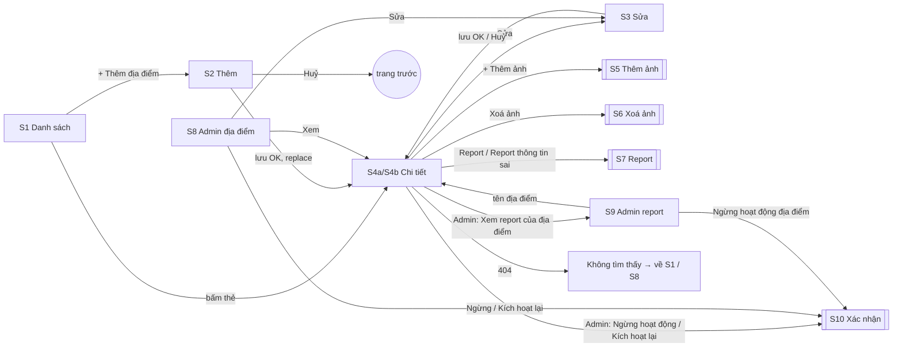

# Screen Flow — VENUE-001 Quản lý địa điểm sân

| Mục | Giá trị |
|---|---|
| Mã chức năng | `VENUE-001` |
| Phạm vi tầng | frontend (ArenaFlow-fe) — backend: ngoài phạm vi repo này (API_Spec BE) |
| Repo/stack | ArenaFlow-fe · React 19 + TypeScript + Vite · React Router (FE ADR-0003, Proposed, nhánh `feature/USER-001-user-team`) |
| Nguồn SRS/UI/API | `docs/agent/upstream/business-spec/SYSTEM-001/` (UC-V01..V07, BR-V01..V13, Business_Rules §2.6, §5.1, §5.4) · `UI_Design.md` (S1–S10) · `docs/agent/upstream/api/VENUE-001/API_Spec.md` · USER-003 `API_Spec.md` §2.1–§2.2 (danh mục khu vực) |
| Căn cứ | `ArenaFlow-spec@53aee11` · API_Spec `v6.2` (USER-003 `v2.0`, SYSTEM-002 `v1.2`) |
| Khung dùng chung | `docs/agent/design/SHARED/APP-SHELL/` (nhánh `feature/USER-001-user-team`, đang review) — route registry, guard, layout, `ROUTE_PATHS`, `useUrlParam` **trỏ**, không định nghĩa lại |
| Quy ước áp dụng | `docs/agent/design-standards.md`, `docs/agent/convention-frontend.md`, `docs/agent/security-frontend.md` |
| Tác giả / Ngày / Phiên bản | `solution-architect` (agent) / `2026-11-27` / `v1.2` (baseline `v1.0`; lịch sử: `CHANGELOG.md`) |

> Ba file: `Screen_Flow.md` (file này — route, quyền, điều hướng, tham số URL) · `Component_Design.md` (cây component, form, quyền hiển thị nút) · `State_API_Integration.md` (endpoint, query key, cache, lỗi, số API call).
> Module FE: `src/modules/venue/`. Route khai trong `src/modules/venue/routes/venue.routes.tsx` theo `AppRouteGroups` (APP-SHELL Screen_Flow §1.1).

## 1. Danh sách màn hình

| # (UI_Design) | Màn hình | Route (`ROUTE_PATHS.*`) | Nhóm route / layout | Use case (SRS) |
|---|---|---|---|---|
| S1 | Danh sách / tìm địa điểm | `/venues` (`venues`) | `authenticated` · `MainLayout` | BR-V13, AC-V06 |
| S2 | Thêm địa điểm | `/venues/new` (`venueNew`) | `authenticated` · `MainLayout` | UC-V01 |
| S3 | Sửa địa điểm | `/venues/:venueId/edit` (`venueEdit`) · `/admin/venues/:venueId/edit` (`adminVenueEdit`) | `authenticated` · `MainLayout` / `admin` · `AdminLayout` | UC-V05 |
| S4a / S4b | Chi tiết địa điểm (đang / ngừng hoạt động) | `/venues/:venueId` (`venueDetail`) · `/admin/venues/:venueId` (`adminVenueDetail`) | như S3 | UC-V02, V03, V05 1a, V06; §2.6 |
| S5 | Thêm ảnh sân | Dialog trên S4 (không route) | — | UC-V02 |
| S6 | Xoá ảnh | Dialog trên S4 | — | UC-V06 |
| S7 | Report địa điểm | Dialog trên S4 | — | UC-V03 |
| S8 | Admin — danh sách địa điểm | `/admin/venues` (`adminVenues`) | `admin` · `AdminLayout` | UC-V07 |
| S9 | Admin — report địa điểm | `/admin/venue-reports` (`adminVenueReports`) | `admin` · `AdminLayout` | UC-V04 bước 1–2 |
| S10 | Admin — ngừng hoạt động / kích hoạt lại | Dialog trên S4 (admin), S8, S9 | — | UC-V04 bước 3–6, UC-V07 bước 4 |

**Thêm vào `src/shared/constants/route-paths.constant.ts`** (PR của VENUE-001):

| Tên | Giá trị | Hàm dựng URL |
|---|---|---|
| `venues` | `/venues` | — |
| `venueNew` | `/venues/new` | — |
| `venueDetail` | `/venues/:venueId` | `buildVenueDetailPath(venueId)` |
| `venueEdit` | `/venues/:venueId/edit` | `buildVenueEditPath(venueId)` |
| `adminVenues` | `/admin/venues` | — |
| `adminVenueDetail` | `/admin/venues/:venueId` | `buildAdminVenueDetailPath(venueId)` |
| `adminVenueEdit` | `/admin/venues/:venueId/edit` | `buildAdminVenueEditPath(venueId)` |
| `adminVenueReports` | `/admin/venue-reports` | `buildAdminVenueReportsPath({ venueId?, status? })` |

- Mã khác (MATCH-001, MERCENARY-001) mở chi tiết địa điểm bằng `buildVenueDetailPath(venueId)` — xem được cả địa điểm `INACTIVE` (S4b, API_Spec 2.3).
- S3, S4 khai **hai** route (người dùng / quản trị) trỏ cùng một page; page nhận `context: 'user' | 'admin'` qua `handle` của route để chọn đích "← quay lại" và đích sau khi lưu. Quyền hiển thị nút **không** phụ thuộc context mà theo `role` + `createdById` (Component_Design §5) — Admin mở S4 từ S1 vẫn thấy thao tác Admin, trong `MainLayout` `[cần xác nhận]` #2.

**Mục điều hướng** (`src/modules/venue/constants/venue-nav.constant.ts`, APP-SHELL Screen_Flow §3):

| Hằng | Mục | Đích | Vai trò |
|---|---|---|---|
| `VENUE_NAV_ITEMS` | "Địa điểm" | `ROUTE_PATHS.venues` | mọi người đã đăng nhập — `[cần xác nhận]` #1 |
| `VENUE_ADMIN_NAV_ITEMS` | "Địa điểm", "Report địa điểm" | `adminVenues`, `adminVenueReports` | `ADMIN` (`adminNavItems` của `AdminLayout`) |

## 2. Luồng điều hướng

## 3. Chi tiết từng màn hình

### S1 — Danh sách / tìm địa điểm
- **Vào từ:** mục "Địa điểm" trên header; link từ mã khác. **Ra tới:** S4 (`buildVenueDetailPath`), S2.
- **Thao tác:** ô tìm (debounce 300 ms, ≤ 100 ký tự); nút "Gần tôi" (`aria-pressed`) xin quyền vị trí trình duyệt; chọn bán kính (chỉ bật khi "Gần tôi" bật); phân trang.
- **Trạng thái:** đang xin vị trí → skeleton; loading → skeleton 6 thẻ (mobile 4); empty → `EmptyState` + "+ Thêm địa điểm"; từ chối / không có vị trí → banner "Bật quyền vị trí để tìm sân gần bạn", "Gần tôi" về tắt; error → `ErrorState` + Thử lại.
- **Tham số URL:**

  | Tham số | Giá trị | Mặc định / sai giá trị | Ghi |
  |---|---|---|---|
  | `q` | chuỗi ≤ 100 | rỗng → bỏ | `replace`, reset `page` |
  | `near` | `1` | vắng = tắt | `replace`, reset `page` |
  | `radius` | `1` `3` `5` `10` `20` `50` | `5` | chỉ đọc khi `near=1` |
  | `page` | ≥ 1 | `1` | `push` |

- **Toạ độ người dùng KHÔNG đặt lên URL** (vị trí là dữ liệu cá nhân — `security-frontend.md` §4; APP-SHELL Screen_Flow §1.3). Mở lại URL có `near=1` → tự xin lại vị trí.

### S2 — Thêm địa điểm
- **Vào từ:** S1, empty state S1, link "Thêm địa điểm" của mã khác kèm `returnTo` ("Quay lại mã gọi" dưới đây). **Ra tới:** thành công → toast "Địa điểm đã được thêm" → không có `returnTo` hợp lệ: `navigate(buildVenueDetailPath(id), { replace: true })`; có: `navigate(returnTo, { replace: true, state })`; Huỷ → `navigate(-1)` (không có lịch sử → `returnTo` nếu hợp lệ, không thì S1).
- **Thao tác:** form (Component_Design §4.1); bản đồ / "Dùng vị trí hiện tại" / "Nhập toạ độ" (Component_Design §4.3); Admin thấy nhóm "Thông tin liên hệ".
- **Trạng thái:** danh mục tỉnh/thành, phường/xã chỉ tải khi mở ô (loading / lỗi + Thử lại hiện trong ô — `WardPicker`, không chặn form); đang lưu → nút "Đang lưu…" khoá; lỗi field → dưới ô; lỗi chung → `FormErrorBanner`, giữ dữ liệu.
- **Tham số URL:** `returnTo` (tuỳ chọn) — đường dẫn nội bộ của màn gọi; kiểm bằng `isSafeInternalPath` (`shared/utils`), sai → bỏ qua như không có (chống open redirect).
- **Quay lại mã gọi (chốt v1.1 — MERCENARY-001 Screen_Flow §6 C13, MATCH-001 Screen_Flow §6 C14):**

  | Mã gọi | Màn | `returnTo` | Màn gọi làm gì với `state.createdVenue` |
  |---|---|---|---|
  | MATCH-001 | S4 tạo kèo | `buildMatchNewPath({ type?, teamId? })` | Luồng A: đặt `venueId`; luồng B: thêm vào cuối `venueOptionIds` nếu < 5 |
  | MERCENARY-001 | S6 khai báo trận ngoài hệ thống | `buildTeamExternalMatchNewPath(teamId)` | Chọn sẵn sân |

  - Thành công 2.1 → vẫn `setQueryData(detail)` + invalidate danh sách (State_API_Integration §3.2) + toast, rồi `navigate(returnTo, { replace: true, state: { createdVenue: { venueId, name, address } } })` — `name` = `venueName`, `address` = `address` của response 2.1. Màn gọi chọn sẵn, **không** gọi 2.3.
  - Kiểu `state` dùng chung: `CreatedVenueNavState` (`src/shared/types/created-venue-nav-state.type.ts`, Component_Design §7.1). Màn gọi kiểm hình dạng `location.state` trước khi dùng (state lịch sử có thể cũ / thiếu); thiếu → người dùng tự chọn lại sân.
  - Dữ liệu form của màn gọi mất khi rời trang — thuộc thiết kế mã gọi (MATCH-001 `[cần xác nhận]` #16, MERCENARY-001 #17).

### S3 — Sửa địa điểm
- **Vào từ:** S4 ("Sửa"), S8 ("Sửa"). **Ra tới:** lưu OK → toast "Địa điểm đã được cập nhật" → S4 cùng context (`replace`); Huỷ → S4 cùng context.
- **Chặn phía client:** dữ liệu tải xong mà `canEdit = false` → `ErrorState` "Bạn không có quyền sửa địa điểm này" + link về S4 (không render form). Quyền thật ở BE (`VENUE_013`, `VENUE_002`).
- **Trạng thái:** loading → skeleton form (nhãn khu vực ban đầu lấy từ `venue.ward`, không gọi danh mục); `ward = null` → banner vàng "Địa điểm cần bổ sung phường/xã — chọn phường/xã trước khi lưu"; 404 → như S4; xung đột `VENUE_011` → banner + tải lại chi tiết, giữ giá trị người dùng đã sửa (State_API_Integration §5.2).
- **Tham số URL:** `venueId` (path).

### S4a / S4b — Chi tiết địa điểm
- **Vào từ:** S1, S8, S9, mã khác. **Ra tới:** S3, S9 (`buildAdminVenueReportsPath({ venueId })`), dialog S5/S6/S7/S10; "Chỉ đường" mở tab mới (`rel="noopener noreferrer"`).
- **S4a vs S4b** theo `venue.status` (`ACTIVE` / `INACTIVE`) — cùng page, khác banner + bộ nút (Component_Design §5).
- **Trạng thái:** loading → skeleton ảnh + khối thông tin; `404 VENUE_001` hoặc `400 VALIDATION_ERROR` (id trên path không phải UUID) → "Không tìm thấy địa điểm" + nút về S1 (context admin: S8); lỗi khác → `ErrorState` + Thử lại.
- **Dialog không có route:** đóng dialog trả focus về nút mở (shared `Dialog`). Dialog S7 mở từ gợi ý "Report thông tin sai" → chọn sẵn lý do `WRONG_INFO`.

### S8 — Admin: danh sách địa điểm
- **Ra tới:** S4 (`buildAdminVenueDetailPath`), S3 (`buildAdminVenueEditPath`), dialog S10.
- **Tham số URL:** `q` (≤ 100, debounce 300 ms, `replace`), `status` = `all` | `active` | `inactive` (mặc định `all` → API `ALL`/`ACTIVE`/`INACTIVE`; tab `Tabs`), `page`.
- **Trạng thái:** skeleton bảng (mobile thẻ); empty "Không có địa điểm phù hợp"; error + Thử lại; `403 AUTH_004` → `ErrorState` "Bạn không có quyền truy cập trang này" (APP-SHELL Screen_Flow §2).

### S9 — Admin: report địa điểm
- **Ra tới:** S4 admin (link tên địa điểm), dialog xác nhận chốt report (`ConfirmDialog`), S10.
- **Tham số URL:** `status` = `pending` (mặc định) | `verified` | `rejected` | `all` → API `PENDING`/`VERIFIED`/`REJECTED`/`ALL`; `venueId` (UUID; sai định dạng → bỏ); `page`. Chip "Địa điểm: <tên> ×" khi có `venueId`; bấm × → xoá `venueId`, reset `page`.
- **Trạng thái:** như S8; empty theo tab ("Không có report chờ xử lý" ở tab `pending`).

### S5, S6, S7, S10 — Dialog
- Trạng thái và lỗi: Component_Design §3, State_API_Integration §5. Đang gửi → `dismissible = false` (không đóng bằng nền / Esc).

## 4. Route guard & phân quyền
- Nhóm `authenticated` / `admin` dùng `AuthGuard` / `AuthGuard → RoleGuard('ADMIN')` của APP-SHELL (Screen_Flow §2) — không guard riêng.
- Nút theo quyền chỉ là trải nghiệm; bảng quyền hiển thị ở Component_Design §5, bám API_Spec §3.1. BE trả `403 VENUE_013` / `VENUE_015` / `VENUE_017`, `422 VENUE_002` → xử lý theo State_API_Integration §5 (tải lại chi tiết, không tự đăng xuất).
- `401` → `http.service` refresh một lần (APP-SHELL State_API_Integration §2.3). `404 USER_001` ở 2.1 → `accountGoneCodes` → kết thúc phiên.
- `403 AUTH_004` trên màn admin → `ErrorState`, không redirect im lặng.

## 5. `[cần xác nhận]`
> **Chặn code?** *Có* = developer không code phần liên quan tới khi chốt · *Không* = code theo phương án đề xuất.

| # | Nội dung | Chặn code? |
|---|---|---|
| 1 | **Mục "Địa điểm" trên header người dùng** (UI_Design §4 #4): SRS không nêu lối vào S1; đề xuất mục nav thứ hai sau "Đội của tôi"; `order` chốt cùng `HOME_PATH` (APP-SHELL Screen_Flow §6 #1) | **Không** |
| 2 | **S3 / S4 khi Admin mở từ phía người dùng:** hai route (`/venues/...` → `MainLayout`, `/admin/venues/...` → `AdminLayout`), cùng page; Admin vào từ S1 ở `MainLayout` nhưng đủ thao tác Admin. Phương án loại: luôn chuyển Admin sang `/admin/venues/...` (đổi URL người dùng đang chia sẻ) | **Không** |
| 3 | **"Bỏ thay đổi?" khi huỷ form có dữ liệu** (S2, S3 — UI_Design §4 #6): `ConfirmDialog` khi bấm "Huỷ" lúc `isDirty`; có chặn cả điều hướng khác (link header, Back trình duyệt) bằng `useBlocker` không | **Không** với hộp xác nhận nút "Huỷ"; phần `useBlocker` chỉ code khi user chốt |
| 4 | ~~Quay lại form gọi từ mã khác~~ — **đã chốt v1.1** (§3 S2 "Quay lại mã gọi"). Còn lại: UI_Design S2 không vẽ nhánh này (không có thành phần giao diện mới — chỉ đổi đích điều hướng) | **Không** |
| 5 | **Ngừng hoạt động khi không có report** (UI_Design §4 #9, API_Spec #3): cho phép từ S4 (admin), S8, S9 theo mặc định BE | **Không** |
| 6 | **Lối vào khu quản trị:** theo APP-SHELL Screen_Flow §6 #2; VENUE-001 chỉ thêm 2 mục `adminNavItems` | **Không** |
