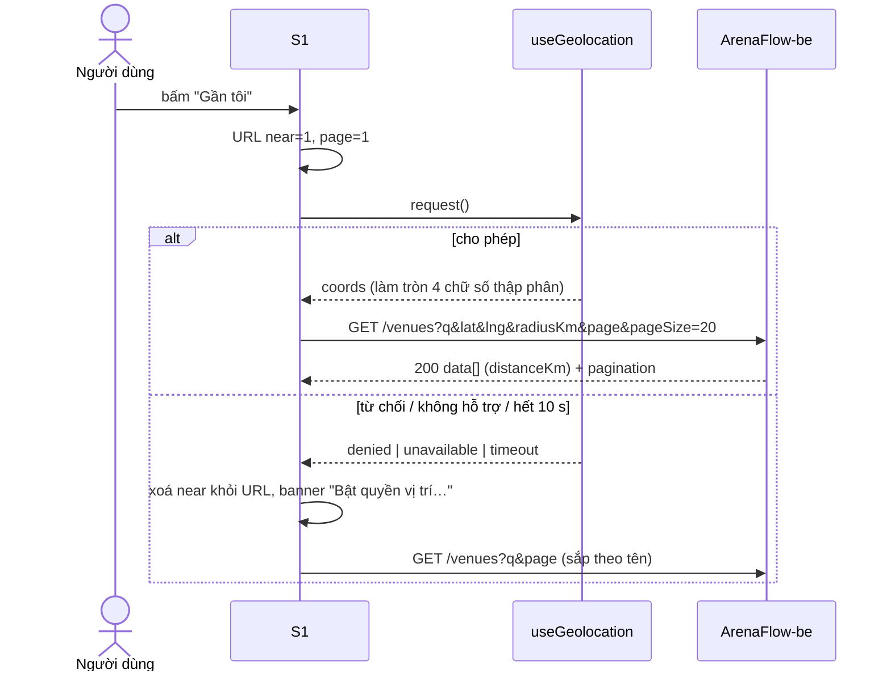
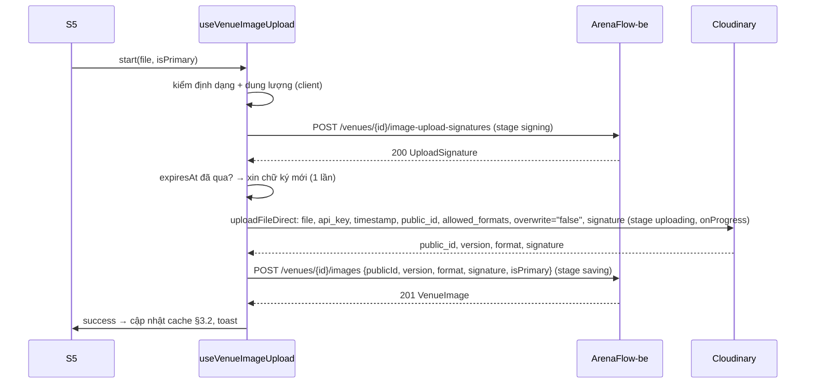

# State & API Integration — VENUE-001 Quản lý địa điểm sân

| Mục | Giá trị |
|---|---|
| Mã chức năng | `VENUE-001` |
| Phạm vi tầng | frontend (ArenaFlow-fe) — hợp đồng API thuộc BE |
| Nguồn API | `docs/agent/upstream/api/VENUE-001/API_Spec.md` · `docs/agent/upstream/api/api-convention.md` · USER-003 `API_Spec.md` §2.1–§2.2, §4.2 (+ USER-003 `State_API_Integration.md` §3, §5 — nhánh `feature/USER-003-lookup`) · SYSTEM-002 `API_Spec.md` §1.1 · BE ADR-0009 (Cloudinary signed direct upload) |
| Căn cứ | `ArenaFlow-spec@53aee11` · API_Spec `v6.2` (USER-003 `v2.0`, SYSTEM-002 `v1.2`) |
| Khung dùng chung | `docs/agent/design/SHARED/APP-SHELL/State_API_Integration.md` (nhánh `feature/USER-001-user-team`) — `http.service`, `ApiError`, `QUERY_ROOTS`, xử lý 401/`SYS_*` **trỏ**, không định nghĩa lại |
| Quy ước áp dụng | `docs/agent/convention-frontend.md` §5, `docs/agent/non-functional-standards.md`, `docs/agent/security-frontend.md` · FE ADR-0004 (TanStack Query), 0005, 0008 (Proposed, nhánh `feature/USER-001-user-team`) · FE ADR-0009, 0016 (Proposed, nhánh này) |
| Tác giả / Ngày / Phiên bản | `solution-architect` (agent) / `2026-11-27` / `v1.2` (baseline `v1.0`; lịch sử: `CHANGELOG.md`) |

## 1. Endpoint dùng theo màn hình

| Màn hình | Thời điểm gọi | Method + path | API_Spec mục | Số call khi tải |
|---|---|---|---|---|
| S1 | khi tải / đổi `q`, `near`, `radius`, `page` | `GET /api/v1/venues` | 2.2 | 1 |
| S2, S3 | mở ô Tỉnh/thành lần đầu trong phiên | `GET /api/v1/provinces` | USER-003 2.1 | 0 (thao tác) |
| S2, S3 | chọn tỉnh; hoặc mở ô Phường/xã với tỉnh có sẵn (S3) | `GET /api/v1/provinces/{provinceId}/wards` | USER-003 2.2 | 0 (thao tác) |
| S2 | "Lưu địa điểm" | `POST /api/v1/venues` | 2.1 | — |
| S3 | khi tải | `GET /api/v1/venues/{venueId}` (0 nếu cache từ S4 còn mới); nhãn khu vực ban đầu lấy từ `venue.ward` (`initialWard`), không gọi danh mục | 2.3 | ≤ 1 |
| S3 | "Lưu thay đổi" | `PATCH /api/v1/venues/{venueId}` | 2.12 | — |
| S4a/S4b | khi tải | `GET /api/v1/venues/{venueId}` | 2.3 | 1 |
| S4 | "Đặt làm ảnh chính" | `PATCH /api/v1/venues/{venueId}/images/{imageId}/set-primary` | 2.6 | — |
| S5 | "Tải ảnh lên" | `POST …/image-upload-signatures` → `POST <uploadUrl>` (Cloudinary) → `POST …/images` | 2.4, luồng thêm ảnh, 2.5 | 0 khi mở |
| S6 | "Xoá ảnh" | `DELETE /api/v1/venues/{venueId}/images/{imageId}` | 2.13 | 0 khi mở |
| S7 | "Gửi report" | `POST /api/v1/venues/{venueId}/reports` | 2.7 | 0 khi mở |
| S8 | khi tải / đổi `q`, `status`, `page` | `GET /api/v1/admin/venues` | 2.14 | 1 |
| S9 | khi tải / đổi `status`, `venueId`, `page` | `GET /api/v1/admin/venue-reports` | 2.8 | 1 |
| S9 | "Xác nhận đúng" / "Từ chối" | `PATCH /api/v1/admin/venue-reports/{reportId}/resolve` | 2.9 | — |
| S10 | "Ngừng hoạt động" / "Kích hoạt lại" | `PATCH /api/v1/admin/venues/{venueId}/mark-inactive` · `…/reactivate` | 2.10, 2.11 | 0 khi mở |

**Tổng API call khi tải** (ngưỡng ≤ 3 — `non-functional-standards.md` §2; không tính request của khung — APP-SHELL State_API_Integration §7 #1): S1 = 1 · S2 = 0 · S3 ≤ 1 · S4 = 1 · S8 = 1 · S9 = 1 · S5/S6/S7/S10 = 0. Mọi màn đạt ngưỡng.
- S1 khi `near=1`: chỉ gọi 2.2 **sau** khi có toạ độ (query `enabled: false` lúc chờ) → không gọi hai lần.
- S9 chip "Địa điểm: <tên>": lấy tên từ cache `venueKeys.detail(venueId)` nếu có, không thì `venueName` của dòng đầu, không thì "Địa điểm đã chọn" — **không** gọi thêm 2.3.
- Tile bản đồ (S2, S3, S4) là ảnh tải từ nhà cung cấp tile, không phải API BE (FE ADR-0009).

## 2. Hàm API & type

### 2.1. Hàm

| Hàm | Đường dẫn | Gọi | Request type | Response type |
|---|---|---|---|---|
| `createVenue(body)` | `src/modules/venue/api/venue.api.ts` | `http.post` 2.1, `accountGoneCodes: ['USER_001']` | `CreateVenueRequest` | `Venue` |
| `getVenues(params, signal)` | như trên | `http.getPage` 2.2 | `VenueSearchParams` (shared) | `Page<VenueSummary>` |
| `getVenue(venueId, signal)` | như trên | `http.get` 2.3 | — | `Venue` |
| `requestVenueImageUploadSignature(venueId, signal)` | như trên | `http.post` 2.4 (không body) | — | `UploadSignature` |
| `saveVenueImage(venueId, body, signal)` | như trên | `http.post` 2.5 | `SaveVenueImageRequest` | `VenueImage` |
| `setPrimaryVenueImage(venueId, imageId)` | như trên | `http.patch` 2.6 | — | `VenueImage[]` |
| `reportVenue(venueId, body)` | như trên | `http.post` 2.7 | `CreateVenueReportRequest` | `VenueReport` |
| `updateVenue(venueId, body)` | như trên | `http.patch` 2.12 | `UpdateVenueRequest` | `Venue` |
| `deleteVenueImage(venueId, imageId)` | như trên | `http.delete` 2.13 | — | `VenueImage[]` |
| `getAdminVenues(params, signal)` | `src/modules/venue/api/admin-venue.api.ts` | `http.getPage` 2.14 | `AdminVenueListParams` | `Page<VenueSummary>` |
| `markVenueInactive(venueId)` / `reactivateVenue(venueId)` | như trên | `http.patch` 2.10 / 2.11 | — | `AdminVenue` |
| `getAdminVenueReports(params, signal)` | như trên | `http.getPage` 2.8 | `AdminVenueReportListParams` | `Page<AdminVenueReport>` |
| `resolveVenueReport(reportId, body)` | như trên | `http.patch` 2.9 | `ResolveVenueReportRequest` | `AdminVenueReport` |
| `http.uploadFileDirect(opts)` | `src/core/services/http.service.ts` (FE ADR-0016; thêm vào APP-SHELL — §8) | `XMLHttpRequest` multipart tới `uploadUrl` Cloudinary, **không** Bearer | `DirectUploadOptions` | JSON Cloudinary (thô) |
| `getProvinces(signal)` | `src/modules/venue/api/catalog.api.ts` | `http.get` USER-003 2.1 | — | `ProvinceItem[]` |
| `getWards(provinceId, signal)` | như trên | `http.get` USER-003 2.2 | — | `WardItem[]` |

**Type** — `src/modules/venue/types/venue.type.ts`, `venue-report.type.ts`; field trỏ API_Spec, **không** chép bảng:

| Type | API_Spec | Ghi chú FE |
|---|---|---|
| `Venue` | §4.2 | `ward: VenueWard \| null` |
| `AdminVenue` | §4.8 | `Venue` + `isCreatedByDeleted` |
| `VenueSummary` | §4.3 | |
| `VenueImage` | §4.4 | |
| `UploadSignature` | §4.5 | `timestamp` number nguyên, `overwrite` boolean |
| `VenueReport`, `AdminVenueReport` | §4.6, §4.7 | |
| `ProvinceItem`, `WardItem` | USER-003 §4.2 | khai tối thiểu trong `src/modules/venue/types/catalog.type.ts` (module không import `account`) |
| `VenueStatus`, `VenueReportReason`, `VenueReportStatus` | §4.1 | union chuỗi; `VenueType` ở `src/shared/constants/venue-type.constant.ts` |
| `CreateVenueRequest`, `UpdateVenueRequest` | 2.1, 2.12 | §2.2 |
| `SaveVenueImageRequest` | 2.5 | `version` number nguyên |
| `CreateVenueReportRequest`, `ResolveVenueReportRequest` | 2.7, 2.9 | |
| `AdminVenueListParams` | 2.14 | `{ q?, status: 'ALL' \| 'ACTIVE' \| 'INACTIVE', page, pageSize }` |
| `AdminVenueReportListParams` | 2.8 | `{ status: 'PENDING' \| 'VERIFIED' \| 'REJECTED' \| 'ALL', venueId?, page, pageSize }` |

### 2.2. Quy tắc dựng body (`utils/venue-request.util.ts`)

| Hàm | Quy tắc |
|---|---|
| `buildCreateVenueBody(values, isAdmin)` (2.1) | Luôn: `venueName`, `address` (đã trim), `latitude`, `longitude` (≤ 7 chữ số thập phân), `wardId`. `venueType` `''` → bỏ key. Admin: `phone` / `website` `''` → bỏ key. **Không Admin: không bao giờ có key `phone` / `website`** (tránh `403 VENUE_017`) |
| `buildUpdateVenueBody(values, dirtyFields, { isAdmin, requireWard })` (2.12) | Dựa `buildPatchBody` (APP-SHELL §4): chỉ field dirty. `location` dirty → gửi cả `latitude` + `longitude`. `venueType` dirty và `''` → gửi `""` (xoá). Admin: `phone` / `website` dirty và `''` → gửi `""` (xoá — API #7). Không Admin: xoá key `phone` / `website` dù dirty. `requireWard` → luôn gửi `wardId`. Không bao giờ gửi `provinceId` |
| `reportVenue` body (2.7) | `detail` rỗng sau trim → bỏ key |

## 3. State

| State | Loại | Nơi giữ | Key / tên | Làm mới khi |
|---|---|---|---|---|
| Danh sách địa điểm (S1) | server | TanStack Query | `venueKeys.list(params)` | §3.2; `staleTime` mặc định 30 s (FE ADR-0004); `placeholderData: keepPreviousData` khi đổi trang |
| Chi tiết địa điểm (S3, S4) | server | TanStack Query | `venueKeys.detail(venueId)` | §3.2 |
| Danh sách Admin (S8) | server | TanStack Query | `adminVenueKeys.list(params)` | §3.2 |
| Report Admin (S9) | server | TanStack Query | `adminVenueReportKeys.list(params)` | §3.2 |
| Tỉnh/thành, phường/xã | server | TanStack Query (`useWardCatalog`) | `catalogKeys.provinces()`, `catalogKeys.wards(provinceId)` — gốc `QUERY_ROOTS.catalog`, dùng chung với module `account` | `staleTime: Infinity` (danh mục chỉ đọc); `enabled` chỉ sau khi mở ô (USER-003 State_API_Integration §3); lỗi §5.2 |
| Phiên (userId, role) | client toàn cục | `core/session` | `useSession()` | — |
| Bộ lọc S1 | URL | query string | `q`, `near`, `radius`, `page` | Screen_Flow §3 S1 |
| Toạ độ người dùng (S1) | client cục bộ | `useGeolocation` (bộ nhớ) | — | bấm "Gần tôi" / "Bật vị trí"; **không** URL, không storage |
| Bộ lọc S8 / S9 | URL | query string | `q`, `status`, `page` / `status`, `venueId`, `page` | Screen_Flow §3 |
| Form S2/S3/S7 | client cục bộ | React Hook Form | — | — |
| Dialog đang mở, tiến trình upload | client cục bộ | `useState` / `useVenueImageUpload` | — | — |

### 3.1. Query key — `src/modules/venue/constants/venue-query-keys.constant.ts`

Thêm vào `QUERY_ROOTS` (APP-SHELL State_API_Integration §4): `venue` = `'venue'` (đã liệt kê), **`adminVenue` = `'admin-venue'`**, **`adminVenueReport` = `'admin-venue-report'`** (mới, theo mẫu `'admin-team'`), **`catalog` = `'catalog'`** (danh mục khu vực dùng chung nhiều module — §8).

Key danh mục **không** khai trong module (hai module phải ra cùng key): `catalogKeys` ở `src/shared/constants/catalog-query-keys.constant.ts` (chỉ hằng key, không gọi API — hợp `convention-frontend.md` §2):

```ts
/** Query key danh mục đơn vị hành chính, dùng chung mọi module. */
export const catalogKeys = {
  all: [QUERY_ROOTS.catalog] as const,
  provinces: () => [...catalogKeys.all, 'provinces'] as const,
  wards: (provinceId: string) => [...catalogKeys.provinces(), provinceId, 'wards'] as const,
}
```
- Hình dạng giữ như `accountKeys.provinces()` / `wards()` của USER-003, chỉ đổi gốc `account` → `catalog`.

```ts
/** Query key phía người dùng của domain địa điểm. */
export const venueKeys = {
  all: [QUERY_ROOTS.venue] as const,
  lists: () => [...venueKeys.all, 'list'] as const,
  list: (params: VenueSearchParams) => [...venueKeys.lists(), params] as const,
  detail: (venueId: string) => [...venueKeys.all, 'detail', venueId] as const,
}
/** Query key danh sách địa điểm của Admin. */
export const adminVenueKeys = {
  all: [QUERY_ROOTS.adminVenue] as const,
  list: (params: AdminVenueListParams) => [...adminVenueKeys.all, 'list', params] as const,
}
/** Query key report địa điểm của Admin. */
export const adminVenueReportKeys = {
  all: [QUERY_ROOTS.adminVenueReport] as const,
  list: (params: AdminVenueReportListParams) => [...adminVenueReportKeys.all, 'list', params] as const,
}
```
- Params chuẩn hoá (mặc định điền sẵn: `page` 1, `pageSize` 20, `status` mặc định của màn; chuỗi rỗng bỏ đi) — APP-SHELL §4.

### 3.2. Cập nhật cache sau thao tác ghi

`invalidateVenueConsumers(qc)` (`utils/venue-cache.util.ts`): `invalidateQueries` theo **gốc** `QUERY_ROOTS.match`, `QUERY_ROOTS.pairing`, `QUERY_ROOTS.mercenary` — response của các mã này nhúng thông tin địa điểm và phải hiện bản mới nhất (BR-V10): MATCH-001 `venue` / `venueOptions` (`matchKeys.all = [QUERY_ROOTS.match]` — MATCH-001 State §3.1), MATCH-002 (`pairingKeys` gốc `pairing` — MATCH-002 Screen_Flow §6 C8), MERCENARY-001 `venue` (`mercenaryKeys.all = [QUERY_ROOTS.mercenary]` — MERCENARY-001 State §3.1). Chỉ theo gốc, không import factory module khác (APP-SHELL §4); chỉ refetch query đang mở → không thêm call cho màn VENUE-001.

`invalidateVenueLists(qc)` (`utils/venue-cache.util.ts`): `invalidateQueries({ queryKey: [QUERY_ROOTS.venue], predicate: q => q.queryKey[1] !== 'detail' })` (gồm cả key bộ chọn sân của mã khác dưới gốc `venue` — Component_Design §7.1) + `invalidateQueries({ queryKey: adminVenueKeys.all })`.

| Thao tác | Thành công |
|---|---|
| Thêm địa điểm (2.1) | `setQueryData(venueKeys.detail(id), venue)` → `invalidateVenueLists` (gồm `venuePickerKey` của bộ chọn sân) → toast → điều hướng: S4 hoặc `returnTo` + `state.createdVenue` (Screen_Flow §3 S2) |
| Sửa địa điểm (2.12) | `setQueryData(detail, venue)` → `invalidateVenueLists` → `invalidateVenueConsumers` → toast → S4 |
| Lưu ảnh (2.5) | `setQueryData(detail)`: thêm ảnh mới, sắp theo `displayOrder`; ảnh mới `isPrimary = true` → các ảnh khác `isPrimary = false` (API_Spec 2.5 "Ảnh chính") → `invalidateVenueLists` (`primaryImageUrl`) |
| Lưu ảnh nhận `409 VENUE_006` | Coi như thành công: `invalidateQueries(detail)` |
| Đặt ảnh chính (2.6), xoá ảnh (2.13) | `setQueryData(detail, { ...venue, images: response })` → `invalidateVenueLists` |
| Report (2.7) | Không đổi cache (người dùng không xem được report — API_Spec §3.2) |
| Ngừng hoạt động / kích hoạt lại (2.10, 2.11) | `invalidateQueries(venueKeys.detail(id))` + `invalidateVenueLists` + `invalidateQueries(adminVenueReportKeys.all)` (report `CLOSED` tự `VERIFIED`; `venueStatus` trên S9 đổi). **Không** `setQueryData` bằng `AdminVenue` vào `venueKeys.detail` — 2.3 che tên người tạo đã xoá, 2.10/2.11 không che (API_Spec §1) |
| Chốt report (2.9) | `invalidateQueries(adminVenueReportKeys.all)` |

## 4. Luồng tương tác

### 4.1. S1 — "Gần tôi"

- `lat`, `lng`, `radiusKm` chỉ gửi khi `near=1` và có toạ độ (API_Spec 2.2: gửi cùng nhau; `radiusKm` thiếu toạ độ → 400). **Không** gửi `status` (BR-V13) → không thể gặp `400 VENUE_018`; nếu vẫn gặp (lỗi FE) → `ErrorState` message BE.

### 4.2. S5 — thêm ảnh (`useVenueImageUpload(venueId)`)

- Field gửi Cloudinary: **đúng** 7 field ở API_Spec "Luồng thêm ảnh" Bước 2, giá trị nguyên từ 2.4 (`timestamp` → chuỗi số nguyên, `overwrite` → `"false"`); không thêm field khác.
- Kết quả Cloudinary: chỉ lấy `public_id` → `publicId`, `version` (phải là số nguyên > 0), `format`, `signature`; thiếu / sai kiểu → lỗi `INVALID_RESPONSE`, làm lại từ 2.4.
- **Mỗi file một chữ ký mới**; `retry()`: lỗi ở 2.4 / Cloudinary / `VENUE_005` / `VALIDATION_ERROR` của 2.5 → chạy lại **từ 2.4**; lỗi mạng / timeout / `503` ở 2.5 → **gửi lại 2.5 cùng dữ liệu** (trong hạn 6 giờ — API_Spec 2.5 "Gửi lại khi lỗi mạng").
- Một `AbortController` cho cả lượt; unmount / đóng dialog sau lỗi → huỷ. Đang chạy: nút khoá, dialog không đóng được.
- `isPrimary`: `imageCount = 0` → gửi `true` (BE vẫn tự đặt — BR-V03).

## 5. Xử lý lỗi

### 5.1. Chung (APP-SHELL State_API_Integration §2.3)
| Tình huống | HTTP / mã | Hiển thị / hành động |
|---|---|---|
| Hết giờ 15 s, mất mạng | `TIMEOUT`, `NETWORK_ERROR` | Query: `ErrorState` + Thử lại. Mutation: toast lỗi / banner trong form, giữ dữ liệu |
| Chưa đăng nhập | 401 `AUTH_001` | `http.service` refresh 1 lần → thất bại về đăng nhập |
| Không phải Admin ở màn / thao tác admin | 403 `AUTH_004` | Màn: `ErrorState` "Bạn không có quyền truy cập trang này"; thao tác: toast message BE |
| Lỗi hệ thống | `SYS_*` / 5xx | "Đã xảy ra lỗi hệ thống" + Thử lại |
| Địa điểm không tồn tại (S3, S4) | 404 `VENUE_001`; 400 `VALIDATION_ERROR` (id path sai) | "Không tìm thấy địa điểm" + nút về S1 (context admin: S8) |
| Địa điểm không tồn tại khi thao tác | 404 `VENUE_001` | Toast message BE → `navigate` S1 / S8, `removeQueries(detail)` |

### 5.2. S2 / S3 — form địa điểm
| HTTP / mã | Hành động |
|---|---|
| 400 `VALIDATION_ERROR` | `applyServerValidationErrors` (Component_Design §4.1) |
| 400 `USER_002` | `setError('wardId', "Khu vực không hợp lệ")`, cho chọn lại; `invalidateQueries(catalogKeys.provinces())` (gồm phường/xã) |
| 404 `USER_004` (danh mục 2.2, khi mở ô Phường/xã) | `useWardCatalog` gọi `onProvinceNotFound`: `provinceError` "Không tìm thấy tỉnh/thành"; `provinceId`, `wardId` → `null`; `removeQueries(catalogKeys.wards(provinceId))`; invalidate `catalogKeys.provinces()` (như USER-003 State_API_Integration §5) |
| 403 `VENUE_017` | `FormErrorBanner` message BE (lỗi FE — body không được có `phone`/`website`) |
| 404 `USER_001` (2.1) | `accountGoneCodes` → kết thúc phiên |
| 403 `VENUE_013`, 422 `VENUE_002` (2.12) | Toast message BE → `invalidateQueries(detail)` → về S4 (nút "Sửa" ẩn theo dữ liệu mới) |
| 422 `VENUE_016` (2.12) | `setError('wardId', "Vui lòng chọn phường/xã")` |
| 409 `VENUE_011` (2.12) | `FormErrorBanner` "Dữ liệu vừa được cập nhật bởi thao tác khác, vui lòng thử lại" + `invalidateQueries(detail)`. Khi chi tiết mới về: `reset(toVenueFormValues(venue), { keepDirtyValues: true })` — field người dùng chưa sửa nhận giá trị mới, field đã sửa **giữ** giá trị đang nhập; người dùng bấm lưu lại. Cùng quy tắc cho mọi lần chi tiết được refetch khi S3 đang mở (`VenueEditPage` chỉ `reset` khi `venue.updatedAt` đổi) |

### 5.3. S5 — thêm ảnh
| Bước | HTTP / mã | Hiển thị (trong dialog trừ khi ghi khác) | `retry()` |
|---|---|---|---|
| 2.4 / 2.5 | 503 `VENUE_012` | "Tạm thời không thêm được ảnh, vui lòng thử lại sau" | như §4.2 |
| 2.4 / 2.5 | 422 `VENUE_002` | Đóng dialog, toast message BE, `invalidateQueries(detail)` (→ S4b) | — |
| 2.4 / 2.5 | 422 `VENUE_003` | "Tối đa 5 ảnh mỗi địa điểm", khoá "Tải ảnh lên", `invalidateQueries(detail)` | — |
| 2.4 / 2.5 | 404 `VENUE_001` | §5.1 | — |
| Cloudinary | HTTP 4xx/5xx (`UPLOAD_REJECTED`), `NETWORK_ERROR`, `TIMEOUT`, `INVALID_RESPONSE`, `INVALID_REQUEST` (`uploadUrl` ngoài danh sách cho phép) | "Tải ảnh thất bại" (không hiện message của Cloudinary) | từ 2.4 |
| 2.5 | 400 `VENUE_005`, 400 `VALIDATION_ERROR` | "Tải ảnh thất bại" | từ 2.4 |
| 2.5 | `NETWORK_ERROR`, `TIMEOUT` | "Chưa lưu được ảnh, vui lòng thử lại" | gửi lại 2.5 |
| 2.5 | 409 `VENUE_006` | Thành công (§3.2) | — |

### 5.4. S4 — ảnh, report
| Thao tác | HTTP / mã | Hành động |
|---|---|---|
| Đặt ảnh chính (2.6) | 404 `VENUE_004`, 422 `VENUE_002` | Toast message BE + `invalidateQueries(detail)` |
| Xoá ảnh (2.13) | 404 `VENUE_004` | Đóng S6, toast "Ảnh không còn tồn tại", `invalidateQueries(detail)` |
| Xoá ảnh (2.13) | 403 `VENUE_013`, 422 `VENUE_002` | Đóng S6, toast message BE, `invalidateQueries(detail)` |
| Report (2.7) | 400 `VALIDATION_ERROR` | Lỗi dưới field (`reason`, `detail`) |
| Report (2.7) | 409 `VENUE_014` | `AlertBanner` trong S7 với message BE; giữ dialog |
| Report (2.7) | 422 `VENUE_002` | Đóng S7, toast message BE, `invalidateQueries(detail)` (→ S4b) |
| Report (2.7) | 403 `VENUE_015` | `AlertBanner` message BE (lỗi FE — Admin không thấy nút Report) |

### 5.5. S8 / S9 / S10 — Admin
| Thao tác | HTTP / mã | Hành động |
|---|---|---|
| Ngừng / kích hoạt lại (2.10, 2.11) | 409 `VENUE_007`, `VENUE_008` | Đóng S10, toast message BE, invalidate như §3.2 |
| như trên | 409 `VENUE_011` | `error` trong S10 (message BE), giữ mở để thử lại; invalidate detail + danh sách |
| Chốt report (2.9) | 404 `VENUE_009`, 409 `VENUE_010` | Đóng dialog, toast message BE ("Báo cáo đã được xử lý"), `invalidateQueries(adminVenueReportKeys.all)` |
| như trên | 409 `VENUE_011` | `error` trong dialog, giữ mở; invalidate danh sách report |
| Danh sách (2.8, 2.14) | 400 `VALIDATION_ERROR` | Không xảy ra khi tham số URL đã chuẩn hoá (Screen_Flow §3); nếu có → `ErrorState` + nút "Xoá bộ lọc" |

## 6. Phân trang / tìm kiếm / sort
- Offset theo `api-convention.md` §7.1: `page` từ URL, `pageSize` = `PAGE_SIZE_DEFAULT` (20); `Pagination` của APP-SHELL. Trang vượt `totalPages` (vd sau khi lọc) → về trang cuối có dữ liệu.
- Không có tham số `sort` (API_Spec §1): S1 sắp theo khoảng cách khi có toạ độ, không thì tên A→Z; S8 tên A→Z; S9 mới nhất trước — FE chỉ hiển thị dòng mô tả thứ tự (S1).
- Ô tìm: `useDebouncedValue` 300 ms; `maxLength = 100` (2.2, 2.14); trim, rỗng → bỏ `q`.

## 7. `[cần xác nhận]`
> **Chặn code?** *Có* = developer không code phần liên quan tới khi chốt · *Không* = code theo phương án đề xuất.

| # | Nội dung | Chặn code? |
|---|---|---|
| 1 | **S8 "Ngừng từ dd/MM/yyyy"**: `VenueSummary` (§4.3) của 2.14 **không** có `adminVerifiedInactiveAt` → hiển thị cần 2.3 từng dòng (N+1, cấm — `non-functional-standards.md` §2). Tạm bỏ dòng này; đề xuất BE thêm field vào 2.14 (repo BE) | **Không** (bỏ dòng; thêm lại khi BE có field) |
| 2 | **Dung lượng ảnh tối đa** 10 MB (API_Spec #19, FE ADR-0016) | **Không** |
| 3 | **Timeout upload Cloudinary 120 s** — vượt ngưỡng 15 s (`non-functional-standards.md` §2); ngưỡng đổi phải duyệt qua PR | **Có** với `http.uploadFileDirect` và S5 tới khi user duyệt ngoại lệ (hoặc chốt giá trị khác) |
| 4 | **Ngưỡng call tính cả request khung** (APP-SHELL State_API_Integration §7 #1): sau khi danh mục chuyển sang tải khi mở ô, mọi màn VENUE-001 ≤ 1 call; mở thẳng URL thêm `GET /profile` của header → ≤ 2. Không màn nào vượt 3 dù tính theo cách nào | **Không** (đạt cả hai cách hiểu) |
| 5 | **`WardPicker` + gốc `catalog`**: đã áp ở SHARED v1.2 (APP-SHELL Component_Design §3.1, State §4); USER-003 đổi `accountKeys.provinces/wards` → `catalogKeys` | **Có** với ô khu vực S2/S3 chỉ tới khi nhánh SHARED merge và FE ADR liên quan được duyệt (Component_Design §9 #2) |
| 6 | **Report `WRONG_INFO` / `OTHER` vẫn `PENDING` sau khi ngừng hoạt động** (API_Spec #4, UI_Design §4 #8): S9 hiển thị đúng dữ liệu BE | **Không** |
| 7 | ~~Invalidate gốc `match` sau khi sửa địa điểm~~ — **đã chốt v1.1**: đối chiếu key của MATCH-001, MATCH-002, MERCENARY-001 → `invalidateVenueConsumers` (§3.2) | **Không** |

## 8. Thay đổi cho SHARED/APP-SHELL — **đã áp (SHARED v1.2)**

> A1–A10 **đã áp ở SHARED v1.2** (nhánh `feature/USER-001-user-team`; còn chờ merge) (coordinator áp; VENUE-001 không sửa APP-SHELL). Bảng giữ làm vết đối chiếu; nguồn hiện hành là APP-SHELL, không phải bảng này.

| # | File · mục | Cũ | Mới |
|---|---|---|---|
| A1 | `State_API_Integration.md` · header "Quy ước áp dụng" | `FE ADR-0002, 0004, 0006, 0007, 0008` | `FE ADR-0002, 0004, 0006, 0007, 0008, 0016` |
| A2 | `State_API_Integration.md` §2.1 · khối code API | `http.post<T>(path, opts) · http.patch<T> · http.put<T> · http.delete<T>   // 204 → undefined` | giữ dòng cũ, thêm dòng: `http.uploadFileDirect(opts: DirectUploadOptions): Promise<unknown>   // upload file thẳng tới nhà cung cấp lưu trữ (FE ADR-0016)` và interface `DirectUploadOptions { url: string; fields: Record<string, string>; file: Blob; onProgress?: (loaded: number, total: number) => void; signal?: AbortSignal; timeoutMs?: number }` (JSDoc từng field) |
| A3 | `State_API_Integration.md` §2.1 · gạch đầu dòng Bearer | `Bearer chỉ gắn cho URL bắt đầu bằng base này (security-frontend.md §1).` | thêm: `` `uploadFileDirect` không gắn Bearer, không đọc token; chỉ nhận `url` có tiền tố trong `DIRECT_UPLOAD_ALLOWED_URL_PREFIXES` (hiện `https://api.cloudinary.com/`), khác → ném `ApiError` `INVALID_REQUEST`, không gửi file. `` |
| A4 | `State_API_Integration.md` §2.1 · gạch đầu dòng Timeout | `**Timeout 15 s** (REQUEST_TIMEOUT_MS): …` | thêm câu: `` `uploadFileDirect`: `XMLHttpRequest` (cần tiến trình upload), timeout mặc định `DIRECT_UPLOAD_TIMEOUT_MS` = 120 s — ngoại lệ chờ duyệt (FE ADR-0016). `` |
| A5 | `State_API_Integration.md` §2.2 · JSDoc `code` của `ApiError` | `'NETWORK_ERROR' \| 'TIMEOUT' \| 'ABORTED' \| 'INVALID_RESPONSE'` | `'NETWORK_ERROR' \| 'TIMEOUT' \| 'ABORTED' \| 'INVALID_RESPONSE' \| 'INVALID_REQUEST' \| 'UPLOAD_REJECTED'` |
| A6 | `State_API_Integration.md` §2.2 · bảng tình huống | — | thêm 2 dòng: `Upload trực tiếp bị nhà cung cấp trả HTTP ≠ 2xx \| UPLOAD_REJECTED \| "Tải ảnh thất bại"` · `` `uploadFileDirect` gặp `NETWORK_ERROR` / `TIMEOUT` / `INVALID_RESPONSE` \| mã tương ứng \| "Tải ảnh thất bại" (không dùng câu chung của request API; không hiện message của nhà cung cấp) `` |
| A7 | `State_API_Integration.md` §4 · bảng `QUERY_ROOTS` | `'account'` · Hồ sơ, đăng nhập · `USER-001, USER-003 (khu vực)` | `'account'` · Hồ sơ, đăng nhập · `USER-001, USER-003`; thêm dòng `'catalog'` · Danh mục đơn vị hành chính (tỉnh/thành, phường/xã) — dùng chung nhiều module · `USER-003, VENUE-001`; dòng "Theo tên" thêm `'admin-venue'`, `'admin-venue-report'` |
| A8 | `State_API_Integration.md` §4 · sau ví dụ `teamKeys` | — | thêm: `` Key dùng chung nhiều module (vd danh mục) khai **một lần** ở `src/shared/constants/<tên>-query-keys.constant.ts` (`catalogKeys`); module chỉ khai hàm API + hook. `` |
| A9 | `Component_Design.md` §3 · bảng shared component | — | thêm dòng `WardPicker` · `ward-picker/ward-picker.component.tsx` · props chốt ở APP-SHELL Component_Design §3.1 · "Thuần trình bày; dữ liệu danh mục qua `provinceCatalog` / `wardCatalog`; thiết kế: USER-003" |
| A10 | `Component_Design.md` §5 · bảng hook & util | — | thêm `isSafeInternalPath` · `src/shared/utils/safe-internal-path.util.ts` · "Chống open redirect cho `returnTo`"; `catalogKeys` · `src/shared/constants/catalog-query-keys.constant.ts` · "Query key danh mục dùng chung (State_API_Integration §4)"; `DIRECT_UPLOAD_ALLOWED_URL_PREFIXES`, `DIRECT_UPLOAD_TIMEOUT_MS` · `src/core/services/http.constant.ts` (hoặc cạnh `http.service`) |

- Thành phần `shared/` khác do VENUE-001 tạo (`VenueCard`, `VenueSearchBar`, `useGeolocation`, `useVenueSearchState`, `VENUE_TYPE_LABELS`, `formatDistanceKm`) định nghĩa ở VENUE-001 Component_Design §7 — APP-SHELL có thể thêm một dòng trỏ, không chép props.
