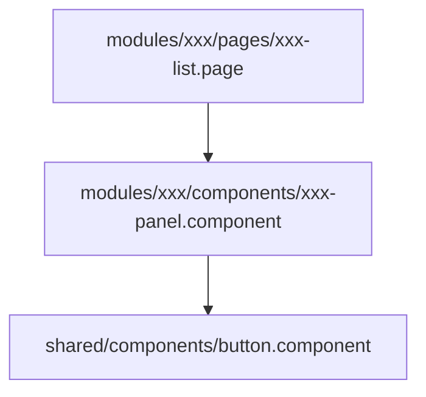

# Component Design — <MÃ> <tên chức năng>

| Mục | Giá trị |
|---|---|
| Mã chức năng | `<MÃ>` |
| Phạm vi tầng | frontend (ArenaFlow-fe) |
| Repo/stack | ArenaFlow-fe · React + TypeScript + Tailwind CSS |
| Quy ước áp dụng | `docs/agent/convention-frontend.md` §2–§4 |
| Tác giả / Ngày / Phiên bản | `<tên>` / `YYYY-MM-DD` / `v1.0` |

## 1. Cây component

## 2. Danh sách component

| Component | Đường dẫn | Loại | Props chính | Trách nhiệm | Tái dùng / Mới |
|---|---|---|---|---|---|
| `XxxPage` | `src/modules/xxx/pages/xxx-list.page.tsx` | page | — | Ghép layout + feature | Mới |

> Loại: `page` · `feature` · `ui` (dùng chung) · `layout`. Tái dùng phải trỏ tới component đã có.

## 3. Form & validation

| Form | Trường | Kiểu | Validation client | Map validation BE (API_Spec mục) | Hiển thị lỗi |
|---|---|---|---|---|---|

- Lỗi field từ BE (400/422) hiển thị: …
- Chống double-submit: …

## 4. Hook / util riêng của feature

| Tên | Đường dẫn | Mục đích |
|---|---|---|

## 5. A11y
- Landmark / heading, `label`, điều hướng bàn phím, focus sau thao tác: …

## 6. `[cần xác nhận]`
1.
