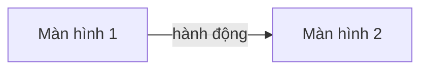

# Screen Flow — <MÃ> <tên chức năng>

| Mục | Giá trị |
|---|---|
| Mã chức năng | `<MÃ>` |
| Phạm vi tầng | frontend (ArenaFlow-fe) — backend: ngoài phạm vi repo này |
| Repo/stack | ArenaFlow-fe · React + TypeScript + Vite |
| Nguồn SRS/UI/API | `docs/agent/upstream/business-spec/<SRS_DIR>/` · `UI_Design.md` · `docs/agent/upstream/api/<MÃ>/API_Spec.md` |
| Căn cứ | `ArenaFlow-spec@<sha7>` · API_Spec `vX.Y` |
| Quy ước áp dụng | `docs/agent/design-standards.md`, `docs/agent/convention-frontend.md`, `docs/agent/security-frontend.md` |
| Tác giả / Ngày / Phiên bản | `<tên>` / `YYYY-MM-DD` / `v1.0` |

## 1. Danh sách màn hình

| # (theo UI_Design) | Màn hình | Route | Quyền truy cập | Use case (SRS) |
|---|---|---|---|---|
| S1 | | `/…` | public / đăng nhập / vai trò `…` | `UC-…` |

## 2. Luồng điều hướng

## 3. Chi tiết từng màn hình

### S1 — <tên>
- **Mục đích:**
- **Vào từ:** · **Ra tới:** (sau thành công / huỷ / lỗi)
- **Thao tác người dùng:** (nút, form, bộ lọc)
- **Trạng thái:** loading · empty · error · thành công — mô tả hiển thị
- **Tham số URL / query:** (page, filter, id…)

## 4. Route guard & phân quyền
- Chưa đăng nhập vào route cần đăng nhập → …
- 403 từ BE → …

## 5. `[cần xác nhận]`
1.
