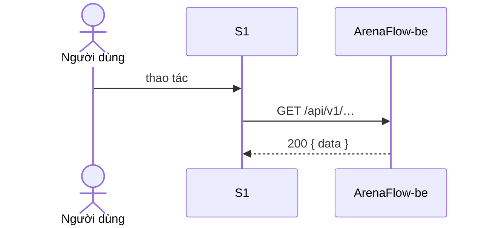

# State & API Integration — <MÃ> <tên chức năng>

| Mục | Giá trị |
|---|---|
| Mã chức năng | `<MÃ>` |
| Phạm vi tầng | frontend (ArenaFlow-fe) — hợp đồng API thuộc BE |
| Nguồn API | `docs/agent/upstream/api/<MÃ>/API_Spec.md` · `docs/agent/upstream/api/api-convention.md` |
| Căn cứ | `ArenaFlow-spec@<sha7>` · API_Spec `vX.Y` |
| Quy ước áp dụng | `docs/agent/convention-frontend.md` §5, `docs/agent/non-functional-standards.md`, `docs/agent/security-frontend.md` |
| Tác giả / Ngày / Phiên bản | `<tên>` / `YYYY-MM-DD` / `v1.0` |

## 1. Endpoint dùng theo màn hình

| Màn hình | Thời điểm gọi | Method + path | API_Spec mục | Số call khi tải |
|---|---|---|---|---|
| S1 | khi tải | `GET /api/v1/…` | §… | 1 |

**Tổng API call khi tải mỗi màn hình** (ngưỡng `non-functional-standards.md` §2): S1 = …

## 2. Hàm API & type

| Hàm | Đường dẫn | Request type | Response type |
|---|---|---|---|
| `getXxx` | `src/modules/xxx/api/xxx.api.ts` | | |

> Field của type trỏ tới API_Spec BE mục tương ứng — không chép bảng field vào đây.

## 3. State

| State | Loại | Nơi giữ | Key / tên | Làm mới khi |
|---|---|---|---|---|
| Danh sách xxx | server | lớp data fetching (ADR) | `['xxx', params]` | sau tạo/sửa/xoá |
| Phiên đăng nhập | client toàn cục | `src/core/session/` | | |
| Bộ lọc | URL | query string | `page`, `pageSize`, … | |

## 4. Luồng tương tác

## 5. Xử lý lỗi

| Tình huống | HTTP / mã lỗi BE | Hiển thị / hành động |
|---|---|---|
| Hết giờ (15s) | — | Thông báo + nút Thử lại |
| Chưa đăng nhập | 401 | refresh 1 lần → thất bại về đăng nhập |
| Không đủ quyền | 403 | |
| Lỗi validation | 400 / 422 | Hiển thị theo field |

## 6. Phân trang / tìm kiếm / sort
- Tham số: theo `api-convention.md` §7–§8 của BE; debounce tìm kiếm theo `non-functional-standards.md`.

## 7. `[cần xác nhận]`
1.
